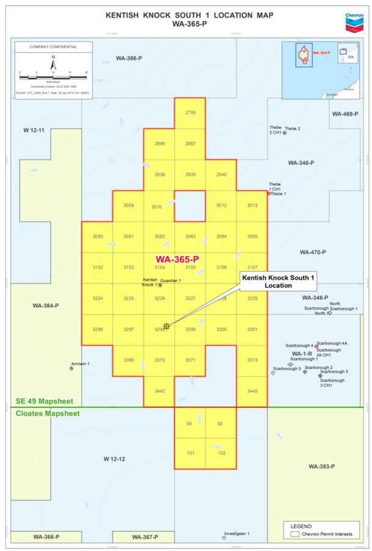
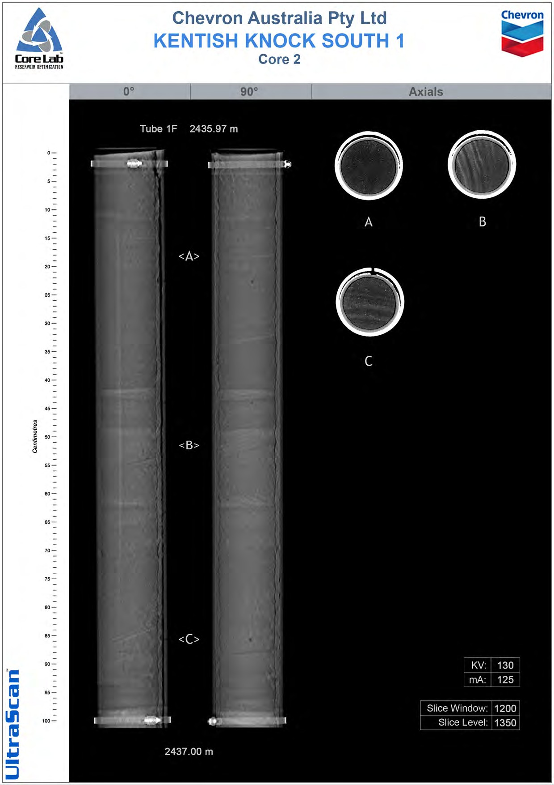
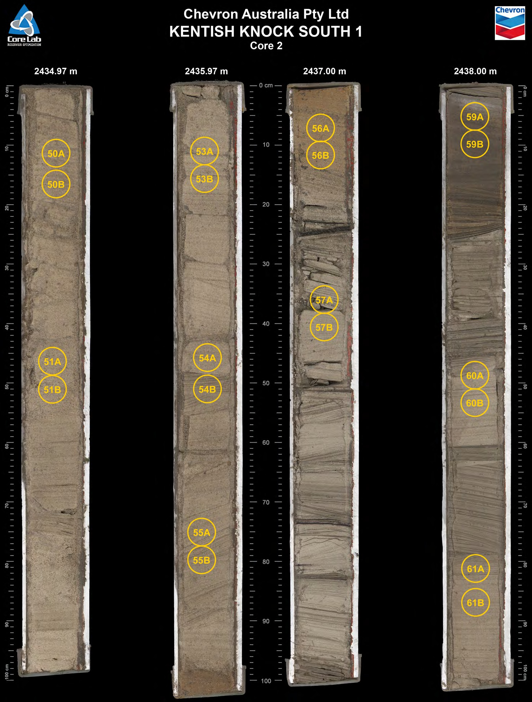

<a name="TOC"></a>

[[_TOC_]]

# A Note about Deprecated Sample-related Schemas

:warning: **WARNING**

This page represents old, out-of-date, information. This page represents a data model from before the creation of the "unified" data model for Rock and Fluid Samples, and the development of the RAFS (Rock and Fluid Sample) DDMS. As a result of the unified approach, some of these older schemas are in the process of being deprecated (Jan. 2025), and should not be used moving forward.

Schemas that should no longer be used:

- `RockSample` >> Use `Sample` instead
- `Coring` >> Use `SampleAcquisitionJob` and `Sample.SampleAcquisition` instead
- `RockSampleAnalysis` >> Use `SamplesAnalysis` and `SamplesAnalysesReport` instead
- `RockImage` >> Use `SampleImage` instead  _(note that `SampleImage` is derived from `RockImage` however.)_

As the data model evolves, certain other schemas - particularly reference schemas - are expected to be consolidated.

More information can be found in the [Petrophysics DD Project Issue 62](https://gitlab.opengroup.org/osdu/subcommittees/data-def/projects/Petrophysics/home/-/issues/62).

**For the more up to date documentation on the Rock and Fluid Data Model, please see [SampleAnalyses Worked Examples](../SampleAnalyses/README.md).**

# Rock Image, Kentish Knock South 1

## File and Document

The examples are built based on the [Kentish_Knock_South_1_WCR_Basic_Data_Rev_0.pdf](https://gitlab.opengroup.org/osdu/subcommittees/data-def/projects/Petrophysics/docs/-/blob/master/Design%20Documents/Kentish%20Knock%20South%201%20-%20Example%20Well/Kentish_Knock_South_1_WCR_Basic_Data_Rev_0.pdf)
located int the Petrophysics work-stream repository in the OSDU Member GitLab. The document itself is represented by a
generic `work-product-component--Document` referring to a `dataset--File.Generic` as PDF.

<details>

<summary markdown="span">Completion Report, <code>dataset--File.Generic</code> example.</summary>

<OsduImportJSON>[Generic File (PDF), Full record](../RockSampleAnalysis/dataset/File.Generic-KKS1-Report.json#only.data)</OsduImportJSON>

```json
{
  "data": {
    "Name": "Kentish Knock South 1, Initial Well Completion Report Carnarvon Basin: WA-365-P (R1)",
    "Description": "Compiled By: Reservoir Management Services; Document ID: ABU130500045; Issue Date: 2013-07-30.",
    "TotalSize": "111433500",
    "EncodingFormatTypeID": "partition-id:reference-data--EncodingFormatType:application%2Fpdf:",
    "DatasetProperties": {
      "FileSourceInfo": {
        "FileSource": "s3://chevron-data/wcr/Carnarvon/Kentish_Knock_South_1_WCR_Basic_Data_Rev_0.pdf",
        "PreloadFilePath": "https://gitlab.opengroup.org/osdu/subcommittees/data-def/projects/Petrophysics/docs/-/blob/master/Design%20Documents/Kentish%20Knock%20South%201%20-%20Example%20Well/Kentish_Knock_South_1_WCR_Basic_Data_Rev_0.pdf",
        "Name": "Kentish_Knock_South_1_WCR_Basic_Data_Rev_0.pdf",
        "FileSize": "111433500"
      }
    }
  }
}
```
</details>


<details>

<summary markdown="span">Completion Report, <code>work-product-component--Document</code> example.</summary>

<OsduImportJSON>[Document WPC, Full record](../RockSampleAnalysis/work-product-component/Document-CompletionReport-KKS1.json#only.data)</OsduImportJSON>

```json
{
  "data": {
    "TechnicalAssuranceID": "partition-id:reference-data--TechnicalAssuranceType:Certified:",
    "Datasets": [
      "partition-id:dataset--File.Generic:WellCompletionReport-KentishKnockSouth1-WA-365-P--R1:"
    ],
    "Artefacts": [],
    "Name": "Kentish Knock South 1, Initial Well Completion Report Carnarvon Basin: WA-365-P (R1)",
    "Description": "Document ID: ABU130500045 Rev 0",
    "CreationDateTime": "2020-02-13T09:13:15.55Z",
    "Tags": [
      "Example Tags"
    ],
    "SpatialPoint": {
      "AsIngestedCoordinates": {
        "type": "AnyCrsFeatureCollection",
        "CoordinateReferenceSystemID": "partition-id:reference-data--CoordinateReferenceSystem:BoundProjected:EPSG::28349_EPSG::1150:",
        "persistableReferenceCrs": "{\"authCode\":{\"auth\":\"OSDU\",\"code\":\"28349001\"},\"lateBoundCRS\":{\"authCode\":{\"auth\":\"EPSG\",\"code\":\"28349\"},\"name\":\"GDA_1994_MGA_Zone_49\",\"type\":\"LBC\",\"ver\":\"PE_10_9_1\",\"wkt\":\"PROJCS[\\\"GDA_1994_MGA_Zone_49\\\",GEOGCS[\\\"GCS_GDA_1994\\\",DATUM[\\\"D_GDA_1994\\\",SPHEROID[\\\"GRS_1980\\\",6378137.0,298.257222101]],PRIMEM[\\\"Greenwich\\\",0.0],UNIT[\\\"Degree\\\",0.0174532925199433]],PROJECTION[\\\"Transverse_Mercator\\\"],PARAMETER[\\\"False_Easting\\\",500000.0],PARAMETER[\\\"False_Northing\\\",10000000.0],PARAMETER[\\\"Central_Meridian\\\",111.0],PARAMETER[\\\"Scale_Factor\\\",0.9996],PARAMETER[\\\"Latitude_Of_Origin\\\",0.0],UNIT[\\\"Meter\\\",1.0],AUTHORITY[\\\"EPSG\\\",28349]]\"},\"name\":\"GDA94 * EPSG-Aus / Map Grid of Australia zone 49 [28349,1150]\",\"singleCT\":{\"authCode\":{\"auth\":\"EPSG\",\"code\":\"1150\"},\"name\":\"GDA_1994_To_WGS_1984\",\"type\":\"ST\",\"ver\":\"PE_10_9_1\",\"wkt\":\"GEOGTRAN[\\\"GDA_1994_To_WGS_1984\\\",GEOGCS[\\\"GCS_GDA_1994\\\",DATUM[\\\"D_GDA_1994\\\",SPHEROID[\\\"GRS_1980\\\",6378137.0,298.257222101]],PRIMEM[\\\"Greenwich\\\",0.0],UNIT[\\\"Degree\\\",0.0174532925199433]],GEOGCS[\\\"GCS_WGS_1984\\\",DATUM[\\\"D_WGS_1984\\\",SPHEROID[\\\"WGS_1984\\\",6378137.0,298.257223563]],PRIMEM[\\\"Greenwich\\\",0.0],UNIT[\\\"Degree\\\",0.0174532925199433]],METHOD[\\\"Position_Vector\\\"],PARAMETER[\\\"X_Axis_Translation\\\",0.0],PARAMETER[\\\"Y_Axis_Translation\\\",0.0],PARAMETER[\\\"Z_Axis_Translation\\\",0.0],PARAMETER[\\\"X_Axis_Rotation\\\",0.0],PARAMETER[\\\"Y_Axis_Rotation\\\",0.0],PARAMETER[\\\"Z_Axis_Rotation\\\",0.0],PARAMETER[\\\"Scale_Difference\\\",0.0],OPERATIONACCURACY[3.2],AUTHORITY[\\\"EPSG\\\",1150]]\"},\"type\":\"EBC\",\"ver\":\"PE_10_9_1\"}",
        "features": [
          {
            "type": "AnyCrsFeature",
            "geometry": {
              "type": "AnyCrsPoint",
              "coordinates": [
                689960.85,
                7811747.53
              ]
            },
            "properties": {}
          }
        ]
      },
      "Wgs84Coordinates": {
        "type": "FeatureCollection",
        "features": [
          {
            "type": "Feature",
            "geometry": {
              "type": "Point",
              "coordinates": [
                112.81324757107716,
                -19.7808907610266
              ]
            },
            "properties": {}
          }
        ]
      },
      "AppliedOperations": [
        "conversion from GDA_1994_MGA_Zone_49 to GCS_GDA_1994; 1 points converted",
        "transformation GCS_GDA_1994 to GCS_WGS_1984 using GDA_1994_To_WGS_1984; 1 points successfully transformed"
      ]
    },
    "GeoContexts": [
      {
        "GeoPoliticalEntityID": "partition-id:master-data--GeoPoliticalEntity:3298:",
        "GeoTypeID": "partition-id:reference-data--GeoPoliticalEntityType:BlockID:"
      },
      {
        "BasinID": "partition-id:master-data--Basin:Carnarvon:",
        "GeoTypeID": "partition-id:reference-data--BasinType:PassiveMargin:"
      },
      {
        "FieldID": "partition-id:master-data--Field:Gorgon:",
        "GeoTypeID": "Field"
      }
    ],
    "SubmitterName": "Chevron Australia Pty Ltd",
    "BusinessActivities": [
      "Drilling"
    ],
    "AuthorIDs": [
      "Daniel van der Aa",
      "Phil Allen"
    ],
    "LineageAssertions": [
      {
        "ID": "partition-id:master-data--Wellbore:KKS1:",
        "LineageRelationshipType": "partition-id:reference-data--LineageRelationshipType:Reference:"
      },
      {
        "ID": "partition-id:master-data--Coring:KKS1-Core-1:",
        "LineageRelationshipType": "partition-id:reference-data--LineageRelationshipType:Reference:"
      },
      {
        "ID": "partition-id:master-data--Coring:KKS1-Core-2:",
        "LineageRelationshipType": "partition-id:reference-data--LineageRelationshipType:Reference:"
      },
      {
        "ID": "partition-id:master-data--Coring:KKS1-Core-3:",
        "LineageRelationshipType": "partition-id:reference-data--LineageRelationshipType:Reference:"
      },
      {
        "ID": "partition-id:master-data--Coring:KKS1-SidewallCoring-1-26:",
        "LineageRelationshipType": "partition-id:reference-data--LineageRelationshipType:Reference:"
      }
    ],
    "DocumentTypeID": "partition-id:reference-data--DocumentType:CompletionReport:",
    "NumberOfPages": 1082,
    "SubTitle": "Document ID: ABU130500045 Rev 0",
    "DocumentSubject": "Kentish Knock South 1 Initial Well Completion Report",
    "DatePublished": "2013-07-30",
    "DocumentLanguage": "English",
    "ExtensionProperties": {}
  }
}
```
</details>

[Back to TOC](#TOC)

#### Figure 1. Location Map



#### Figure 2. Conceptual Model


Worked examples for Well, Wellbore and Coring are provided in the [RockSampleAnalysis](../RockSampleAnalysis/README.md) README.

[Back to TOC](#TOC)

## Schema Usage Guide References

[12.1 Rock Samples](../../../Guides/Chapters/12-RockAndFluidSampleAnalysis.md#121-rock-samples) in the Schema Usage
Guide.

[12.1.2 Rock Sample Analysis](../../../Guides/Chapters/12-RockAndFluidSampleAnalysis.md#1212-rocksampleanalysis) in the Schema Usage
Guide.

[12.1.3 Rock Image](../../../Guides/Chapters/12-RockAndFluidSampleAnalysis.md#1213-rockimage) in the Schema Usage Guide.

## RockImage Schema
The schema documentation for RockImage can be found
[here](../../../E-R/work-product-component/RockImage.1.3.1.md). A RockImage record captures an image of a particular [RockSample](../../../E-R/master-data/RockSample.1.1.1.md). The rock image record
**_refers_** to a wellbore, a rock sample (preferred relationship) or coring event (optional relationship).

#### Below is a schema fragment of the RockImage .data block with example values

<details>

<summary markdown="span">RockImage - Data Block, <code>work-product-component--RockImage</code> example.</summary>

<OsduImportJSON>[RockImage](record/RockImage.1.0.0-kks1-1mCore-2435.97-2437-Photo.json#only.data.Datasets|RockSampleIDs|WellboreID|CoringID|RockImageTypeID|TopDepthMeasuredDepth|BaseDepthMeasuredDepth|VerticalMeasurement|DepthShiftID|ServiceCompanyID|ReferenceIdentifier|Remark|FormatInterval|TextualHeader|LightingConditionID|Magnification)</OsduImportJSON>

```json
{
  "data": {
    "Datasets": [
      "namespace:dataset--File.Image.JPEG:Photo-3f60865f-1c5c-413c-a721-08734eda94d9:"
    ],
    "RockSampleIDs": [
      "namespace:master-data--RockSample:KKS1-CORE2-2435.97-2437:"
    ],
    "WellboreID": "namespace:master-data--Wellbore:KKS1:",
    "CoringID": "namespace:master-data--Coring:SomeUniqueCoringID:",
    "RockImageTypeID": "namespace:reference-data--RockImageType:Photograph:",
    "TopDepthMeasuredDepth": 2435.97,
    "BaseDepthMeasuredDepth": 2437,
    "VerticalMeasurement": {
      "VerticalMeasurementSourceID": "namespace:reference-data--VerticalMeasurementSource:DRL:",
      "VerticalReferenceID": "ZDP",
      "VerticalReferenceEntityID": "namespace:master-data--Wellbore:KKS1:",
      "VerticalMeasurementDescription": "Vertical reference inherited from parent wellbore's ZDP."
    },
    "DepthShiftID": "namespace:work-product-component--WellLog:WellLog-911bb71f-06ab-4deb-8e68-b8c9229dc76b:",
    "ServiceCompanyID": "namespace:master-data--Organisation:SomeUniqueOrganisationID:",
    "ReferenceIdentifier": "JOB 112",
    "Remark": "1m interval. Taken in lab.",
    "FormatInterval": 1.0,
    "TextualHeader": [
      "File Size: 322 kB\nFile Type: JPEG\nMIME Type: image/jpeg\nImage Width: 1231\nImage Height: 927\nEncoding Process: Baseline DCT, Huffman coding\nBits Per Sample: 8\nColor Components: 3\nX Resolution: 1\nY Resolution: 1\nSoftware: Google\nYCbCr Sub Sampling: YCbCr4:2:0 (2 2)"
    ],
    "LightingConditionID": "namespace:reference-data--ImageLightingCondition:Ultraviolet:",
    "Magnification": 1.0
  }
}
```
</details>

[Back to TOC](#TOC)

#### Below is a complete, generated schema with example values

<details>

<summary markdown="span">RockImage - data block, <code>work-product-component--RockImage</code> example.</summary>

<OsduImportJSON>[RockImage](record/RockImage.1.0.0-kks1-1mCore-2435.97-2437-Photo.json#only.data)</OsduImportJSON>

```json
{
  "data": {
    "ResourceHomeRegionID": "namespace:reference-data--OSDURegion:AWSEastUSA:",
    "ResourceHostRegionIDs": [
      "namespace:reference-data--OSDURegion:AWSEastUSA:"
    ],
    "ResourceCurationStatus": "namespace:reference-data--ResourceCurationStatus:CREATED:",
    "ResourceLifecycleStatus": "namespace:reference-data--ResourceLifecycleStatus:LOADING:",
    "Source": "Example Data Source",
    "ExistenceKind": "namespace:reference-data--ExistenceKind:Prototype:",
    "Datasets": [
      "namespace:dataset--File.Image.JPEG:Photo-3f60865f-1c5c-413c-a721-08734eda94d9:"
    ],
    "Artefacts": [],
    "IsExtendedLoad": true,
    "IsDiscoverable": true,
    "TechnicalAssurances": [
      {
        "TechnicalAssuranceTypeID": "namespace:reference-data--TechnicalAssuranceType:Trusted:",
        "Reviewers": [
          {
            "RoleTypeID": "namespace:reference-data--ContactRoleType:AccountOwner:",
            "OrganisationID": "namespace:master-data--Organisation:SomeUniqueOrganisationID:",
            "Name": "Example Name"
          }
        ],
        "AcceptableUsage": [
          {
            "WorkflowUsageTypeID": "namespace:reference-data--WorkflowUsageType:SeismicProcessing:",
            "WorkflowPersonaTypeID": "namespace:reference-data--WorkflowPersonaType:SeismicProcessor:"
          }
        ],
        "UnacceptableUsage": [
          {
            "WorkflowUsageTypeID": "namespace:reference-data--WorkflowUsageType:SeismicInterpretation:",
            "WorkflowPersonaTypeID": "namespace:reference-data--WorkflowPersonaType:SeismicInterpreter:"
          }
        ],
        "EffectiveDate": "2020-02-13",
        "Comment": "This is free form text from reviewer, e.g. restrictions on use"
      }
    ],
    "Name": "Example Name",
    "Description": "Example Description",
    "CreationDateTime": "2020-02-13T09:13:15.55Z",
    "Tags": [
      "Example Tags"
    ],
    "SpatialPoint": {
      "CoordinateQualityCheckRemarks": [
        "Wgs84Coordinates copied from parent Wellbore ProjectedBottomHoleLocation."
      ],
      "Wgs84Coordinates": {
        "type": "FeatureCollection",
        "features": [
          {
            "type": "Feature",
            "geometry": {
              "type": "Point",
              "coordinates": [
                112.81362197200383,
                -19.781020115817476
              ]
            },
            "properties": {}
          }
        ]
      },
      "AppliedOperations": [
        "conversion from GDA_1994_MGA_Zone_49 to GCS_GDA_1994; 1 points converted",
        "transformation GCS_GDA_1994 to GCS_WGS_1984 using GDA_1994_To_WGS_1984; 1 points successfully transformed"
      ],
      "SpatialGeometryTypeID": "namespace:reference-data--SpatialGeometryType:Point:"
    },
    "GeoContexts": [
      {
        "GeoPoliticalEntityID": "namespace:master-data--GeoPoliticalEntity:3298:",
        "GeoTypeID": "namespace:reference-data--GeoPoliticalEntityType:BlockID:"
      },
      {
        "BasinID": "namespace:master-data--Basin:Carnarvon:",
        "GeoTypeID": "namespace:reference-data--BasinType:PassiveMargin:"
      },
      {
        "BasinID": "namespace:master-data--Field:Gorgon:",
        "GeoTypeID": "Field"
      }
    ],
    "SubmitterName": "Example SubmitterName",
    "BusinessActivities": [
      "Example BusinessActivities"
    ],
    "AuthorIDs": [
      "Example AuthorIDs"
    ],
    "LineageAssertions": [],
    "RockSampleIDs": [
      "namespace:master-data--RockSample:KKS1-CORE2-2435.97-2437:"
    ],
    "WellboreID": "namespace:master-data--Wellbore:KKS1:",
    "CoringID": "namespace:master-data--Coring:SomeUniqueCoringID:",
    "RockImageTypeID": "namespace:reference-data--RockImageType:Photograph:",
    "TopDepthMeasuredDepth": 2435.97,
    "BaseDepthMeasuredDepth": 2437,
    "VerticalMeasurement": {
      "VerticalMeasurementSourceID": "namespace:reference-data--VerticalMeasurementSource:DRL:",
      "VerticalReferenceID": "ZDP",
      "VerticalReferenceEntityID": "namespace:master-data--Wellbore:KKS1:",
      "VerticalMeasurementDescription": "Vertical reference inherited from parent wellbore's ZDP."
    },
    "DepthShiftID": "namespace:work-product-component--WellLog:WellLog-911bb71f-06ab-4deb-8e68-b8c9229dc76b:",
    "AcquisitionDate": "2022-09-09",
    "ServiceCompanyID": "namespace:master-data--Organisation:SomeUniqueOrganisationID:",
    "ReferenceIdentifier": "JOB 112",
    "Remark": "1m interval. Taken in lab.",
    "FormatInterval": 1.0,
    "TextualHeader": [
      "File Size: 322 kB\nFile Type: JPEG\nMIME Type: image/jpeg\nImage Width: 1231\nImage Height: 927\nEncoding Process: Baseline DCT, Huffman coding\nBits Per Sample: 8\nColor Components: 3\nX Resolution: 1\nY Resolution: 1\nSoftware: Google\nYCbCr Sub Sampling: YCbCr4:2:0 (2 2)"
    ],
    "LightingConditionID": "namespace:reference-data--ImageLightingCondition:Ultraviolet:",
    "Magnification": 1.0,
    "ExtensionProperties": {}
  }
}
```
</details>

[Back to TOC](#TOC)

## Example RockImages

Figure 3 below is an example 1-metre interval core photograph RockImage from the KKS1 wellbore. This RockImage is associated to the [RockSample.1.0.0-kks1-core2-2435.97-2437](record/RockSample.1.0.0-kks1-core2-2435.97-2437.json) RockSample record and to the [File.Image.JPEG-KKS1-CorePhoto](dataset/File.Image.JPEG-KKS1-CorePhoto.json)  dataset.

#### Figure 3. 1-metre core photograph image


[Back to TOC](#TOC)

Figure 4 below is an example 1-metre interval core CT (JPEG image file) RockImage from the KKS1 wellbore. This RockImage is associated to the [RockSample.1.0.0-kks1-core2-2435.97-2437](record/RockSample.1.0.0-kks1-core2-2435.97-2437.json)  RockSample record and to the [File.Image.JPEG-KKS1-CoreCT](dataset/File.Image.JPEG-KKS1-CoreCT.json)  dataset. CT parameters can be captured in the RockImage data.Remark property, for example "kV130, mA125, Slice Window 1200, Slice Level 1350"

#### Figure 4. 1-metre core CT image



The RockImage record detail for this CT image looks like this:

<details>

<summary markdown="span">RockImage - CT Image Data Block, <code>work-product-component--RockImage</code> example.</summary>

<OsduImportJSON>[CT RockImage, full record](record/RockImage.1.0.0-kks1-1mCore-2435.97-2437-CT.json#only.data.Datasets|RockSampleIDs|WellboreID|CoringID|RockImageTypeID|TopDepthMeasuredDepth|BaseDepthMeasuredDepth|VerticalMeasurement|DepthShiftID|ServiceCompanyID|ReferenceIdentifier|Remark|FormatInterval|TextualHeader|LightingConditionID|Magnification)</OsduImportJSON>

```json
{
  "data": {
    "Datasets": [
      "namespace:dataset--File.Image.JPEG:CT-2eb3aced-f079-432d-9b47-8efebc9b6c9a:"
    ],
    "RockSampleIDs": [
      "namespace:master-data--RockSample:KKS1-CORE2-2435.97-2437:"
    ],
    "WellboreID": "namespace:master-data--Wellbore:KKS1:",
    "CoringID": "namespace:master-data--Coring:SomeUniqueCoringID:",
    "RockImageTypeID": "namespace:reference-data--RockImageType:ComputedTomography:",
    "TopDepthMeasuredDepth": 2435.97,
    "BaseDepthMeasuredDepth": 2437,
    "VerticalMeasurement": {
      "VerticalMeasurementSourceID": "namespace:reference-data--VerticalMeasurementSource:DRL:",
      "VerticalReferenceID": "ZDP",
      "VerticalReferenceEntityID": "namespace:master-data--Wellbore:KKS1:",
      "VerticalMeasurementDescription": "Vertical reference inherited from parent wellbore's ZDP."
    },
    "DepthShiftID": "namespace:work-product-component--WellLog:WellLog-911bb71f-06ab-4deb-8e68-b8c9229dc76b:",
    "ServiceCompanyID": "namespace:master-data--Organisation:SomeUniqueOrganisationID:",
    "ReferenceIdentifier": "Tube 1F",
    "Remark": "kV130, mA125, Slice Window 1200, Slice Level 1350.",
    "FormatInterval": 1.0,
    "TextualHeader": [
      "File Size: 322 kB\nFile Type: JPEG\nMIME Type: image/jpeg\nImage Width: 1231\nImage Height: 927\nEncoding Process: Baseline DCT, Huffman coding\nBits Per Sample: 8\nColor Components: 3\nX Resolution: 1\nY Resolution: 1\nSoftware: Google\nYCbCr Sub Sampling: YCbCr4:2:0 (2 2)"
    ],
    "LightingConditionID": "namespace:reference-data--ImageLightingCondition:Ultraviolet:",
    "Magnification": 1.0
  }
}
```
</details>


Figure 5 below is an example 4-metre interval core photograph RockImage from the KKS1 wellbore. This RockImage record can be associated to one or more RockSamples and/or a Coring records, as an array. For example, this RockImage can be associated to several RockSample records representing the 2434.97-2435.97m, 2435.97-2437m, 2537-2438m and 2438-2439m depth range as illustrated in the core photograph.

#### Figure 5. 4-metre interval core photograph image


This example image covers multiple samples in one image.

<details>

<summary markdown="span">RockImage - Image of 4 Samples, <code>work-product-component--RockImage</code>.</summary>

<OsduImportJSON>[Combined RockImage, full record](record/RockImage.1.0.0-kks1-4mCore-2435.97-2439-Photo.json#only.data.Datasets|RockSampleIDs|WellboreID|CoringID|RockImageTypeID|TopDepthMeasuredDepth|BaseDepthMeasuredDepth|VerticalMeasurement|DepthShiftID|ServiceCompanyID|ReferenceIdentifier|Remark|FormatInterval|TextualHeader|LightingConditionID|Magnification)</OsduImportJSON>

```json
{
  "data": {
    "Datasets": [
      "namespace:dataset--File.Image.JPEG:Photo-624b918f-19b4-4e4d-a232-a309b9390989:"
    ],
    "RockSampleIDs": [
      "namespace:master-data--RockSample:KKS1-CORE2-2434.97-2435.97:",
      "namespace:master-data--RockSample:KKS1-CORE2-2435.97-2437:",
      "namespace:master-data--RockSample:KKS1-CORE2-2437-2438:",
      "namespace:master-data--RockSample:KKS1-CORE2-2438-2439:"
    ],
    "WellboreID": "namespace:master-data--Wellbore:KKS1:",
    "CoringID": "namespace:master-data--Coring:SomeUniqueCoringID:",
    "RockImageTypeID": "namespace:reference-data--RockImageType:Photograph:",
    "TopDepthMeasuredDepth": 2434.97,
    "BaseDepthMeasuredDepth": 2439.0,
    "VerticalMeasurement": {
      "VerticalMeasurementSourceID": "namespace:reference-data--VerticalMeasurementSource:DRL:",
      "VerticalReferenceID": "ZDP",
      "VerticalReferenceEntityID": "namespace:master-data--Wellbore:KKS1:",
      "VerticalMeasurementDescription": "Vertical reference inherited from parent wellbore's ZDP."
    },
    "DepthShiftID": "namespace:work-product-component--WellLog:WellLog-911bb71f-06ab-4deb-8e68-b8c9229dc76b:",
    "ServiceCompanyID": "namespace:master-data--Organisation:SomeUniqueOrganisationID:",
    "ReferenceIdentifier": "JOB 112",
    "Remark": "4x1m interval. Taken in lab.",
    "FormatInterval": 1.0,
    "TextualHeader": [
      "File Size: 561 kB\nFile Type: JPEG\nMIME Type: image/jpeg\nImage Width: 1476\nImage Height: 1949\nEncoding Process: Baseline DCT, Huffman coding\nBits Per Sample: 8\nColor Components: 3\nX Resolution: 1\nY Resolution: 1\nSoftware: Google\nYCbCr Sub Sampling: YCbCr4:2:0 (2 2)"
    ],
    "LightingConditionID": "namespace:reference-data--ImageLightingCondition:Natural:",
    "Magnification": 1.0
  }
}
```
</details>

The referenced sample records are as follows:

<details>

<summary markdown="span">1. RockSample 2434.97-2435.97.</summary>

<OsduImportJSON>[1. RockSample, full record](record/RockSample.1.0.0-kks1-core2-2434.97-2435.97.json#only.data.WellboreID|Name|VerticalMeasurement|TopDepth|BottomDepth|SampleStorageLocations)</OsduImportJSON>

```json
{
  "data": {
    "WellboreID": "namespace:master-data--Wellbore:KKS1:",
    "Name": "Core 2; Sample 1; 2434.97-2435.97",
    "VerticalMeasurement": {
      "VerticalMeasurementSourceID": "namespace:reference-data--VerticalMeasurementSource:DRL:",
      "VerticalReferenceID": "ZDP",
      "VerticalReferenceEntityID": "namespace:master-data--Wellbore:KKS1:",
      "VerticalMeasurementDescription": "Vertical reference inherited from parent wellbore's ZDP."
    },
    "TopDepth": 2434.97,
    "BottomDepth": 2435.97,
    "SampleStorageLocations": [
      {
        "SampleIdentifier": "3d5dba2c-4025-4184-b618-8f258ea38d04",
        "StorageLocationDescription": "Chevron Sample Store, Perth, WA",
        "StorageFacilityID": "partition-id:master-data--StorageFacility:Chevron-SampleStore-Perth-WA:",
        "StorageOrganisationID": "partition-id:master-data--Organisation:ChevronAustraliaPtyLtd:",
        "EffectiveDateTime": "2013-02-02"
      }
    ]
  }
}
```
</details>

<details>

<summary markdown="span">2. RockSample 2435.97-2437.</summary>

<OsduImportJSON>[2. RockSample, full record](record/RockSample.1.0.0-kks1-core2-2435.97-2437.json#only.data.WellboreID|Name|VerticalMeasurement|TopDepth|BottomDepth|SampleStorageLocations)</OsduImportJSON>

```json
{
  "data": {
    "WellboreID": "namespace:master-data--Wellbore:KKS1:",
    "Name": "Core 2; Sample 2; 2435.97-2437",
    "VerticalMeasurement": {
      "VerticalMeasurementSourceID": "namespace:reference-data--VerticalMeasurementSource:DRL:",
      "VerticalReferenceID": "ZDP",
      "VerticalReferenceEntityID": "namespace:master-data--Wellbore:KKS1:",
      "VerticalMeasurementDescription": "Vertical reference inherited from parent wellbore's ZDP."
    },
    "TopDepth": 2435.97,
    "BottomDepth": 2437.0,
    "SampleStorageLocations": [
      {
        "SampleIdentifier": "67635841-6470-4f4a-a406-9b7e0ecc6415",
        "StorageLocationDescription": "Chevron Sample Store, Perth, WA",
        "StorageFacilityID": "partition-id:master-data--StorageFacility:Chevron-SampleStore-Perth-WA:",
        "StorageOrganisationID": "partition-id:master-data--Organisation:ChevronAustraliaPtyLtd:",
        "EffectiveDateTime": "2013-02-02"
      }
    ]
  }
}
```
</details>

<details>

<summary markdown="span">3. RockSample 2437-2438.</summary>

<OsduImportJSON>[3. RockSample, full record](record/RockSample.1.0.0-kks1-core2-2437-2438.json#only.data.WellboreID|Name|VerticalMeasurement|TopDepth|BottomDepth|SampleStorageLocations)</OsduImportJSON>

```json
{
  "data": {
    "WellboreID": "namespace:master-data--Wellbore:KKS1:",
    "Name": "Core 2; Sample 3; 2437-2438",
    "VerticalMeasurement": {
      "VerticalMeasurementSourceID": "namespace:reference-data--VerticalMeasurementSource:DRL:",
      "VerticalReferenceID": "ZDP",
      "VerticalReferenceEntityID": "namespace:master-data--Wellbore:KKS1:",
      "VerticalMeasurementDescription": "Vertical reference inherited from parent wellbore's ZDP."
    },
    "TopDepth": 2437.0,
    "BottomDepth": 2438.0,
    "SampleStorageLocations": [
      {
        "SampleIdentifier": "6f431d05-dee4-4874-9e76-b87c81b64a89",
        "StorageLocationDescription": "Chevron Sample Store, Perth, WA",
        "StorageFacilityID": "partition-id:master-data--StorageFacility:Chevron-SampleStore-Perth-WA:",
        "StorageOrganisationID": "partition-id:master-data--Organisation:ChevronAustraliaPtyLtd:",
        "EffectiveDateTime": "2013-02-02"
      }
    ]
  }
}
```
</details>

<details>

<summary markdown="span">4. RockSample 2438-2439.</summary>

<OsduImportJSON>[4. RockSample, full record](record/RockSample.1.0.0-kks1-core2-2438-2439.json#only.data.WellboreID|Name|VerticalMeasurement|TopDepth|BottomDepth|SampleStorageLocations)</OsduImportJSON>

```json
{
  "data": {
    "WellboreID": "namespace:master-data--Wellbore:KKS1:",
    "Name": "Core 2; Sample 4; 2438-2439",
    "VerticalMeasurement": {
      "VerticalMeasurementSourceID": "namespace:reference-data--VerticalMeasurementSource:DRL:",
      "VerticalReferenceID": "ZDP",
      "VerticalReferenceEntityID": "namespace:master-data--Wellbore:KKS1:",
      "VerticalMeasurementDescription": "Vertical reference inherited from parent wellbore's ZDP."
    },
    "TopDepth": 2438.0,
    "BottomDepth": 2439.0,
    "SampleStorageLocations": [
      {
        "SampleIdentifier": "7e2963cc-7dc2-4cad-85e9-3ace5db4e7c6",
        "StorageLocationDescription": "Chevron Sample Store, Perth, WA",
        "StorageFacilityID": "partition-id:master-data--StorageFacility:Chevron-SampleStore-Perth-WA:",
        "StorageOrganisationID": "partition-id:master-data--Organisation:ChevronAustraliaPtyLtd:",
        "EffectiveDateTime": "2013-02-02"
      }
    ]
  }
}
```
</details>

[Back to TOC](#TOC)