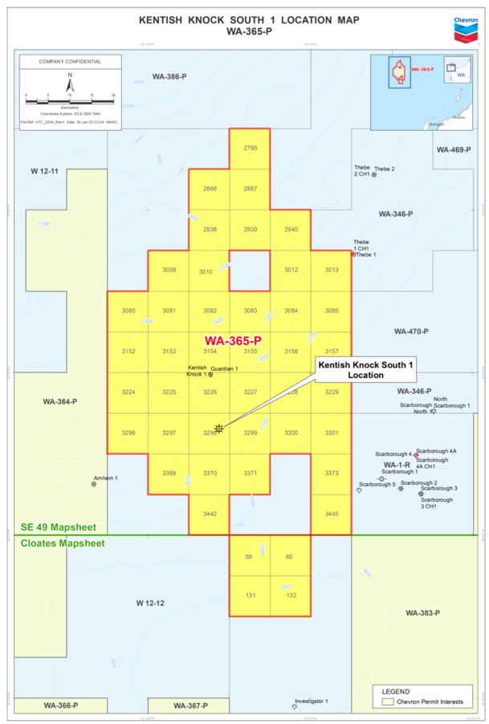

<a name="TOC"></a>

[[_TOC_]]

# A Note about Deprecated Sample-related Schemas

:warning: **WARNING**

This page represents old, out-of-date, information. This page represents a data model from before the creation of the "unified" data model for Rock and Fluid Samples, and the development of the RAFS (Rock and Fluid Sample) DDMS. As a result of the unified approach, some of these older schemas are in the process of being deprecated (Jan. 2025), and should not be used moving forward.

Schemas that should no longer be used:

- `RockSample` >> Use `Sample` instead
- `Coring` >> Use `SampleAcquisitionJob` and `Sample.SampleAcquisition` instead
- `RockSampleAnalysis` >> Use `SamplesAnalysis` and `SamplesAnalysesReport` instead
- `RockImage` >> Use `SampleImage` instead

As the data model evolves, certain other schemas - particularly reference schemas - are expected to be consolidated.

More information can be found in the [Petrophysics DD Project Issue 62](https://gitlab.opengroup.org/osdu/subcommittees/data-def/projects/Petrophysics/home/-/issues/62).

**For the more up to date documentation on the Rock and Fluid Data Model, please see [SampleAnalyses Worked Examples](../SampleAnalyses/README.md).**

# Rock Sample Analysis, Kentish Knock South 1

## File and Document

The examples are built based on the [Basic_WCR_Kentish_Knock_South_1_Rev_0.pdf](https://gitlab.opengroup.org/osdu/subcommittees/data-def/projects/Petrophysics/docs/-/blob/master/Design%20Documents/Kentish%20Knock%20South%201%20-%20Example%20Well/Basic_WCR_Kentish_Knock_South_1_Rev_0.pdf)
located int the Petrophysics work-stream repository in the OSDU Member GitLab. The document itself is represented by a
generic `work-product-component--Document` referring to a `dataset--File.Generic` as PDF.

<details>

<summary markdown="span">Completion Report, <code>dataset--File.Generic</code> example.</summary>

<OsduImportJSON>[Generic File (PDF), Full record](./dataset/File.Generic-KKS1-Report.json#only.data)</OsduImportJSON>

```json
{
  "data": {
    "Name": "Kentish Knock South 1, Initial Well Completion Report Carnarvon Basin: WA-365-P (R1)",
    "Description": "Compiled By: Reservoir Management Services; Document ID: ABU130500045; Issue Date: 2013-07-30.",
    "TotalSize": "111433500",
    "EncodingFormatTypeID": "partition-id:reference-data--EncodingFormatType:application%2Fpdf:",
    "DatasetProperties": {
      "FileSourceInfo": {
        "FileSource": "s3://chevron-data/wcr/Carnarvon/Kentish_Knock_South_1_WCR_Basic_Data_Rev_0.pdf",
        "PreloadFilePath": "https://gitlab.opengroup.org/osdu/subcommittees/data-def/projects/Petrophysics/docs/-/blob/master/Design%20Documents/Kentish%20Knock%20South%201%20-%20Example%20Well/Kentish_Knock_South_1_WCR_Basic_Data_Rev_0.pdf",
        "Name": "Kentish_Knock_South_1_WCR_Basic_Data_Rev_0.pdf",
        "FileSize": "111433500"
      }
    }
  }
}
```
</details>


<details>

<summary markdown="span">Completion Report, <code>work-product-component--Document</code> example.</summary>

<OsduImportJSON>[Document WPC, Full record](./work-product-component/Document-CompletionReport-KKS1.json#only.data)</OsduImportJSON>

```json
{
  "data": {
    "TechnicalAssuranceID": "partition-id:reference-data--TechnicalAssuranceType:Certified:",
    "Datasets": [
      "partition-id:dataset--File.Generic:WellCompletionReport-KentishKnockSouth1-WA-365-P--R1:"
    ],
    "Artefacts": [],
    "Name": "Kentish Knock South 1, Initial Well Completion Report Carnarvon Basin: WA-365-P (R1)",
    "Description": "Document ID: ABU130500045 Rev 0",
    "CreationDateTime": "2020-02-13T09:13:15.55Z",
    "Tags": [
      "Example Tags"
    ],
    "SpatialPoint": {
      "AsIngestedCoordinates": {
        "type": "AnyCrsFeatureCollection",
        "CoordinateReferenceSystemID": "partition-id:reference-data--CoordinateReferenceSystem:BoundProjected:EPSG::28349_EPSG::1150:",
        "persistableReferenceCrs": "{\"authCode\":{\"auth\":\"OSDU\",\"code\":\"28349001\"},\"lateBoundCRS\":{\"authCode\":{\"auth\":\"EPSG\",\"code\":\"28349\"},\"name\":\"GDA_1994_MGA_Zone_49\",\"type\":\"LBC\",\"ver\":\"PE_10_9_1\",\"wkt\":\"PROJCS[\\\"GDA_1994_MGA_Zone_49\\\",GEOGCS[\\\"GCS_GDA_1994\\\",DATUM[\\\"D_GDA_1994\\\",SPHEROID[\\\"GRS_1980\\\",6378137.0,298.257222101]],PRIMEM[\\\"Greenwich\\\",0.0],UNIT[\\\"Degree\\\",0.0174532925199433]],PROJECTION[\\\"Transverse_Mercator\\\"],PARAMETER[\\\"False_Easting\\\",500000.0],PARAMETER[\\\"False_Northing\\\",10000000.0],PARAMETER[\\\"Central_Meridian\\\",111.0],PARAMETER[\\\"Scale_Factor\\\",0.9996],PARAMETER[\\\"Latitude_Of_Origin\\\",0.0],UNIT[\\\"Meter\\\",1.0],AUTHORITY[\\\"EPSG\\\",28349]]\"},\"name\":\"GDA94 * EPSG-Aus / Map Grid of Australia zone 49 [28349,1150]\",\"singleCT\":{\"authCode\":{\"auth\":\"EPSG\",\"code\":\"1150\"},\"name\":\"GDA_1994_To_WGS_1984\",\"type\":\"ST\",\"ver\":\"PE_10_9_1\",\"wkt\":\"GEOGTRAN[\\\"GDA_1994_To_WGS_1984\\\",GEOGCS[\\\"GCS_GDA_1994\\\",DATUM[\\\"D_GDA_1994\\\",SPHEROID[\\\"GRS_1980\\\",6378137.0,298.257222101]],PRIMEM[\\\"Greenwich\\\",0.0],UNIT[\\\"Degree\\\",0.0174532925199433]],GEOGCS[\\\"GCS_WGS_1984\\\",DATUM[\\\"D_WGS_1984\\\",SPHEROID[\\\"WGS_1984\\\",6378137.0,298.257223563]],PRIMEM[\\\"Greenwich\\\",0.0],UNIT[\\\"Degree\\\",0.0174532925199433]],METHOD[\\\"Position_Vector\\\"],PARAMETER[\\\"X_Axis_Translation\\\",0.0],PARAMETER[\\\"Y_Axis_Translation\\\",0.0],PARAMETER[\\\"Z_Axis_Translation\\\",0.0],PARAMETER[\\\"X_Axis_Rotation\\\",0.0],PARAMETER[\\\"Y_Axis_Rotation\\\",0.0],PARAMETER[\\\"Z_Axis_Rotation\\\",0.0],PARAMETER[\\\"Scale_Difference\\\",0.0],OPERATIONACCURACY[3.2],AUTHORITY[\\\"EPSG\\\",1150]]\"},\"type\":\"EBC\",\"ver\":\"PE_10_9_1\"}",
        "features": [
          {
            "type": "AnyCrsFeature",
            "geometry": {
              "type": "AnyCrsPoint",
              "coordinates": [
                689960.85,
                7811747.53
              ]
            },
            "properties": {}
          }
        ]
      },
      "Wgs84Coordinates": {
        "type": "FeatureCollection",
        "features": [
          {
            "type": "Feature",
            "geometry": {
              "type": "Point",
              "coordinates": [
                112.81324757107716,
                -19.7808907610266
              ]
            },
            "properties": {}
          }
        ]
      },
      "AppliedOperations": [
        "conversion from GDA_1994_MGA_Zone_49 to GCS_GDA_1994; 1 points converted",
        "transformation GCS_GDA_1994 to GCS_WGS_1984 using GDA_1994_To_WGS_1984; 1 points successfully transformed"
      ]
    },
    "GeoContexts": [
      {
        "GeoPoliticalEntityID": "partition-id:master-data--GeoPoliticalEntity:3298:",
        "GeoTypeID": "partition-id:reference-data--GeoPoliticalEntityType:BlockID:"
      },
      {
        "BasinID": "partition-id:master-data--Basin:Carnarvon:",
        "GeoTypeID": "partition-id:reference-data--BasinType:PassiveMargin:"
      },
      {
        "FieldID": "partition-id:master-data--Field:Gorgon:",
        "GeoTypeID": "Field"
      }
    ],
    "SubmitterName": "Chevron Australia Pty Ltd",
    "BusinessActivities": [
      "Drilling"
    ],
    "AuthorIDs": [
      "Daniel van der Aa",
      "Phil Allen"
    ],
    "LineageAssertions": [
      {
        "ID": "partition-id:master-data--Wellbore:KKS1:",
        "LineageRelationshipType": "partition-id:reference-data--LineageRelationshipType:Reference:"
      },
      {
        "ID": "partition-id:master-data--Coring:KKS1-Core-1:",
        "LineageRelationshipType": "partition-id:reference-data--LineageRelationshipType:Reference:"
      },
      {
        "ID": "partition-id:master-data--Coring:KKS1-Core-2:",
        "LineageRelationshipType": "partition-id:reference-data--LineageRelationshipType:Reference:"
      },
      {
        "ID": "partition-id:master-data--Coring:KKS1-Core-3:",
        "LineageRelationshipType": "partition-id:reference-data--LineageRelationshipType:Reference:"
      },
      {
        "ID": "partition-id:master-data--Coring:KKS1-SidewallCoring-1-26:",
        "LineageRelationshipType": "partition-id:reference-data--LineageRelationshipType:Reference:"
      }
    ],
    "DocumentTypeID": "partition-id:reference-data--DocumentType:CompletionReport:",
    "NumberOfPages": 1082,
    "SubTitle": "Document ID: ABU130500045 Rev 0",
    "DocumentSubject": "Kentish Knock South 1 Initial Well Completion Report",
    "DatePublished": "2013-07-30",
    "DocumentLanguage": "English",
    "ExtensionProperties": {}
  }
}
```
</details>

#### Figure 1. Location Map



#### Figure 2. Conceptual Model


The following sections will refer to entities shown in this data model and provide examples. See also the section
[12.1 Rock Samples](../../../Guides/Chapters/12-RockAndFluidSampleAnalysis.md#121-rock-samples) in the Schema Usage
Guide.

## Well

&rarr; [`master-data--Well` record](./master-data/well-kks1.json) with surface location from report page 217.

## Wellbore

&rarr; [`master-data--Wellbore` record](./master-data/wellbore-kks1.json) with bottom hole location from report page 12.

## Cores (Coring)

Please refer to the Core schema [documentation master-data--Coring](../../../E-R/master-data/Coring.1.1.1.md).
**_Important:_** A Coring record is **_either_** a conventional core **_or_** a sidewall core. This is easily identified
by the root property name `ConventionalCoring` versus `SidewallCoring`.

### Vertical References and Depths

The schema does not qualify the kind of depth in the property names, e.g. `TopDepth`, `BottomDepth`. The details are
defined with the `data.VerticalMeasurement` property. In this structure the `VerticalMeasurementPathID` (typically `MD`
and assumed if absent) and `VerticalMeasurementSourceID` are defined to provide the required context to the depth
values. This pattern is used throughout the subdomain of Core, RockSample and RockSampleAnalysis. An example is
provided with this Core record fragment:

<details>

<summary markdown="span">Core, <code>VerticalMeasurement</code> example.</summary>

<OsduImportJSON>[Core 1, Full record](./master-data/Core-kks1-1.json#only.data.VerticalMeasurement)</OsduImportJSON>

```json
{
  "data": {
    "VerticalMeasurement": {
      "VerticalReferenceID": "ZDP",
      "VerticalMeasurement": 0.0,
      "VerticalMeasurementPathID": "partition-id:reference-data--VerticalMeasurementPath:MeasuredDepth:",
      "VerticalMeasurementSourceID": "partition-id:reference-data--VerticalMeasurementSource:DRL:",
      "VerticalMeasurementDescription": "Same vertical reference as wellbore ZDP, Measured Depth, Drillers Depth.",
      "VerticalReferenceEntityID": "partition-id:master-data--Wellbore:KKS1:"
    }
  }
}
```
</details>

Translated this means:

1. The depth values are referring to the Wellbore's vertical measurement "ZDP" (`"VerticalReferenceID": "ZDP"`).
2. There is no shift (`"VerticalMeasurement": 0.0`), the depth values directly refer to "ZDP"
3. The depth values are in Driller's
   depth (`"VerticalMeasurementSourceID": "partition-id:reference-data--VerticalMeasurementSource:DRL:"`)
4. It is good practice summarising this in the `VerticalMeasurementDescription` for human consumption.

### Conventional Cores
#### Core 1

&rarr; [`master-data--Coring` Core 1](./master-data/Core-kks1-1.json) report page 182 with sections from core inventory page 466.

<details>

<summary markdown="span">Core 1 with 18 m section parameters.</summary>

<OsduImportJSON>[Core 1, Full record](./master-data/Core-kks1-1.json#only.data.ServiceCompanyID|Name|TopDepth|BottomDepth|RunNumber|CoreDiameter|ConventionalCoring)</OsduImportJSON>

```json
{
  "data": {
    "ServiceCompanyID": "partition-id:master-data--Organisation:Baker_Hughes_Inteq_BHI:",
    "Name": "KKS1 Core #1",
    "TopDepth": 2413.0,
    "BottomDepth": 2431.0,
    "RunNumber": 1,
    "CoreDiameter": 5.125,
    "ConventionalCoring": {
      "CoreTypeID": "partition-id:reference-data--ConventionalCoreType:ConventionalCore:",
      "CoreSections": [
        {
          "CoreSectionID": "1A",
          "RecoveredLength": 1.0,
          "TopDepth": 2413.0,
          "BottomDepth": 2414.0
        },
        {
          "CoreSectionID": "1B",
          "RecoveredLength": 0.5,
          "TopDepth": 2414.0,
          "BottomDepth": 2414.5
        },
        {
          "CoreSectionID": "1C",
          "RecoveredLength": 0.61,
          "TopDepth": 2414.5,
          "BottomDepth": 2415.11
        },
        {
          "CoreSectionID": "2A",
          "RecoveredLength": 0.89,
          "TopDepth": 2415.11,
          "BottomDepth": 2416.0
        },
        {
          "CoreSectionID": "2B",
          "RecoveredLength": 1.0,
          "TopDepth": 2416.0,
          "BottomDepth": 2417.0
        },
        {
          "CoreSectionID": "2C",
          "RecoveredLength": 1.0,
          "TopDepth": 2417.0,
          "BottomDepth": 2418.0
        },
        {
          "CoreSectionID": "2D",
          "RecoveredLength": 1.0,
          "TopDepth": 2418.0,
          "BottomDepth": 2419.0
        },
        {
          "CoreSectionID": "2E",
          "RecoveredLength": 1.0,
          "TopDepth": 2419.0,
          "BottomDepth": 2420.0
        },
        {
          "CoreSectionID": "2F",
          "RecoveredLength": 1.0,
          "TopDepth": 2420.0,
          "BottomDepth": 2421.0
        },
        {
          "CoreSectionID": "2G",
          "RecoveredLength": 1.0,
          "TopDepth": 2421.0,
          "BottomDepth": 2422.0
        },
        {
          "CoreSectionID": "3A",
          "RecoveredLength": 1.0,
          "TopDepth": 2422.0,
          "BottomDepth": 2423.0
        },
        {
          "CoreSectionID": "3B",
          "RecoveredLength": 1.0,
          "TopDepth": 2423.0,
          "BottomDepth": 2424.0
        },
        {
          "CoreSectionID": "3C",
          "RecoveredLength": 0.23,
          "TopDepth": 2424.0,
          "BottomDepth": 2424.23
        },
        {
          "CoreSectionID": "4A",
          "RecoveredLength": 0.98,
          "TopDepth": 2424.23,
          "BottomDepth": 2425.21
        }
      ]
    }
  }
}
```

</details>

<details>

<summary markdown="span">Core 1 <code>CoreRemarks</code> from report page 441.</summary>

<OsduImportJSON>[Core 1, Full record](./master-data/Core-kks1-1.json#only.data.CoreRemarks)</OsduImportJSON>

```json
{
  "data": {
    "CoreRemarks": [
      {
        "RemarkID": "1",
        "Remark": "Core difficult to start.  Initial dip with stick indicated that top of core was 1.32 m from top of barrel 1 - Core GR was started from that point. Subsequent measurement showed that the top of the core was actually 5.8 m from the top of barrel 1 - therefore the first 4.48 m (5.8 - 1.32 m) of core GR should be dicarded.  Subsequent inspection of the core indicated that the annulus of the core deteriotated towards the base.  The core catcher was removed - core appeared to be jammed.  The core was removed and packed into a PVC pipe.  Note some junk (from the shoe) was subsequently found on the top of core 2.  This junk probably was the cause of the poor start to core 1 and to the poor recovery.",
        "RemarkSource": "Kentish Knock South 1 Completion Report, Comments"
      },
      {
        "RemarkID": "2",
        "Remark": "1. 2415.1 m SANDSTONE:   100%  very light grey, friable, predominantly very fine minor fine grained quartz, sub-angular, moderate sphericity, well sorted, weak siliceous cement, trace pyritic cement, trace dark grey claystone lithics, trace carbonaceous detritus,  trace mica (muscovite and trace biotite?), trace chlorite, good visual porosity.",
        "RemarkSource": "Kentish Knock South 1 Completion Report, Lithology/Shows"
      },
      {
        "RemarkID": "3",
        "Remark": "2. 2424.2 m SANDSTONE:   100%  very light grey, friable, predominantly very fine minor fine grained quartz, sub-angular to angular, moderate sphericity, well sorted, weak siliceous cement, trace dark grey claystone lithics, trace carbonaceous detritus,  trace mica (muscovite and trace biotite?), trace chlorite, good visual porosity.",
        "RemarkSource": "Kentish Knock South 1 Completion Report, Lithology/Shows"
      },
      {
        "RemarkID": "4",
        "Remark": "3. 2425.2 m SANDSTONE:   100%  very light grey, friable, predominantly very fine minor fine grained quartz, sub-angular to angular, moderate sphericity, well sorted, weak siliceous cement, trace carbonaceous detritus, trace chlorite, good visual porosity.",
        "RemarkSource": "Kentish Knock South 1 Completion Report, Lithology/Shows"
      }
    ]
  }
}
```

</details>

#### Core 2

&rarr; [`master-data--Coring` Core 2](./master-data/Core-kks1-2.json) report page 193 with sections from core inventory page 465.

<details>

<summary markdown="span">Core 2 <code>CoreRemarks</code> from report page 442.</summary>

<OsduImportJSON>[Core 2, Full record](./master-data/Core-kks1-2.json#only.data.CoreRemarks)</OsduImportJSON>

```json
{
  "data": {
    "CoreRemarks": [
      {
        "RemarkID": "1",
        "Remark": "None",
        "RemarkSource": "Kentish Knock South 1 Completion Report, Comments"
      },
      {
        "RemarkID": "2",
        "Remark": "1. 2431.0 m SANDSTONE:   100%  light grey to medium light grey, friable, very fine to fine grained quartz, sub-angular, sub-spherical, well sorted, weak siliceous cement, trace carbonaceous detritus, trace pinkish grey quartz, trace micro micas (biotite and muscovite), fair to good visual porosity.",
        "RemarkSource": "Kentish Knock South 1 Completion Report, Lithology/Shows"
      },
      {
        "RemarkID": "3",
        "Remark": "2. 2439.8 m SANDSTONE:   100%  light grey, friable, very fine to minor fine grained quartz, sub-angular, sub-spherical, well sorted, weak siliceous cement, trace carbonaceous detritus, trace pinkish grey and yellowish grey quartz, trace micro micas, trace chlorite, good visual porosity.",
        "RemarkSource": "Kentish Knock South 1 Completion Report, Lithology/Shows"
      },
      {
        "RemarkID": "4",
        "Remark": "3. 2449.9 m SANDSTONE:   100%  medium light grey to medium grey, friable, very fine to fine grained quartz, sub-angular, sub-spherical, well sorted, weak siliceous cement, trace carbonaceous detritus, trace orange grey quartz, trace micro micas, good visual porosity.",
        "RemarkSource": "Kentish Knock South 1 Completion Report, Lithology/Shows"
      }
    ]
  }
}
```

</details>

#### Core 3

&rarr; [`master-data--Coring` Core 3](./master-data/Core-kks1-3.json) report page 204 with sections from core inventory page 465, 466.

<details>

<summary markdown="span">Core 3 with CoreSections element 1B.</summary>

<OsduImportJSON>[Core 3, Full record](./master-data/Core-kks1-3.json#only.data.ConventionalCoring.CoreSections[1])</OsduImportJSON>

```json
{
  "data": {
    "ConventionalCoring": {
      "CoreSections": [
        {
          "CoreSectionID": "1B",
          "RecoveredLength": 1.0,
          "TopDepth": 2451.0,
          "BottomDepth": 2452.0
        }
      ]
    }
  }
}
```

</details>

<details>

<summary markdown="span">Core 3 <code>CoreRemarks</code> from report page 443.</summary>

<OsduImportJSON>[Core 3, Full record](./master-data/Core-kks1-3.json#only.data.CoreRemarks)</OsduImportJSON>

```json
{
  "data": {
    "CoreRemarks": [
      {
        "RemarkID": "1",
        "Remark": "Clam shell catcher activated - no chip sample from bottom of core.\nTop of core appears to be thin - partially washed out at the top of the core.",
        "RemarkSource": "Kentish Knock South 1 Completion Report, Comments"
      },
      {
        "RemarkID": "2",
        "Remark": "1. 2458.1 m SILTY SANDSTONE:   100%  medium grey, friable, very fine grained quartz, sub-angular to angular, moderate sphericity, well sorted, weak siliceous cement, 20% light grey silty matrix, 2% micro-mica (biotite and muscovite), trace carbonaceous detritus, poor visual porosity.",
        "RemarkSource": "Kentish Knock South 1 Completion Report, Lithology/Shows"
      }
    ]
  }
}
```

</details>

[Back to TOC](#TOC)

### Sidewall Cores

Sidewall cores have a distinctly different detailed structure. Instead of `data.ConventionalCoring.CoreSections[]`,
`data.SidewallCoring.SidewallCores[]` are used. In the following example we use the sidewall core descriptions, page
595-597 of the report.

<details>

<summary markdown="span">Sidewall Coring, <code>VerticalMeasurement</code> this time Logger's depth.</summary>

<OsduImportJSON>[Sidewall Core, full record](./master-data/SidewallCoring-kks1.json#only.data.VerticalMeasurement)</OsduImportJSON>

```json
{
  "data": {
    "VerticalMeasurement": {
      "VerticalReferenceID": "ZDP",
      "VerticalMeasurement": 0.0,
      "VerticalMeasurementPathID": "partition-id:reference-data--VerticalMeasurementPath:MeasuredDepth:",
      "VerticalMeasurementSourceID": "partition-id:reference-data--VerticalMeasurementSource:LOG:",
      "VerticalMeasurementDescription": "Same vertical reference as wellbore ZDP, Measured Depth, Logger's Depth.",
      "VerticalReferenceEntityID": "partition-id:master-data--Wellbore:KKS1:"
    }
  }
}
```
</details>

<details>

<summary markdown="span">Sidewall Coring, <code>CoreRemarks</code> from report page 16.</summary>

<OsduImportJSON>[Sidewall Core, full record](./master-data/SidewallCoring-kks1.json#only.data.CoreRemarks)</OsduImportJSON>

```json
{
  "data": {
    "CoreRemarks": [
      {
        "RemarkID": "1",
        "Remark": "Suite 1, Run 5. Twenty-six cores were cut and twenty-six were recovered (100% recovery) over the interval 2958.3 m to 2361.3 m.",
        "RemarkSource": "Kentish Knock South 1 Completion Report, pages 595-597"
      }
    ]
  }
}
```
</details>

<details>

<summary markdown="span">Sidewall Coring, <code>SidewallCores[]</code> sample No. 3 from report page 595.</summary>

<OsduImportJSON>[Sidewall Core, full record](./master-data/SidewallCoring-kks1.json#only.data.SidewallCoring.SidewallCores[2])</OsduImportJSON>

```json
{
  "data": {
    "SidewallCoring": {
      "SidewallCores": [
        {
          "SampleID": "3",
          "RecoveredLength": 2.0,
          "Depth": 2958.3,
          "Description": "SANDSTONE: (100%) light olive grey, minor light grey to medium light grey, very soft to friable, fine to medium grained, predominantly fine grained, sub-angular, rare sub-rounded, sub-spherical, well to very well sorted, trace weak siliceous cement, trace argillaceous matrix, trace pinkish grey quartz grains, trace micro micas, trace carbonaceous (?) specks, good intergranular visual porosity."
        }
      ]
    }
  }
}
```
</details>

### Activity Usage

#### Activity Behaviour

This example demonstrates flexible model extension to capture 'activity' parameters.

<details>

<summary markdown="span">Sidewall Coring, Activity <code>Parameters[]</code> example.</summary>

<OsduImportJSON>[Sidewall Core, full record](./master-data/SidewallCoring-kks1.json#only.data.ActivityTemplateID|Parameters)</OsduImportJSON>

```json
{
  "data": {
    "ActivityTemplateID": "partition-id:master-data--ActivityTemplate:SidewallCoringActivity:",
    "Parameters": [
      {
        "Title": "Geologists",
        "StringParameter": "M. Bilek, S. Broun, D. Hartney, D. van der Aa",
        "ParameterKindID": "partition-id:reference-data--ParameterKind:String:"
      },
      {
        "Title": "ToolString",
        "DataObjectParameter": "partition-id:master-data--SidewallCoringToolString:MSCT-GR-ECRD:",
        "ParameterKindID": "partition-id:reference-data--ParameterKind:DataObject:",
        "ParameterRoleID": "partition-id:reference-data--ParameterRole:Control:"
      }
    ]
  }
}
```
</details>

#### Activity Template

Activity templates organise the 'activity' extensions by defining well-known parameters and possibly defaults.
<details>

<summary markdown="span">Sidewall Coring, TemplateActivity <code>Parameters[]</code> example.</summary>

<OsduImportJSON>[Sidewall Coring TemplateActivity, full record](./master-data/SidewallCoringActivityTemplate.json#only.data.Parameters)</OsduImportJSON>

```json
{
  "data": {
    "Parameters": [
      {
        "AllowedParameterKind": "namespace:reference-data--ParameterKind:DataObject:",
        "IsInput": true,
        "IsOutput": false,
        "Title": "ToolString",
        "DataObjectContentType": [
          "master-data--SidewallCoringToolString"
        ],
        "MaxOccurs": 1,
        "MinOccurs": 1
      },
      {
        "AllowedParameterKind": "namespace:reference-data--ParameterKind:String:",
        "IsInput": true,
        "IsOutput": false,
        "Title": "Geologists",
        "MaxOccurs": 1,
        "MinOccurs": 1
      }
    ]
  }
}
```
</details>


[Back to TOC](#TOC)

## RockSamples

In total 113 plugs were cut from the core slabs (see page 26 of the report).

### Plug 10A

Please refer to the Core schema [documentation master-data--RockSample:1.0.0](../../../E-R/master-data/RockSample.1.1.1.md).

Currently, there is only one RockSample created, an arbitrary "plug" taken out of the inventory of plugs, see page 467
in the report. The report does not identify a top and a bottom depth, neither a plug size. The `TopDepth`
and `BottomDepth` are set to the same value.

<details>

<summary markdown="span">Core 1, Plug Sample 10A data section</summary>

<OsduImportJSON>[Core 1, plug 10A, Full record](./master-data/RockSample-kks1-Core1-10A.json#only.data)</OsduImportJSON>

```json
{
  "data": {
    "TechnicalAssuranceID": "partition-id:reference-data--TechnicalAssuranceType:Certified:",
    "GeoContexts": [
      {
        "GeoPoliticalEntityID": "partition-id:master-data--GeoPoliticalEntity:3298:",
        "GeoTypeID": "partition-id:reference-data--GeoPoliticalEntityType:BlockID:"
      },
      {
        "BasinID": "partition-id:master-data--Basin:Carnarvon:",
        "GeoTypeID": "partition-id:reference-data--BasinType:PassiveMargin:"
      },
      {
        "FieldID": "partition-id:master-data--Field:Gorgon:",
        "GeoTypeID": "Field"
      }
    ],
    "SpatialLocation": {
      "CoordinateQualityCheckRemarks": [
        "Wgs84Coordinates copied from parent Wellbore ProjectedBottomHoleLocation."
      ],
      "Wgs84Coordinates": {
        "type": "FeatureCollection",
        "features": [
          {
            "type": "Feature",
            "geometry": {
              "type": "Point",
              "coordinates": [
                112.81362197200383,
                -19.781020115817476
              ]
            },
            "properties": {}
          }
        ]
      },
      "AppliedOperations": [
        "conversion from GDA_1994_MGA_Zone_49 to GCS_GDA_1994; 1 points converted",
        "transformation GCS_GDA_1994 to GCS_WGS_1984 using GDA_1994_To_WGS_1984; 1 points successfully transformed"
      ],
      "SpatialGeometryTypeID": "partition-id:reference-data--SpatialGeometryType:Point:"
    },
    "VersionCreationReason": "Example VersionCreationReason",
    "RockSampleIdentifier": "10A",
    "WellboreID": "partition-id:master-data--Wellbore:KKS1:",
    "CoringID": "partition-id:master-data--Coring:KKS1-Core-1:",
    "Name": "KKS1 Core #1, Sample 10A",
    "VerticalMeasurement": {
      "VerticalReferenceID": "ZDP",
      "VerticalMeasurement": 0.0,
      "VerticalMeasurementPathID": "partition-id:reference-data--VerticalMeasurementPath:MeasuredDepth:",
      "VerticalMeasurementSourceID": "partition-id:reference-data--VerticalMeasurementSource:DRL:",
      "VerticalMeasurementDescription": "Same vertical reference as wellbore ZDP, Measured Depth, Drillers Depth.",
      "VerticalReferenceEntityID": "partition-id:master-data--Wellbore:KKS1:"
    },
    "LabSampleIdentifier": "10A",
    "DataSource": "Kentish Knock South 1 Completion Report",
    "SampleTypeID": "partition-id:reference-data--RockSampleType:PLUG:",
    "TopDepth": 2423.26,
    "BottomDepth": 2423.26,
    "SampleLength": 1.5,
    "SampleDiameter": 1.0,
    "SampleWeight": 42.5,
    "SampleOwnerID": "partition-id:master-data--Organisation:ChevronAustraliaPtyLtd:",
    "SampleAcquiredDate": "2012-12-19T12:00:00.00+08:00",
    "IsPlugCleaned": true,
    "SampleStorageLocations": [
      {
        "StorageLocationDescription": "Example StorageLocationDescription",
        "StorageFacilityID": "partition-id:master-data--StorageFacility:SomeUniqueStorageFacilityID:",
        "StorageOrganisationID": "partition-id:master-data--Organisation:SomeUniqueOrganisationID:",
        "EffectiveDateTime": "2020-02-13"
      }
    ],
    "SampleRemarks": [
      {
        "RemarkID": "1",
        "Remark": "No remark",
        "RemarkSource": "Kentish Knock South 1 Completion Report"
      }
    ],
    "ExtensionProperties": {}
  }
}
```

</details>

### Sidewall Core Sample

In the report on page 597 the sidewall cores are described and page 634 has the routine core analysis. the following
example record describes one (sample 22) of the 26 samples taken. Sidewall core samples are represented using the
[documentation master-data--RockSample:1.0.0](../../../E-R/master-data/RockSample.1.1.1.md) schema.

<details>

<summary markdown="span">Sidewall Core, Sample 22</summary>

<OsduImportJSON>[Sidewall Core Sample 22, Full record](./master-data/RockSample-kks1-Sidewall-Sample22.json#only.data)</OsduImportJSON>

```json
{
  "data": {
    "TechnicalAssuranceID": "partition-id:reference-data--TechnicalAssuranceType:Certified:",
    "GeoContexts": [
      {
        "GeoPoliticalEntityID": "partition-id:master-data--GeoPoliticalEntity:3298:",
        "GeoTypeID": "partition-id:reference-data--GeoPoliticalEntityType:BlockID:"
      },
      {
        "BasinID": "partition-id:master-data--Basin:Carnarvon:",
        "GeoTypeID": "partition-id:reference-data--BasinType:PassiveMargin:"
      },
      {
        "FieldID": "partition-id:master-data--Field:Gorgon:",
        "GeoTypeID": "Field"
      }
    ],
    "SpatialLocation": {
      "CoordinateQualityCheckRemarks": [
        "Wgs84Coordinates copied from parent Wellbore ProjectedBottomHoleLocation."
      ],
      "Wgs84Coordinates": {
        "type": "FeatureCollection",
        "features": [
          {
            "type": "Feature",
            "geometry": {
              "type": "Point",
              "coordinates": [
                112.81362197200383,
                -19.781020115817476
              ]
            },
            "properties": {}
          }
        ]
      },
      "AppliedOperations": [
        "conversion from GDA_1994_MGA_Zone_49 to GCS_GDA_1994; 1 points converted",
        "transformation GCS_GDA_1994 to GCS_WGS_1984 using GDA_1994_To_WGS_1984; 1 points successfully transformed"
      ],
      "SpatialGeometryTypeID": "partition-id:reference-data--SpatialGeometryType:Point:"
    },
    "VersionCreationReason": "Example VersionCreationReason",
    "RockSampleIdentifier": "22",
    "WellboreID": "partition-id:master-data--Wellbore:KKS1:",
    "CoringID": "partition-id:master-data--Coring:KKS1-SidewallCoring-1-26:",
    "Name": "KKS1 Core #1, Sample 22",
    "VerticalMeasurement": {
      "VerticalReferenceID": "ZDP",
      "VerticalMeasurement": 0.0,
      "VerticalMeasurementPathID": "partition-id:reference-data--VerticalMeasurementPath:MeasuredDepth:",
      "VerticalMeasurementSourceID": "partition-id:reference-data--VerticalMeasurementSource:DRL:",
      "VerticalMeasurementDescription": "Same vertical reference as wellbore ZDP, Measured Depth, Drillers Depth.",
      "VerticalReferenceEntityID": "partition-id:master-data--Wellbore:KKS1:"
    },
    "LabSampleIdentifier": "22",
    "DataSource": "Kentish Knock South 1 Completion Report, page 597",
    "SampleTypeID": "partition-id:reference-data--RockSampleType:PLUG:",
    "TopDepth": 2417.5,
    "BottomDepth": 2417.5,
    "SampleLength": 2.0,
    "SampleDiameter": 1.0,
    "SampleWeight": 56.7,
    "SampleOwnerID": "partition-id:master-data--Organisation:ChevronAustraliaPtyLtd:",
    "SampleAcquiredDate": "2013-01-05",
    "IsPlugCleaned": true,
    "SampleStorageLocations": [
      {
        "StorageLocationDescription": "Example StorageLocationDescription",
        "StorageFacilityID": "partition-id:master-data--StorageFacility:SomeUniqueStorageFacilityID:",
        "StorageOrganisationID": "partition-id:master-data--Organisation:SomeUniqueOrganisationID:",
        "EffectiveDateTime": "2013-02-13"
      }
    ],
    "SampleRemarks": [
      {
        "RemarkID": "1",
        "Remark": "SANDSTONE:  (100%)  olive grey to in parts medium dark grey, very soft to friable, fine grained, sub-angular to minor sub-rounded, sub-spherical, very well sorted, trace weak siliceous cement, trace carbonaceous material, good intergranular visual porosity.",
        "RemarkSource": "Kentish Knock South 1 Completion Report, page 597"
      }
    ],
    "ExtensionProperties": {}
  }
}
```

</details>


### Cuttings Samples (2415-2431)

Here an example record for cuttings samples. The details are found in the KKS1 report page 18 and 661. There are four
worked example records for the interval 2415 to 2431 m. The samples are numbered, with 65 previous samples, starting at
66. They are then suffixed with A,B,C,D depending on the destination (see page 18).

Cuttings samples are represented using the [documentation master-data--RockSample:1.0.0](../../../E-R/master-data/RockSample.1.1.1.md)
schema. 4 example cuttings samples are provided, representing the interval 2415-2431, first in 3 5m intervals, then one
1m interval :

<details>

<summary markdown="span">Cuttings 2415-2420 interval, Set A (66A)</summary>

<OsduImportJSON>[Cuttings, 2415-2420, Full record](./master-data/RockSample-kks1-Cuttings-2415-2420-A.json#only.data)</OsduImportJSON>

```json
{
  "data": {
    "TechnicalAssuranceID": "partition-id:reference-data--TechnicalAssuranceType:Certified:",
    "GeoContexts": [
      {
        "GeoPoliticalEntityID": "partition-id:master-data--GeoPoliticalEntity:3298:",
        "GeoTypeID": "partition-id:reference-data--GeoPoliticalEntityType:BlockID:"
      },
      {
        "BasinID": "partition-id:master-data--Basin:Carnarvon:",
        "GeoTypeID": "partition-id:reference-data--BasinType:PassiveMargin:"
      },
      {
        "FieldID": "partition-id:master-data--Field:Gorgon:",
        "GeoTypeID": "Field"
      }
    ],
    "SpatialLocation": {
      "CoordinateQualityCheckRemarks": [
        "Wgs84Coordinates copied from parent Wellbore ProjectedBottomHoleLocation."
      ],
      "Wgs84Coordinates": {
        "type": "FeatureCollection",
        "features": [
          {
            "type": "Feature",
            "geometry": {
              "type": "Point",
              "coordinates": [
                112.81362197200383,
                -19.781020115817476
              ]
            },
            "properties": {}
          }
        ]
      },
      "AppliedOperations": [
        "conversion from GDA_1994_MGA_Zone_49 to GCS_GDA_1994; 1 points converted",
        "transformation GCS_GDA_1994 to GCS_WGS_1984 using GDA_1994_To_WGS_1984; 1 points successfully transformed"
      ],
      "SpatialGeometryTypeID": "partition-id:reference-data--SpatialGeometryType:Point:"
    },
    "VersionCreationReason": "Example VersionCreationReason",
    "RockSampleIdentifier": "KKS1-66-A",
    "WellboreID": "partition-id:master-data--Wellbore:KKS1:",
    "Name": "KKS1 Cuttings 2415 to 2420 m MDRT, Set A",
    "SampleOwnerID": "partition-id:master-data--Organisation:ChevronAustraliaPtyLtd:",
    "VerticalMeasurement": {
      "VerticalReferenceID": "ZDP",
      "VerticalMeasurement": 0.0,
      "VerticalMeasurementPathID": "partition-id:reference-data--VerticalMeasurementPath:MeasuredDepth:",
      "VerticalMeasurementSourceID": "partition-id:reference-data--VerticalMeasurementSource:DRL:",
      "VerticalMeasurementDescription": "Same vertical reference as wellbore ZDP, Measured Depth, Drillers Depth.",
      "VerticalReferenceEntityID": "partition-id:master-data--Wellbore:KKS1:"
    },
    "LabSampleIdentifier": "66A",
    "DataSource": "Kentish Knock South 1 Completion Report, page 18, page 661",
    "SampleTypeID": "partition-id:reference-data--RockSampleType:CUTT:",
    "TopDepth": 2415.0,
    "BottomDepth": 2420.0,
    "SampleInterval": 5,
    "SampleWeight": 157.0,
    "SampleAcquiredDate": "2012-12-18T12:00:00.00+08:00",
    "AreCuttingsWashedAndDried": true,
    "SampleStorageLocations": [
      {
        "StorageLocationDescription": "Example StorageLocationDescription",
        "StorageFacilityID": "partition-id:master-data--StorageFacility:SomeUniqueStorageFacilityID:",
        "StorageOrganisationID": "partition-id:master-data--Organisation:SomeUniqueOrganisationID:",
        "EffectiveDateTime": "2013-02-02"
      }
    ],
    "SampleRemarks": [
      {
        "RemarkID": "1",
        "Remark": "Shaker not functioning properly for a short period of time.",
        "RemarkSource": "Kentish Knock South 1 Completion Report, made up, no evidence in report."
      }
    ],
    "ExtensionProperties": {}
  }
}
```

</details>

<details>

<summary markdown="span">Cuttings 2420-2425 interval, Set D (67D)</summary>

<OsduImportJSON>[Cuttings, 2420-2425, Full record](./master-data/RockSample-kks1-Cuttings-2420-2425-D.json#only.data)</OsduImportJSON>

```json
{
  "data": {
    "TechnicalAssuranceID": "partition-id:reference-data--TechnicalAssuranceType:Certified:",
    "GeoContexts": [
      {
        "GeoPoliticalEntityID": "partition-id:master-data--GeoPoliticalEntity:3298:",
        "GeoTypeID": "partition-id:reference-data--GeoPoliticalEntityType:BlockID:"
      },
      {
        "BasinID": "partition-id:master-data--Basin:Carnarvon:",
        "GeoTypeID": "partition-id:reference-data--BasinType:PassiveMargin:"
      },
      {
        "FieldID": "partition-id:master-data--Field:Gorgon:",
        "GeoTypeID": "Field"
      }
    ],
    "SpatialLocation": {
      "CoordinateQualityCheckRemarks": [
        "Wgs84Coordinates copied from parent Wellbore ProjectedBottomHoleLocation."
      ],
      "Wgs84Coordinates": {
        "type": "FeatureCollection",
        "features": [
          {
            "type": "Feature",
            "geometry": {
              "type": "Point",
              "coordinates": [
                112.81362197200383,
                -19.781020115817476
              ]
            },
            "properties": {}
          }
        ]
      },
      "AppliedOperations": [
        "conversion from GDA_1994_MGA_Zone_49 to GCS_GDA_1994; 1 points converted",
        "transformation GCS_GDA_1994 to GCS_WGS_1984 using GDA_1994_To_WGS_1984; 1 points successfully transformed"
      ],
      "SpatialGeometryTypeID": "partition-id:reference-data--SpatialGeometryType:Point:"
    },
    "VersionCreationReason": "Example VersionCreationReason",
    "RockSampleIdentifier": "KKS1-67-D",
    "WellboreID": "partition-id:master-data--Wellbore:KKS1:",
    "Name": "KKS1 Cuttings 2425 to 2430 m MDRT, Set C",
    "SampleOwnerID": "partition-id:master-data--Organisation:DepartmentOfMinesAndPetroleum:",
    "VerticalMeasurement": {
      "VerticalReferenceID": "ZDP",
      "VerticalMeasurement": 0.0,
      "VerticalMeasurementPathID": "partition-id:reference-data--VerticalMeasurementPath:MeasuredDepth:",
      "VerticalMeasurementSourceID": "partition-id:reference-data--VerticalMeasurementSource:DRL:",
      "VerticalMeasurementDescription": "Same vertical reference as wellbore ZDP, Measured Depth, Drillers Depth.",
      "VerticalReferenceEntityID": "partition-id:master-data--Wellbore:KKS1:"
    },
    "LabSampleIdentifier": "67D",
    "DataSource": "Kentish Knock South 1 Completion Report, page 18, page 661",
    "SampleTypeID": "partition-id:reference-data--RockSampleType:CUTT:",
    "TopDepth": 2420.0,
    "BottomDepth": 2425.0,
    "SampleInterval": 5,
    "SampleWeight": 158.0,
    "SampleAcquiredDate": "2012-12-18T12:00:00.00+08:00",
    "AreCuttingsWashedAndDried": true,
    "SampleStorageLocations": [
      {
        "StorageLocationDescription": "Core Library, Department of Mines and Petroleum, Carlisle, WA",
        "StorageFacilityID": "partition-id:master-data--StorageFacility:DepartmentOfMinesAndPetroleum-CoreLibrary-CarlisleWA:",
        "StorageOrganisationID": "partition-id:master-data--Organisation:DepartmentOfMinesAndPetroleum:",
        "EffectiveDateTime": "2013-02-02"
      }
    ],
    "SampleRemarks": [],
    "ExtensionProperties": {}
  }
}
```

</details>

Note, that the Cuttings 2420-2425 interval, Set D went into storage in Carlisle, WA. this is declared in the
`data.SampleStorageLocations[0]`, which relates to the StorageFacility as in this example:

<details>

<summary markdown="span">Storage Facility "Perth Core Library"</summary>

<OsduImportJSON>[StorageFacility, Full record](./master-data/StorageFacility-CoreLibrary-CarlisleWA.json#only.data)</OsduImportJSON>

```json
{
  "data": {
    "TechnicalAssuranceID": "namespace:reference-data--TechnicalAssuranceType:Certified:",
    "NameAliases": [],
    "GeoContexts": [
      {
        "GeoPoliticalEntityID": "namespace:master-data--GeoPoliticalEntity:Australia:",
        "GeoTypeID": "namespace:reference-data--GeoPoliticalEntityType:Country:"
      }
    ],
    "SpatialLocation": {
      "Wgs84Coordinates": {
        "type": "FeatureCollection",
        "features": [
          {
            "type": "Feature",
            "properties": {},
            "geometry": {
              "type": "Point",
              "coordinates": [
                115.92684232529491,
                -31.982747883989525
              ]
            }
          }
        ]
      },
      "SpatialGeometryTypeID": "namespace:reference-data--SpatialGeometryType:Point:"
    },
    "FacilityID": "Perth Core Library",
    "FacilityTypeID": "namespace:reference-data--FacilityType:Storage:",
    "FacilityOperators": [
      {
        "FacilityOperatorID": "Department of Mines and Petroleum",
        "FacilityOperatorOrganisationID": "namespace:master-data--Organisation:DepartmentOfMinesAndPetroleum:"
      }
    ],
    "InitialOperatorID": "namespace:master-data--Organisation:DepartmentOfMinesAndPetroleum:",
    "CurrentOperatorID": "namespace:master-data--Organisation:DepartmentOfMinesAndPetroleum:",
    "DataSourceOrganisationID": "namespace:master-data--Organisation:DepartmentOfMinesAndPetroleum:",
    "OperatingEnvironmentID": "namespace:reference-data--OperatingEnvironment:Onshore:",
    "FacilityName": "Perth Core Library",
    "FacilityStates": [
      {
        "FacilityStateTypeID": "namespace:reference-data--FacilityStateType:Operating:"
      }
    ],
    "FacilityEvents": [],
    "FacilitySpecifications": [],
    "Address": "37 Harris St, Carlisle WA 6101, Australia",
    "ExtensionProperties": {}
  }
}
```
</details>

<details>

<summary markdown="span">Cuttings 2425-2430 interval, Set C (68C)</summary>

<OsduImportJSON>[Cuttings, 2425-2430, Full record](./master-data/RockSample-kks1-Cuttings-2425-2430-C.json#only.data)</OsduImportJSON>

```json
{
  "data": {
    "TechnicalAssuranceID": "partition-id:reference-data--TechnicalAssuranceType:Certified:",
    "GeoContexts": [
      {
        "GeoPoliticalEntityID": "partition-id:master-data--GeoPoliticalEntity:3298:",
        "GeoTypeID": "partition-id:reference-data--GeoPoliticalEntityType:BlockID:"
      },
      {
        "BasinID": "partition-id:master-data--Basin:Carnarvon:",
        "GeoTypeID": "partition-id:reference-data--BasinType:PassiveMargin:"
      },
      {
        "FieldID": "partition-id:master-data--Field:Gorgon:",
        "GeoTypeID": "Field"
      }
    ],
    "SpatialLocation": {
      "CoordinateQualityCheckRemarks": [
        "Wgs84Coordinates copied from parent Wellbore ProjectedBottomHoleLocation."
      ],
      "Wgs84Coordinates": {
        "type": "FeatureCollection",
        "features": [
          {
            "type": "Feature",
            "geometry": {
              "type": "Point",
              "coordinates": [
                112.81362197200383,
                -19.781020115817476
              ]
            },
            "properties": {}
          }
        ]
      },
      "AppliedOperations": [
        "conversion from GDA_1994_MGA_Zone_49 to GCS_GDA_1994; 1 points converted",
        "transformation GCS_GDA_1994 to GCS_WGS_1984 using GDA_1994_To_WGS_1984; 1 points successfully transformed"
      ],
      "SpatialGeometryTypeID": "partition-id:reference-data--SpatialGeometryType:Point:"
    },
    "VersionCreationReason": "Example VersionCreationReason",
    "RockSampleIdentifier": "KKS1-68-D",
    "WellboreID": "partition-id:master-data--Wellbore:KKS1:",
    "Name": "KKS1 Cuttings 2425 to 2430 m MDRT, Set C",
    "SampleOwnerID": "partition-id:master-data--Organisation:GeoScienceAustralia:",
    "VerticalMeasurement": {
      "VerticalReferenceID": "ZDP",
      "VerticalMeasurement": 0.0,
      "VerticalMeasurementPathID": "partition-id:reference-data--VerticalMeasurementPath:MeasuredDepth:",
      "VerticalMeasurementSourceID": "partition-id:reference-data--VerticalMeasurementSource:DRL:",
      "VerticalMeasurementDescription": "Same vertical reference as wellbore ZDP, Measured Depth, Drillers Depth.",
      "VerticalReferenceEntityID": "partition-id:master-data--Wellbore:KKS1:"
    },
    "LabSampleIdentifier": "68C",
    "DataSource": "Kentish Knock South 1 Completion Report, page 18, page 661",
    "SampleTypeID": "partition-id:reference-data--RockSampleType:CUTT:",
    "TopDepth": 2425.0,
    "BottomDepth": 2430.0,
    "SampleInterval": 5,
    "SampleWeight": 158.0,
    "SampleAcquiredDate": "2012-12-18T12:00:00.00+08:00",
    "AreCuttingsWashedAndDried": true,
    "SampleStorageLocations": [
      {
        "StorageLocationDescription": "Core and Cuttings Repository, GeoScience Australia, Symonston ACT",
        "StorageFacilityID": "partition-id:master-data--StorageFacility:GeoScienceAustralia-CoreAndCuttingsRepository-SymonstonACT:",
        "StorageOrganisationID": "partition-id:master-data--Organisation:GeoScienceAustralia:",
        "EffectiveDateTime": "2013-02-02"
      }
    ],
    "SampleRemarks": [],
    "ExtensionProperties": {}
  }
}
```

</details>

<details>

<summary markdown="span">Cuttings 2430-2431 interval, Set B (69B)</summary>

<OsduImportJSON>[Cuttings, 2430-2431, Full record](./master-data/RockSample-kks1-Cuttings-2430-2431-B.json#only.data)</OsduImportJSON>

```json
{
  "data": {
    "TechnicalAssuranceID": "partition-id:reference-data--TechnicalAssuranceType:Certified:",
    "GeoContexts": [
      {
        "GeoPoliticalEntityID": "partition-id:master-data--GeoPoliticalEntity:3298:",
        "GeoTypeID": "partition-id:reference-data--GeoPoliticalEntityType:BlockID:"
      },
      {
        "BasinID": "partition-id:master-data--Basin:Carnarvon:",
        "GeoTypeID": "partition-id:reference-data--BasinType:PassiveMargin:"
      },
      {
        "FieldID": "partition-id:master-data--Field:Gorgon:",
        "GeoTypeID": "Field"
      }
    ],
    "SpatialLocation": {
      "CoordinateQualityCheckRemarks": [
        "Wgs84Coordinates copied from parent Wellbore ProjectedBottomHoleLocation."
      ],
      "Wgs84Coordinates": {
        "type": "FeatureCollection",
        "features": [
          {
            "type": "Feature",
            "geometry": {
              "type": "Point",
              "coordinates": [
                112.81362197200383,
                -19.781020115817476
              ]
            },
            "properties": {}
          }
        ]
      },
      "AppliedOperations": [
        "conversion from GDA_1994_MGA_Zone_49 to GCS_GDA_1994; 1 points converted",
        "transformation GCS_GDA_1994 to GCS_WGS_1984 using GDA_1994_To_WGS_1984; 1 points successfully transformed"
      ],
      "SpatialGeometryTypeID": "partition-id:reference-data--SpatialGeometryType:Point:"
    },
    "VersionCreationReason": "Example VersionCreationReason",
    "RockSampleIdentifier": "KKS1-69-D",
    "WellboreID": "partition-id:master-data--Wellbore:KKS1:",
    "Name": "KKS1 Cuttings 2430 to 2431 m MDRT, Set B",
    "SampleOwnerID": "partition-id:master-data--Organisation:ChevronAustraliaPtyLtd:",
    "VerticalMeasurement": {
      "VerticalReferenceID": "ZDP",
      "VerticalMeasurement": 0.0,
      "VerticalMeasurementPathID": "partition-id:reference-data--VerticalMeasurementPath:MeasuredDepth:",
      "VerticalMeasurementSourceID": "partition-id:reference-data--VerticalMeasurementSource:DRL:",
      "VerticalMeasurementDescription": "Same vertical reference as wellbore ZDP, Measured Depth, Drillers Depth.",
      "VerticalReferenceEntityID": "partition-id:master-data--Wellbore:KKS1:"
    },
    "LabSampleIdentifier": "69C",
    "DataSource": "Kentish Knock South 1 Completion Report, page 18, page 661",
    "SampleTypeID": "partition-id:reference-data--RockSampleType:CUTT:",
    "TopDepth": 2430.0,
    "BottomDepth": 2431.0,
    "SampleInterval": 1,
    "SampleWeight": 161.0,
    "SampleAcquiredDate": "2012-12-18T12:00:00.00+08:00",
    "AreCuttingsWashedAndDried": true,
    "SampleStorageLocations": [
      {
        "StorageLocationDescription": "Chevron Sample Store, Perth, WA",
        "StorageFacilityID": "partition-id:master-data--StorageFacility:Chevron-SampleStore-Perth-WA:",
        "StorageOrganisationID": "partition-id:master-data--Organisation:ChevronAustraliaPtyLtd:",
        "EffectiveDateTime": "2013-02-02"
      }
    ],
    "SampleRemarks": [],
    "ExtensionProperties": {}
  }
}
```

</details>

[Back to TOC](#TOC)

## Rock Sample Analyses

The schema documentation for RockSampleAnalysis can be found
[here](../../../E-R/work-product-component/RockSampleAnalysis.1.3.1.md). A rock sample analysis record captures an
experiment made on a particular [RockSample](../../../E-R/master-data/RockSample.1.1.1.md). The analysis record
**_refers_** to a sample (but it is an optional relationship).

### Routine Core Analysis

#### RCA for Plug 10A

RCA for core plugs are found on pages 453. The analysis results in one record with two `RCAMeasurements` because of two
stress conditions.

Cleaning and drying information (page 451) are captured in the activity parameters, which are governed by
an [ActivityTemplate](../../../E-R/master-data/ActivityTemplate.1.2.0.md) record
[tailored to RoutineCoreAnalysis](master-data/ActivityTemplate-RoutineCoreAnalysis-0001.json).

<details>

<summary markdown="span">RCA for Plug 10A, Cleaning and Drying</summary>

<OsduImportJSON>[RCA for Plug 10A, Full record](./work-product-component/RockSampleAnalysis-kks1-Core1-10A.json#only.data.ActivityTemplateID|Parameters)</OsduImportJSON>

```json
{
  "data": {
    "ActivityTemplateID": "partition-id:master-data--ActivityTemplate:RoutineCoreAnalysis-0001:",
    "Parameters": [
      {
        "Title": "SampleCleaning",
        "Index": 0,
        "StringParameter": "Hot solvent: tetrahydrofuran, toluene & methanol",
        "ParameterKindID": "partition-id:reference-data--ParameterKind:String:",
        "ParameterRoleID": "partition-id:reference-data--ParameterRole:Input:"
      },
      {
        "Title": "SampleDrying",
        "Index": 0,
        "StringParameter": "Convection oven @ 105 degC",
        "ParameterKindID": "partition-id:reference-data--ParameterKind:String:",
        "ParameterRoleID": "partition-id:reference-data--ParameterRole:Input:"
      },
      {
        "Title": "SamplePreparationDescription",
        "Index": 0,
        "StringParameter": "Horizontal samples (Suffix A) plugs were drilled and trimmed using chilled Nitrogen gas every 0.30m for routine core analysis (most of the samples were sleeved in nickel with steel screens). The horizontal plugs were cleaned of residual hydrocarbons and salts using warm THF, warm toluene and warm methanol respectively. Hydrocarbon removal was confirmed by gas chromatography analysis of the toluene, while salt removal was indicated by a negative reaction to silver nitrate in the methanol. After cleaning, the samples were dried in a convection oven at 105\u00b0C to a constant weight +/- 0.02 g. After drying, the samples were cooled down to room temperature in a desiccator, prior to analysis.",
        "ParameterKindID": "partition-id:reference-data--ParameterKind:String:",
        "ParameterRoleID": "partition-id:reference-data--ParameterRole:Input:"
      }
    ]
  }
}
```

</details>

In the example above, the embedded activity behavior is used to capture relevant information about the cleaning and
drying. This is useful when this information is used in context of the analysis. Alternatively, a standalone
[Activity](../../../E-R/work-product-component/Activity.1.4.0.md) record can record this information for the entire set
of analyses with references to the analysis records. This option is not worked out.

##### General Information Plug 10A

1. The letter A means Horizontal plug, report page 26 &rarr; `SampleOrientationType:Horizontal`.
2. Permeability measurement type is given in page 452 "...Steady-state Air permeability..." &rarr; `PermeabilityMeasurementType:Gas`.
3. Grain density measurement type is implied by CoreLab's CMS-300™ &rarr; `GrainDensityMeasurementType:BoylesLaw` (page 452).
4. Porosity measurement type is implied by CoreLab's Ultrapore-300™ &rarr; `PorosityMeasurementType:HeliumInjection` (page 452).
5. Pressure measurement type (in conditions) given as confining stress &rarr; `PressureMeasurementType:Overburden`

<details>

<summary markdown="span">RCA for Plug 10A, all conditions</summary>

<OsduImportJSON>[RCA for Plug 10A (800 psi), Full record](./work-product-component/RockSampleAnalysis-kks1-Core1-10A.json#only.data.AnalysisDate|TopDepth|DepthShiftsID|SampleOrientationID|RoutineCoreAnalysis|Remarks)</OsduImportJSON>

```json
{
  "data": {
    "AnalysisDate": "2012-12-29",
    "TopDepth": 2423.26,
    "DepthShiftsID": "partition-id:work-product-component--WellLog:WellLog-911bb71f-06ab-4deb-8e68-b8c9229dc76b:",
    "SampleOrientationID": "partition-id:reference-data--SampleOrientationType:Horizontal:",
    "RoutineCoreAnalysis": {
      "GrainDensity": 2.643,
      "GrainDensityMeasurementTypeID": "partition-id:reference-data--GrainDensityMeasurementType:BoylesLaw:",
      "RCAMeasurements": [
        {
          "Conditions": {
            "Pressure": 800,
            "Temperature": 12345.6,
            "PressureMeasurementTypeID": "partition-id:reference-data--PressureMeasurementType:Overburden:",
            "OtherConditions": []
          },
          "Permeability": 4410.0,
          "PermeabilityMeasurementTypeID": "partition-id:reference-data--PermeabilityMeasurementType:Gas:",
          "Porosity": 35.7,
          "PorosityMeasurementTypeID": "partition-id:reference-data--PorosityMeasurementType:HeliumInjection:",
          "OtherMeasurements": []
        },
        {
          "Conditions": {
            "Pressure": 1280,
            "PressureMeasurementTypeID": "partition-id:reference-data--PressureMeasurementType:Overburden:",
            "OtherConditions": []
          },
          "Permeability": 4340.0,
          "PermeabilityMeasurementTypeID": "partition-id:reference-data--PermeabilityMeasurementType:Gas:",
          "Porosity": 35.4,
          "PorosityMeasurementTypeID": "partition-id:reference-data--PorosityMeasurementType:HeliumInjection:",
          "OtherMeasurements": []
        }
      ]
    },
    "Remarks": [
      {
        "RemarkID": "Remark 1",
        "Remark": "Mounted",
        "RemarkSource": "Kentish Knock South 1 Completion Report, page 453."
      }
    ]
  }
}
```
</details>

<details>

<summary markdown="span">RCA for Plug 10A, 800 psi</summary>

<OsduImportJSON>[RCA for Plug 10A (800 psi), Full record](./work-product-component/RockSampleAnalysis-kks1-Core1-10A.json#only.data.RoutineCoreAnalysis.RCAMeasurements[0])</OsduImportJSON>

```json
{
  "data": {
    "RoutineCoreAnalysis": {
      "RCAMeasurements": [
        {
          "Conditions": {
            "Pressure": 800,
            "Temperature": 12345.6,
            "PressureMeasurementTypeID": "partition-id:reference-data--PressureMeasurementType:Overburden:",
            "OtherConditions": []
          },
          "Permeability": 4410.0,
          "PermeabilityMeasurementTypeID": "partition-id:reference-data--PermeabilityMeasurementType:Gas:",
          "Porosity": 35.7,
          "PorosityMeasurementTypeID": "partition-id:reference-data--PorosityMeasurementType:HeliumInjection:",
          "OtherMeasurements": []
        }
      ]
    }
  }
}
````

</details>

<details>

<summary markdown="span">RCA for Plug 10A, 1280 psi</summary>

<OsduImportJSON>[RCA for Plug 10A (1280 psi), Full record](./work-product-component/RockSampleAnalysis-kks1-Core1-10A.json#only.data.RoutineCoreAnalysis.RCAMeasurements[1])</OsduImportJSON>

```json
{
  "data": {
    "RoutineCoreAnalysis": {
      "RCAMeasurements": [
        {
          "Conditions": {
            "Pressure": 1280,
            "PressureMeasurementTypeID": "partition-id:reference-data--PressureMeasurementType:Overburden:",
            "OtherConditions": []
          },
          "Permeability": 4340.0,
          "PermeabilityMeasurementTypeID": "partition-id:reference-data--PermeabilityMeasurementType:Gas:",
          "Porosity": 35.4,
          "PorosityMeasurementTypeID": "partition-id:reference-data--PorosityMeasurementType:HeliumInjection:",
          "OtherMeasurements": []
        }
      ]
    }
  }
}
````

</details>

[Back to TOC](#TOC)

#### RCA for SidewallCore Sample 22

Page 634 has the results for RCA for sidewall cores. Only one experiment with 1280 psi confining stress is available.

Cleaning and drying information (page 631, 632) are captured in the activity parameters, which are governed by
an [ActivityTemplate](../../../E-R/master-data/ActivityTemplate.1.2.0.md) record
[tailored to RoutineCoreAnalysis](master-data/ActivityTemplate-RoutineCoreAnalysis-0001.json).

<details>

<summary markdown="span">RCA for Sidewall Core Sample 22, Cleaning and drying parameters</summary>

<OsduImportJSON>[RCA for Sidewall Core Sample 22, Full record](./work-product-component/RockSampleAnalysis-kks1-SidewallCore22.json#only.data.ActivityTemplateID|Parameters)</OsduImportJSON>

```json
{
  "data": {
    "ActivityTemplateID": "partition-id:master-data--ActivityTemplate:RoutineCoreAnalysis-0001:",
    "Parameters": [
      {
        "Title": "SampleCleaning",
        "Index": 0,
        "StringParameter": "Hot solvent: tetrahydrofuran, toluene & methanol",
        "ParameterKindID": "partition-id:reference-data--ParameterKind:String:",
        "ParameterRoleID": "partition-id:reference-data--ParameterRole:Input:"
      },
      {
        "Title": "SampleDrying",
        "Index": 0,
        "StringParameter": "Convection oven @ 105 degC",
        "ParameterKindID": "partition-id:reference-data--ParameterKind:String:",
        "ParameterRoleID": "partition-id:reference-data--ParameterRole:Input:"
      },
      {
        "Title": "SamplePreparationDescription",
        "Index": 0,
        "StringParameter": "The samples undergoing analysis were trimmed dry. Fifteen friable samples were mounted in nickel and Teflon with stainless steel screens. The samples were cleaned using hot tetrahydrofuran (THF) and toluene to remove residual hydrocarbons, and hot methanol to remove salts. Hydrocarbon removal was confirmed by gas chromatography analysis of the toluene, while salt removal was indicated by a negative reaction to silver nitrate in the methanol. After cleaning, the samples were dried in a convection oven at 105\u00b0C to a constant weight +/- 0.02 g. After drying, the samples were cooled to room temperature in a desiccator, prior to analysis. Three samples with higher clay content were damaged in cleaning and subsequently unsuitable for permeability measurements.",
        "ParameterKindID": "partition-id:reference-data--ParameterKind:String:",
        "ParameterRoleID": "partition-id:reference-data--ParameterRole:Input:"
      }
    ]
  }
}
```

</details>

In the example above, the embedded activity behavior is used to capture relevant information about the cleaning and
drying. This is useful when this information is used in context of the analysis. Alternatively, a standalone
[Activity](../../../E-R/work-product-component/Activity.1.4.0.md) record can record this information for the entire set
of analyses with references to the analysis records. This option is not worked out.


##### General Information SidewallCore Sample 22

1. The report page 631 says "Permeability, horz, steady state" assuming this means &rarr; `SampleOrientationType:Horizontal`.
2. Permeability measurement type is given in page 634 SS Kair  &rarr; `PermeabilityMeasurementType:Gas`.
3. Grain density measurement type is unclear page 632 assuming the same as for the core plugs  &rarr; `GrainDensityMeasurementType:BoylesLaw`.
4. Porosity measurement type is implied by CoreLab's Ultrapore™, page 633 &rarr; `PorosityMeasurementType:HeliumInjection`.
5. Pressure measurement type (in conditions) given as confining stress &rarr; `PressureMeasurementType:Overburden`, page 634


<details>

<summary markdown="span">RCA for Sidewall Core Sample 22, 1280 psi</summary>

<OsduImportJSON>[RCA for Sidewall Core Sample 22 (1280 psi), Full record](./work-product-component/RockSampleAnalysis-kks1-SidewallCore22.json#only.data.AnalysisDate|TopDepth|DepthShiftsID|SampleOrientationID|RoutineCoreAnalysis|Remarks)</OsduImportJSON>

```json
{
  "data": {
    "AnalysisDate": "2012-12-29",
    "TopDepth": 2417.5,
    "DepthShiftsID": "partition-id:work-product-component--WellLog:WellLog-911bb71f-06ab-4deb-8e68-b8c9229dc76b:",
    "SampleOrientationID": {},
    "RoutineCoreAnalysis": {
      "GrainDensity": 2.621,
      "GrainDensityMeasurementTypeID": "partition-id:reference-data--GrainDensityMeasurementType:BoylesLaw:",
      "RCAMeasurements": [
        {
          "Conditions": {
            "Pressure": 1280,
            "PressureMeasurementTypeID": "partition-id:reference-data--PressureMeasurementType:Overburden:",
            "OtherConditions": []
          },
          "Permeability": 2160.0,
          "PermeabilityMeasurementTypeID": "partition-id:reference-data--PermeabilityMeasurementType:Gas:",
          "Porosity": 34.5,
          "PorosityMeasurementTypeID": "partition-id:reference-data--PorosityMeasurementType:HeliumInjection:",
          "OtherMeasurements": []
        }
      ]
    },
    "Remarks": [
      {
        "RemarkID": "Remark 1",
        "Remark": "Mounted",
        "RemarkSource": "Kentish Knock South 1 Completion Report, page 634."
      }
    ]
  }
}
````

</details>

### Grain Size Analysis

A Grain Size Analysis result is only exposed as a summary. Details, i.e., the full content with all results, are kept in
the dataset associated to the `work-product-component--RockSampleAnalysis`: the `data.Datasets[]` refers to the
document - in our example a [dry sieve results spreadsheet associated with dataset](./dataset/File.Generic-KKS1-DrySieve.json)
and [LPSA results spreadsheet associated with dataset](./dataset/File.Generic-KKS1-LPSA.json).

There are 4 example analysis records, which demonstrate:

1. Multiple analysis records can refer to the same dataset, eventually the
   spreadsheets [CHEVRON_Kentish_Knock_South_904833_DrySieve.xlsx](./dataset/content/CHEVRON_Kentish_Knock_South_904833_DrySieve.xlsx)
   and [CHEVRON_Kentish_Knock_South_904833_LPSA](./dataset/content/CHEVRON_Kentish_Knock_South_904833_LPSA.xlsx).
2. GrainSizeAnalysis records can refer to explicit RockSample records or implicit by `LabSampleIdentifier` (no recorded
   RockSample record).
   1. Dry sieve analysis KK-36 with explicit KK-36 RockSample relationship
   2. Dry sieve analysis KK-37 with implicit sample via LabSampleIdentifier
   3. LPSA KK-36 with explicit KK-36 RockSample relationship
   4. LPSA KK-37 with implicit sample via LabSampleIdentifier

<details>

<summary markdown="span">1. Dry sieve analysis KK-36 with explicit KK-36 RockSample</summary>

<OsduImportJSON>[1. Dry sieve analysis KK-36 with explicit KK-36 RockSample, Full record](./work-product-component/RockSampleAnalysis-kks1-DrySieve-KK-36.json#only.data.RockSampleID|Name|TopDepth|BottomDepth|AnalysisTypeIDs|GrainSizeAnalysis)</OsduImportJSON>

```json
{
  "data": {
    "RockSampleID": "partition-id:master-data--RockSample:KKS1-Sample-KK-36:",
    "Name": "KK-36",
    "TopDepth": 2434.97,
    "BottomDepth": 2434.97,
    "AnalysisTypeIDs": [
      "partition-id:reference-data--RockSampleAnalysisType:GrainSizeAnalysis:"
    ],
    "GrainSizeAnalysis": {
      "GrainSizeMethodTypeID": "namespace:reference-data--GrainSizeAnalysisMethod:SieveAnalysis:",
      "GrainSizeClassificationSchemeID": "namespace:reference-data--GrainSizeClassificationScheme:WesternAustraliaOffshore-6-Classes:",
      "MeanGrainSizeClassificationID": "namespace:reference-data--GrainSizeClassification:ISO.Sand.MediumSand:",
      "MedianGrainSize": 0.294
    }
  }
}
````

</details>

<details>

<summary markdown="span">2. Dry sieve analysis KK-37 with implicit sample</summary>

<OsduImportJSON>[2. Dry sieve analysis KK-37 with implicit sample, Full record](./work-product-component/RockSampleAnalysis-kks1-DrySieve-KK-37.json#only.data.LabSampleIdentifier|Name|TopDepth|BottomDepth|AnalysisTypeIDs|GrainSizeAnalysis)</OsduImportJSON>

```json
{
  "data": {
    "LabSampleIdentifier": "KK-37",
    "Name": "KK-37",
    "TopDepth": 2435.15,
    "BottomDepth": 2435.15,
    "AnalysisTypeIDs": [
      "partition-id:reference-data--RockSampleAnalysisType:GrainSizeAnalysis:"
    ],
    "GrainSizeAnalysis": {
      "GrainSizeMethodTypeID": "namespace:reference-data--GrainSizeAnalysisMethod:SieveAnalysis:",
      "GrainSizeClassificationSchemeID": "namespace:reference-data--GrainSizeClassificationScheme:WesternAustraliaOffshore-6-Classes:",
      "MeanGrainSizeClassificationID": "namespace:reference-data--GrainSizeClassification:ISO.Sand.FineSand:",
      "MedianGrainSize": 0.306
    }
  }
}
````

</details>

<details>

<summary markdown="span">3. LPSA KK-36 with explicit KK-36 RockSample relationship</summary>

<OsduImportJSON>[3. LPSA KK-36 with explicit KK-36 RockSample relationship, Full record](./work-product-component/RockSampleAnalysis-kks1-LPSA-KK-36.json#only.data.RockSampleID|Name|TopDepth|BottomDepth|AnalysisTypeIDs|GrainSizeAnalysis)</OsduImportJSON>

```json
{
  "data": {
    "RockSampleID": "partition-id:master-data--RockSample:KKS1-Sample-KK-36:",
    "Name": "KK-36",
    "TopDepth": 2434.97,
    "BottomDepth": 2434.97,
    "AnalysisTypeIDs": [
      "partition-id:reference-data--RockSampleAnalysisType:GrainSizeAnalysis:"
    ],
    "GrainSizeAnalysis": {
      "GrainSizeMethodTypeID": "namespace:reference-data--GrainSizeAnalysisMethod:LPSA:",
      "GrainSizeClassificationSchemeID": "namespace:reference-data--GrainSizeClassificationScheme:WesternAustraliaOffshore-6-Classes:",
      "MeanGrainSizeClassificationID": "namespace:reference-data--GrainSizeClassification:ISO.Sand.MediumSand:",
      "MedianGrainSize": 0.266
    }
  }
}
````

</details>

<details>

<summary markdown="span">4. LPSA KK-37 with implicit sample via LabSampleIdentifier</summary>

<OsduImportJSON>[4. LPSA KK-37 with implicit sample via LabSampleIdentifier, Full record](./work-product-component/RockSampleAnalysis-kks1-LPSA-KK-37.json#only.data.LabSampleIdentifier|Name|TopDepth|BottomDepth|AnalysisTypeIDs|GrainSizeAnalysis)</OsduImportJSON>

```json
{
  "data": {
    "LabSampleIdentifier": "KK-37",
    "Name": "KK-37",
    "TopDepth": 2435.15,
    "BottomDepth": 2435.15,
    "AnalysisTypeIDs": [
      "partition-id:reference-data--RockSampleAnalysisType:GrainSizeAnalysis:"
    ],
    "GrainSizeAnalysis": {
      "GrainSizeMethodTypeID": "namespace:reference-data--GrainSizeAnalysisMethod:LPSA:",
      "GrainSizeClassificationSchemeID": "namespace:reference-data--GrainSizeClassificationScheme:WesternAustraliaOffshore-6-Classes:",
      "MeanGrainSizeClassificationID": "namespace:reference-data--GrainSizeClassification:ISO.Sand.FineSand:",
      "MedianGrainSize": 0.43
    }
  }
}
````

</details>


[Back to TOC](#TOC)