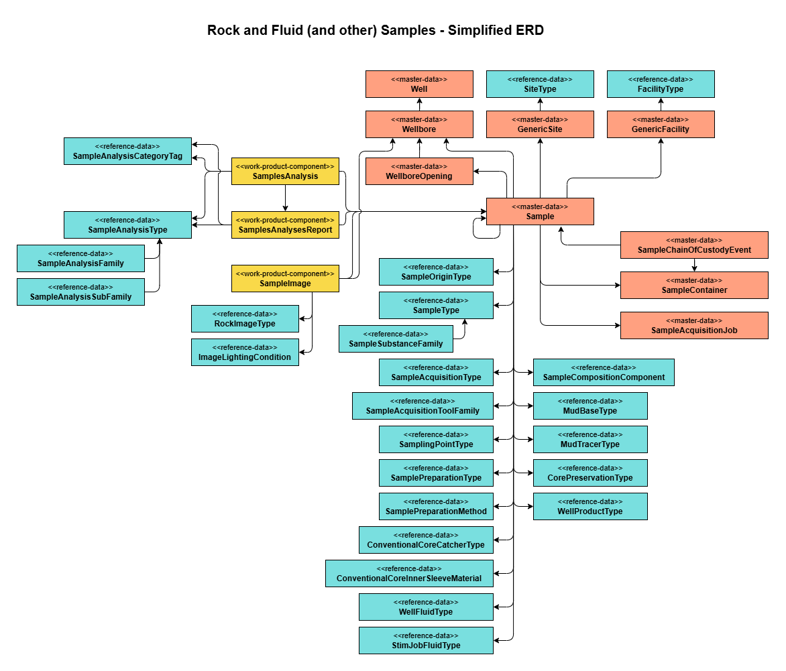
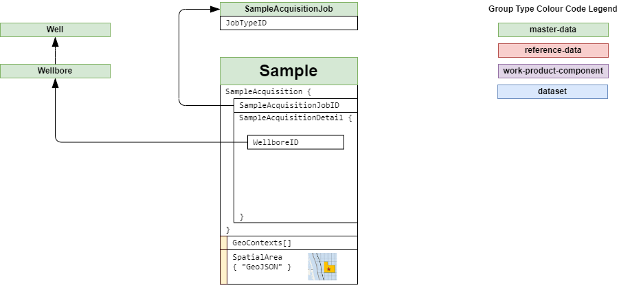
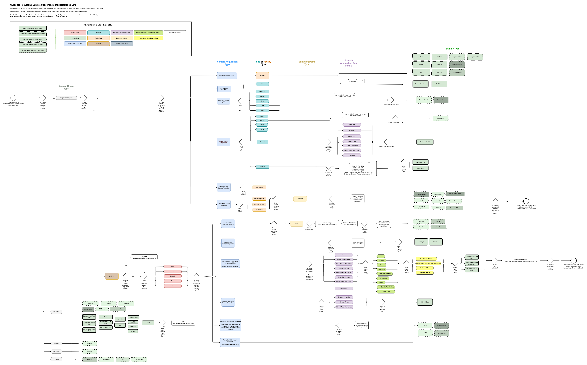
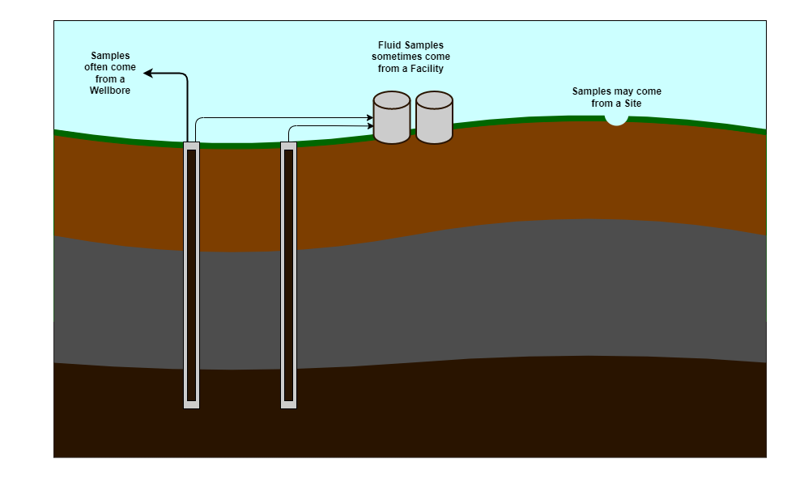
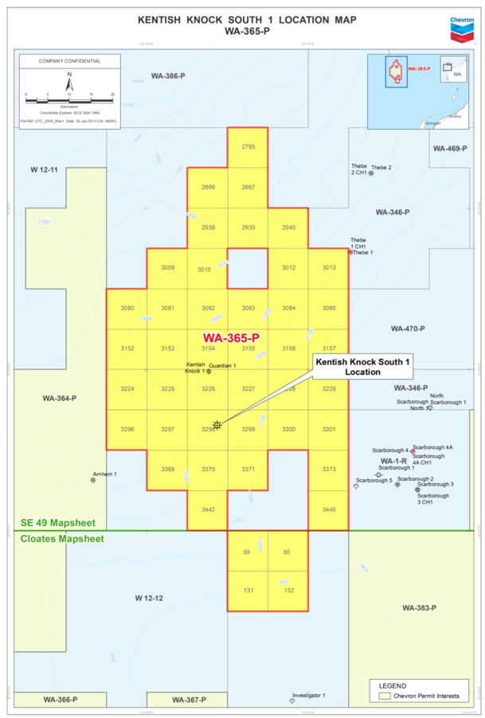

<a name="TOC"><b>Table of Contents</b></a>

[[_TOC_]]

# OSDU Unified Sample Concept (Rock, Fluids, and others)

Some industry data models strongly distinguish the inventory, acquisition, and analysis of rock sample (e.g. core) from fluid samples (e.g. oil from a formation test). In contrast, in OSDU, the Unified Sample model approach provides a common, unified, way to manage the “sample” ("specimen-to-analyze") concept for both rock and fluid sample types, as well as other materials that might be analyzed in a scientific lab (e.g., glass, metal).

The unified approach includes capturing data for the associated processes used to acquire, create, store, analyze and characterize samples. This unified model leverages the commonalities available between both rock and fluid samples as well as accounting for the differences between both sample types. A key deliverable for this approach is establishing the relationship, where applicable, between rock and fluid samples which are acquired from a single source; e.g. fluid samples extracted from core samples acquired from target formations.

The E-R diagram showing the relationships between the different objects as well as the list of all objects defined for the Unified Sample Model can be seen below :

## E-R Diagram


|  |
|:-----------------------------------------------------------------------------------------------------:|
|         **The simplified E-R Diagram**  (This png image has embedded draw.io metadata, making it editable again in its native form.)              |

## A Note about Deprecated Sample-related Schemas

Before the creation of the "unified" data model, and the development of the [RAFS (Rock and Fluid Sample) DDMS](https://community.opengroup.org/osdu/platform/domain-data-mgmt-services/rock-and-fluid-sample/rafs-ddms-services/-/wikis/home), some schemas were published in OSDU without this unified approach. As a result of the unified approach, some of those older schemas began the process of being deprecated in Jan. 2025 and should be fully deprecated in Oct. 2025. To use the newest, unified, approach, these deprecated schemas should not be used moving forward.

Schemas that should no longer be used include:

1. `RockSample` >> Use `Sample` instead
2. `Coring` >> Use `SampleAcquisitionJob` and `Sample.SampleAcquisition` instead
3. `RockSampleAnalysis` >> Use `SamplesAnalysis` and `SamplesAnalysesReport` instead
4. `RockImage` >> Use `SampleImage` instead

In October 2025 (Data Definitions Milestone M25.8 Tag v0.28.8), the following schemas were deprecated (while moving relevant concepts to `reference-data--SampleType` and other reference lists as conceptually appropriate):

- `reference-data--ConventionalCoreType`
- `reference-data--SidewallCoreType`
- `reference-data--RockSampleType`

## Unified Sample Model Schemas List

Please see explanations of these schemas and/or concepts in the separate sections below.

### Master Data Schemas

- [SampleAcquisitionJob](../../../Generated/master-data/SampleAcquisitionJob.1.0.0.json)
- [Sample](../../../Generated/master-data/Sample.3.1.0.json)
- [SampleContainer](../../../Generated/master-data/SampleContainer.1.0.0.json)
- [SampleChainOfCustodyEvent](../../../Generated/master-data/SampleChainOfCustodyEvent.1.1.0.json)

### Work Product Component Schemas

- [SamplesAnalysis](../../../Generated/work-product-component/SamplesAnalysis.2.0.0.json)
- [SamplesAnalysesReport](../../../Generated/work-product-component/SamplesAnalysesReport.1.0.0.json)
- [SampleImage](../../../Generated/work-product-component/SampleImage.1.1.0.json)

### Reference Schemas

- [SampleType ](../../../Generated/reference-data/SampleType.1.1.0.json)
- [SampleAcquisitionType](../../../Generated/reference-data/SampleAcquisitionType.1.0.0.json)
- [SampleAnalysisFamily](../../../Generated/reference-data/SampleAnalysisFamily.1.0.0.json)
- [SampleAnalysisSubFamily](../../../Generated/reference-data/SampleAnalysisSubFamily.1.0.0.json)
- [SampleAnalysisType](../../../Generated/reference-data/SampleAnalysisType.1.0.0.json)
- [SampleCompositionComponent](../../../Generated/reference-data/SampleCompositionComponent.1.0.0.json)
- [SampleContainerServiceType](../../../Generated/reference-data/SampleContainerServiceType.1.0.0.json)
- [SampleContainerType](../../../Generated/reference-data/SampleContainerType.1.0.0.json)
- [SampleOrientationType](../../../Generated/reference-data/SampleOrientationType.1.0.1.json)
- [SampleOriginType](../../../Generated/reference-data/SampleOriginType.1.0.0.json)
- [SamplePreparationMethod](../../../Generated/reference-data/SamplePreparationMethod.1.0.0.json)
- [SamplePreparationType](../../../Generated/reference-data/SamplePreparationType.1.0.0.json)
- [SampleAnalysisCategoryTag](../../../Generated/reference-data/SamplesAnalysisCategoryTag.1.0.0.json)
- [SamplingPointType](../../../Generated/reference-data/SamplingPointType.1.0.0.json)
- [MudTracerType](../../../Generated/reference-data/MudTracerType.1.0.1.json)
- [Conventional Core Catcher Type](../../../Generated/reference-data/ConventionalCoreCatcherType.1.0.0.json)
- [Conventional Core Inner Sleeve Material](../../../Generated/reference-data/ConventionalCoreInnerSleeveMaterial.1.0.0.json)
- [Sample Acquisition Tool Family](../../../Generated/reference-data/SampleAcquisitionToolFamily.1.0.0.json)
- [Sample Substance Family](../../../Generated/reference-data/SampleSubstanceFamily.1.0.0.json)


### Reference Values

- [SampleType](../../../ReferenceValues/Published/SampleType.1.xlsx)
- [SampleAcquisitionType](../../../ReferenceValues/Published/SampleAcquisitionType.1.xlsx)
- [SampleAnalysisFamily](../../../ReferenceValues/Published/SampleAnalysisFamily.1.xlsx)
- [SampleAnalysisSubFamily](../../../ReferenceValues/Published/SampleAnalysisSubFamily.1.xlsx)
- [SampleAnalysisType](../../../ReferenceValues/Published/SampleAnalysisType.1.xlsx)
- [SampleCompositionComponent](../../../ReferenceValues/Published/SampleCompositionComponent.1.xlsx)
- [SampleContainerServiceType](../../../ReferenceValues/Published/SampleContainerServiceType.1.xlsx)
- [SampleContainerType](../../../ReferenceValues/Published/SampleContainerType.1.xlsx)
- SampleOrientationType
- [SampleOriginType](../../../ReferenceValues/Published/SampleOriginType.1.xlsx)
- [SamplePreparationMethod](../../../ReferenceValues/Published/SamplePreparationMethod.1.xlsx)
- [SamplePreparationType](../../../ReferenceValues/Published/SamplePreparationType.1.xlsx)
- [SampleAnalysisCategoryTag](../../../ReferenceValues/Published/SamplesAnalysisCategoryTag.1.xlsx)
- [SamplingPointType](../../../ReferenceValues/Published/SamplingPointType.1.xlsx)
- [CustodyEventType](../../../ReferenceValues/Published/CustodyEventType.1.xlsx)
- [MudTracerType](../../../ReferenceValues/Published/MudTracerType.1.xlsx)
- [ConventionalCoreCatcherType](../../../ReferenceValues/Published/ConventionalCoreCatcherType.1.xlsx)
- [ConventionalCoreInnerSleeveMaterial](../../../ReferenceValues/Published/ConventionalCoreInnerSleeveMaterial.1.xlsx)
- [SampleAcquisitionToolFamily](../../../ReferenceValues/Published/SampleAcquisitionToolFamily.1.xlsx)
- [SampleSubstanceFamily](../../../ReferenceValues/Published/SampleSubstanceFamily.1.xlsx)

# Sample Container

The sample container is used in storing samples generated or acquired through some sample creation process (e.g. initial acquisition events / operations, sample recombination processes, sub sampling processes, etc.). Sample containers are usually associated with the lifecycle of the sample and could change over time especially during chain of custody events. Sample containers, especially for fluids, will also typically undergo a certification process to determine their viability for both storage and transportation. Information about the certification process are part of the collection of attributes stored within the sample container data object.

Typical attributes captured within the sample container object includes the manufacturers, make, and model, capacity, construction material, operating condition rating, certification process, container type, container service type, service dates, owners.

# Sample Acquisition

The sample acquisition process is a critical piece in modelling the Unified Sample object. It seeks to provide information and understanding on the sample acquisition method used, acquisition parameters recorded during sample retrieval, site from which the sample was acquired, equipment used, quality control applied as well as other relevant information needed for the subsequent laboratory analysis. There are two (2) master data objects primarily responsible for modelling the acquisition process – `master-data--SampleAcquisitionJob` and `SampleAcquisition` events that are a part of `master-data--Sample`. The information here provides information about the Sample Acquisition Job object.

The **sample acquisition job** is an overarching project containing a series of activities capable of handling acquisition of samples using varied sample acquisition events. High level information about the project, its description, operator, and service companies involved are captured within this object definition. An important note here is that the model accommodates a single acquisition job having multiple acquisition events of varying types e.g. a single acquisition job used for both conventional core sample acquisition events as well as formation sample acquisition events.

**Sample Acquisition** is a nested object within the `Sample` schema. It captures information about the acquisition of the sample from the original source location from which it was obtained, before subsequent sub-sampling and analysis. This set of attributes should only be used when associating the sample with an acquisition event from its original source and not for sub-sampling or derivative sources.

# Sample

|                        |
|:----------------------------------------------------------------------------------:|
| A Sample acquired in a Wellbore (This png image has embedded draw.io instructions) |

The `Sample` schema represents a physical rock or fluid, (or other specimen) such as a core slab, a core plug, rock cuttings, or a vial of oil.

The sample is classified by various attributes and reference lists such as `SampleType`. This is because physical specimens come from different sources, via different methods, with different tools, with different accompanying fluids, and are often modified/prepared for subsequent processes. In many cases, various smaller specimens come from larger specimens via cutting, crushing, or other methods. For example, a conventional core section is cut into a slab, a plug is drilled from that slab, and an endtrim is cut from that plug. In some cases two batches of specimens are recombined.

The `Sample` schema is used for **any** of these kinds of samples/specimens, and the chain of relationship of these _physical_ specimens to each other is captured via `ParentSampleIDs`.

## Thought-Flow Diagram For Classifying Samples

|                        |
|:----------------------------------------------------------------------------------:|
| A thought-flow for classifying Samples with reference data. (This png image has embedded draw.io instructions) |

## Sample Creation Process

Look for `SampleOriginTypeID` to identify this.

The sample at hand may be original as-acquired, or it might be a smaller portion of the original, a chemical derivation of the original, a combination of multiple samples, or a synthetic lab-creation that approximates the natural sample.

In fluids, aliquoting of samples is the process of extracting a piece of a sample while ensuring the smaller sample extracted has the same chemical composition and properties of the larger sample; It has been sub-sampled. However, if the fluid changes chemically and is not an aliquot, it is "derived" rather than "sub-sampled".

For rock sample sub-sampling, as mentioned elsewhere, a conventional whole core section can be cut into a slab, a plug can be drilled from that slab, and an endtrim can be cut from that plug.

### Sample Preparation

At various times in their life cycle, rock and fluid samples are prepared for subsequent steps via slicing, crushing, cleaning, acidizing, washing, drying, and more. The properties referring to reference lists `SamplePreparationMethod` and `SamplePreparationType` help capture this information, as it can affect the interpretation of sample lab analysis.

### Initial Sample Acquisition Events

_Please see the Thought Flow above, and Sample Acquisition Location and Sample Acquisition Type below._

### Sample Recombination

Look for `SampleOriginTypeID` to identify this.

Sample recombination is a process which involves combining fractions of different samples to create a new sample. Examples of scenarios where samples area created through recombination process can be seen below:
- Oil and gas fluid samples obtained from separators or production streams could be recombined at certain conditions to emulate reservoir operating conditions. This sample could then be subjected to further PVT analysis to get a better understanding of fluid regime within the reservoirs from which the parent samples were obtained.
- Creation of synthetic fluid samples. A synthetic sample is one that is created by a recombination of fluids that are not necessary collected from production stream directly. For example, if you replace a separator gas sample with a mixture of pure component gas such as C1, C2, C3 in the lab to mimic the separator gas sample, then you will end up with a synthetic fluid. In other words, if you create mixtures of pure gases and liquids in the lab to either mimic sample obtained directly from production streams, then you will end up with a synthetic sample.

Within the Sample model, there is a nested RecombinationSpecification object which captures information pertaining to the parent samples and associated fractions (volumetric, mass or molar) used in the recombination process, the recombination conditions. (pressure and temperature) as well as the expected / target composition for the final sample created.
Note: If using the recombination method in creating a sample, ensure the SampleOriginTypeID reference value used within the Sample object is set to either SYNTHETIC or RECOMBINED.

Sample Recombination Scenario usage within the Sample object can be seen below:
- Example 1: Synthetic Fluid sample created from 2 or more samples
- Example 2: Fluid sample created from 2 or more samples obtained from direct production streams.

### Sample Extraction

Look for `SampleOriginTypeID` to identify this.

This is mostly focused on the extraction of fluid samples from rock samples.

### Sub-Sampling

Look for `SampleOriginTypeID` to identify this.

This is the process of extracting a piece of a sample while ensuring the smaller sample extracted has the same chemical composition and properties of the larger sample. Aliquoting of samples is a perfect example of the sub-sampling process in action.

## Sample Depths

As of Sample.3.1.0, there are two locations where depth-related data is stored within Sample:
- at the 'root' level of Sample within the data.DepthMeasurements array object.  This is the primary location for the depth data of the sample, or subsample, represented by the Sample record.  The depths may differ from the acquisition depths, which could be representative of a parent plug or other sample.
- within SampleAcquisition.VerticalMeasurements.  This pertains specifically for the depths recorded at the acquisition of the original sample.  In many cases this will be consistent with the root level.


## Sample Acquisition Location

Look for `WellboreID` or `SiteID` to identify one of the three types of acquisition locations:

- Wellbore (`master-data--Wellbore`)
- Non-wellbore Facility (`master-data--GenericFacility`, with `FacilityType`)
- Natural Site (`master-data--GenericSite`, with `SiteType`)





## Sample Acquisition Type

Look for `SampleAcquisitionTypeID` to identify the following in a `Sample` data record. (Also, consider the Thought Flow diagram above to consider how the Sample Acquisition relates to other Sample classifications.)

The Sample acquisition events refers to the various types of acquisition events or approaches used in retrieving either rock or fluid samples. OSDU maintains a reference list of the different types of sample acquisition events: `SampleAcquisitionType`.

It should be noted that different types of acquisition events will model different acquisition parameters. However, there are parameters that are common across board such as the Acquisition Condition (Pressure and Temperature). Within the OSDU data model, the Sample Acquisition parameters are stored within nested objects (`SampleAcquisition`->`SampleAcquisitionDetail`) in the Sample object.

Itemized below are the different types of sample acquisition events and the typical attributes provided that support their use case.

### Formation Testing Fluid Sample Acquisition Event

Formation testing activities provide pressure measurements at different depths as well as **fluid** samples which when analyzed provide information that can be used in understanding the pressure profile within the formation as well as characterizing aspects of the target formation. Typical parameters captured during sample formation testing acquisition events include VerticalMeasurements, TopDepth, BaseDepth, WellboreID, FormationCondition (Pressure and Temperature), SampleCarrierSlotName, ToolSectionName, GrossFluidKindID, Acquisition GOR and AcquisitionCondition (Pressure and Temperature). For more information on the definition, refer to the SampleAcquisition->SampleAcquisitionDetail nested object under the Sample object.


### Downhole Fluid Sample Acquisition

This is focused on acquiring **fluid** samples from already completed wells. The production streams from these wells could either come from completions within specific wellbore contact intervals (perforated or open hole). Special sampling tools are run down the well on wireline in order to extract the fluids produced from a completed interval. Typical parameters captured as part of the bottom hole sampling event include: VerticalMeasurements, TopDepth, BaseDepth, WellboreID, ContributingWellboreOpeningIDs, ToolKind, RunNumber, FormationCondition (Pressure and Temperature), Acquisition GOR and AcquisitionCondition (Pressure and Temperature).  For more information on the definition, refer to the SampleAcquisition->SampleAcquisitionDetail nested object under the Sample object.


### Wellhead Fluid Sample Acquisition

This is focused on acquiring **fluid** samples from production streams from a well using a flow port available at the wellhead. Depending on the completion and production configuration, this type of acquisition can handle samples acquired from both single or comingled (multiple completion intervals) production streams. Typical parameters captured as part of the wellhead sampling event include: WellboreID, ContributingWellboreOpeningIDs, WellheadOperatingCondition (Pressure and Temperature), SamplingPoint, FormationCondition (Pressure and Temperature), Acquisition GOR and AcquisitionCondition (Pressure and Temperature).  For more information on the definition, refer to the SampleAcquisition->SampleAcquisitionDetail nested object under the Sample object.


### Separator Fluid Sample Acquisition

This acquisition event type takes place at the separator and is used for **gas condensates and saturated oil streams**.  Typical parameters captured as part of the separator sampling event include: WellboreID, ContributingWellboreOpeningIDs, SeparatorOperatingCondition (Pressure and Temperature), SamplingPoint, FormationCondition (Pressure and Temperature), Acquisition GOR and AcquisitionCondition (Pressure and Temperature), CorrectedOilRate, CorrectedGasRate, CorrectedWaterRate, MeasuredOilRate, MeasuredGasRate, MeasuredWaterRate and CorrectionRemarks. For more information on the definition, refer to the SampleAcquisition->SampleAcquisitionDetail nested object under the Sample object.


### Facility Fluid Sample Acquisition

This **fluid **acquisition event takes place at any topside facility within the production chain. Typical parameters captured as part of the separator sampling event include: FacilityEquipmentOperatingCondition (Pressure and Temperature), SamplingPoint, SiteID, Acquisition GOR and AcquisitionCondition (Pressure and Temperature).  Note that the SiteID should be of OSDU reference data type “GenericFacility”. For more information on the definition, refer to the SampleAcquisition->SampleAcquisitionDetail nested object under the Sample object.


### Conventional Coring Rock Sample Acquisition

This references the downhole acquisition event type for a conventional core sample acquired from a coring operation using a coring bit and coring barrel. Typical parameters captured as part of the conventional coring event include: VerticalMeasurements, TopDepth, BaseDepth, ToolKind, RunNumber, WellboreID, FormationCondition, ToolSectionName, SampleRecoveredLengthPlanned, SampleRecoveredLengthActual, PreservationTypeID, AcquisitionCondition (Pressure and Temperature), MudBaseTypeID and MudTracerTypeID.  For more information on the definition, refer to the SampleAcquisition->SampleAcquisitionDetail nested object under the Sample object.


### Sidewall Coring Rock Sample Acquisition

This references the downhole acquisition event type for a sidewall core sample acquired from a coring operation. Typical parameters captured as part of the sidewall coring event include: VerticalMeasurements, TopDepth, BaseDepth, ToolKind, RunNumber, WellboreID, FormationCondition, ToolSectionName, SampleRecoveredLengthPlanned, SampleRecoveredLengthActual, PreservationTypeID, AcquisitionCondition (Pressure and Temperature), MudBaseTypeID and MudTracerTypeID.  For more information on the definition, refer to the SampleAcquisition->SampleAcquisitionDetail nested object under the Sample object.


### Cuttings Rock Sample Acquisition

This references the downhole acquisition event type for a cuttings sample acquired from a wellbore through rotary, percussion, or auger methods during drilling operations. Typical parameters captured as part of the cuttings acquisition event include: VerticalMeasurements, TopDepth, BaseDepth, ToolKind, RunNumber, WellboreID, FormationCondition, ToolSectionName, PreservationTypeID, AcquisitionCondition (Pressure and Temperature), MudBaseTypeID and MudTracerTypeID.  For more information on the definition, refer to the SampleAcquisition->SampleAcquisitionDetail nested object under the Sample object.


### Mining Sample Acquisition
An acquisition event type involving the collection of specimens/samples from mining activities that extract minerals from the earth.

### Water Body Sample Acquisition
An acquisition event type involving the collection of specimens/samples from the surface or midst of the body of water (e.g., oil slick), but not from its bottom.

### Surface Sample Acquisition
This replaced and expanded the deprecated "Surface Sediment Acquisition" and "Outcrop Sample Acquisition".

An acquisition event type involving the collection of specimens/samples of rock, sediment, or fluid from the surface of the earth - either exposed dry land (e.g., outcrop), or from the base of a water body (e.g., seabed).

### Other Sample Acquisition
An acquisition event type not otherwise captured by this list.

# Chain of Custody Event
This provides historical information on the events that affect the physical sample, such as sub-sampling, or changing storage container or storage location.

It has been adapted to OSDU from Energistics PRODML.

# Samples Analyses Report
 The `SamplesAnalysesReport` work-product-component is intended to catalog:
 - a document (e.g. PDF, Excel, etc.) that is delivered in its full form and contains more than one type of rock and/or fluid analysis, or...
 - a data file that contains more than one type of rock and/or fluid analysis (e.g. PRODML).

Often it also references more than rock or fluid sample, and sometimes references even more than one wellbore. Such a document may be only a few pages or hundreds of pages or data frames.

If data is delivered in a form where it contains only one `SampleAnalysisType` from one site/facility/wellbore, then `SamplesAnalyesReport` is optional and unneeded; Instead, only `work-product-component--SamplesAnalysis` can be used.

On the other hand, if a `SamplesAnalysesReport` is needed, a best practice is to create more than one `work-product-component--SamplesAnalysis`, where each one represents a single SampleAnalysisType dataset within the parent report, and with each one relating back to its parent SampleAnalysisReport via the section `data.ParentSamplesAnalysesReports[]`.

# Samples Analysis
In contrast to `SamplesAnalysesReport`, the `SamplesAnalysis` work-product-component is intended to catalog a single dataset of a single `SampleAnalysisType`, such as routine core analysis, electrical properties, constant composition expansion, or GCMS.

Previous schema versions technically allowed an array of `SampleAnalysisTypes` to accommodate edge cases, but this caused more confusion than good, so starting with `SamplesAnalysis.2.0.0`, the schema enforces a single `SampleAnalysisType`.

Consistent with this, the RAFS (Rock and Fluids) DDMS expects a single `SampleAnalysisType` in order to provide a content schema structure appropriate to the `SampleAnalysisType`. (See the following section, "Samples Analysis Content" for more.)

As mentioned with `SamplesAnalysesReport`, sometimes a `SamplesAnalysis` record will have a file of its own, representing its dataset. In other cases, a `SamplesAnalysis` record will reference a parent `SamplesAnalysesReport` and the location in that original report where the current dataset can be found. These references and relationships can be established in an ingestion and/or enrichment process.

## Samples Analysis Content
In the OSDU Data Platform, data content (as opposed to a data catalog record/metadata), can be captured various ways.

1. In rare cases, no content/file is necessary. All data needed is captured in the OSDU well known schema.
2. Sometimes a file is attached via `Datasets`
3. Sometimes an optimized dataset is related via `DDMSDatasets`

When content must be captured and a DDMS exists, the DDMS option is the optimal solution recommended by the OSDU Forum.

(See the OSDU Schema Usage Guide for more on this.)

For Rock and Fluid Samples (RAFS), there is a RAFS DDMS. This DDMS supports more than 40 Sample Analysis Types via structured schemas and optimized indexing and storage.

Learn more in the [RAFS DDMS wiki](https://community.opengroup.org/osdu/platform/domain-data-mgmt-services/rock-and-fluid-sample/rafs-ddms-services/-/wikis/home) and associated pages.

# Transitioning to the Unified Sample Data Model
See "A Note about Deprecated Sample-related Schemas" above.

# Example Documentation

:warning: **WARNING**

_The examples in the following "Details" expansion section are outdated. They are kept here for now as indicative of how example data may be used to populate a similar schema, but the guidance here, such as using `RockSampleAnalysis` and the `Document` WPC is no longer valid._

<details>

The examples are built based on the [Basic_WCR_Kentish_Knock_South_1_Rev_0.pdf](https://gitlab.opengroup.org/osdu/subcommittees/data-def/projects/Petrophysics/docs/-/blob/master/Design%20Documents/Kentish%20Knock%20South%201%20-%20Example%20Well/Basic_WCR_Kentish_Knock_South_1_Rev_0.pdf)
located int the Petrophysics work-stream repository in the OSDU Member GitLab. The document itself is represented by a
generic `work-product-component--Document` referring to a `dataset--File.Generic` as PDF.

<details>
<summary markdown="span">Completion Report, <code>dataset--File.Generic</code> example.</summary>

<OsduImportJSON>[Generic File (PDF), Full record](../RockSampleAnalysis/dataset/File.Generic-KKS1-Report.json#only.data)</OsduImportJSON>

```json
{
  "data": {
    "Name": "Kentish Knock South 1, Initial Well Completion Report Carnarvon Basin: WA-365-P (R1)",
    "Description": "Compiled By: Reservoir Management Services; Document ID: ABU130500045; Issue Date: 2013-07-30.",
    "TotalSize": "111433500",
    "EncodingFormatTypeID": "partition-id:reference-data--EncodingFormatType:application%2Fpdf:",
    "DatasetProperties": {
      "FileSourceInfo": {
        "FileSource": "s3://chevron-data/wcr/Carnarvon/Kentish_Knock_South_1_WCR_Basic_Data_Rev_0.pdf",
        "PreloadFilePath": "https://gitlab.opengroup.org/osdu/subcommittees/data-def/projects/Petrophysics/docs/-/blob/master/Design%20Documents/Kentish%20Knock%20South%201%20-%20Example%20Well/Kentish_Knock_South_1_WCR_Basic_Data_Rev_0.pdf",
        "Name": "Kentish_Knock_South_1_WCR_Basic_Data_Rev_0.pdf",
        "FileSize": "111433500"
      }
    }
  }
}
```
</details>

<details>

<summary markdown="span">Completion Report, <code>work-product-component--Document</code> example.</summary>

<OsduImportJSON>[Document WPC, Full record](../RockSampleAnalysis/work-product-component/Document-CompletionReport-KKS1.json#only.data)</OsduImportJSON>

```json
{
  "data": {
    "TechnicalAssuranceID": "partition-id:reference-data--TechnicalAssuranceType:Certified:",
    "Datasets": [
      "partition-id:dataset--File.Generic:WellCompletionReport-KentishKnockSouth1-WA-365-P--R1:"
    ],
    "Artefacts": [],
    "Name": "Kentish Knock South 1, Initial Well Completion Report Carnarvon Basin: WA-365-P (R1)",
    "Description": "Document ID: ABU130500045 Rev 0",
    "CreationDateTime": "2020-02-13T09:13:15.55Z",
    "Tags": [
      "Example Tags"
    ],
    "SpatialPoint": {
      "AsIngestedCoordinates": {
        "type": "AnyCrsFeatureCollection",
        "CoordinateReferenceSystemID": "partition-id:reference-data--CoordinateReferenceSystem:BoundProjected:EPSG::28349_EPSG::1150:",
        "persistableReferenceCrs": "{\"authCode\":{\"auth\":\"OSDU\",\"code\":\"28349001\"},\"lateBoundCRS\":{\"authCode\":{\"auth\":\"EPSG\",\"code\":\"28349\"},\"name\":\"GDA_1994_MGA_Zone_49\",\"type\":\"LBC\",\"ver\":\"PE_10_9_1\",\"wkt\":\"PROJCS[\\\"GDA_1994_MGA_Zone_49\\\",GEOGCS[\\\"GCS_GDA_1994\\\",DATUM[\\\"D_GDA_1994\\\",SPHEROID[\\\"GRS_1980\\\",6378137.0,298.257222101]],PRIMEM[\\\"Greenwich\\\",0.0],UNIT[\\\"Degree\\\",0.0174532925199433]],PROJECTION[\\\"Transverse_Mercator\\\"],PARAMETER[\\\"False_Easting\\\",500000.0],PARAMETER[\\\"False_Northing\\\",10000000.0],PARAMETER[\\\"Central_Meridian\\\",111.0],PARAMETER[\\\"Scale_Factor\\\",0.9996],PARAMETER[\\\"Latitude_Of_Origin\\\",0.0],UNIT[\\\"Meter\\\",1.0],AUTHORITY[\\\"EPSG\\\",28349]]\"},\"name\":\"GDA94 * EPSG-Aus / Map Grid of Australia zone 49 [28349,1150]\",\"singleCT\":{\"authCode\":{\"auth\":\"EPSG\",\"code\":\"1150\"},\"name\":\"GDA_1994_To_WGS_1984\",\"type\":\"ST\",\"ver\":\"PE_10_9_1\",\"wkt\":\"GEOGTRAN[\\\"GDA_1994_To_WGS_1984\\\",GEOGCS[\\\"GCS_GDA_1994\\\",DATUM[\\\"D_GDA_1994\\\",SPHEROID[\\\"GRS_1980\\\",6378137.0,298.257222101]],PRIMEM[\\\"Greenwich\\\",0.0],UNIT[\\\"Degree\\\",0.0174532925199433]],GEOGCS[\\\"GCS_WGS_1984\\\",DATUM[\\\"D_WGS_1984\\\",SPHEROID[\\\"WGS_1984\\\",6378137.0,298.257223563]],PRIMEM[\\\"Greenwich\\\",0.0],UNIT[\\\"Degree\\\",0.0174532925199433]],METHOD[\\\"Position_Vector\\\"],PARAMETER[\\\"X_Axis_Translation\\\",0.0],PARAMETER[\\\"Y_Axis_Translation\\\",0.0],PARAMETER[\\\"Z_Axis_Translation\\\",0.0],PARAMETER[\\\"X_Axis_Rotation\\\",0.0],PARAMETER[\\\"Y_Axis_Rotation\\\",0.0],PARAMETER[\\\"Z_Axis_Rotation\\\",0.0],PARAMETER[\\\"Scale_Difference\\\",0.0],OPERATIONACCURACY[3.2],AUTHORITY[\\\"EPSG\\\",1150]]\"},\"type\":\"EBC\",\"ver\":\"PE_10_9_1\"}",
        "features": [
          {
            "type": "AnyCrsFeature",
            "geometry": {
              "type": "AnyCrsPoint",
              "coordinates": [
                689960.85,
                7811747.53
              ]
            },
            "properties": {}
          }
        ]
      },
      "Wgs84Coordinates": {
        "type": "FeatureCollection",
        "features": [
          {
            "type": "Feature",
            "geometry": {
              "type": "Point",
              "coordinates": [
                112.81324757107716,
                -19.7808907610266
              ]
            },
            "properties": {}
          }
        ]
      },
      "AppliedOperations": [
        "conversion from GDA_1994_MGA_Zone_49 to GCS_GDA_1994; 1 points converted",
        "transformation GCS_GDA_1994 to GCS_WGS_1984 using GDA_1994_To_WGS_1984; 1 points successfully transformed"
      ]
    },
    "GeoContexts": [
      {
        "GeoPoliticalEntityID": "partition-id:master-data--GeoPoliticalEntity:3298:",
        "GeoTypeID": "partition-id:reference-data--GeoPoliticalEntityType:BlockID:"
      },
      {
        "BasinID": "partition-id:master-data--Basin:Carnarvon:",
        "GeoTypeID": "partition-id:reference-data--BasinType:PassiveMargin:"
      },
      {
        "FieldID": "partition-id:master-data--Field:Gorgon:",
        "GeoTypeID": "Field"
      }
    ],
    "SubmitterName": "Chevron Australia Pty Ltd",
    "BusinessActivities": [
      "Drilling"
    ],
    "AuthorIDs": [
      "Daniel van der Aa",
      "Phil Allen"
    ],
    "LineageAssertions": [
      {
        "ID": "partition-id:master-data--Wellbore:KKS1:",
        "LineageRelationshipType": "partition-id:reference-data--LineageRelationshipType:Reference:"
      },
      {
        "ID": "partition-id:master-data--Coring:KKS1-Core-1:",
        "LineageRelationshipType": "partition-id:reference-data--LineageRelationshipType:Reference:"
      },
      {
        "ID": "partition-id:master-data--Coring:KKS1-Core-2:",
        "LineageRelationshipType": "partition-id:reference-data--LineageRelationshipType:Reference:"
      },
      {
        "ID": "partition-id:master-data--Coring:KKS1-Core-3:",
        "LineageRelationshipType": "partition-id:reference-data--LineageRelationshipType:Reference:"
      },
      {
        "ID": "partition-id:master-data--Coring:KKS1-SidewallCoring-1-26:",
        "LineageRelationshipType": "partition-id:reference-data--LineageRelationshipType:Reference:"
      }
    ],
    "DocumentTypeID": "partition-id:reference-data--DocumentType:CompletionReport:",
    "NumberOfPages": 1082,
    "SubTitle": "Document ID: ABU130500045 Rev 0",
    "DocumentSubject": "Kentish Knock South 1 Initial Well Completion Report",
    "DatePublished": "2013-07-30",
    "DocumentLanguage": "English",
    "ExtensionProperties": {}
  }
}
```
</details>

</details>

#### Figure 1. Location Map

