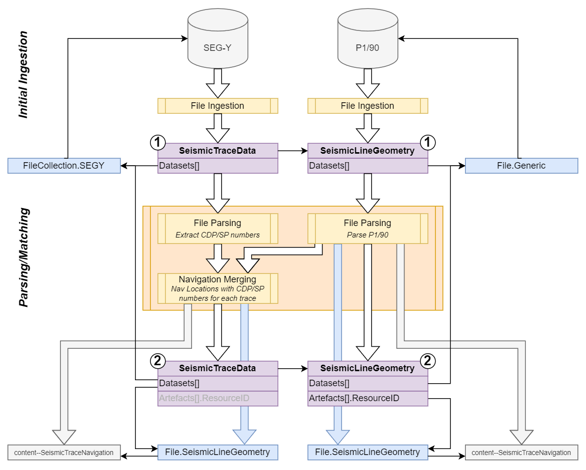
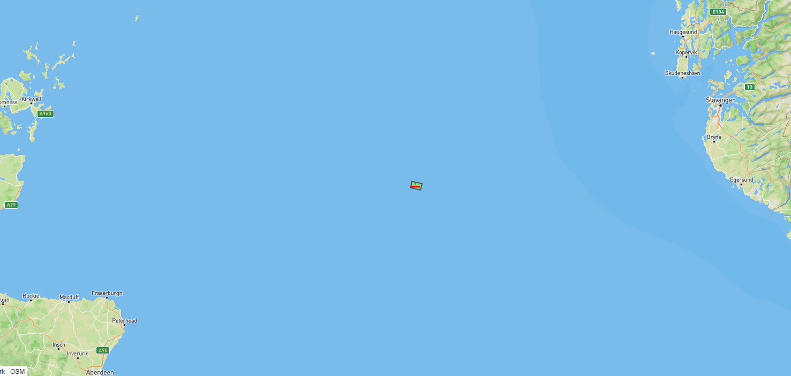
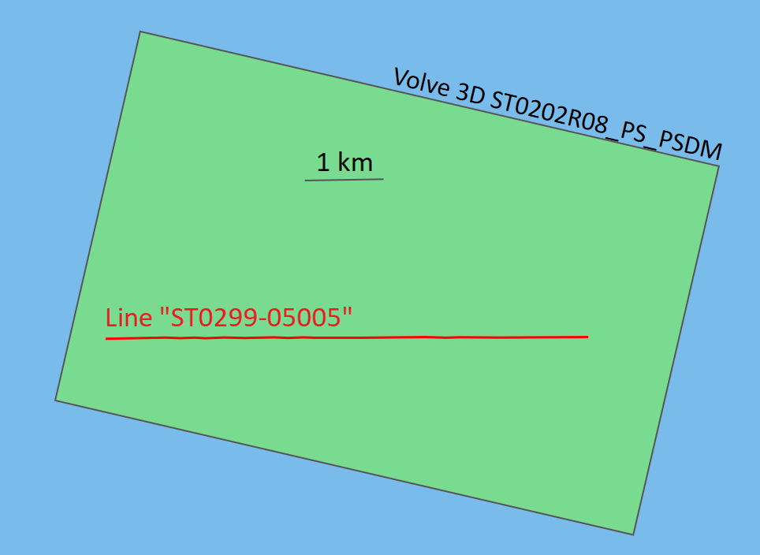
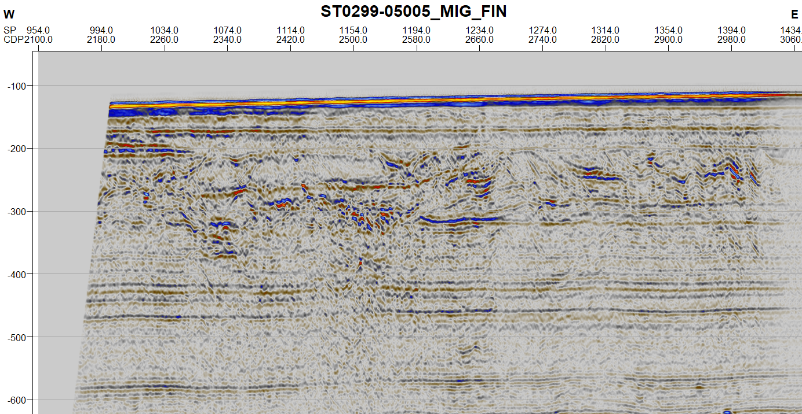

<a name="TOC"></a> **Table Of Contents**

[[_TOC_]]

# Seismic Line Geometry 'Content'

This user story is based on original Volve data. The data in the published manifests for test data loading show
interesting, real-life data management challenges - read inconsistencies - which need to be resolved before the data can
be consumed by applications. The data have been copied into this example area because the original open test data
manifests contain artefacts confusing in this user story context and may get corrected.

## OpenTestData

Taking the Open Test Data for Volve as example case with a SEG-Y file and a separate navigation file:

### 1. SEG-Y `ST0299-05005+MIG_FIN.segy`

   ([OpenTestData location](https://community.opengroup.org/osdu/data/open-test-data/-/blob/master/rc--3.0.0/4-instances/Volve/work-products/seismics_1_2_0/load_ST0299-05005%2BMIG_FIN-segy.json#L136-142))
   claims to have 1034 traces, in reality there are only 984 when downloading the SEG-Y from s3. First shot point (1001)
   and first CMP (2100) are correct. The CRS seems correct, Norwegian sector, South of 62 degrees North
   (BoundProjected:EPSG::23031_EPSG::1613).

### 2. The matching seismic navigation file is `ST0299-CMP-05005.p190`

   ([OpenTestData location](https://community.opengroup.org/osdu/data/open-test-data/-/blob/master/rc--3.0.0/4-instances/Volve/work-products/seismics_1_2_0/load_ST0299-05005%2BMIG_FIN_segp1.json#L246-251)).
   The advertised FirstCMP is in fact the first shot point (1001)
   ([OpenTestData](https://community.opengroup.org/osdu/data/open-test-data/-/blob/master/rc--3.0.0/4-instances/Volve/work-products/seismics_1_2_0/load_ST0299-05005%2BMIG_FIN_segp1.json#L136-137))
   The coordinate reference system is the one for the UK sector (BoundProjected:EPSG::23031_EPSG::1133) and different
   from the SEG-Y file's CRS. The navigation file confirms `H1400 GEODETIC DATUM SURVEYED   ED50(NOR)S62` with the
   7-parameter values for EPSG::1613.

## Initial Ingestion

### 3. Manifest-based ingestion

It is possible to use manifest based ingestion to register the work-product-components/dataset pairs using the resources in the OpenTestData for
   1. SEG-Y: [ST0299-05005+MIG_FIN.segy](https://community.opengroup.org/osdu/data/open-test-data/-/blob/master/rc--3.0.0/4-instances/Volve/work-products/seismics_1_2_0/load_ST0299-05005%2BMIG_FIN-segy.json#L136-142)
   2. Navigation: [ST0299-CMP-05005.p190](https://community.opengroup.org/osdu/data/open-test-data/-/blob/master/rc--3.0.0/4-instances/Volve/work-products/seismics_1_2_0/load_ST0299-05005%2BMIG_FIN_segp1.json)

### 4. Ingestion Outcome

This concludes the initial ingestion as per (1) in the diagram below:
   1. a [work-product-component--SeismicLineGeometry](work-product-component/SeismicLineGeometry-1.json) referring to the p190 ([content record](content/ST0299-CMP-05005.p190)) file via [dataset--File.Generic](dataset/File.Generic-p190.json);
   2. a [work-product-component--SeismicTraceData record](work-product-component/SeismicTraceData-1.json) referring to a [dataset--FileCollection.SEGY](dataset/FileCollection.SEGY.json).



---

[Back to TOC](#TOC)

## Parsing/Matching

Generally, the navigation provided by the surveyors is the trusted position information and needs to be aligned with the
SeismicTraceData trace numbering and trace locations. Parsing the original files, SEG-Y traces and navigation in step
(2) achieves this. But first, some conflicts have to be resolved:

### 5. SeismicLineGeometry CRS

The p1/90 claims that the numbers are CMP numbers `H0800 CO-ORDINATE LOCATION      CMP Position` - the numbers, however
match the SEG-Y files' shot point numbers (byte 17). The parsing must therefore accept the correction from CMP to shot
point numbering, i.e., the location card key `C` must be changed to a `S`, or parsed as `S`. Roughly only every 5th shot
point is represented with a position. Shot point range is 1001-1468, in total 468 shot points.

### 6. SeismicLineGeometry CRS Correction

The SeismicLineGeometry CRS needs to be corrected to the same value as the SEG-Y SeismicTraceData.

<details>

<summary markdown="span">SeismicLineGeometry CRS, corrected</summary>

<OsduImportJSON>[SeismicLineGeometry, Full record](work-product-component/SeismicLineGeometry-2.json#only.data.SpatialArea.AsIngestedCoordinates.CoordinateReferenceSystemID|persistableReferenceCrs)</OsduImportJSON>

```json
{
  "data": {
    "SpatialArea": {
      "AsIngestedCoordinates": {
        "CoordinateReferenceSystemID": "partition-id:reference-data--CoordinateReferenceSystem:BoundProjected:EPSG::23031_EPSG::1613:",
        "persistableReferenceCrs": "{\"authCode\":{\"auth\":\"OSDU\",\"code\":\"23031024\"},\"lateBoundCRS\":{\"authCode\":{\"auth\":\"EPSG\",\"code\":\"23031\"},\"name\":\"ED_1950_UTM_Zone_31N\",\"type\":\"LBC\",\"ver\":\"PE_10_9_1\",\"wkt\":\"PROJCS[\\\"ED_1950_UTM_Zone_31N\\\",GEOGCS[\\\"GCS_European_1950\\\",DATUM[\\\"D_European_1950\\\",SPHEROID[\\\"International_1924\\\",6378388.0,297.0]],PRIMEM[\\\"Greenwich\\\",0.0],UNIT[\\\"Degree\\\",0.0174532925199433]],PROJECTION[\\\"Transverse_Mercator\\\"],PARAMETER[\\\"False_Easting\\\",500000.0],PARAMETER[\\\"False_Northing\\\",0.0],PARAMETER[\\\"Central_Meridian\\\",3.0],PARAMETER[\\\"Scale_Factor\\\",0.9996],PARAMETER[\\\"Latitude_Of_Origin\\\",0.0],UNIT[\\\"Meter\\\",1.0],AUTHORITY[\\\"EPSG\\\",23031]]\"},\"name\":\"ED50 * EPSG-Nor S62 2001 / UTM zone 31N [23031,1613]\",\"singleCT\":{\"authCode\":{\"auth\":\"EPSG\",\"code\":\"1613\"},\"name\":\"ED_1950_To_WGS_1984_24\",\"type\":\"ST\",\"ver\":\"PE_10_9_1\",\"wkt\":\"GEOGTRAN[\\\"ED_1950_To_WGS_1984_24\\\",GEOGCS[\\\"GCS_European_1950\\\",DATUM[\\\"D_European_1950\\\",SPHEROID[\\\"International_1924\\\",6378388.0,297.0]],PRIMEM[\\\"Greenwich\\\",0.0],UNIT[\\\"Degree\\\",0.0174532925199433]],GEOGCS[\\\"GCS_WGS_1984\\\",DATUM[\\\"D_WGS_1984\\\",SPHEROID[\\\"WGS_1984\\\",6378137.0,298.257223563]],PRIMEM[\\\"Greenwich\\\",0.0],UNIT[\\\"Degree\\\",0.0174532925199433]],METHOD[\\\"Position_Vector\\\"],PARAMETER[\\\"X_Axis_Translation\\\",-90.365],PARAMETER[\\\"Y_Axis_Translation\\\",-101.13],PARAMETER[\\\"Z_Axis_Translation\\\",-123.384],PARAMETER[\\\"X_Axis_Rotation\\\",0.333],PARAMETER[\\\"Y_Axis_Rotation\\\",0.077],PARAMETER[\\\"Z_Axis_Rotation\\\",0.894],PARAMETER[\\\"Scale_Difference\\\",1.994],OPERATIONACCURACY[1.0],AUTHORITY[\\\"EPSG\\\",1613]]\"},\"type\":\"EBC\",\"ver\":\"PE_10_9_1\"}"
      }
    }
  }
}
```
</details>


### 7. SeismicLineGeometry P1/90 Parsing

With one record, as example, swap the `C` with `S` because the locations are actually shot point locations.

``` text
H2600 -NAME-><->---<-SP-><---LAT--><--LONG---><--EAST-><-NORTH-><-DEP><D><TIME>-
SST0299-05005        1001582613.93N  15046.97E 432642.36478112.9   0.0
```

1. Capture the schema for the AnyCrsFeatureCollection properties in `Kind`, and
2. place the line header essence for GIS use in the FeatureProperties:

<details>

<summary markdown="span">Parsed TraceNavigation, Line Header</summary>

<OsduImportJSON>[TraceNavigation P1/90, Full record](content/ST0299-CMP-05005.p190.json#only.SpatialLocation.AsIngestedCoordinates.features[0].properties.Kind|FeatureProperties)</OsduImportJSON>

```json
{
  "SpatialLocation": {
    "AsIngestedCoordinates": {
      "features": {
        "properties": {
          "Kind": "osdu:wks:AbstractGeoJson.PropertiesSeismic2DLineNavigation:1.0.0",
          "FeatureProperties": {
            "LineName": "ST0299-05005",
            "PointTypes": [
              "ShotPointNumbers"
            ]
          }
        }
      }
    }
  }
}
```
</details>

3. Parse the Easting and Northing and place them as coordinate values into the AsIngestedCoordinates.

<details>

<summary markdown="span">Parsed TraceNavigation, first coordinate</summary>

<OsduImportJSON>[TraceNavigation P1/90, Full record](content/ST0299-CMP-05005.p190.json#only.SpatialLocation.AsIngestedCoordinates.features[0].geometry.coordinates[0])</OsduImportJSON>

```json
{
  "SpatialLocation": {
    "AsIngestedCoordinates": {
      "features": {
        "geometry": {
          "coordinates": [
            [
              432642.3,
              6478112.9
            ]
          ]
        }
      }
    }
  }
}
```
</details>

4. Parse the `C` records of the P1/90 as `S` (shot point) records and place them in PointsProperties.

<details>

<summary markdown="span">Parsed TraceNavigation, first shot-point label</summary>

<OsduImportJSON>[TraceNavigation P1/90, Full record](content/ST0299-CMP-05005.p190.json#only.SpatialLocation.AsIngestedCoordinates.features[0].properties.PointsProperties.ShotPointNumbers[0])</OsduImportJSON>

```json
{
  "SpatialLocation": {
    "AsIngestedCoordinates": {
      "features": {
        "properties": {
          "PointsProperties": {
            "ShotPointNumbers": [
              1001
            ]
          }
        }
      }
    }
  }
}
```
</details>

5. Convert/transform the locations to WGS 84 using the OSDU
      [CRS Converter service /v3/ConvertGeoJson](https://community.opengroup.org/osdu/platform/system/reference/crs-conversion-service/-/blob/master/docs/v3/api_spec/crs_converter_openapi.json).
6. Place the result in Wgs84Coordinates, which is then 'annotated' GeoJSON, consumable by any GIS system.

<details>

<summary markdown="span">Parsed TraceNavigation, converted/transformed first coordinate in WGS 84 GeoJSON</summary>

<OsduImportJSON>[TraceNavigation P1/90, Full record](content/ST0299-CMP-05005.p190.json#only.SpatialLocation.Wgs84Coordinates.features[0].geometry.coordinates[0])</OsduImportJSON>

```json
{
  "SpatialLocation": {
    "Wgs84Coordinates": {
      "features": {
        "geometry": {
          "coordinates": [
            [
              1.844797612319489,
              58.43658689280604
            ]
          ]
        }
      }
    }
  }
}
```
</details>

7. Complete the metadata for the line:
   1. Content `SchemaKind`
   2. Relationship to the `OriginalSeismicLineGeometryID`
   3. `LineSegment` metadata - commonly only one element; note the captured state of extrapolation/interpolation and the
      shotpoint range summary.

<details>

<summary markdown="span">Parsed TraceNavigation, Metadata</summary>

<OsduImportJSON>[TraceNavigation P1/90, Full record](content/ST0299-CMP-05005.p190.json#only.SchemaKind|OriginalSeismicLineGeometryID|LineSegments)</OsduImportJSON>

```json
{
  "SchemaKind": "osdu:wks:content--SeismicTraceNavigation:1.0.0",
  "OriginalSeismicLineGeometryID": "partition-id:work-product-component--SeismicLineGeometry:ST00299-CMP-05005:",
  "LineSegments": [
    {
      "NavigationLineName": "ST00299-CMP-05005",
      "NumberOfLocations": 95,
      "ShotPointRange": {
        "Start": 1001,
        "End": 1486
      },
      "IsExtrapolated": false,
      "IsInterpolated": false
    }
  ]
}
```
</details>

8. Upload the content--TraceNavigation ([content record](content/ST0299-CMP-05005.p190.json)) to the File or dataset Service.
9. Associate the content to [dataset--File.SeismicLineGeometry](dataset/File.SeismicLineGeometry-NavOnly.json).

<details>

<summary markdown="span">dataset--SeismicLineGeometry, referring to TraceNavigation content</summary>

<OsduImportJSON>[dataset--SeismicLineGeometry, Full record](dataset/File.SeismicLineGeometry-NavOnly.json#only.data)</OsduImportJSON>

```json
{
  "data": {
    "Source": "Equinor",
    "ExistenceKind": "partition-id:reference-data--ExistenceKind:Actual:",
    "Name": "ST0299-CMP-05005.p190.json",
    "Description": "Provides connection to ../content/ST0299-CMP-05005.p190.json. The parsed version",
    "TotalSize": "27113",
    "Endian": "BIG",
    "DatasetProperties": {
      "FileSourceInfo": {
        "Name": "ST0299-CMP-05005.p190.json",
        "FileSize": "27113",
        "EncodingFormatTypeID": "partition-id:reference-data--EncodingFormatType:text%2Fjson:",
        "FileSource": "s3://osdu-seismic-test-data/volve/seismic/st0299/navigation_2D/ST0299-CMP-05005.p190.json",
        "PreloadFilePath": "s3://osdu-seismic-test-data/volve/seismic/st0299/navigation_2D/ST0299-CMP-05005.p190.json"
      }
    },
    "Checksum": "d41d8cd98f00b204e9800998ecf8427e",
    "ContentSchemaKind": "osdu:wks:content--TraceNavigation:1.0.0",
    "ExtensionProperties": {}
  }
}
```
</details>


10. As a result, a GIS/consumer friendly version of the parsed navigation can be recorded as artefact in the
   [work-product-component--SeismicLineGeometry record](work-product-component/SeismicLineGeometry-3.json), referring to a
      dataset--File.SeismicLineGeometry.

<details>

<summary markdown="span">work-product-component--SeismicLineGeometry, updated with Artefact</summary>

<OsduImportJSON>[SeismicLineGeometry, Full record](work-product-component/SeismicLineGeometry-3.json#only.data.Artefacts[0])</OsduImportJSON>

```json
{
  "data": {
    "Artefacts": [
      {
        "RoleID": "partition-id:reference-data--ArtefactRole:ConvertedContent:",
        "ResourceKind": "osdu:wks:dataset--File.SeismicLineGeometry:1.0.1",
        "ResourceID": "partition-id:dataset--File.SeismicLineGeometry:NavOnly-b08e2a77-cc1c-44c3-9fa6-c48f0d33e394:"
      }
    ]
  }
}
```
</details>

Now the generated Wgs84Coordinates can be placed into a GIS viewer or [geojson.io](https://geojson.io/). The resulting
geometry is put into the context of the 3D Volve dataset as background:


**Overview Map**


**Detailed Map**

---

[Back to TOC](#TOC)

## SeismicTraceData

Next the SeismicTraceData:

### 8. Merging Navigation and Trace Data

1. Assuming that the navigation data are taken as the basis for the seismic trace locations, the seismic traces have to
   be matched to the navigation trace numbers. This can be done via the shot point numbers. The SEG-Y file's EBCDIC
   header provides the formula how shot points (SP) and common mid-point (CMP or 'CDP') numbers relate:<br>
   `C34 SHOTPOINT / CDP RELATION,  SP: 1001-1445 / CDP: 2100-3083`<br>
   `C35 SHOTPOINT / CDP RELATION,  CDP = 2SP + 193               `<br>
   The CMP range 2100-3083 aligns with the available traces in the SEG-Y file. In the file, the first trace's SP is 954,
   CMP is 2100. The last trace's SP is 1445, CMP is 3083. The formula `CDP = 2SP + 193` is consistent, except the first
   SP is not 1001 but 983.5/984.
2. The trace ranges in the seismic and the navigation data, however, do not exactly align. To create locations for the
   traces at the beginning of the line, the navigation data must be extrapolated.
   1. Determine the ShotPoint-to-CommonMidPoint ratio - `CMP = 2SP + 193`
   2. Extrapolate and interpolate - the original navigation starts at SP 1001, but there are 95 traces, for which the
      locations have to be extrapolated. for the CMP range 2195-3083 simple interpolation can be applied.
   3. Record the settings in NavigationInfo.LineSegments[]. Typically, there is only one line segment, except for merged
      seismic lines.

### 9. Extrapolation and Interpolation

Consumers wish to deal with an easy to consume navigation matching the seismic traces 1:1.
1. Extrapolate line locations for the seismic traces not covered in the navigation

<details>

<summary markdown="span">content--SeismicLineNavigation, with extrapolated first AsIngestedCoordinates location</summary>

<OsduImportJSON>[SeismicLineGeometry, Full record](content/TraceNav.ST0299-05005_MIG_FIN.json#only.SpatialLocation.AsIngestedCoordinates.features[0].geometry.coordinates[0])</OsduImportJSON>

```json
{
  "SpatialLocation": {
    "AsIngestedCoordinates": {
      "features": {
        "geometry": {
          "coordinates": [
            [
              432051.0,
              6478111.65
            ]
          ]
        }
      }
    }
  }
}
```
</details>

2. Interpolate trace locations such that each trace has a location and a set of labels, shot point and CMP.

<details>

<summary markdown="span">content--SeismicLineNavigation, with extrapolated first SP Number.</summary>

<OsduImportJSON>[SeismicLineGeometry, Full record](content/TraceNav.ST0299-05005_MIG_FIN.json#only.SpatialLocation.AsIngestedCoordinates.features[0].properties.PointsProperties.ShotPointNumbers[0])</OsduImportJSON>

```json
{
  "SpatialLocation": {
    "AsIngestedCoordinates": {
      "features": {
        "properties": {
          "PointsProperties": {
            "ShotPointNumbers": [
              953.5
            ]
          }
        }
      }
    }
  }
}
```
</details>

3. Extrapolations and interpolations are linear in the coordinate reference systems 'as ingested', in our example
   BoundProjected:EPSG::23031_EPSG::1613.
4. Use the AsIngestedCoordinates data structure to convert/transform the trace locations to WGS 84 using the OSDU
   [CRS Converter service /v3/ConvertGeoJson](https://community.opengroup.org/osdu/platform/system/reference/crs-conversion-service/-/blob/master/docs/v3/api_spec/crs_converter_openapi.json).
5. Place the result in Wgs84Coordinates, which is then 'annotated' GeoJSON, consumable by any GIS system.

<details>

<summary markdown="span">content--SeismicLineNavigation, with extrapolated first Wgs84Coordinates location</summary>

<OsduImportJSON>[SeismicLineGeometry, Full record](content/TraceNav.ST0299-05005_MIG_FIN.json#only.SpatialLocation.Wgs84Coordinates.features[0].geometry.coordinates[0])</OsduImportJSON>

```json
{
  "SpatialLocation": {
    "Wgs84Coordinates": {
      "features": {
        "geometry": {
          "coordinates": [
            [
              1.8346730478328976,
              58.43648401588219
            ]
          ]
        }
      }
    }
  }
}
```
</details>

6. Add LineSegments data and relate the content to the SeismicLineGeometry

<details>

<summary markdown="span">content--SeismicLineNavigation metadata and back reference to source work-product-component--SeismicLineGeometry.</summary>

<OsduImportJSON>[SeismicLineGeometry, Full record](content/TraceNav.ST0299-05005_MIG_FIN.json#only.SchemaKind|OriginalSeismicLineGeometryID|LineSegments)</OsduImportJSON>

```json
{
  "SchemaKind": "osdu:wks:content--SeismicTraceNavigation:1.0.0",
  "OriginalSeismicLineGeometryID": "partition-id:work-product-component--SeismicLineGeometry:ST00299-CMP-05005:",
  "LineSegments": [
    {
      "NavigationLineName": "ST00299-CMP-05005",
      "SeismicLineName": "ST0299-05005+MIG_FIN",
      "NumberOfLocations": 984,
      "ShotPointRange": {
        "Start": 953.5,
        "End": 1445
      },
      "CommonMidPointRange": {
        "Start": 2100,
        "End": 3083
      },
      "ShotPointCommonMidPointRatio": {
        "ShotPoint": 1,
        "CommonMidPoint": 2,
        "RoundingError": 0.0
      },
      "GenericLabels": {
        "First": "",
        "Last": ""
      },
      "IsExtrapolated": true,
      "IsInterpolated": true
    }
  ]
}
```
</details>


### 10. Persist and link the TraceNavigation Content

1. Upload the content--TraceNavigation to the File or dataset Service
   ([content record](content/TraceNav.ST0299-05005_MIG_FIN.json)).
2. Associate the content to dataset--File.SeismicLineGeometry.

<details>

<summary markdown="span">dataset-SeismicLineNavigation, referring to the trace navigation content</summary>

<OsduImportJSON>[SeismicLineGeometry, Full record](dataset/File.SeismicLineGeometry-TraceNav.json#only.kind|id|data)</OsduImportJSON>

```json
{
  "kind": "osdu:wks:dataset--File.SeismicLineGeometry:1.1.0",
  "id": "namespace:dataset--File.SeismicLineGeometry:TraceNav-00ffa8a0-e867-4c6b-adde-cef94a9d80b0",
  "data": {
    "Source": "Equinor",
    "ExistenceKind": "namespace:reference-data--ExistenceKind:Actual:",
    "Name": "TraceNav.ST0299-05005_MIG_FIN.json",
    "Description": "Provides connection to ../content/TraceNav.ST0299-05005_MIG_FIN.json. The parsed, extrapolated and interpolated version",
    "TotalSize": "293727",
    "Endian": "BIG",
    "DatasetProperties": {
      "FileSourceInfo": {
        "Name": "TraceNav.ST0299-05005_MIG_FIN.json",
        "FileSize": "293727",
        "EncodingFormatTypeID": "namespace:reference-data--EncodingFormatType:text%2Fjson:",
        "FileSource": "s3://osdu-seismic-test-data/volve/seismic/st0299/navigation_2D/TraceNav.ST0299-05005_MIG_FIN.json",
        "PreloadFilePath": "s3://osdu-seismic-test-data/volve/seismic/st0299/navigation_2D/TraceNav.ST0299-05005_MIG_FIN.json"
      }
    },
    "Checksum": "d41d8cd98f00b204e9800998ecf8427e",
    "ContentSchemaKind": "osdu:wks:content--TraceNavigation:1.0.0",
    "ExtensionProperties": {}
  }
}
```
</details>

3. Record the dataset id as another member in data.Datasets[]

Provide access to the trace navigation (1:1 location to trace/trace to location) from the SeismicTraceData record. The
dataset relationship is recorded here in the main `data.Datasets[]` as the dataset--File.SeismicLineGeometry is no
trivial 'derived content' but a curated, validated, extrapolated and interpolated dataset.

<details>

<summary markdown="span">work-product-component--SeismicTraceData, referring to the 1:1 trace navigation and corrected trace ranges</summary>

<OsduImportJSON>[SeismicTraceData, Full record](work-product-component/SeismicTraceData-2.json#only.data.Datasets[]|TraceCount|FirstShotPoint|LastShotPoint|FirstCMP|LastCMP)</OsduImportJSON>

```json
{
  "data": {
    "Datasets": [
      "partition-id:dataset--FileCollection.SEGY:SEGY-4c0352ac-02b3-4602-a709-2f9eb3e1961c:",
      "partition-id:dataset--File.SeismicLineGeometry:TraceNav-00ffa8a0-e867-4c6b-adde-cef94a9d80b0:"
    ],
    "TraceCount": 984,
    "FirstShotPoint": 953.5,
    "LastShotPoint": 1445,
    "FirstCMP": 2100,
    "LastCMP": 3083
  }
}
```
</details>

The dataset--File.SeismicLineGeometry and the content can be re-used between multiple SeismicTraceData records, which
share exactly the same trace geometry and labeling. The number of traces in the dataset--FileCollection.SEGY shall match
the number of coordinates in the content--TraceNavigation AsIngestedCoordinates/Wgs84Coordinates.

---

[Back to TOC](#TOC)

## Consumption

### 11. Annotated Section as Example



The visualized SeismicTraceData, now annotated with shot point and common mid-point numbers (CMP annotated as CDP).

Seismic viewer and seismic interpretation applications can now simply associate, by index, each trace in the
SeismicTraceData to the coordinates and labels in the content--TraceNavigation.

An individual trace location can be highlighted on the map and vice versa, a pick on the map can identify the
closest trace.

1. A user expresses interest in a SeismicTraceData object and wants to see its location on the map.
2. The SeismicTraceData data.Datasets[] contains a member of type dataset--SeismicLineGeometry.
3. The dataset--SeismicLineGeometry identifies
   1. the content schema ContentSchemaKind, and
   2. leads to the cloud location of the content
4. Load the content content--TraceNavigation
   1. The SpatialLocation.Wgs84Coordinates GeoJSON provides the GIS friendly coordinates in full resolution. The posting
      of labels is at the discretion of the GIS application depending on the map-scale.
   2. The SpatialLocation.AsIngestedCoordinates provides a GeoJSON-like, application friendly mapping from trace to
      location/trace labels. Annotation is at the discretion of the seismic viewer application.

---

[Back to TOC](#TOC)

# Notes:

Download commands for AWS s3 content:
1. SEG-Y file:<br>`aws s3 cp s3://osdu-seismic-test-data/volve/seismic/st0299/ST0299-05005+MIG_FIN.segy ST0299-05005_MIG_FIN.segy --no-sign-request`
2. p1/90 navigation:<br>`aws s3 ls s3://osdu-seismic-test-data/volve/seismic/st0299/ST0299-05005+MIG_FIN.p190 --no-sign-request`