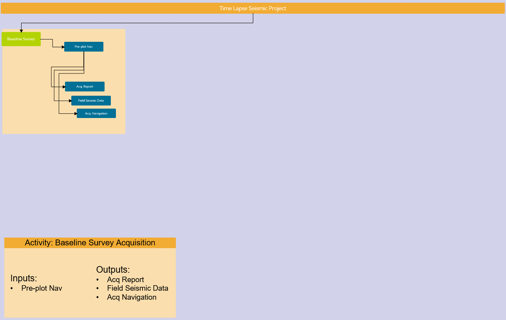
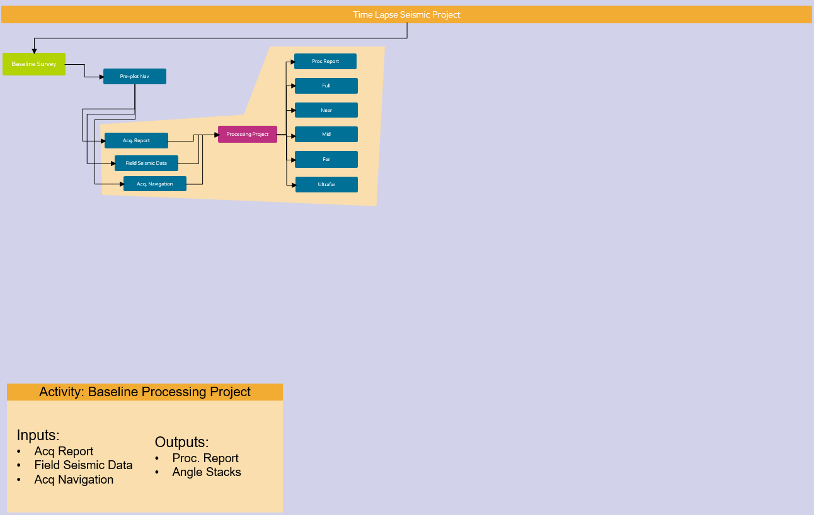
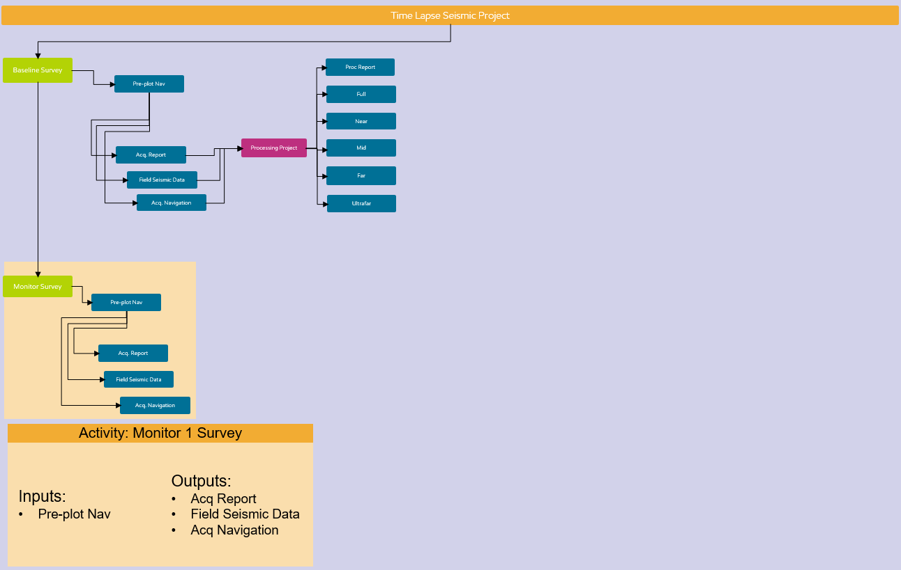
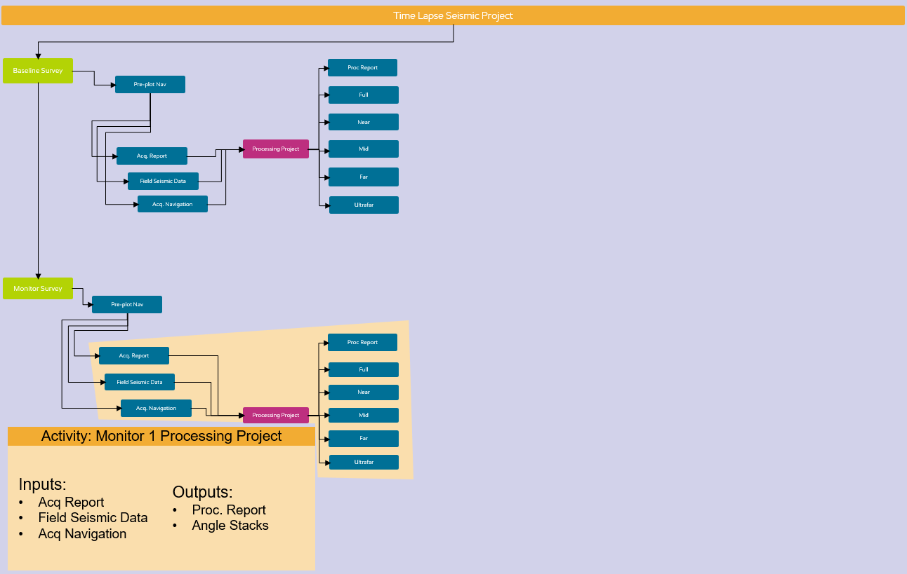
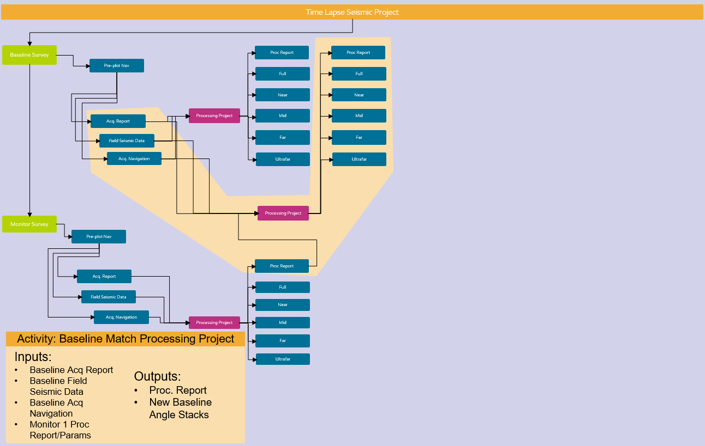
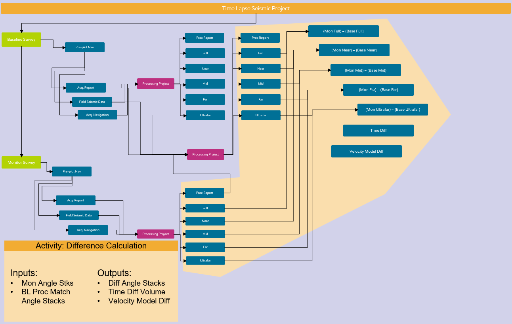
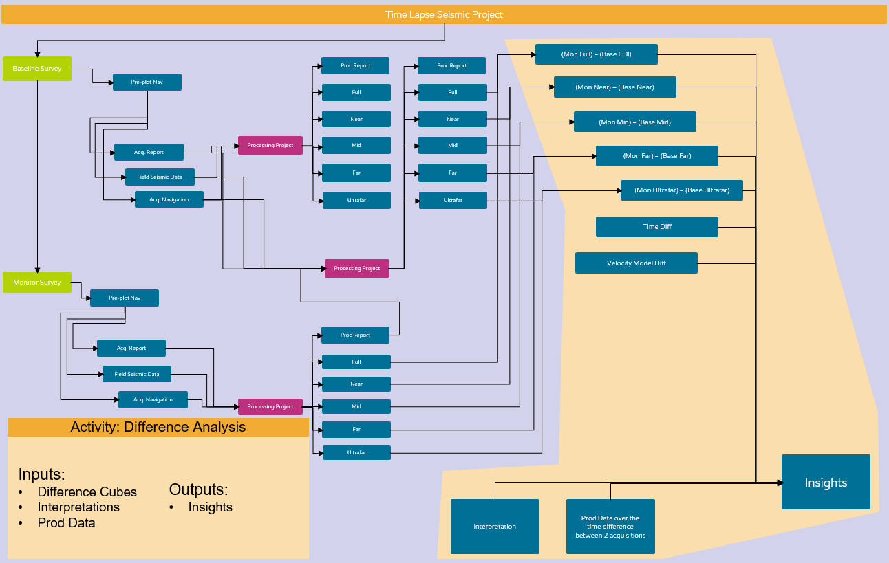
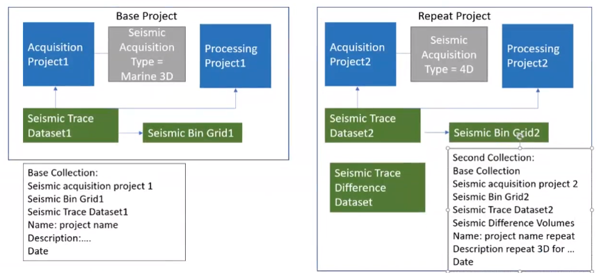
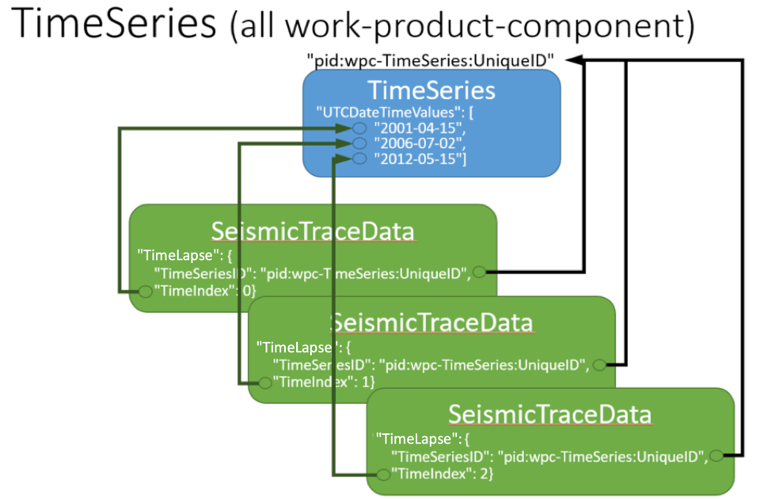
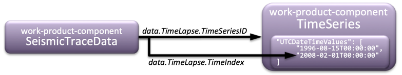

<a name="TOC"></a>

[[_TOC_]]

# 4D Seismic Definition & Examples

#  Definition
- **Timelapse Seismic:** Seismic that is acquired to assess changes in the subsurface over time and is accomplished by acquiring new seismic over an existing survey, typically using the previous survey acquisition geometry.
- **4D Seismic:** 3D seismic data that is acquired to assess changes in the subsurface over time and is accomplished by acquiring new 3D seismic over an existing 3D survey, typically using the previous 3D survey geometry


- **Note:** 4D is more of a process than an explicit data type. The term '4D' is sometimes used as shorthand to describe reservoir monitoring, simulation, & forward casting utilizing 4D seismic; this document does not expand beyond the seismic itself


# User Stories
- As a user I want to be able to quickly & easily identify 4D data sets
- As a user I want to be able to quickly & easily identify a 4D data set’s corresponding data set in the initial and/or previous survey
- As a user I want to be able to quickly & easily understand the time span between surveys
- As a user I want to be able to quickly & easily understand if there are acquisition differences between surveys and, if there are, what those differences are
- As a user I want to be able to understand the different processing flows between surveys (such as velocity model diff)

[Back to TOC](#TOC)

# Activities


## Baseline Acquisition


The Acquisition Report and Navigation have Lineage showing that the relation to the Acquisition Survey and to the seismic field traces is Indirect.

The location or outline can be approximated by a simplified polygon, both in original, acquisition CRS context or in
world map WGS 84 coordinates in GeoJSON.

<details>

<summary markdown="span">Outline of Baseline Survey in original coordinates (in manifest).</summary>

<OsduImportJSON>[Baseline survey, full record](manifests/Baseline_acquisition_survey.json#only.MasterData[0].data.SpatialLocation.AsIngestedCoordinates)</OsduImportJSON>

```json
{
  "MasterData": {
    "data": {
      "SpatialLocation": {
        "AsIngestedCoordinates": {
          "type": "AnyCrsFeatureCollection",
          "CoordinateReferenceSystemID": "osdu:reference-data--CoordinateReferenceSystem:BoundProjected:EPSG::23031_EPSG::1613:",
          "persistableReferenceCrs": "{\"authCode\":{\"auth\":\"OSDU\",\"code\":\"23031024\"},\"lateBoundCRS\":{\"authCode\":{\"auth\":\"EPSG\",\"code\":\"23031\"},\"name\":\"ED_1950_UTM_Zone_31N\",\"type\":\"LBC\",\"ver\":\"PE_10_9_1\",\"wkt\":\"PROJCS[\\\"ED_1950_UTM_Zone_31N\\\",GEOGCS[\\\"GCS_European_1950\\\",DATUM[\\\"D_European_1950\\\",SPHEROID[\\\"International_1924\\\",6378388.0,297.0]],PRIMEM[\\\"Greenwich\\\",0.0],UNIT[\\\"Degree\\\",0.0174532925199433]],PROJECTION[\\\"Transverse_Mercator\\\"],PARAMETER[\\\"False_Easting\\\",500000.0],PARAMETER[\\\"False_Northing\\\",0.0],PARAMETER[\\\"Central_Meridian\\\",3.0],PARAMETER[\\\"Scale_Factor\\\",0.9996],PARAMETER[\\\"Latitude_Of_Origin\\\",0.0],UNIT[\\\"Meter\\\",1.0],AUTHORITY[\\\"EPSG\\\",23031]]\"},\"name\":\"ED50 * EPSG-Nor S62 2001 / UTM zone 31N [23031,1613]\",\"singleCT\":{\"authCode\":{\"auth\":\"EPSG\",\"code\":\"1613\"},\"name\":\"ED_1950_To_WGS_1984_24\",\"type\":\"ST\",\"ver\":\"PE_10_9_1\",\"wkt\":\"GEOGTRAN[\\\"ED_1950_To_WGS_1984_24\\\",GEOGCS[\\\"GCS_European_1950\\\",DATUM[\\\"D_European_1950\\\",SPHEROID[\\\"International_1924\\\",6378388.0,297.0]],PRIMEM[\\\"Greenwich\\\",0.0],UNIT[\\\"Degree\\\",0.0174532925199433]],GEOGCS[\\\"GCS_WGS_1984\\\",DATUM[\\\"D_WGS_1984\\\",SPHEROID[\\\"WGS_1984\\\",6378137.0,298.257223563]],PRIMEM[\\\"Greenwich\\\",0.0],UNIT[\\\"Degree\\\",0.0174532925199433]],METHOD[\\\"Position_Vector\\\"],PARAMETER[\\\"X_Axis_Translation\\\",-90.365],PARAMETER[\\\"Y_Axis_Translation\\\",-101.13],PARAMETER[\\\"Z_Axis_Translation\\\",-123.384],PARAMETER[\\\"X_Axis_Rotation\\\",0.333],PARAMETER[\\\"Y_Axis_Rotation\\\",0.077],PARAMETER[\\\"Z_Axis_Rotation\\\",0.894],PARAMETER[\\\"Scale_Difference\\\",1.994],AUTHORITY[\\\"EPSG\\\",1613]]\"},\"type\":\"EBC\",\"ver\":\"PE_10_9_1\"}",
          "features": [
            {
              "type": "AnyCrsFeature",
              "properties": {},
              "geometry": {
                "type": "AnyCrsPolygon",
                "coordinates": [
                  [
                    [
                      438727.125,
                      6475514.5
                    ],
                    [
                      439888.34375,
                      6480172.0
                    ],
                    [
                      432562.59375,
                      6481998.5
                    ],
                    [
                      431401.375,
                      6477341.0
                    ],
                    [
                      438727.125,
                      6475514.5
                    ]
                  ]
                ]
              }
            }
          ]
        }
      }
    }
  }
}
```

</details>

<details>

<summary markdown="span">Outline of Baseline Survey in WGS 84 longitude, latitude coordinates (in manifest).</summary>

<OsduImportJSON>[Baseline survey, full record](manifests/Baseline_acquisition_survey.json#only.MasterData[0].data.SpatialLocation.Wgs84Coordinates)</OsduImportJSON>

```json
{
  "MasterData": {
    "data": {
      "SpatialLocation": {
        "Wgs84Coordinates": {
          "type": "FeatureCollection",
          "features": [
            {
              "type": "Feature",
              "properties": {},
              "geometry": {
                "type": "Polygon",
                "coordinates": [
                  [
                    [
                      1.9496878,
                      58.4141503
                    ],
                    [
                      1.9683366,
                      58.4561357
                    ],
                    [
                      1.8422866,
                      58.4714655
                    ],
                    [
                      1.8237804,
                      58.4294624
                    ],
                    [
                      1.9496878,
                      58.4141503
                    ]
                  ]
                ]
              }
            }
          ]
        }
      }
    }
  }
}
```

</details>


[Back to TOC](#TOC)

## Baseline Processing



A fictive baseline survey ST0202R08_Baseline is provided in the [provided example manifest](manifests/Baseline_acquisition_survey.json).

ST0202R08_Baseline is then used as preceding survey in monitor surveys.

[Back to TOC](#TOC)

## Monitor Acquisition



The monitor acquisition survey has indicators that it is a repeat survey. The name uses a convention indicating it's a
repeat, as does the Description. The AcquisitionType stays at 3D, however, the `data.PrecedingTimeLapseSurveyID` is set
to the baseline survey.

Example: [Monitor_acquisition_survey.json](manifests/Monitor_acquisition_survey.json).

<details>

<summary markdown="span">Here is a snippet of a data block of <code>Monitor_acquisition_survey.json</code></summary>

<OsduImportJSON>[`Monitor_acquisition_survey`, Full](manifests/Monitor_acquisition_survey.json#only.MasterData[0].data.PrecedingTimeLapseSurveyID|AcquisitionTypeID|SeismicGeometryTypeID)</OsduImportJSON>

```json
{
  "MasterData": {
    "data": {
      "PrecedingTimeLapseSurveyID": "namespace:master-data--SeismicAcquisitionSurvey:ST0202R08_Baseline:",
      "AcquisitionTypeID": "namespace:reference-data--SeismicAcquisitionType:3D:",
      "SeismicGeometryTypeID": "osdu:reference-data--SeismicGeometryType:3D:"
    }
  }
}
```

</details>

[Back to TOC](#TOC)

## Monitor Processing



[Back to TOC](#TOC)

## Baseline Match Processing


The processing parameters can be saved in the SeismicTraceData schema, as a list of parameters.   The parameters, along with the names of input and output volumes can be stored with the activity model.

Example: [Activity_4D_Match_Processing.1.0.0.json](manifests/Activity_4D_Match_Processing.1.0.0.json)

<details>

<summary markdown="span">Here is a snippet of a data block of <code>Activity_4D_Match_Processing.1.0.0.json</code></summary>

<OsduImportJSON>[`Activity_4D_Match_Processing`, Full](manifests/Activity_4D_Match_Processing.1.0.0.json#only.data)</OsduImportJSON>

```json
{
  "data": {
    "Name": "Baseline to Monitor Match Processing",
    "Description": "A template processing activity establishing lineage of seismic products related to a 4D baseline reprocessing to match a newly processed monitor acquisition ",
    "Source": "Example ",
    "ExistenceKind": "namespace:reference-data--ExistenceKind:Prototype:",
    "VersionCreationReason": "Demonstrate seismic lineage building",
    "Parameters": [
      {
        "Title": "Input Baseline Trace Data",
        "AllowedParameterKind": "namespace:reference-data--ParameterKind:DataObject:",
        "DataObjectContentType": [
          "work-product-component--SeismicTraceData"
        ],
        "IsInput": true,
        "IsOutput": false,
        "MaxOccurs": 1,
        "MinOccurs": 1
      },
      {
        "Title": "Input Baseline Positioning Data",
        "AllowedParameterKind": "namespace:reference-data--ParameterKind:DataObject:",
        "DataObjectContentType": [
          "work-product-component--SeismicBinGrid",
          "work-product-component--SeismicLineGeometry"
        ],
        "IsInput": true,
        "IsOutput": false,
        "MaxOccurs": 1,
        "MinOccurs": 0
      },
      {
        "Title": "Input Baseline Acquisition Report",
        "AllowedParameterKind": "namespace:reference-data--ParameterKind:DataObject:",
        "DataObjectContentType": [
          "work-product-component--Document"
        ],
        "IsInput": true,
        "IsOutput": false,
        "MaxOccurs": 1,
        "MinOccurs": 0
      },
      {
        "Title": "Input Monitor Processing Report",
        "AllowedParameterKind": "namespace:reference-data--ParameterKind:DataObject:",
        "DataObjectContentType": [
          "work-product-component--Document"
        ],
        "IsInput": true,
        "IsOutput": false,
        "MaxOccurs": 1,
        "MinOccurs": 0
      },
      {
        "Title": "Match Processing Project",
        "AllowedParameterKind": "namespace:reference-data--ParameterKind:DataObject:",
        "DataObjectContentType": [
          "master-data--SeismicProcessingProject"
        ],
        "IsInput": true,
        "IsOutput": false,
        "MaxOccurs": 1,
        "MinOccurs": 1
      },
      {
        "Title": "Output Matched Processing Report for Baseline Reprocessing",
        "AllowedParameterKind": "namespace:reference-data--ParameterKind:DataObject:",
        "DataObjectContentType": [
          "work-product-component--Document"
        ],
        "IsInput": false,
        "IsOutput": true,
        "MaxOccurs": 1,
        "MinOccurs": 1
      },
      {
        "Title": "Output Matched Processing Baseline KPSTM Full Trace Data",
        "AllowedParameterKind": "namespace:reference-data--ParameterKind:DataObject:",
        "DataObjectContentType": [
          "work-product-component--SeismicTraceData"
        ],
        "IsInput": false,
        "IsOutput": true,
        "MaxOccurs": 0,
        "MinOccurs": 1
      },
      {
        "Title": "Output Matched Processing Baseline KPSTM Near Trace Data",
        "AllowedParameterKind": "namespace:reference-data--ParameterKind:DataObject:",
        "DataObjectContentType": [
          "work-product-component--SeismicTraceData"
        ],
        "IsInput": false,
        "IsOutput": true,
        "MaxOccurs": 0,
        "MinOccurs": 1
      },
      {
        "Title": "Output Matched Processing Baseline KPSTM Mid Trace Data",
        "AllowedParameterKind": "namespace:reference-data--ParameterKind:DataObject:",
        "DataObjectContentType": [
          "work-product-component--SeismicTraceData"
        ],
        "IsInput": false,
        "IsOutput": true,
        "MaxOccurs": 0,
        "MinOccurs": 1
      },
      {
        "Title": "Output Matched Processing Baseline KPSTM Far Trace Data",
        "AllowedParameterKind": "namespace:reference-data--ParameterKind:DataObject:",
        "DataObjectContentType": [
          "work-product-component--SeismicTraceData"
        ],
        "IsInput": false,
        "IsOutput": true,
        "MaxOccurs": 0,
        "MinOccurs": 1
      },
      {
        "Title": "Output Matched Processing Baseline KPSTM Ultra Far Trace Data",
        "AllowedParameterKind": "namespace:reference-data--ParameterKind:DataObject:",
        "DataObjectContentType": [
          "work-product-component--SeismicTraceData"
        ],
        "IsInput": false,
        "IsOutput": true,
        "MaxOccurs": 0,
        "MinOccurs": 1
      }
    ],
    "ExtensionProperties": {}
  }
}
```

</details>

[Back to TOC](#TOC)

## Difference Calculation



[Back to TOC](#TOC)

Example: [Activity_4D_Difference_Calculation.1.0.0.json](manifests/Activity_4D_Difference_Calculation.1.0.0.json)

<details>

<summary markdown="span">Here is a snippet of a data block of <code>Activity_4D_Difference_Calculation.1.0.0.json</code></summary>

<OsduImportJSON>[`Activity_4D_Difference_Calculation.1.0.0.json`, Full](manifests/Activity_4D_Difference_Calculation.1.0.0.json#only.data)</OsduImportJSON>

```json
{
  "data": {
    "Name": "Baseline to Monitor Difference Calculation",
    "Description": "A template processing activity establishing lineage of seismic products related to a 4D baseline and monitor difference calculations ",
    "Source": "Example ",
    "ExistenceKind": "namespace:reference-data--ExistenceKind:Prototype:",
    "VersionCreationReason": "Demonstrate seismic lineage building",
    "Parameters": [
      {
        "Title": "Input Monitor KPSTM Full Trace Data",
        "AllowedParameterKind": "namespace:reference-data--ParameterKind:DataObject:",
        "DataObjectContentType": [
          "work-product-component--SeismicTraceData"
        ],
        "IsInput": true,
        "IsOutput": false,
        "MaxOccurs": 1,
        "MinOccurs": 0
      },
      {
        "Title": "Input Monitor KPSTM Near Trace Data",
        "AllowedParameterKind": "namespace:reference-data--ParameterKind:DataObject:",
        "DataObjectContentType": [
          "work-product-component--SeismicTraceData"
        ],
        "IsInput": true,
        "IsOutput": false,
        "MaxOccurs": 1,
        "MinOccurs": 0
      },
      {
        "Title": "Input Monitor KPSTM Mid Trace Data",
        "AllowedParameterKind": "namespace:reference-data--ParameterKind:DataObject:",
        "DataObjectContentType": [
          "work-product-component--SeismicTraceData"
        ],
        "IsInput": true,
        "IsOutput": false,
        "MaxOccurs": 1,
        "MinOccurs": 0
      },
      {
        "Title": "Input Monitor KPSTM Far Trace Data",
        "AllowedParameterKind": "namespace:reference-data--ParameterKind:DataObject:",
        "DataObjectContentType": [
          "work-product-component--SeismicTraceData"
        ],
        "IsInput": true,
        "IsOutput": false,
        "MaxOccurs": 1,
        "MinOccurs": 0
      },
      {
        "Title": "Input Monitor KPSTM Ultrafar Trace Data",
        "AllowedParameterKind": "namespace:reference-data--ParameterKind:DataObject:",
        "DataObjectContentType": [
          "work-product-component--SeismicTraceData"
        ],
        "IsInput": true,
        "IsOutput": false,
        "MaxOccurs": 1,
        "MinOccurs": 0
      },
      {
        "Title": "Output Matched Processing Baseline KPSTM Full Trace Data",
        "AllowedParameterKind": "namespace:reference-data--ParameterKind:DataObject:",
        "DataObjectContentType": [
          "work-product-component--SeismicTraceData"
        ],
        "IsInput": true,
        "IsOutput": false,
        "MaxOccurs": 1,
        "MinOccurs": 0
      },
      {
        "Title": "Output Matched Processing Baseline KPSTM Near Trace Data",
        "AllowedParameterKind": "namespace:reference-data--ParameterKind:DataObject:",
        "DataObjectContentType": [
          "work-product-component--SeismicTraceData"
        ],
        "IsInput": true,
        "IsOutput": false,
        "MaxOccurs": 1,
        "MinOccurs": 0
      },
      {
        "Title": "Output Matched Processing Baseline KPSTM Mid Trace Data",
        "AllowedParameterKind": "namespace:reference-data--ParameterKind:DataObject:",
        "DataObjectContentType": [
          "work-product-component--SeismicTraceData"
        ],
        "IsInput": true,
        "IsOutput": false,
        "MaxOccurs": 1,
        "MinOccurs": 0
      },
      {
        "Title": "Output Matched Processing Baseline KPSTM Far Trace Data",
        "AllowedParameterKind": "namespace:reference-data--ParameterKind:DataObject:",
        "DataObjectContentType": [
          "work-product-component--SeismicTraceData"
        ],
        "IsInput": true,
        "IsOutput": false,
        "MaxOccurs": 1,
        "MinOccurs": 0
      },
      {
        "Title": "Output Matched Processing Baseline KPSTM Ultra Far Trace Data",
        "AllowedParameterKind": "namespace:reference-data--ParameterKind:DataObject:",
        "DataObjectContentType": [
          "work-product-component--SeismicTraceData"
        ],
        "IsInput": false,
        "IsOutput": true,
        "MaxOccurs": 1,
        "MinOccurs": 0
      },
      {
        "Title": "Monitor minus Output Matched Processing Baseline KPSTM Full Trace Data",
        "AllowedParameterKind": "namespace:reference-data--ParameterKind:DataObject:",
        "DataObjectContentType": [
          "work-product-component--SeismicTraceData"
        ],
        "IsInput": false,
        "IsOutput": true,
        "MaxOccurs": 1,
        "MinOccurs": 0
      },
      {
        "Title": "Monitor minus Output Matched Processing Baseline KPSTM Near Trace Data",
        "AllowedParameterKind": "namespace:reference-data--ParameterKind:DataObject:",
        "DataObjectContentType": [
          "work-product-component--SeismicTraceData"
        ],
        "IsInput": false,
        "IsOutput": true,
        "MaxOccurs": 1,
        "MinOccurs": 0
      },
      {
        "Title": "Monitor minus Output Matched Processing Baseline KPSTM Mid Trace Data",
        "AllowedParameterKind": "namespace:reference-data--ParameterKind:DataObject:",
        "DataObjectContentType": [
          "work-product-component--SeismicTraceData"
        ],
        "IsInput": false,
        "IsOutput": true,
        "MaxOccurs": 1,
        "MinOccurs": 0
      },
      {
        "Title": "Monitor minus Output Matched Processing Baseline KPSTM Far Trace Data",
        "AllowedParameterKind": "namespace:reference-data--ParameterKind:DataObject:",
        "DataObjectContentType": [
          "work-product-component--SeismicTraceData"
        ],
        "IsInput": false,
        "IsOutput": true,
        "MaxOccurs": 1,
        "MinOccurs": 0
      },
      {
        "Title": "Monitor minus Output Matched Processing Baseline KPSTM Ultrafar Trace Data",
        "AllowedParameterKind": "namespace:reference-data--ParameterKind:DataObject:",
        "DataObjectContentType": [
          "work-product-component--SeismicTraceData"
        ],
        "IsInput": false,
        "IsOutput": true,
        "MaxOccurs": 1,
        "MinOccurs": 0
      },
      {
        "Title": "Monitor to Baseline Time Difference Trace Data",
        "AllowedParameterKind": "namespace:reference-data--ParameterKind:DataObject:",
        "DataObjectContentType": [
          "work-product-component--SeismicTraceData"
        ],
        "IsInput": false,
        "IsOutput": true,
        "MaxOccurs": 1,
        "MinOccurs": 0
      },
      {
        "Title": "Monitor to Baseline Velocity Model Difference Trace Data",
        "AllowedParameterKind": "namespace:reference-data--ParameterKind:DataObject:",
        "DataObjectContentType": [
          "work-product-component--SeismicTraceData"
        ],
        "IsInput": false,
        "IsOutput": true,
        "MaxOccurs": 1,
        "MinOccurs": 0
      }
    ],
    "ExtensionProperties": {}
  }
}
```

</details>

## Interpretation of Results



[Back to TOC](#TOC)

# Collections



This would allow for quick grouping of connected seismic data but would lack direct time sequence information.

[Back to TOC](#TOC)

# Representations



This would allow for grouping of related volumes and each dataset would know its order.
Explore use as-is or creation of seismic variant.

A SeismicTraceData record can be declared as part of a time-lapse sequence by means of a relationship to a
[TimeSeries](../../../E-R/work-product-component/TimeSeries.1.2.0.md) record. The latter holds all the 'dates' in an
ordered list of date times, see figure below.



<details>

<summary markdown="span">Here is a snippet of a data block of <code>SeismicTraceData4D-manifest.json</code></summary>

<OsduImportJSON>[`4D SeismicTraceData`, Full](manifests/SeismicTraceData4D-manifest.json#only.Data.WorkProductComponents[0].data.TimeLapse)</OsduImportJSON>

```json
{
  "Data": {
    "WorkProductComponents": {
      "data": {
        "TimeLapse": {
          "TimeSeriesID": "osdu:work-product-component--TimeSeries:911bb71f-06ab-4deb-8e68-b8c9229dc76b:",
          "TimeIndex": 2
        }
      }
    }
  }
}
```

</details>


<details>

<summary markdown="span">The 4D SeismicTraceData record refers to a<code>TimeSeries</code> record by <code>id</code>, which contains the full time-lapse sequence.</summary>

<OsduImportJSON>[`4D SeismicTraceData`, Full](records/TimeSeries.json#only.data)</OsduImportJSON>

```json
{
  "data": {
    "IsExtendedLoad": true,
    "IsDiscoverable": true,
    "Name": "Volve 4D",
    "Description": "4D Seismic Volume Sequence for Volve",
    "CreationDateTime": "2022-02-13T09:13:15.55Z",
    "GeoContexts": [
      {
        "GeoPoliticalEntityID": "osdu:master-data--GeoPoliticalEntity:Norway_Country:",
        "GeoTypeID": "osdu:reference-data--GeoPoliticalEntityType:Country:"
      }
    ],
    "UTCDateTimeValues": [
      "1996-08-15T00:00:00",
      "2008-02-01T00:00:00"
    ],
    "ExtensionProperties": {}
  }
}
```

</details>

[Back to TOC](#TOC)

## Schema Usage Guide

A more general explanation of the OSDU seismic entities is provided in the
[Schema Usage Guide Chapter _Seismic Projects and Related Data_](../../../Guides/Chapters/09-SeismicProjectsAndRelatedData.md).

[Back to TOC](#TOC)