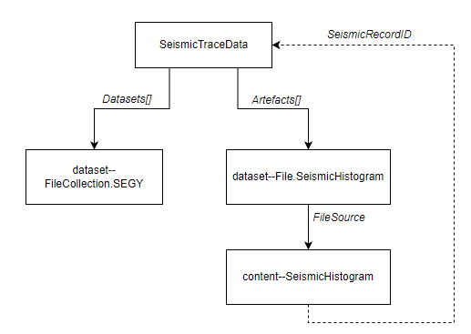

<a name="TOC"></a>

[[_TOC_]]

# Seismic Manifest Loading

## Ingestion Use Case

The use case is the following:

1. A SEG-Y revision 0 bulk file is uploaded to the cloud.
2. Optional:
   1. The SEG-Y file is analysed against a number of predefined templates collected in
      the `osdu:wks:reference-data--SEGY-HeaderMappingTemplate:1.0.0` [catalog](../../../E-R/reference-data/SEGY-HeaderMappingTemplate.1.0.0.md).
   2. A particular instance was found to be delivering the best result, the instance is presented as [example record](Examples/Records/reference-data/SEGY-HeaderTemplate.json).
   3. The actual values can then be copied, either unchanged or adjusted, into the [dataset--FileCollection.SEGY](Examples/Records/seismic/seismic-segy-file.json).
3. A [manifest](Examples/Manifests/seismic-manifest.json) is prepared. This manifest conforms to the manifest schema as
   defined and documented
   [Manifest:1.0.0](../../../E-R/manifest/Manifest.1.0.0.md).
3. The manifest is passed as payload to the ingestion service (API to be defined), the body of the POST message is
   likely to refer to the manifest schema, which is flexible enough to carry any type of metadata record bound for
   ingestion.
4. The ingestion service receives the request, including
   [manifest](Examples/Manifests/seismic-manifest.json) payload.
   1. Validate the payload contents,
      1. Resolve the item `kind` with the Schema Service to obtain the item schema. </br>
      2. Validate the item against the item resolved schema.

   2. Iterate over the items in the manifest, for each item (see [Items in Manifest below](#items-in-manifest))
      1. Determine whether a specific workflow has been registered with the `kind`.
          * if yes, invoke the workflow with the item in context
          * else, invoke a default workflow, which simply sends the item to the Storage Service.

5. Assume there is a workflow registered for the combination `osdu:wks:work-product-component.SeismicTraceData:1.0.0`
   and `osdu:wks:dataset--.FileCollection.SEGY:1.0.0`. Then this workflow
    1. Creates the `FileCollection.SEGY` dataset metadata records in Storage.
    2. Augments the `SeismicTraceData` work-product-component and replaces `
       surrogate-key:file-1` with the `id`
       received from the dataset metadata creation in i).
    3. Creates the `SeismicTraceData` work-product-component metadata in Storage.
    4. Augments the `WorkProduct` and replaces `surrogate-key:wpc-1` with the `id` received from Storage during
       the `SeismicTraceData` metadata creation in iii.
    5. Creates the `WorkProduct` metadata in storage.
    6. Invokes sub-workflow to create the OVDS dataset (Artefact creation).
    7. The artefact is registered as `FileCollection.Bluware.OVDS` dataset with the Storage service.
    8. Augments the `SeismicTraceData` work-product-component and adds the artefact dataset id to the Artefacts array
       received from the previous workflow in vii.
    9. Invokes enrichment to compute live-trace outline, statistics, header extraction, etc.
    10. Augments the `SeismicTraceData` work-product-component with the results from the enrichment in ix.

[Back to TOC](#TOC)

## SEG-Y Header Challenges

Since SEG-Y's publishing as standard in 1975 technology moved on and caused creative usage of the trace headers. In
addition to different dialects, datasets with genuine mistakes occur. OSDU introduced a variety of ways to enable
parsers to extract traces correctly **without re-writing** the datasets.

### SEG-Y Header Mapping

Sometimes trace header values appear in non-standard locations. OSDU uses
[AbstractVectorHeaderMapping](../../../E-R/abstract/AbstractVectorHeaderMapping.1.1.0.md) to associate well-known
[HeaderKeyName](../../../E-R/reference-data/HeaderKeyName.1.0.0.md) with corrected byte locations. A hypothetical
example for `VectorHeaderMapping[]` is shown below:

<details>

<summary markdown="span">SEG-Y Header Mapping to assist file parsing for a 2D SEG-Y.</summary>

<OsduImportJSON>[Full dataset--FileCollection.SEGY record](Examples/Records/seismic/dataset--FileCollection.SEGY-2D.json#only.data.Is3D|VectorHeaderMapping)</OsduImportJSON>

```json
{
  "data": {
    "Is3D": false,
    "VectorHeaderMapping": [
      {
        "KeyName": "namespace:reference-data--HeaderKeyName:CMP:",
        "WordFormat": "namespace:reference-data--WordFormatType:INT:",
        "WordWidth": 4,
        "Position": 21
      },
      {
        "KeyName": "namespace:reference-data--HeaderKeyName:SP:",
        "WordFormat": "namespace:reference-data--WordFormatType:INT:",
        "WordWidth": 4,
        "Position": 17
      },
      {
        "KeyName": "namespace:reference-data--HeaderKeyName:TraceNumber:",
        "WordFormat": "namespace:reference-data--WordFormatType:INT:",
        "WordWidth": 4,
        "Position": 1
      },
      {
        "KeyName": "namespace:reference-data--HeaderKeyName:ReelNumber:",
        "WordFormat": "namespace:reference-data--WordFormatType:INT:",
        "WordWidth": 4,
        "Position": 3209
      }
    ]
  }
}
```
</details>

### SEG-Y Header Value Overrides

The values at the header locations may also be incorrect and require overrides. Based on the
[HeaderKeyName](../../../E-R/reference-data/HeaderKeyName.1.0.0.md) it is possible to set up `TraceHeaderOverrides[]`
to compute - during parsing - corrected trace header values. In the hypothetical example below the shot point number
SP is corrected to "`SP = TraceNumber + 101`" and the common mid-point number CMP is corrected to
"`CMP = SP * 2 + 100`".

<details>

<summary markdown="span">SEG-Y TraceHeaderOverrides to assist file parsing for a 2D SEG-Y.</summary>

<OsduImportJSON>[Full dataset--FileCollection.SEGY record](Examples/Records/seismic/dataset--FileCollection.SEGY-2D.json#only.data.TraceHeaderOverrides)</OsduImportJSON>

```json
{
  "data": {
    "TraceHeaderOverrides": [
      {
        "KeyName": "namespace:reference-data--HeaderKeyName:SP:",
        "OverrideByExpressions": [
          {
            "Input": "namespace:reference-data--HeaderKeyName:TraceNumber:",
            "Operator1": "Plus",
            "Operand1Constant": 101,
            "Remark": "Recalculate SP as TraceNumber + 101"
          }
        ]
      },
      {
        "KeyName": "namespace:reference-data--HeaderKeyName:CMP:",
        "OverrideByExpressions": [
          {
            "Input": "namespace:reference-data--HeaderKeyName:SP:",
            "Operator1": "MultiplyBy",
            "Operand1Constant": 2,
            "Operator2": "Plus",
            "Operand2Constant": 100,
            "Remark": "Recalculate CMP as SP * 2 + 100"
          }
        ]
      }
    ]
  }
}
```
</details>

Less frequently the binary header requires corrections. Similarly, the binary header values can be corrected:

<details>

<summary markdown="span">SEG-Y BinaryHeaderOverrides to assist file parsing for a 2D SEG-Y.</summary>

<OsduImportJSON>[Full dataset--FileCollection.SEGY record](Examples/Records/seismic/dataset--FileCollection.SEGY-2D.json#only.data.BinaryHeaderOverrides)</OsduImportJSON>

```json
{
  "data": {
    "BinaryHeaderOverrides": [
      {
        "KeyName": "namespace:reference-data--HeaderKeyName:ReelNumber:",
        "OverrideByConstant": 2474
      }
    ]
  }
}
```
</details>

The examples above show typical applications. More complicated expressions involving variables are possible
if `Operand1Variable` and/or `Operand2Variable` are used instead of `Operand1Constant` and/or `Operand2Constant`.
The `Operand(1|2)Variable` refer to [reference-data--HeaderKeyName](../../../E-R/reference-data/HeaderKeyName.1.0.0.md)
containing the variable to be used in the expression.

### SEG-Y Header Mapping Template

Parsing SEG-Y revision 0 can be ambiguous, in particular for 3D datasets. Over the decades a variety of dialects have
evolved until SEG-Y revision 1 and higher introduced a firm standard.

In such cases it is efficient to create a "library" of SEG-Y header mappings. The mappings are represented by individual
mappings persisted as `reference-data--SEGY-HeaderMappingTemplate`.

<details>

<summary markdown="span">SEG-Y Header Template to assist file parsing, in particular for revision 0 SEG-Y files.</summary>

<OsduImportJSON>[Full reference-data record](Examples/Records/reference-data/SEGY-HeaderTemplate.json#only.data.Name|Description|SEGYRevision|VectorHeaderMapping)</OsduImportJSON>

```json
{
  "data": {
    "Name": "Metric UTM 3D",
    "Description": "A SEG-Y Template for metric UTM coordinates and 100 scaling, developed for Volve.",
    "SEGYRevision": "rev 0",
    "VectorHeaderMapping": [
      {
        "KeyName": "partition-id:reference-data--HeaderKeyName:Inline:",
        "Position": 189,
        "ScalarIndicator": "NOSCALE",
        "WordFormat": "partition-id:reference-data--WordFormatType:INT:",
        "WordWidth": 4
      },
      {
        "KeyName": "partition-id:reference-data--HeaderKeyName:Crossline:",
        "Position": 193,
        "ScalarIndicator": "NOSCALE",
        "WordFormat": "partition-id:reference-data--WordFormatType:INT:",
        "WordWidth": 4
      },
      {
        "KeyName": "partition-id:reference-data--HeaderKeyName:CMPY:",
        "Position": 181,
        "ScalarIndicator": "OVERRIDE",
        "ScalarOverride": -100,
        "UoM": "partition-id:reference-data--UnitOfMeasure:m:",
        "WordFormat": "partition-id:reference-data--WordFormatType:UINT:",
        "WordWidth": 4
      },
      {
        "KeyName": "partition-id:reference-data--HeaderKeyName:CMPX:",
        "Position": 185,
        "ScalarIndicator": "OVERRIDE",
        "ScalarOverride": -100,
        "UoM": "partition-id:reference-data--UnitOfMeasure:m:",
        "WordFormat": "partition-id:reference-data--WordFormatType:UINT:",
        "WordWidth": 4
      },
      {
        "KeyName": "partition-id:reference-data--HeaderKeyName:STARTTIME:",
        "Position": 109,
        "ScalarIndicator": "NOSCALE",
        "UoM": "partition-id:reference-data--UnitOfMeasure:ms:",
        "WordFormat": "partition-id:reference-data--WordFormatType:INT:",
        "WordWidth": 2
      }
    ]
  }
}
```
</details>


Often the source of the data lets data managers
decide, which header mapping is the correct one. In the general case it is conceivable to use the entire "library":
* Loop over all (or a selected list of) `reference-data--SEGY-HeaderMappingTemplate`:
  * load the `reference-data--SEGY-HeaderMappingTemplate` instance;
  * open the `dataset--FileCollection.SEGY` and read the trace headers according to the template;
  * evaluate the decoded trace positions and inline/cross-line numbers and their relative change from trace to trace;
  * rank the result — the EBCDIC header may provide context about the expected ranges of values for coordinates (order
    of magnitude for Easting and Northing) and inline/cross-line number ranges;
  * deliver the ranked list of `reference-data--SEGY-HeaderMappingTemplate` as result.

Using the OSDU Activity model, it is possible to capture the process and its results:

<details>

<summary markdown="span">Activity record, input SEG-Y File.</summary>

<OsduImportJSON>[Full activity record](Examples/Records/activity/Activity-SEGY_ParsingTrial.json#only.data.Parameters[0])</OsduImportJSON>

```json
{
  "data": {
    "Parameters": [
      {
        "Title": "SEGY-Dataset",
        "Selection": "Selected input to the process",
        "DataObjectParameter": "partition-id:dataset--FileCollection.SEGY:eba9adc4-f274-4cea-9df8-abc9916bb4fd:",
        "ParameterKindID": "partition-id:reference-data--ParameterKind:DataObject:",
        "ParameterRoleID": "partition-id:reference-data--ParameterRole:Input:"
      }
    ]
  }
}
```
</details>

<details>

<summary markdown="span">Activity record, input SEGY-HeaderMappingTemplate references (excerpt).</summary>

<OsduImportJSON>[Full activity record](Examples/Records/activity/Activity-SEGY_ParsingTrial.json#only.data.Parameters[2]|Parameters[3]|Parameters[7])</OsduImportJSON>

```json
{
  "data": {
    "Parameters": [
      {
        "Title": "SEGY-HeaderMappingTemplate",
        "Index": 1,
        "Selection": "Retrieved by query",
        "DataObjectParameter": "partition-id:reference-data--SEGY-HeaderMappingTemplate:Popular3DMetric:",
        "ParameterKindID": "partition-id:reference-data--ParameterKind:DataObject:",
        "ParameterRoleID": "partition-id:reference-data--ParameterRole:Input:"
      },
      {
        "Title": "SEGY-HeaderMappingTemplate",
        "Index": 2,
        "Selection": "Retrieved by query",
        "DataObjectParameter": "partition-id:reference-data--SEGY-HeaderMappingTemplate:Popular3DFeet:",
        "ParameterKindID": "partition-id:reference-data--ParameterKind:DataObject:",
        "ParameterRoleID": "partition-id:reference-data--ParameterRole:Input:"
      },
      {
        "Title": "SEGY-HeaderMappingTemplate",
        "Index": 6,
        "Selection": "Retrieved by query",
        "DataObjectParameter": "partition-id:reference-data--SEGY-HeaderMappingTemplate:MetricUTM3D:",
        "ParameterKindID": "partition-id:reference-data--ParameterKind:DataObject:",
        "ParameterRoleID": "partition-id:reference-data--ParameterRole:Input:"
      }
    ]
  }
}
```
</details>

<details>

<summary markdown="span">Activity record, output rank results (excerpt).</summary>

<OsduImportJSON>[Full activity record](Examples/Records/activity/Activity-SEGY_ParsingTrial.json#only.data.Parameters[10]|Parameters[11]|Parameters[15])</OsduImportJSON>

```json
{
  "data": {
    "Parameters": [
      {
        "Title": "RankResult",
        "Index": 1,
        "Selection": "Created by ranking process",
        "DataQuantityParameter": 0.3425,
        "ParameterKindID": "partition-id:reference-data--ParameterKind:Double:",
        "ParameterRoleID": "partition-id:reference-data--ParameterRole:Output:"
      },
      {
        "Title": "RankResult",
        "Index": 2,
        "Selection": "Created by ranking process",
        "DataQuantityParameter": 0.3324,
        "ParameterKindID": "partition-id:reference-data--ParameterKind:Double:",
        "ParameterRoleID": "partition-id:reference-data--ParameterRole:Output:"
      },
      {
        "Title": "RankResult",
        "Index": 6,
        "Selection": "Created by ranking process",
        "DataQuantityParameter": 0.981263,
        "ParameterKindID": "partition-id:reference-data--ParameterKind:Double:",
        "ParameterRoleID": "partition-id:reference-data--ParameterRole:Output:"
      }
    ]
  }
}
```
</details>

<details>

<summary markdown="span">Activity record, output suggested best template.</summary>

<OsduImportJSON>[Full activity record](Examples/Records/activity/Activity-SEGY_ParsingTrial.json#only.data.Parameters[17])</OsduImportJSON>

```json
{
  "data": {
    "Parameters": [
      {
        "Title": "SelectedHeaderMapping",
        "Selection": "Created by ranking process",
        "DataObjectParameter": "partition-id:reference-data--SEGY-HeaderMappingTemplate:MetricUTM3D:",
        "ParameterKindID": "partition-id:reference-data--ParameterKind:Double:",
        "ParameterRoleID": "partition-id:reference-data--ParameterRole:Output:"
      }
    ]
  }
}
```
</details>

The activity instances can refer to an ActivityTemplate, which defines the expected parameters, their cardinality and constraints

<details>

<summary markdown="span">ActivityTemplate record, defining the expected parameters.</summary>

<OsduImportJSON>[Full activity template record](Examples/Records/activity/ActivityTemplate-SEGY_ParsingTrial.json#only.data.Parameters)</OsduImportJSON>

```json
{
  "data": {
    "Parameters": [
      {
        "Title": "SEGY-Dataset",
        "AllowedParameterKind": "partition-id:reference-data--ParameterKind:DataObject:",
        "IsInput": true,
        "IsOutput": false,
        "DataObjectContentType": [
          "dataset--FileCollection.SEGY"
        ],
        "MaxOccurs": 1,
        "MinOccurs": 1
      },
      {
        "Title": "SEGY-HeaderMappingTemplate",
        "AllowedParameterKind": "partition-id:reference-data--ParameterKind:DataObject:",
        "IsInput": true,
        "IsOutput": false,
        "DataObjectContentType": [
          "reference-data--SEGY-HeaderMappingTemplate"
        ],
        "MaxOccurs": -1,
        "MinOccurs": 1
      },
      {
        "Title": "RankResult",
        "AllowedParameterKind": "partition-id:reference-data--ParameterKind:Double:",
        "IsInput": false,
        "IsOutput": true,
        "MaxOccurs": -1,
        "MinOccurs": 0
      },
      {
        "Title": "SelectedHeaderMapping",
        "AllowedParameterKind": "partition-id:reference-data--ParameterKind:DataObject:",
        "IsInput": false,
        "IsOutput": true,
        "DataObjectContentType": [
          "reference-data--SEGY-HeaderMappingTemplate"
        ],
        "MaxOccurs": 1,
        "MinOccurs": 0
      }
    ]
  }
}
```
</details>

[Back to TOC](#TOC)

---

## Items in Manifest

<details>

<summary markdown="span">Manifest fragment with Dataset and <code>surrogate-key:file-1</code></summary>

<OsduImportJSON>[Full manifest record](Examples/Manifests/seismic-manifest.json#only.Data.Datasets[0])</OsduImportJSON>

```json
{
  "Data": {
    "Datasets": [
      {
        "id": "surrogate-key:file-1",
        "kind": "osdu:wks:dataset--FileCollection.SEGY:1.3.0",
        "acl": {
          "owners": [
            "someone@company.com"
          ],
          "viewers": [
            "someone@company.com"
          ]
        },
        "legal": {
          "legaltags": [
            "Example legaltags"
          ],
          "otherRelevantDataCountries": [
            "US"
          ]
        },
        "data": {
          "ExistenceKind": "partition-id:reference-data--ExistenceKind:Actual:",
          "ResourceCurationStatus": "partition-id:reference-data--ResourceCurationStatus:CREATED:",
          "ResourceLifecycleStatus": "partition-id:reference-data--ResourceLifecycleStatus:LOADING:",
          "Source": "Example Data Source",
          "Name": "Dataset X221/15",
          "Description": "As originally delivered by ACME.com.",
          "TotalSize": "13245217273",
          "SchemaFormatTypeID": "partition-id:reference-data--SchemaFormatType:SEG-Y:",
          "SEGYRevision": "rev 0",
          "Endian": "BIG",
          "DatasetProperties": {
            "FileCollectionPath": "s3://default_bucket/opendes/data/vds-dataset/",
            "IndexFilePath": "s3://default_bucket/opendes/data/vds-dataset/vds-dataset.index",
            "FileSourceInfos": [
              {
                "FileSource": "s3://default_bucket/opendes/data/vds-dataset/vds-file-1",
                "PreloadFilePath": "s3://staging-area/r7/raw-data/provided/documents/vds-file-1",
                "Name": "vds-file-1",
                "FileSize": "439452464"
              },
              {
                "FileSource": "s3://default_bucket/opendes/data/vds-dataset/vds-file-2",
                "PreloadFilePath": "s3://staging-area/r7/raw-data/provided/documents/vds-file-2",
                "Name": "vds-file-2",
                "FileSize": "433645463"
              }
            ],
            "Checksum": "d41d8cd98f00b204e9800998ecf8427e"
          },
          "VectorHeaderMapping": [
            {
              "KeyName": "partition-id:reference-data--HeaderKeyName:Inline:",
              "Position": 189,
              "ScalarIndicator": "NOSCALE",
              "WordFormat": "partition-id:reference-data--WordFormatType:INT:",
              "WordWidth": 4
            },
            {
              "KeyName": "partition-id:reference-data--HeaderKeyName:Crossline:",
              "Position": 193,
              "ScalarIndicator": "NOSCALE",
              "WordFormat": "partition-id:reference-data--WordFormatType:INT:",
              "WordWidth": 4
            },
            {
              "KeyName": "partition-id:reference-data--HeaderKeyName:CMPY:",
              "Position": 181,
              "ScalarIndicator": "OVERRIDE",
              "ScalarOverride": -100,
              "UoM": "partition-id:reference-data--UnitOfMeasure:m:",
              "WordFormat": "partition-id:reference-data--WordFormatType:UINT:",
              "WordWidth": 4
            },
            {
              "KeyName": "partition-id:reference-data--HeaderKeyName:CMPX:",
              "Position": 185,
              "ScalarIndicator": "OVERRIDE",
              "ScalarOverride": -100,
              "UoM": "partition-id:reference-data--UnitOfMeasure:m:",
              "WordFormat": "partition-id:reference-data--WordFormatType:UINT:",
              "WordWidth": 4
            },
            {
              "KeyName": "partition-id:reference-data--HeaderKeyName:STARTTIME:",
              "Position": 109,
              "ScalarIndicator": "NOSCALE",
              "UoM": "partition-id:reference-data--UnitOfMeasure:ms:",
              "WordFormat": "partition-id:reference-data--WordFormatType:INT:",
              "WordWidth": 2
            }
          ],
          "ExtensionProperties": {}
        }
      }
    ]
  }
}
```
</details>

<details>

<summary markdown="span">Manifest fragment with <code>work-product-component--SeismicTraceData</code> and <code>surrogate-key:wpc-1</code></summary>

<OsduImportJSON>[Full manifest record](Examples/Manifests/seismic-manifest.json#only.Data.WorkProductComponents[0])</OsduImportJSON>

```json
{
  "Data": {
    "WorkProductComponents": [
      {
        "id": "surrogate-key:wpc-1",
        "kind": "osdu:wks:work-product-component--SeismicTraceData:1.8.0",
        "acl": {
          "owners": [
            "someone@company.com"
          ],
          "viewers": [
            "someone@company.com"
          ]
        },
        "legal": {
          "legaltags": [
            "Example legaltags"
          ],
          "otherRelevantDataCountries": [
            "US"
          ]
        },
        "meta": [
          {
            "kind": "Unit",
            "name": "ms",
            "persistableReference": "{\"abcd\":{\"a\":0.0,\"b\":0.001,\"c\":1.0,\"d\":0.0},\"symbol\":\"ms\",\"baseMeasurement\":{\"ancestry\":\"T\",\"type\":\"UM\"},\"type\":\"UAD\"}",
            "unitOfMeasureID": "partition-id:reference-data--UnitOfMeasure:ms:",
            "propertyNames": [
              "StartTime",
              "EndTime",
              "TraceLength",
              "SampleInterval"
            ]
          },
          {
            "kind": "Unit",
            "name": "m/s",
            "persistableReference": "{\"scaleOffset\":{\"scale\":1.0,\"offset\":0.0},\"symbol\":\"m/s\",\"baseMeasurement\":{\"ancestry\":\"L/T\",\"type\":\"UM\"},\"type\":\"USO\"}",
            "unitOfMeasureID": "partition-id:reference-data--UnitOfMeasure:m%2Fs:",
            "propertyNames": [
              "ReplacementVelocity"
            ]
          }
        ],
        "data": {
          "Source": "Example Data Source",
          "ExistenceKind": "partition-id:reference-data--ExistenceKind:Actual:",
          "Datasets": [
            "surrogate-key:file-1"
          ],
          "BinGridID": "partition-id:work-product-component--SeismicBinGrid:ExampleSeismicBinGrid-911bb71f-06ab-4deb-8e68-b8c9229dc76b:",
          "HorizontalCRSID": "partition-id:reference-data--CoordinateReferenceSystem:BoundProjected:EPSG::23031_EPSG::1613:",
          "Preferred3DInterpretationSetID": "partition-id:master-data--Seismic3DInterpretationSet:ExampleSeismic3DInterpretationSurvey:",
          "Preferred2DInterpretationSetID": "partition-id:master-data--Seismic2DInterpretationSet:ExampleSeismic2DInterpretationSurvey:",
          "SeismicAttributeTypeID": "partition-id:reference-data--SeismicAttributeType:ExampleSeismicAttributeType:",
          "SeismicProcessingStageTypeID": "partition-id:reference-data--SeismicProcessingStageType:ExampleSeismicProcessingStageType:",
          "PrincipalAcquisitionProjectID": "partition-id:master-data--SeismicAcquisitionSurvey:ST0202R08:",
          "ProcessingProjectID": "partition-id:master-data--SeismicProcessingProject:ST0202R08:",
          "SeismicTraceDataDimensionalityTypeID": "partition-id:reference-data--SeismicTraceDataDimensionalityType:3D:",
          "SeismicMigrationTypeID": "partition-id:reference-data--SeismicMigrationType:PSDM-Kirch:",
          "SeismicStackingTypeID": "partition-id:reference-data--SeismicStackingType:Full:",
          "SeismicFilteringTypeID": "partition-id:reference-data--SeismicFilteringType:Taup:",
          "SeismicPhaseID": "partition-id:reference-data--SeismicPhase:ZeroPhase:",
          "SeismicPolarityID": "partition-id:reference-data--SeismicPolarity:PositiveSEG:",
          "Difference": false,
          "StartTime": 0.0,
          "EndTime": 10200.0,
          "TraceLength": 10200.0,
          "SampleInterval": 4.0,
          "SampleCount": 2551,
          "VerticalMeasurementTypeID": "partition-id:reference-data--VerticalMeasurementType:MeanSeaLevel:",
          "ReplacementVelocity": 1450.0,
          "ShiftApplied": 0.0,
          "Precision": {
            "WordFormat": "partition-id:reference-data--WordFormatType:IEEE_FLOAT:",
            "WordWidth": 4
          },
          "ProcessingParameters": [
            {
              "ProcessingParameterTypeID": "partition-id:reference-data--ProcessingParameterType:ExampleProcessingParameterType:",
              "ProcessingParameterValue": "Example ProcessingParameterValue"
            }
          ],
          "SeismicWaveTypeID": "partition-id:reference-data--SeismicWaveType:ExampleSeismicWaveType:",
          "ExtensionProperties": {}
        }
      }
    ]
  }
}
```
</details>

<details>

<summary markdown="span">Manifest fragment with <code>work-product--WorkProduct</code> without <code>id</code> specified </summary>

<OsduImportJSON>[Full manifest record](Examples/Manifests/seismic-manifest.json#only.Data.WorkProduct)</OsduImportJSON>

```json
{
  "Data": {
    "WorkProduct": {
      "kind": "osdu:wks:work-product--WorkProduct:1.0.0",
      "acl": {
        "owners": [
          "someone@company.com"
        ],
        "viewers": [
          "someone@company.com"
        ]
      },
      "legal": {
        "legaltags": [
          "Example legaltags"
        ],
        "otherRelevantDataCountries": [
          "US"
        ]
      },
      "meta": [],
      "data": {
        "Source": "Equinor",
        "ExistenceKind": "partition-id:reference-data--ExistenceKind:Actual:",
        "Components": [
          "surrogate-key:wpc-1"
        ],
        "Name": "ST0202R08-PS_PSDM_FULL_OFFSET_DEPTH",
        "Description": "ST0202R08-PS_PSDM_FULL_OFFSET_DEPTH.MIG_FIN.POST_STACK.3D.JS-017534.segy"
      }
    }
  }
}
```
</details>

## Outcome

Outcome (WorkProduct instance is omitted):

<details>

<summary markdown="span">1. SeismicTraceData wpc record, enriched</summary>

<OsduImportJSON>[SeismicTraceData work-product-component record](Examples/Records/seismic/seismic-wpc.json)</OsduImportJSON>

```json
{
  "id": "partition-id:work-product-component--SeismicTraceData:1f855537-dea8-5b2a-a6d6-63fc9a0bbac1",
  "kind": "osdu:wks:work-product-component--SeismicTraceData:1.8.0",
  "version": 1605873241000221,
  "acl": {
    "owners": [
      "someone@company.com"
    ],
    "viewers": [
      "someone@company.com"
    ]
  },
  "legal": {
    "legaltags": [
      "Example legaltags"
    ],
    "otherRelevantDataCountries": [
      "US"
    ],
    "status": "compliant"
  },
  "ancestry": {
    "parents": []
  },
  "meta": [
    {
      "kind": "Unit",
      "name": "m",
      "persistableReference": "{\"scaleOffset\":{\"scale\":1.0,\"offset\":0.0},\"symbol\":\"m\",\"baseMeasurement\":{\"ancestry\":\"L\",\"type\":\"UM\"},\"type\":\"USO\"}",
      "unitOfMeasureID": "partition-id:reference-data--UnitOfMeasure:m:",
      "propertyNames": [
        "StartDepth",
        "EndDepth",
        "TraceLength"
      ]
    },
    {
      "kind": "Unit",
      "name": "ms",
      "persistableReference": "{\"abcd\":{\"a\":0.0,\"b\":0.001,\"c\":1.0,\"d\":0.0},\"symbol\":\"ms\",\"baseMeasurement\":{\"ancestry\":\"T\",\"type\":\"UM\"},\"type\":\"UAD\"}",
      "unitOfMeasureID": "partition-id:reference-data--UnitOfMeasure:ms:",
      "propertyNames": [
        "StartTime",
        "EndTime"
      ]
    },
    {
      "kind": "Unit",
      "name": "m/s",
      "persistableReference": "{\"scaleOffset\":{\"scale\":1.0,\"offset\":0.0},\"symbol\":\"m/s\",\"baseMeasurement\":{\"ancestry\":\"L/T\",\"type\":\"UM\"},\"type\":\"USO\"}",
      "unitOfMeasureID": "partition-id:reference-data--UnitOfMeasure:m%2Fs:",
      "propertyNames": [
        "ReplacementVelocity"
      ]
    }
  ],
  "data": {
    "Source": "Example Data Source",
    "ExistenceKind": "partition-id:reference-data--ExistenceKind:Actual:",
    "Datasets": [
      "partition-id:dataset--FileCollection.SEGY:eba9adc4-f274-4cea-9df8-abc9916bb4fd:"
    ],
    "DDMSDatasets": [
      "urn://sddms-v4/openvds/c7b49f00-e6de-4992-9614-326a06876034"
    ],
    "Artefacts": [
      {
        "RoleID": "partition-id:reference-data--ArtefactRole:OpenVDSDataSet:",
        "ResourceKind": "osdu:wks:dataset--FileCollection.Bluware.OpenVDS:1.1.1",
        "ResourceID": "partition-id:dataset--FileCollection.Bluware.OpenVDS:c7b49f00-e6de-4992-9614-326a06876034:"
      },
      {
        "RoleID": "partition-id:reference-data--ArtefactRole:ContentMetadata:",
        "ResourceKind": "osdu:wks:dataset--File.SeismicHistogram:1.0.1",
        "ResourceID": "partition-id:dataset--File.SeismicHistogram:486b349b-0455-5a45-a3ca-17581bddaa0f:"
      }
    ],
    "IsExtendedLoad": true,
    "IsDiscoverable": true,
    "Name": "ST0202R08-PS_PSDM_FULL_OFFSET_DEPTH",
    "Description": "Example Description",
    "CreationDateTime": "2020-02-13T09:13:15.55Z",
    "Tags": [
      "Example Tags"
    ],
    "SpatialPoint": {},
    "SpatialArea": {
      "SpatialLocationCoordinatesDate": "2020-02-13T09:13:15.55Z",
      "QuantitativeAccuracyBandID": "partition-id:reference-data--QuantitativeAccuracyBand:ExampleQuantitativeAccuracyBand:",
      "QualitativeSpatialAccuracyTypeID": "partition-id:reference-data--QualitativeSpatialAccuracyType:ExampleQualitativeSpatialAccuracyType:",
      "CoordinateQualityCheckPerformedBy": "Example CoordinateQualityCheckPerformedBy",
      "CoordinateQualityCheckDateTime": "2020-02-13T09:13:15.55Z",
      "CoordinateQualityCheckRemarks": [
        "Example CoordinateQualityCheckRemarks"
      ],
      "SpatialParameterTypeID": "partition-id:reference-data--SpatialParameterType:ExampleSpatialParameterType:",
      "SpatialGeometryTypeID": "partition-id:reference-data--SpatialGeometryType:ExampleSpatialGeometryType:"
    },
    "GeoContexts": [
      {
        "BasinID": "partition-id:master-data--Basin:ExampleBasin:",
        "GeoTypeID": "partition-id:reference-data--BasinType:ExampleBasinType:"
      }
    ],
    "SubmitterName": "Example SubmitterName",
    "BusinessActivities": [
      "Example BusinessActivities"
    ],
    "AuthorIDs": [
      "Example AuthorIDs"
    ],
    "LineageAssertions": [
      {
        "ID": "partition-id:any-group-type--AnyIndividualType:SomeUniqueAnyIndividualTypeID:",
        "LineageRelationshipType": "partition-id:reference-data--LineageRelationshipType:Direct:"
      }
    ],
    "LiveTraceOutline": {
      "SpatialLocationCoordinatesDate": "2020-02-13T09:13:15.55Z",
      "QuantitativeAccuracyBandID": "partition-id:reference-data--QuantitativeAccuracyBand:ExampleQuantitativeAccuracyBand:",
      "QualitativeSpatialAccuracyTypeID": "partition-id:reference-data--QualitativeSpatialAccuracyType:ExampleQualitativeSpatialAccuracyType:",
      "CoordinateQualityCheckPerformedBy": "Example CoordinateQualityCheckPerformedBy",
      "CoordinateQualityCheckDateTime": "2020-02-13T09:13:15.55Z",
      "CoordinateQualityCheckRemarks": [
        "Example CoordinateQualityCheckRemarks"
      ],
      "AsIngestedCoordinates": {
        "type": "AnyCrsFeatureCollection",
        "CoordinateReferenceSystemID": "partition-id:reference-data--CoordinateReferenceSystem:BoundProjected:EPSG::23031_EPSG::1613:",
        "VerticalCoordinateReferenceSystemID": "partition-id:reference-data--CoordinateReferenceSystem:Vertical:EPSG::5714:",
        "persistableReferenceCrs": "{\"authCode\":{\"auth\":\"OSDU\",\"code\":\"23031024\"},\"lateBoundCRS\":{\"authCode\":{\"auth\":\"EPSG\",\"code\":\"23031\"},\"name\":\"ED_1950_UTM_Zone_31N\",\"type\":\"LBC\",\"ver\":\"PE_10_9_1\",\"wkt\":\"PROJCS[\\\"ED_1950_UTM_Zone_31N\\\",GEOGCS[\\\"GCS_European_1950\\\",DATUM[\\\"D_European_1950\\\",SPHEROID[\\\"International_1924\\\",6378388.0,297.0]],PRIMEM[\\\"Greenwich\\\",0.0],UNIT[\\\"Degree\\\",0.0174532925199433]],PROJECTION[\\\"Transverse_Mercator\\\"],PARAMETER[\\\"False_Easting\\\",500000.0],PARAMETER[\\\"False_Northing\\\",0.0],PARAMETER[\\\"Central_Meridian\\\",3.0],PARAMETER[\\\"Scale_Factor\\\",0.9996],PARAMETER[\\\"Latitude_Of_Origin\\\",0.0],UNIT[\\\"Meter\\\",1.0],AUTHORITY[\\\"EPSG\\\",23031]]\"},\"name\":\"ED50 * EPSG-Nor S62 2001 / UTM zone 31N [23031,1613]\",\"singleCT\":{\"authCode\":{\"auth\":\"EPSG\",\"code\":\"1613\"},\"name\":\"ED_1950_To_WGS_1984_24\",\"type\":\"ST\",\"ver\":\"PE_10_9_1\",\"wkt\":\"GEOGTRAN[\\\"ED_1950_To_WGS_1984_24\\\",GEOGCS[\\\"GCS_European_1950\\\",DATUM[\\\"D_European_1950\\\",SPHEROID[\\\"International_1924\\\",6378388.0,297.0]],PRIMEM[\\\"Greenwich\\\",0.0],UNIT[\\\"Degree\\\",0.0174532925199433]],GEOGCS[\\\"GCS_WGS_1984\\\",DATUM[\\\"D_WGS_1984\\\",SPHEROID[\\\"WGS_1984\\\",6378137.0,298.257223563]],PRIMEM[\\\"Greenwich\\\",0.0],UNIT[\\\"Degree\\\",0.0174532925199433]],METHOD[\\\"Position_Vector\\\"],PARAMETER[\\\"X_Axis_Translation\\\",-90.365],PARAMETER[\\\"Y_Axis_Translation\\\",-101.13],PARAMETER[\\\"Z_Axis_Translation\\\",-123.384],PARAMETER[\\\"X_Axis_Rotation\\\",0.333],PARAMETER[\\\"Y_Axis_Rotation\\\",0.077],PARAMETER[\\\"Z_Axis_Rotation\\\",0.894],PARAMETER[\\\"Scale_Difference\\\",1.994],OPERATIONACCURACY[1.0],AUTHORITY[\\\"EPSG\\\",1613]]\"},\"type\":\"EBC\",\"ver\":\"PE_10_9_1\"}",
        "persistableReferenceVerticalCrs": "{\"authCode\":{\"auth\":\"EPSG\",\"code\":\"5714\"},\"name\":\"MSL_Height\",\"type\":\"LBC\",\"ver\":\"PE_10_9_1\",\"wkt\":\"VERTCS[\\\"MSL_Height\\\",VDATUM[\\\"Mean_Sea_Level\\\"],PARAMETER[\\\"Vertical_Shift\\\",0.0],PARAMETER[\\\"Direction\\\",1.0],UNIT[\\\"Meter\\\",1.0],AUTHORITY[\\\"EPSG\\\",5714]]\"}",
        "persistableReferenceUnitZ": "{\"scaleOffset\":{\"scale\":1.0,\"offset\":0.0},\"symbol\":\"m\",\"baseMeasurement\":{\"ancestry\":\"Length\",\"type\":\"UM\"},\"type\":\"USO\"}",
        "features": [
          {
            "type": "AnyCrsFeature",
            "properties": {},
            "geometry": {
              "type": "AnyCrsPolygon",
              "coordinates": [
                [
                  [
                    438727.0,
                    6475514.4
                  ],
                  [
                    431401.3,
                    6477341.0
                  ],
                  [
                    432562.5,
                    6481998.4
                  ],
                  [
                    439888.3,
                    6480171.9
                  ],
                  [
                    438727.0,
                    6475514.4
                  ]
                ]
              ]
            }
          }
        ],
        "bbox": [
          431401.3,
          6475514.4,
          439888.3,
          6481998.4
        ]
      },
      "Wgs84Coordinates": {
        "type": "FeatureCollection",
        "features": [
          {
            "type": "Feature",
            "properties": {},
            "geometry": {
              "type": "Polygon",
              "coordinates": [
                [
                  [
                    1.823767236,
                    58.42946998
                  ],
                  [
                    1.949673713,
                    58.4141567
                  ],
                  [
                    1.968324105,
                    58.45614207
                  ],
                  [
                    1.84227351,
                    58.47147214
                  ],
                  [
                    1.823767236,
                    58.42946998
                  ]
                ]
              ]
            }
          }
        ],
        "bbox": [
          1.823767236,
          58.4141567,
          1.968324105,
          58.45614207
        ]
      },
      "AppliedOperations": [
        "conversion from ED_1950_UTM_Zone_31N to GCS_European_1950; 5 points converted",
        "transformation GCS_European_1950 to GCS_WGS_1984 using ED_1950_To_WGS_1984_24; 5 points successfully transformed"
      ],
      "SpatialParameterTypeID": "partition-id:reference-data--SpatialParameterType:Outline:",
      "SpatialGeometryTypeID": "partition-id:reference-data--SpatialGeometryType:Polygon:"
    },
    "BinGridID": "partition-id:work-product-component--SeismicBinGrid:ExampleSeismicBinGrid-911bb71f-06ab-4deb-8e68-b8c9229dc76b:",
    "HorizontalCRSID": "partition-id:reference-data--CoordinateReferenceSystem:BoundProjected:EPSG::23031_EPSG::1613:",
    "Preferred3DInterpretationSetID": "partition-id:master-data--Seismic3DInterpretationSet:ExampleSeismic3DInterpretationSurvey:",
    "Preferred2DInterpretationSetID": "partition-id:master-data--Seismic2DInterpretationSet:ExampleSeismic2DInterpretationSurvey:",
    "Seismic2DName": "",
    "SeismicAttributeTypeID": "partition-id:reference-data--SeismicAttributeType:ExampleSeismicAttributeType:",
    "SeismicProcessingStageTypeID": "partition-id:reference-data--SeismicProcessingStageType:ExampleSeismicProcessingStageType:",
    "PrincipalAcquisitionProjectID": "partition-id:master-data--SeismicAcquisitionSurvey:ST0202R08:",
    "ProcessingProjectID": "partition-id:master-data--SeismicProcessingProject:ST0202R08:",
    "SeismicTraceDataDimensionalityTypeID": "partition-id:reference-data--SeismicTraceDataDimensionalityType:3D:",
    "SeismicDomainTypeID": "partition-id:reference-data--SeismicDomainType:Depth:",
    "SeismicMigrationTypeID": "partition-id:reference-data--SeismicMigrationType:PSDM-Kirch:",
    "SeismicStackingTypeID": "partition-id:reference-data--SeismicStackingType:Full:",
    "SeismicFilteringTypeID": "partition-id:reference-data--SeismicFilteringType:Taup:",
    "SeismicPhaseID": "partition-id:reference-data--SeismicPhase:ZeroPhase:",
    "SeismicPolarityID": "partition-id:reference-data--SeismicPolarity:PositiveSEG:",
    "SampleInterval": 5.0,
    "SampleCount": 901,
    "Difference": false,
    "StartTime": 0.0,
    "EndTime": 4090.0,
    "StartDepth": 0.0,
    "EndDepth": 4500.0,
    "TraceCount": 232925,
    "TraceLength": 4500.0,
    "TraceDomainUOM": "partition-id:reference-data--UnitOfMeasure:m:",
    "InlineMin": 9985.0,
    "InlineMax": 10369.0,
    "CrosslineMin": 1932.0,
    "CrosslineMax": 2536.0,
    "InlineIncrement": 1.0,
    "CrosslineIncrement": 1.0,
    "VerticalDatumOffset": 0,
    "VerticalMeasurementTypeID": "partition-id:reference-data--VerticalMeasurementType:MeanSeaLevel:",
    "ReplacementVelocity": 1480.0,
    "ShiftApplied": 0,
    "Precision": {
      "WordFormat": "partition-id:reference-data--WordFormatType:IEEE_FLOAT:",
      "WordWidth": 4
    },
    "ProcessingParameters": [
      {
        "ProcessingParameterTypeID": "partition-id:reference-data--ProcessingParameterType:ExampleProcessingParameterType:",
        "ProcessingParameterValue": "Example ProcessingParameterValue"
      }
    ],
    "CoveragePercent": 12345.6,
    "TextualFileHeader": [
      "C35 HEADER WORD POSITIONS:C36 INLINE: 189-192             ;  X-LINE: 193-196;C37 BINX (CDPX): 181-184,        BINY (CDPY): 185-188,C38 MERID.: 3.0E,SPHEROID: INT.;  ROTATION (AMS): 1245600000"
    ],
    "RangeAmplitudeMax": 12345.6,
    "RangeAmplitudeMin": 12345.6,
    "StackAngleRangeMax": 12345.6,
    "StackAngleRangeMin": 12345.6,
    "StackAzimuthRangeMax": 12345.6,
    "StackAzimuthRangeMin": 12345.6,
    "StackOffsetRangeMax": 12345.6,
    "StackOffsetRangeMin": 12345.6,
    "SeismicWaveTypeID": "partition-id:reference-data--SeismicWaveType:ExampleSeismicWaveType:",
    "ExtensionProperties": {}
  }
}
```

</details>

<details>

<summary markdown="span">2. Original SEG-Y file record</summary>

<OsduImportJSON>[Original SEG-Y file record](Examples/Records/seismic/seismic-segy-file.json)</OsduImportJSON>

```json
{
  "id": "partition-id:dataset--FileCollection.SEGY:eba9adc4-f274-4cea-9df8-abc9916bb4fd",
  "kind": "osdu:wks:dataset--FileCollection.SEGY:1.3.0",
  "version": 1605860768554777,
  "acl": {
    "owners": [
      "someone@company.com"
    ],
    "viewers": [
      "someone@company.com"
    ]
  },
  "legal": {
    "legaltags": [
      "Example legaltags"
    ],
    "otherRelevantDataCountries": [
      "US"
    ],
    "status": "compliant"
  },
  "ancestry": {
    "parents": []
  },
  "meta": [],
  "data": {
    "ResourceCurationStatus": "partition-id:reference-data--ResourceCurationStatus:CREATED:",
    "ResourceLifecycleStatus": "partition-id:reference-data--ResourceLifecycleStatus:LOADING:",
    "Source": "Example Data Source",
    "ExistenceKind": "partition-id:reference-data--ExistenceKind:Prototype:",
    "Name": "ST0202R08-PS_PSDM_FULL_OFFSET_DEPTH",
    "Description": "As originally delivered by ACME.com.",
    "TotalSize": "13245217273",
    "SchemaFormatTypeID": "partition-id:reference-data--SchemaFormatType:SEG-Y:",
    "Endian": "BIG",
    "DatasetProperties": {
      "FileCollectionPath": "s3://default_bucket/opendes/data/vds-dataset/",
      "IndexFilePath": "s3://default_bucket/opendes/data/vds-dataset/vds-dataset.index",
      "FileSourceInfos": [
        {
          "FileSource": "s3://default_bucket/opendes/data/vds-dataset/vds-file-1",
          "PreloadFilePath": "s3://staging-area/r7/raw-data/provided/documents/vds-file-1",
          "Name": "vds-file-1",
          "FileSize": "439452464"
        },
        {
          "FileSource": "s3://default_bucket/opendes/data/vds-dataset/vds-file-2",
          "PreloadFilePath": "s3://staging-area/r7/raw-data/provided/documents/vds-file-2",
          "Name": "vds-file-2",
          "FileSize": "433645463"
        }
      ],
      "Checksum": "d41d8cd98f00b204e9800998ecf8427e"
    },
    "VectorHeaderMapping": [
      {
        "KeyName": "partition-id:reference-data--HeaderKeyName:Inline:",
        "Position": 189,
        "ScalarIndicator": "NOSCALE",
        "WordFormat": "partition-id:reference-data--WordFormatType:INT:",
        "WordWidth": 4
      },
      {
        "KeyName": "partition-id:reference-data--HeaderKeyName:Crossline:",
        "Position": 193,
        "ScalarIndicator": "NOSCALE",
        "WordFormat": "partition-id:reference-data--WordFormatType:INT:",
        "WordWidth": 4
      },
      {
        "KeyName": "partition-id:reference-data--HeaderKeyName:CMPY:",
        "Position": 181,
        "ScalarIndicator": "OVERRIDE",
        "ScalarOverride": -100,
        "UoM": "partition-id:reference-data--UnitOfMeasure:m:",
        "WordFormat": "partition-id:reference-data--WordFormatType:UINT:",
        "WordWidth": 4
      },
      {
        "KeyName": "partition-id:reference-data--HeaderKeyName:CMPX:",
        "Position": 185,
        "ScalarIndicator": "OVERRIDE",
        "ScalarOverride": -100,
        "UoM": "partition-id:reference-data--UnitOfMeasure:m:",
        "WordFormat": "partition-id:reference-data--WordFormatType:UINT:",
        "WordWidth": 4
      },
      {
        "KeyName": "partition-id:reference-data--HeaderKeyName:STARTTIME:",
        "Position": 109,
        "ScalarIndicator": "NOSCALE",
        "UoM": "partition-id:reference-data--UnitOfMeasure:ms:",
        "WordFormat": "partition-id:reference-data--WordFormatType:INT:",
        "WordWidth": 2
      }
    ],
    "ExtensionProperties": {}
  }
}
```

</details>

<details>

<summary markdown="span">3. Artefact OVDS dataset record</summary>

<OsduImportJSON>[Artefact OVDS dataset record](Examples/Records/seismic/seismic-ovds-file.json)</OsduImportJSON>

```json
{
  "id": "partition-id:dataset--FileCollection.Bluware.OpenVDS:c7b49f00-e6de-4992-9614-326a06876034",
  "kind": "osdu:wks:dataset--FileCollection.Bluware.OpenVDS:1.1.1",
  "version": 1605832053000,
  "acl": {
    "owners": [
      "someone@company.com"
    ],
    "viewers": [
      "someone@company.com"
    ]
  },
  "legal": {
    "legaltags": [
      "Example legaltags"
    ],
    "otherRelevantDataCountries": [
      "US"
    ],
    "status": "compliant"
  },
  "ancestry": {
    "parents": [
      "partition-id:dataset--FileCollection.SEGY:eba9adc4-f274-4cea-9df8-abc9916bb4fd:1605860768554777"
    ]
  },
  "meta": [],
  "data": {
    "TotalSize": "3859233985032",
    "Endian": "BIG",
    "VectorHeaderMapping": [],
    "DatasetProperties": {
      "FileCollectionPath": "s3://default_bucket/opendes/data/vds-dataset/",
      "IndexFilePath": "s3://default_bucket/opendes/data/vds-dataset/vds-dataset.index",
      "FileSourceInfos": [
        {
          "FileSource": "s3://default_bucket/opendes/data/vds-dataset/vds-file-1",
          "PreloadFilePath": "s3://staging-area/r7/raw-data/provided/documents/vds-file-1",
          "Name": "vds-file-1",
          "FileSize": "3859233985032",
          "Checksum": "d41d8cd98f00b204e9800998ecf8427e",
          "ChecksumAlgorithm": "MD5"
        }
      ],
      "Checksum": "d41d8cd98f00b204e9800998ecf8427e"
    },
    "ExtensionProperties": {}
  }
}
```

</details>

## Further Enrichment

Applications may want to derive additional content in the form of artefacts. One example is the scanning of seismic
trace data and the generation of a histogram. The histogram is recorded as an artefact in the SeismicTraceData record.

To foster interoperability, OSDU has defined a context schema for a histogram and seismic summary statistics:
1. [dataset--File.SeismicHistogram](../../../E-R/dataset/File.SeismicHistogram.1.1.0.md), the dataset schema
2. [content-SeismicHistogram](../../../E-R/content/SeismicHistogram.1.0.0.md) for the content JSON schema.



Example records:

<details>

<summary markdown="span">4. SeismicTraceData wpc record, enriched with histogram artefact.</summary>

<OsduImportJSON>[Full SeismicTraceData work-product-component record](Examples/Records/seismic/seismic-wpc.json#only.data.Artefacts[1])</OsduImportJSON>

```json
{
  "data": {
    "Artefacts": [
      {
        "RoleID": "partition-id:reference-data--ArtefactRole:ContentMetadata:",
        "ResourceKind": "osdu:wks:dataset--File.SeismicHistogram:1.0.1",
        "ResourceID": "partition-id:dataset--File.SeismicHistogram:486b349b-0455-5a45-a3ca-17581bddaa0f:"
      }
    ]
  }
}
```

</details>

<details>

<summary markdown="span">5. Histogram dataset record.</summary>

<OsduImportJSON>[Full dataset--File.SeismicHistogram dataset record](Examples/Records/seismic/dataset--File.SeismicHistogram.json#only.data)</OsduImportJSON>

```json
{
  "data": {
    "Source": "SEG-Y Scanning",
    "ExistenceKind": "partition-id:reference-data--ExistenceKind:Active:",
    "Name": "ST0202R08-PS_PSDM_FULL_OFFSET_DEPTH Histogram",
    "Description": "As originally delivered by ACME.com.",
    "TotalSize": "876",
    "EncodingFormatTypeID": "partition-id:reference-data--EncodingFormatType:application%2Fjson:",
    "SchemaFormatTypeID": "partition-id:reference-data--SchemaFormatType:OSDU-ContentSchema:",
    "Endian": "BIG",
    "DatasetProperties": {
      "FileSourceInfo": {
        "FileSource": "s3://default_bucket/r1/data/provided/documents/d3ab924a-ac24-4e99-a3b6-7280770362a1.json",
        "PreloadFilePath": "s3://staging-area/r7/raw-data/provided/documents/SeismicHistogram.json",
        "PreloadFileCreateUser": "somebody@acme.org",
        "PreloadFileCreateDate": "2019-12-16T11:46:20.163Z",
        "PreloadFileModifyUser": "somebody.else@acme.org",
        "PreloadFileModifyDate": "2019-12-20T17:20:05.356Z",
        "Name": "SeismicHistogram.json",
        "FileSize": "876",
        "EncodingFormatTypeID": "partition-id:reference-data--EncodingFormatType:application%2Fjson:",
        "Checksum": "0c16a9a122a5f61236bcc88e6801e3ef0de470573aa2b3ec91d7c5782d412818",
        "ChecksumAlgorithm": "SHA-256"
      }
    },
    "ContentSchemaKind": "osdu:wks:content--SeismicHistogram:1.0.0",
    "ExtensionProperties": {}
  }
}
```

</details>

<details>

<summary markdown="span">6. Histogram dataset <b>content</b> record.</summary>

<OsduImportJSON>[SeismicHistogram content file](Examples/Records/content/SeismicHistogram.json)</OsduImportJSON>

```json
{
  "SchemaKind": "osdu:wks:content--SeismicHistogram:1.0.0",
  "Name": "ST0202R08-PS_PSDM_FULL_OFFSET_DEPTH",
  "SeismicRecordID": "partition-id:work-product-component--SeismicTraceData:1f855537-dea8-5b2a-a6d6-63fc9a0bbac1:",
  "RangeAmplitudeMin": -32076.25,
  "RangeAmplitudeMean": 0.000205,
  "RangeAmplitudeMax": 32022.96,
  "RangeAmplitudeRMS": 16035.45,
  "AmplitudeUnitOfMeasureID": "partition-id:reference-data--UnitOfMeasure:Euc:",
  "TraceCountBinGrid": 232925,
  "TraceCountFileCollection": 231839,
  "TraceCountLive": 231762,
  "Histograms": [
    {
      "Name": "32 Bin Histogram",
      "Description": "Coarse histogram for to create thumbnail.",
      "BucketMin": -32076.25,
      "BucketMax": 32022.96,
      "BucketSize": 15.65,
      "BucketCount": 32,
      "Buckets": [
        0,
        1,
        0,
        0,
        0,
        3,
        3,
        2,
        5,
        3,
        8,
        15,
        47,
        64,
        76,
        89,
        102,
        170,
        130,
        91,
        80,
        67,
        45,
        31,
        17,
        9,
        4,
        5,
        3,
        1,
        0,
        1
      ]
    }
  ]
}
```

</details>


## Schemas

Here the schemas involved in this exercise:
* [Manifest](../../../E-R/manifest/Manifest.1.0.0.md)
* [SeismicTraceData](../../../E-R/work-product-component/SeismicTraceData.1.8.0.md)
* [FileCollection.SEGY](../../../E-R/dataset/FileCollection.SEGY.1.3.0.md)
* [FileCollection.Bluware.OVDS](../../../E-R/dataset/FileCollection.Bluware.OpenVDS.1.2.0.md)
* [FileCollection.Slb.OpenZGY](../../../E-R/dataset/FileCollection.Slb.OpenZGY.1.2.0.md)

## Schema Usage Guide

A more general explanation of the OSDU seismic entities is provided in the
[Schema Usage Guide Chapter _Seismic Projects and Related Data_](../../../Guides/Chapters/09-SeismicProjectsAndRelatedData.md).

[Back to TOC](#TOC)