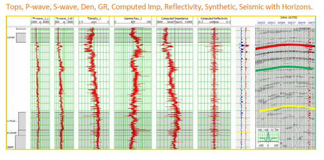
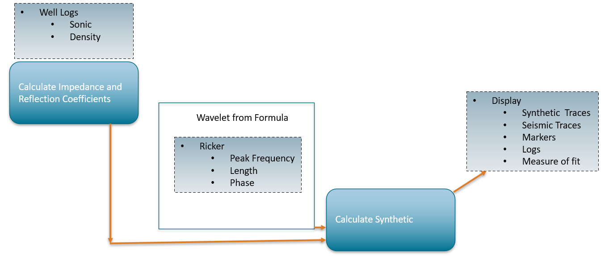
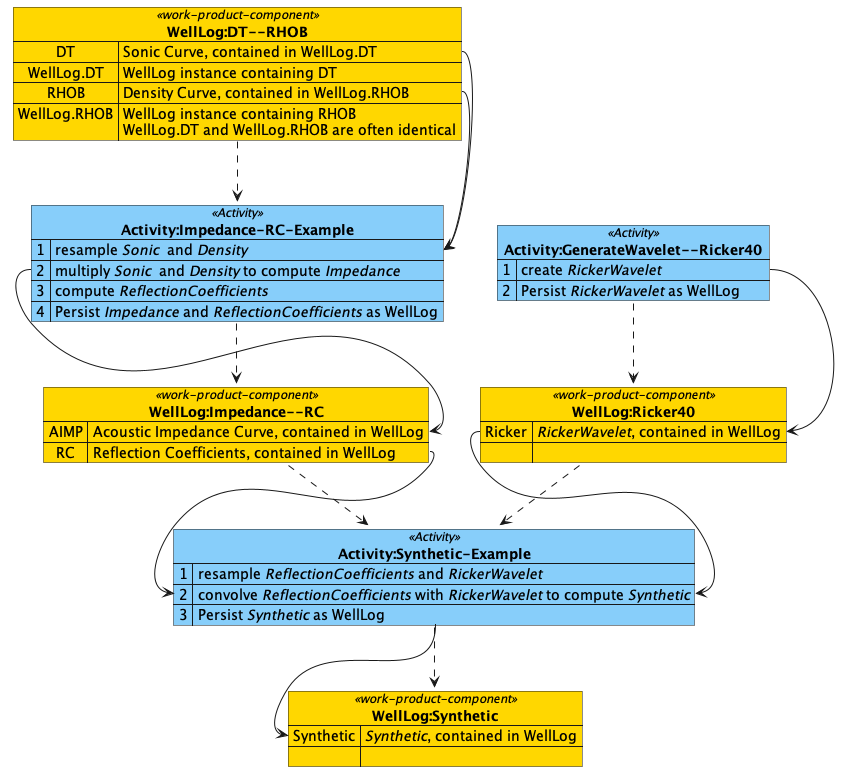
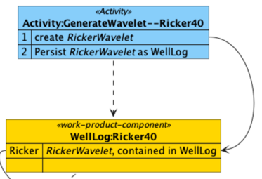
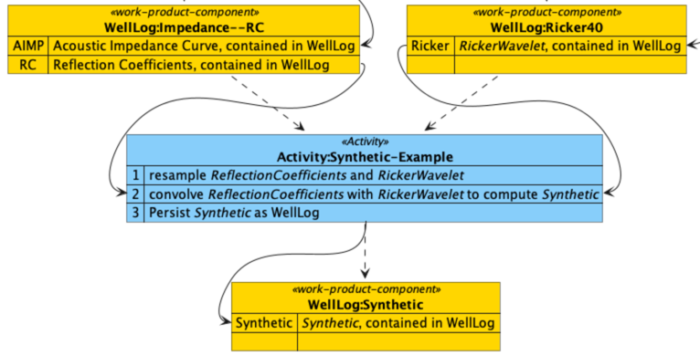
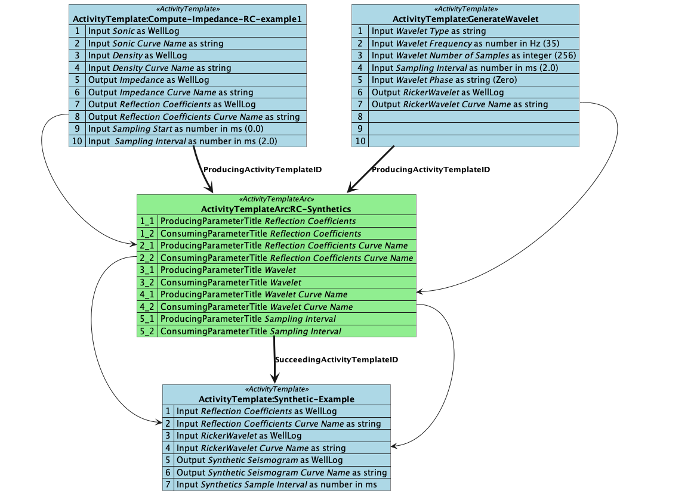

<a name="TOC"></a>

[[_TOC_]]

# Seismic Well Tie

Synthetic seismograms are used to correlate well logs and seismic traces. The 1D acoustic case is produced by convolving
a wavelet with reflection coefficients. The reflection coefficients are calculated from sonic and density logs.

# Synthetic Preparation

The steps in preparation for generation of a synthetic are:

- Edit and calibrate the sonic and density curves
- Select a seismic volume to be used for the well seismic tie
- Identify any other information that can be used to determine or validate the tie, include logs, tops, and horizons
- Check the datum and deviation logs
- Examine the seismic bandwidth to be used to estimate and initial wavelet

A typical seismic well tie display is illustrated:



[Back to TOC](#TOC)

---

# Steps in Generating Synthetic

- Select a curve for Time-Depth conversion.   Perform checkshot correction.
- Generate the acoustic impedance and reflection coefficients
- Generate a wavelet.  Initially use a zero-phase Ricker.
- Calculate the synthetic by convolution of the reflection coefficients with the wavelet
- Optionally examine the tie (not covered in the worked examples):
  - Update the T-Z curve
  - Refine the wavelet
  - Calculate new synthetic

[Back to TOC](#TOC)

---

# Activity Model

The Activity Model will be used to describe the steps in calculation of a synthetic. The examples will illustrate the
following steps.



[Back to TOC](#TOC)

---

The example sequence does not include checkshot correction; it is assumed that the Sonic log is already
checkshot-corrected. The sequence covered in the worked example is the following diagram:

#### Figure 1: Synthetics Activity Instances



[Back to TOC](#TOC)

---

## Calculate Impedance and Reflection Coefficients

The first activity in the sequence manages the task of loading the input sonic and density logs, resampling them so that
an impedance log can be computed. Based on the impedance the reflection coefficients are computed (one can consider the
three steps as activities themselves but for the example the tasks have been combined in one activity instance).

[Back to TOC](#TOC)

---

### Control Parameters Impedance and Reflection Coefficients

The example assumes that the impedance and reflection coefficient log curves are regularly resample in seismic two-way
travel time. The SamplingStart and SamplingInterval are control parameters to the computation process.

<details>

<summary markdown="span">Activity:Impedance-RC-Example control parameter declaration.</summary>

<OsduImportJSON>[Activity:Impedance-RC-Example, full record](records/Activity-Impedance-RC-Example.json#only.data.Parameters[8]|Parameters[9])</OsduImportJSON>

```json
{
  "data": {
    "Parameters": [
      {
        "Title": "Sampling Start",
        "Selection": "Default from ActivityTemplate",
        "DataQuantityParameter": 0.0,
        "ParameterKindID": "partition-id:reference-data--ParameterKind:Double:",
        "ParameterRoleID": "partition-id:reference-data--ParameterRole:Input:",
        "DataQuantityParameterUOMID": "partition-id:reference-data--UnitOfMeasure:ms:"
      },
      {
        "Title": "Sampling Interval",
        "Selection": "Default from ActivityTemplate",
        "DataQuantityParameter": 0.5,
        "ParameterKindID": "partition-id:reference-data--ParameterKind:Double:",
        "ParameterRoleID": "partition-id:reference-data--ParameterRole:Input:",
        "DataQuantityParameterUOMID": "partition-id:reference-data--UnitOfMeasure:ms:"
      }
    ]
  }
}
```

</details>

[Back to TOC](#TOC)

---

### Inputs to Impedance and Reflection Coefficients

The computation requires a sonic and a density curve as input. The input identifies the source WellLog record `id` and
the `data.Curves[].CurveID` name. The expandable sections below highlight the individual elements in
the `data.Parameters[]` array.

<details>

<summary markdown="span">Activity:Impedance-RC-Example sonic input declaration.</summary>

<OsduImportJSON>[Activity:Impedance-RC-Example, full record](records/Activity-Impedance-RC-Example.json#only.data.Parameters[0]|Parameters[1])</OsduImportJSON>

```json
{
  "data": {
    "Parameters": [
      {
        "Title": "WellLog with Sonic Curve",
        "Selection": "Selected by end-user",
        "DataObjectParameter": "partition-id:work-product-component--WellLog:DT--RHOB:",
        "ParameterKindID": "partition-id:reference-data--ParameterKind:DataObject:",
        "ParameterRoleID": "partition-id:reference-data--ParameterRole:Input:"
      },
      {
        "Title": "Sonic Curve Name",
        "Selection": "Selected by end-user",
        "StringParameter": "DT",
        "ParameterKindID": "partition-id:reference-data--ParameterKind:String:",
        "ParameterRoleID": "partition-id:reference-data--ParameterRole:Input:"
      }
    ]
  }
}
```

</details>
<details>

<summary markdown="span">Activity:Impedance-RC-Example density input declaration.</summary>

<OsduImportJSON>[Activity:Impedance-RC-Example, full record](records/Activity-Impedance-RC-Example.json#only.data.Parameters[2]|Parameters[3])</OsduImportJSON>

```json
{
  "data": {
    "Parameters": [
      {
        "Title": "WellLog with Density Curve",
        "Selection": "Selected by end-user",
        "DataObjectParameter": "partition-id:work-product-component--WellLog:DT--RHOB:",
        "ParameterKindID": "partition-id:reference-data--ParameterKind:DataObject:",
        "ParameterRoleID": "partition-id:reference-data--ParameterRole:Input:"
      },
      {
        "Title": "Density Curve Name",
        "Selection": "Selected by end-user",
        "StringParameter": "RHOB",
        "ParameterKindID": "partition-id:reference-data--ParameterKind:String:",
        "ParameterRoleID": "partition-id:reference-data--ParameterRole:Input:"
      }
    ]
  }
}
```

</details>
<details>

<summary markdown="span">WellLog:DT--RHOB Curve definitions as addressed by the previous Activity input parameters.</summary>

<OsduImportJSON>[WellLog:DT--RHOB, full record](records/WellLog.DT--RHOB.json#only.data.Curves[2]|Curves[3])</OsduImportJSON>

```json
{
  "data": {
    "Curves": [
      {
        "CurveID": "DT",
        "Mnemonic": "DT",
        "CurveUnit": "partition-id:reference-data--UnitOfMeasure:us%2Fft:",
        "LogCurveTypeID": "partition-id:reference-data--LogCurveType:Schlumberger:DT:",
        "LogCurveFamilyID": "partition-id:reference-data--LogCurveFamily:Acoustic%20Slowness:",
        "LogCurveMainFamilyID": "partition-id:reference-data--LogCurveMainFamily:Slowness:",
        "TopDepth": 2182.0,
        "BaseDepth": 2481.0
      },
      {
        "CurveID": "RHOB",
        "Mnemonic": "RHOB",
        "CurveUnit": "partition-id:reference-data--UnitOfMeasure:g%2Fcm3:",
        "LogCurveTypeID": "partition-id:reference-data--LogCurveType:Schlumberger:RHOB:",
        "LogCurveFamilyID": "partition-id:reference-data--LogCurveFamily:Bulk%20Density:",
        "LogCurveMainFamilyID": "partition-id:reference-data--LogCurveMainFamily:Density:",
        "TopDepth": 2282.0,
        "BaseDepth": 2460.0
      }
    ]
  }
}
```

</details>

[Back to TOC](#TOC)

---

### Outputs from Impedance and Reflection Coefficients

Similar to the input, the target WellLog record `id` and `data.Curves[].CurveID` name must be specified.

<details>

<summary markdown="span">Activity:Impedance-RC-Example impedance output declaration.</summary>

<OsduImportJSON>[Activity:Impedance-RC-Example, full record](records/Activity-Impedance-RC-Example.json#only.data.Parameters[4]|Parameters[5])</OsduImportJSON>

```json
{
  "data": {
    "Parameters": [
      {
        "Title": "WellLog with Impedance Curve",
        "Selection": "Selected by end-user",
        "DataObjectParameter": "partition-id:work-product-component--WellLog:Impedance--RC:",
        "ParameterKindID": "partition-id:reference-data--ParameterKind:DataObject:",
        "ParameterRoleID": "partition-id:reference-data--ParameterRole:Output:"
      },
      {
        "Title": "Impedance Curve Name",
        "Selection": "Selected by end-user",
        "StringParameter": "Impedance",
        "ParameterKindID": "partition-id:reference-data--ParameterKind:String:",
        "ParameterRoleID": "partition-id:reference-data--ParameterRole:Output:"
      }
    ]
  }
}
```

</details>
<details>

<summary markdown="span">Activity:Impedance-RC-Example reflection coefficient output declaration.</summary>

<OsduImportJSON>[Activity:Impedance-RC-Example, full record](records/Activity-Impedance-RC-Example.json#only.data.Parameters[6]|Parameters[7])</OsduImportJSON>

```json
{
  "data": {
    "Parameters": [
      {
        "Title": "WellLog with Reflection Coefficients Curve",
        "Selection": "Selected by end-user",
        "DataObjectParameter": "partition-id:work-product-component--WellLog:Impedance--RC:",
        "ParameterKindID": "partition-id:reference-data--ParameterKind:DataObject:",
        "ParameterRoleID": "partition-id:reference-data--ParameterRole:Output:"
      },
      {
        "Title": "Reflection Coefficients Curve Name",
        "Selection": "Selected by end-user",
        "StringParameter": "RC",
        "ParameterKindID": "partition-id:reference-data--ParameterKind:String:",
        "ParameterRoleID": "partition-id:reference-data--ParameterRole:Output:"
      }
    ]
  }
}
```

</details>
<details>

<summary markdown="span">WellLog:Impedance--RC output Curve definitions as defined by the previous Activity output parameters.</summary>

<OsduImportJSON>[WellLog:Impedance--RC, full record](records/WellLog.Impedance--RC.json#only.data.ReferenceCurveID|SamplingStart|SamplingStop|SamplingInterval|Curves[2]|Curves[3])</OsduImportJSON>

```json
{
  "data": {
    "ReferenceCurveID": "TravelTime",
    "SamplingStart": 0.0,
    "SamplingStop": 2432.0,
    "SamplingInterval": 0.5,
    "Curves": [
      {
        "CurveID": "Impedance",
        "Mnemonic": "AIMP",
        "LogCurveTypeID": "partition-id:reference-data--LogCurveType:Schlumberger:AIMP:",
        "LogCurveFamilyID": "partition-id:reference-data--LogCurveFamily:Acoustic%20Impedance:",
        "LogCurveMainFamilyID": "partition-id:reference-data--LogCurveMainFamily:GeophysicalSynthetics:",
        "CurveUnit": "partition-id:reference-data--UnitOfMeasure:g.ft%2F%28cm3.s%29:"
      },
      {
        "CurveID": "RC",
        "Mnemonic": "RC",
        "CurveUnit": "partition-id:reference-data--UnitOfMeasure:Euc:",
        "LogCurveTypeID": "partition-id:reference-data--LogCurveType:Schlumberger:REFL:",
        "LogCurveFamilyID": "partition-id:reference-data--LogCurveFamily:Reflection%20Coefficient:",
        "LogCurveMainFamilyID": "partition-id:reference-data--LogCurveMainFamily:GeophysicalSynthetics:"
      }
    ]
  }
}
```

</details>
<details>

<summary markdown="span">WellLog:Impedance--RC output LineageAssertions to capture simplistic lineage on the result (input WellLog and producing Activity).</summary>

<OsduImportJSON>[WellLog:Impedance--RC, full record](records/WellLog.Impedance--RC.json#only.data.LineageAssertions[])</OsduImportJSON>

```json
{
  "data": {
    "LineageAssertions": [
      {
        "ID": "partition-id:work-product-component--WellLog:DT-RHOB:",
        "LineageRelationshipType": "partition-id:reference-data--LineageRelationshipType:Direct:"
      },
      {
        "ID": "partition-id:work-product-component--Activity:Impedance-RC-Example:",
        "LineageRelationshipType": "partition-id:reference-data--LineageRelationshipType:Reference:"
      }
    ]
  }
}
```

</details>

[Back to TOC](#TOC)

---

### ActivityState

It is good practice to record the status of the activity. For short running activities it is not required the populate
the `data.ActivityStates[]` array, which can hold the history of the activity lifecycle. In this case only
the `data.LastActivityState` is populated to
record [ActivityStatus](../../../E-R/reference-data/ActivityStatus.1.0.0.md). An example is given below:

<details>

<summary markdown="span">Activity:Impedance--RC ActivityState capture.</summary>

<OsduImportJSON>[Activity:Impedance--RC, full record](records/Activity-Impedance-RC-Example.json#only.data.LastActivityState)</OsduImportJSON>

```json
{
  "data": {
    "LastActivityState": {
      "EffectiveDateTime": "2021-04-04T09:12:05.28Z",
      "TerminationDateTime": "2021-04-04T09:12:05.28Z",
      "ActivityStatusID": "partition-id:reference-data--ActivityStatus:Completed:",
      "Remark": "Success"
    }
  }
}
```
</details>

[Back to TOC](#TOC)

---

### Activity Template for Impedance and Reflection Coefficients

The next level of abstraction is achieved by the introduction of
[ActivityTemplates](../../../E-R/master-data/ActivityTemplate.1.2.0.md), which allow to describe the activity
parameters, their roles, cardinality, and expected value types. The ActivityTemplate parameters are linked to the
Activity record parameters by the `Title` property.

<details>

<summary markdown="span">ActivityTemplate-Impedance-RC-Example parameter specifications.</summary>

<OsduImportJSON>[ActivityTemplate-Impedance-RC-Example, full record](records/ActivityTemplate-Impedance-RC-Example.json#only.data.Parameters[])</OsduImportJSON>

```json
{
  "data": {
    "Parameters": [
      {
        "Title": "WellLog with Sonic Curve",
        "AllowedParameterKind": "partition-id:reference-data--ParameterKind:DataObject:",
        "IsInput": true,
        "IsOutput": false,
        "DataObjectContentType": [
          "work-product-component--WellLog"
        ],
        "MaxOccurs": 1,
        "MinOccurs": 1
      },
      {
        "Title": "Sonic Curve Name",
        "AllowedParameterKind": "partition-id:reference-data--ParameterKind:String:",
        "IsInput": true,
        "IsOutput": false,
        "MaxOccurs": 1,
        "MinOccurs": 1
      },
      {
        "Title": "WellLog with Density Curve",
        "AllowedParameterKind": "partition-id:reference-data--ParameterKind:DataObject:",
        "IsInput": true,
        "IsOutput": false,
        "DataObjectContentType": [
          "work-product-component--WellLog"
        ],
        "MaxOccurs": 1,
        "MinOccurs": 0
      },
      {
        "Title": "Density Curve Name",
        "AllowedParameterKind": "partition-id:reference-data--ParameterKind:String:",
        "IsInput": true,
        "IsOutput": false,
        "MaxOccurs": 1,
        "MinOccurs": 1
      },
      {
        "Title": "WellLog with Impedance Curve",
        "AllowedParameterKind": "partition-id:reference-data--ParameterKind:DataObject:",
        "IsInput": false,
        "IsOutput": true,
        "DataObjectContentType": [
          "work-product-component--WellLog"
        ],
        "MaxOccurs": 1,
        "MinOccurs": 1
      },
      {
        "Title": "Impedance Curve Name",
        "AllowedParameterKind": "partition-id:reference-data--ParameterKind:String:",
        "IsInput": false,
        "IsOutput": true,
        "MaxOccurs": 1,
        "MinOccurs": 1
      },
      {
        "Title": "WellLog with Reflection Coefficients Curve",
        "AllowedParameterKind": "partition-id:reference-data--ParameterKind:DataObject:",
        "IsInput": false,
        "IsOutput": true,
        "DataObjectContentType": [
          "work-product-component--WellLog"
        ],
        "MaxOccurs": 1,
        "MinOccurs": 1
      },
      {
        "Title": "Reflection Coefficients Curve Name",
        "AllowedParameterKind": "partition-id:reference-data--ParameterKind:String:",
        "IsInput": false,
        "IsOutput": true,
        "MaxOccurs": 1,
        "MinOccurs": 1
      },
      {
        "Title": "Sampling Start",
        "AllowedParameterKind": "partition-id:reference-data--ParameterKind:Double:",
        "IsInput": true,
        "IsOutput": false,
        "MaxOccurs": 1,
        "MinOccurs": 1,
        "DefaultValue": {
          "Title": "Sampling Start",
          "Selection": "Selected by end-user",
          "DataQuantityParameter": 0.0,
          "ParameterKindID": "partition-id:reference-data--ParameterKind:Double:",
          "ParameterRoleID": "partition-id:reference-data--ParameterRole:Input:",
          "DataQuantityParameterUOMID": "partition-id:reference-data--UnitOfMeasure:ms:"
        }
      },
      {
        "Title": "Sampling Interval",
        "AllowedParameterKind": "partition-id:reference-data--ParameterKind:Double:",
        "IsInput": true,
        "IsOutput": false,
        "MaxOccurs": 1,
        "MinOccurs": 1,
        "DefaultValue": {
          "Title": "Sampling Interval",
          "Selection": "Selected by end-user",
          "DataQuantityParameter": 0.5,
          "ParameterKindID": "partition-id:reference-data--ParameterKind:Double:",
          "ParameterRoleID": "partition-id:reference-data--ParameterRole:Input:",
          "DataQuantityParameterUOMID": "partition-id:reference-data--UnitOfMeasure:ms:"
        }
      }
    ]
  }
}
```

</details>
<details>

<summary markdown="span">Activity:Impedance-RC-Example refers to ActivityTemplate:Impedance--RC.</summary>

<OsduImportJSON>[Activity:Impedance-RC-Example, full record](records/Activity-Impedance-RC-Example.json#only.data.ActivityTemplateID)</OsduImportJSON>

```json
{
  "data": {
    "ActivityTemplateID": "partition-id:master-data--ActivityTemplate:Compute-Impedance-RC-example1:"
  }
}
```

</details>

With this information, generic consumers can understand the context of the activity parameters. Using the
ActivityTemplate it is theoretically possible to standardize the business process for impedance and reflectivity
calculation for different calculation engines/vendors.

In this example the activity outputs were exclusively expected to be `work-product-component--WellLog` kinds. Sometimes
synthetics along with the impedance curves are stored as SEGY traces. In this case the output
`DataObjectParameter` would be changed to a `work-product-component--SeismicTraceData` with an associated SEGY file.


[Back to TOC](#TOC)

---

## Generate Wavelet

The example will use a Ricker wavelet generation. The following picture zooms in on this simple activity:

#### Figure 2: Ricker Wavelet Generation



### Wavelet Generation Control Parameters

The activity captures the parameters to create a Ricker wavelet.
These are:
* Wavelet Type
* Wavelet Frequency
* Wavelet Number of Samples
* Wavelet Sample Interval
* Wavelet Phase

<details>

<summary markdown="span">Activity:GenerateWavelet--Ricker40 contains the wavelet control parameters.</summary>

<OsduImportJSON>[Activity:GenerateWavelet--Ricker40, full record](records/Activity-GenerateWavelet--Ricker40.json#only.data.Parameters[0]|Parameters[1]|Parameters[2]|Parameters[3]|Parameters[4])</OsduImportJSON>

```json
{
  "data": {
    "Parameters": [
      {
        "Title": "Wavelet Type",
        "Selection": "Selected by end-user",
        "StringParameter": "Ricker",
        "ParameterKindID": "partition-id:reference-data--ParameterKind:String:",
        "ParameterRoleID": "partition-id:reference-data--ParameterRole:Input:"
      },
      {
        "Title": "Wavelet Frequency",
        "Selection": "Selected by end-user",
        "DataQuantityParameter": 40,
        "ParameterKindID": "partition-id:reference-data--ParameterKind:Double:",
        "ParameterRoleID": "partition-id:reference-data--ParameterRole:Input:",
        "DataQuantityParameterUOMID": "partition-id:reference-data--UnitOfMeasure:Hz:"
      },
      {
        "Title": "Wavelet Number of Samples",
        "Selection": "Default from ActivityTemplate",
        "IntegerQuantityParameter": 256,
        "ParameterKindID": "partition-id:reference-data--ParameterKind:Integer:",
        "ParameterRoleID": "partition-id:reference-data--ParameterRole:Input:"
      },
      {
        "Title": "Wavelet Sample Interval",
        "Selection": "Selected by end-user",
        "DataQuantityParameter": 0.5,
        "ParameterKindID": "partition-id:reference-data--ParameterKind:Double:",
        "ParameterRoleID": "partition-id:reference-data--ParameterRole:Input:",
        "DataQuantityParameterUOMID": "partition-id:reference-data--UnitOfMeasure:ms:"
      },
      {
        "Title": "Wavelet Phase",
        "Selection": "Default from ActivityTemplate",
        "StringParameter": "Zero",
        "ParameterKindID": "partition-id:reference-data--ParameterKind:String:",
        "ParameterRoleID": "partition-id:reference-data--ParameterRole:Input:"
      }
    ]
  }
}
```
</details>

[Back to TOC](#TOC)

---

### Wavelet Output Parameters and Outputs

The example assumes that the wavelet is persisted as a `work-product-component--WellLog` with a Curve description. The output specification is as follows:

<details>

<summary markdown="span">Activity:GenerateWavelet--Ricker40 output parameters.</summary>

<OsduImportJSON>[Activity:GenerateWavelet--Ricker40, full record](records/Activity-GenerateWavelet--Ricker40.json#only.data.Parameters[5]|Parameters[6])</OsduImportJSON>

```json
{
  "data": {
    "Parameters": [
      {
        "Title": "Output Ricker Wavelet WellLog",
        "Selection": "Selected by end-user",
        "DataObjectParameter": "partition-id:work-product-component--WellLog:Ricker40:",
        "ParameterKindID": "partition-id:reference-data--ParameterKind:DataObject:",
        "ParameterRoleID": "partition-id:reference-data--ParameterRole:Output:"
      },
      {
        "Title": "Output Ricker Wavelet Curve Name",
        "Selection": "Selected by end-user",
        "StringParameter": "Ricker40:",
        "ParameterKindID": "partition-id:reference-data--ParameterKind:String:",
        "ParameterRoleID": "partition-id:reference-data--ParameterRole:Output:"
      }
    ]
  }
}
```
</details>
<details>

<summary markdown="span">WellLog.Ricker40 Curve definitions as defined by the previous Activity output parameters.</summary>

<OsduImportJSON>[WellLog.Ricker40, full record](records/WellLog.Ricker40.json#only.data.ReferenceCurveID|SamplingStart|SamplingStop|SamplingInterval|Curves[0]|Curves[1])</OsduImportJSON>

```json
{
  "data": {
    "ReferenceCurveID": "TravelTime",
    "SamplingStart": -200.0,
    "SamplingStop": 200.0,
    "SamplingInterval": 4.0,
    "Curves": [
      {
        "CurveID": "TravelTime",
        "Mnemonic": "TIME",
        "LogCurveTypeID": "partition-id:reference-data--LogCurveType:Schlumberger:TIME:",
        "CurveUnit": "partition-id:reference-data--UnitOfMeasure:ms:",
        "LogCurveFamilyID": "partition-id:reference-data--LogCurveFamily:Two-Way%20Time:"
      },
      {
        "CurveID": "Ricker40",
        "LogCurveTypeID": "partition-id:reference-data--LogCurveType:Schlumberger:V1:",
        "LogCurveFamilyID": "partition-id:reference-data--LogCurveFamily:Waveform:",
        "LogCurveMainFamilyID": "partition-id:reference-data--LogCurveMainFamily:GeophysicalSynthetics:"
      }
    ]
  }
}
```

</details>
<details>

<summary markdown="span">WellLog.Ricker40 LineageAssertions to producing Activity.</summary>

<OsduImportJSON>[WellLog.Ricker40, full record](records/WellLog.Ricker40.json#only.data.LineageAssertions[])</OsduImportJSON>

```json
{
  "data": {
    "LineageAssertions": [
      {
        "ID": "partition-id:work-product-component--Activity:GenerateWavelet-Ricker40:",
        "LineageRelationshipType": "partition-id:reference-data--LineageRelationshipType:Reference:"
      }
    ]
  }
}
```

</details>

[Back to TOC](#TOC)

---

### Activity Template for Wavelet

The template for a Wavelet Generation process would for example be described by the following parameter specifications,
which includes defaults:

<details>

<summary markdown="span">ActivityTemplate:GenerateWavelet parameter specifications.</summary>

<OsduImportJSON>[ActivityTemplate:GenerateWavelet, full record](records/ActivityTemplate-GenerateWavelet.json#only.data.Parameters[])</OsduImportJSON>

```json
{
  "data": {
    "Parameters": [
      {
        "Title": "Wavelet Type",
        "AllowedParameterKind": "partition-id:reference-data--ParameterKind:String:",
        "IsInput": true,
        "IsOutput": false,
        "MaxOccurs": 1,
        "MinOccurs": 1,
        "DefaultValue": {
          "Title": "Wavelet Type",
          "Selection": "Default from ActivityTemplate",
          "StringParameter": "Ricker",
          "ParameterKindID": "partition-id:reference-data--ParameterKind:String:",
          "ParameterRoleID": "partition-id:reference-data--ParameterRole:Input:"
        }
      },
      {
        "Title": "Wavelet Frequency",
        "AllowedParameterKind": "partition-id:reference-data--ParameterKind:Double:",
        "IsInput": true,
        "IsOutput": false,
        "MaxOccurs": 1,
        "MinOccurs": 1,
        "DefaultValue": {
          "Title": "Wavelet Frequency",
          "Selection": "Default from ActivityTemplate",
          "DataQuantityParameter": 35.0,
          "ParameterKindID": "partition-id:reference-data--ParameterKind:Double:",
          "ParameterRoleID": "partition-id:reference-data--ParameterRole:Input:",
          "DataQuantityParameterUOMID": "partition-id:reference-data--UnitOfMeasure:Hz:"
        }
      },
      {
        "Title": "Wavelet Number of Samples",
        "AllowedParameterKind": "partition-id:reference-data--ParameterKind:Integer:",
        "IsInput": true,
        "IsOutput": false,
        "MaxOccurs": 1,
        "MinOccurs": 1,
        "DefaultValue": {
          "Title": "Wavelet Number of Samples",
          "Selection": "Default from ActivityTemplate",
          "IntegerQuantityParameter": 256,
          "ParameterKindID": "partition-id:reference-data--ParameterKind:Integer:",
          "ParameterRoleID": "partition-id:reference-data--ParameterRole:Input:"
        }
      },
      {
        "Title": "Wavelet Sample Interval",
        "AllowedParameterKind": "partition-id:reference-data--ParameterKind:Double:",
        "IsInput": true,
        "IsOutput": false,
        "MaxOccurs": 1,
        "MinOccurs": 1,
        "DefaultValue": {
          "Title": "Wavelet Sample Interval",
          "Selection": "Default from ActivityTemplate",
          "DataQuantityParameter": 2.0,
          "ParameterKindID": "partition-id:reference-data--ParameterKind:Double:",
          "ParameterRoleID": "partition-id:reference-data--ParameterRole:Input:",
          "DataQuantityParameterUOMID": "partition-id:reference-data--UnitOfMeasure:ms:"
        }
      },
      {
        "Title": "Wavelet Phase",
        "AllowedParameterKind": "partition-id:reference-data--ParameterKind:String:",
        "IsInput": true,
        "IsOutput": false,
        "MaxOccurs": 1,
        "MinOccurs": 1,
        "DefaultValue": {
          "Title": "Wavelet Sample Interval",
          "Selection": "Default by ActivityTemplate",
          "StringParameter": "Zero",
          "ParameterKindID": "partition-id:reference-data--ParameterKind:String:",
          "ParameterRoleID": "partition-id:reference-data--ParameterRole:Input:"
        }
      },
      {
        "Title": "Output Ricker Wavelet WellLog",
        "AllowedParameterKind": "partition-id:reference-data--ParameterKind:DataObject:",
        "IsInput": false,
        "IsOutput": true,
        "DataObjectContentType": [
          "work-product-component--WellLog"
        ],
        "MaxOccurs": 1,
        "MinOccurs": 1
      },
      {
        "Title": "Output Ricker Wavelet Curve Name",
        "AllowedParameterKind": "partition-id:reference-data--ParameterKind:String:",
        "IsInput": false,
        "IsOutput": true,
        "MaxOccurs": 1,
        "MinOccurs": 1
      }
    ]
  }
}
```

</details>
<details>

<summary markdown="span">Activity:GenerateWavelet--Ricker40 refers to ActivityTemplate:GenerateWavelet.</summary>

<OsduImportJSON>[Activity:GenerateWavelet--Ricker40, full record](records/Activity-GenerateWavelet--Ricker40.json#only.data.ActivityTemplateID)</OsduImportJSON>

```json
{
  "data": {
    "ActivityTemplateID": "partition-id:master-data--ActivityTemplate:GenerateWavelet:"
  }
}
```

</details>

[Back to TOC](#TOC)

---

## Calculate Synthetics

This activity combines the outputs from the previous activities, the Reflection Coefficients and the Ricker Wavelet. The
following picture zooms in on this activity:

#### Figure 3: Synthetics Calculation Instances



[Back to TOC](#TOC)

---

### Control Parameters for Synthetics

The two input curves may be sampled with different sampling intervals. The "Sampling Interval" parameter determines the
output sampling interval. The Synthetics Generation will re-sample the inputs if they do not match the requested
sampling interval.

<details>

<summary markdown="span">Activity:Synthetic-Example control parameter declaration.</summary>

<OsduImportJSON>[Activity:Synthetic-Example, full record](records/Activity-Synthetic-Example.json#only.data.Parameters[6]|PriorActivityIDs[])</OsduImportJSON>

```json
{
  "data": {
    "Parameters": [
      {
        "Title": "Synthetics Sample Interval",
        "Selection": "Selected by end-user",
        "DataQuantityParameter": 0.5,
        "ParameterKindID": "partition-id:reference-data--ParameterKind:Integer:",
        "ParameterRoleID": "partition-id:reference-data--ParameterRole:Input:",
        "DataQuantityParameterUOMID": "partition-id:reference-data--UnitOfMeasure:ms:"
      }
    ],
    "PriorActivityIDs": [
      "partition-id:work-product-component--Activity:Impedance--RC-Example:",
      "partition-id:work-product-component--Activity:GenerateWavelet-Ricker40:"
    ]
  }
}
```

</details>

For tracking purposes, the previous activity records, which were responsible for the inputs are recorded as well.

<details>

<summary markdown="span">Activity:Synthetic-Example prior activity relationships.</summary>

<OsduImportJSON>[Activity:Synthetic-Example, full record](records/Activity-Synthetic-Example.json#only.data.PriorActivityIDs[])</OsduImportJSON>

```json
{
  "data": {
    "PriorActivityIDs": [
      "partition-id:work-product-component--Activity:Impedance--RC-Example:",
      "partition-id:work-product-component--Activity:GenerateWavelet-Ricker40:"
    ]
  }
}
```

</details>

### Inputs to Synthetics

The inputs will likely come from different WellLog instances - The wavelet is generally kept separate in order to be
reusable in multiple synthetic generation activities.

<details>

<summary markdown="span">Activity:Synthetic-Example input Reflection Coefficient declaration.</summary>

<OsduImportJSON>[Activity:Synthetic-Example, full record](records/Activity-Synthetic-Example.json#only.data.Parameters[0]|Parameters[1])</OsduImportJSON>

```json
{
  "data": {
    "Parameters": [
      {
        "Title": "Input Reflection Coefficients WellLog",
        "Selection": "Selected by end-user",
        "DataObjectParameter": "partition-id:work-product-component--WellLog:Impedance--RC:",
        "ParameterKindID": "partition-id:reference-data--ParameterKind:DataObject:",
        "ParameterRoleID": "partition-id:reference-data--ParameterRole:Input:"
      },
      {
        "Title": "Input Reflection Coefficients Curve Name",
        "Selection": "Selected by end-user",
        "StringParameter": "RC",
        "ParameterKindID": "partition-id:reference-data--ParameterKind:String:",
        "ParameterRoleID": "partition-id:reference-data--ParameterRole:Input:"
      }
    ]
  }
}
```

</details>
<details>

<summary markdown="span">Activity:Synthetic-Example input Ricker Wavelet declaration.</summary>

<OsduImportJSON>[Activity:Synthetic-Example, full record](records/Activity-Synthetic-Example.json#only.data.Parameters[2]|Parameters[3])</OsduImportJSON>

```json
{
  "data": {
    "Parameters": [
      {
        "Title": "Input Ricker Wavelet WellLog",
        "Selection": "Selected by end-user",
        "DataObjectParameter": "partition-id:work-product-component--WellLog:Ricker40:",
        "ParameterKindID": "partition-id:reference-data--ParameterKind:DataObject:",
        "ParameterRoleID": "partition-id:reference-data--ParameterRole:Input:"
      },
      {
        "Title": "Input Ricker Wavelet Curve Name",
        "Selection": "Selected by end-user",
        "StringParameter": "Ricker40",
        "ParameterKindID": "partition-id:reference-data--ParameterKind:String:",
        "ParameterRoleID": "partition-id:reference-data--ParameterRole:Input:"
      }
    ]
  }
}
```

</details>

With these parameters the convolution operation can succeed.

[Back to TOC](#TOC)

---

### Output from Synthetics

<details>

<summary markdown="span">Activity:Synthetic-Example output Synthetics declaration.</summary>

<OsduImportJSON>[Activity:Synthetic-Example, full record](records/Activity-Synthetic-Example.json#only.data.Parameters[4]|Parameters[5])</OsduImportJSON>

```json
{
  "data": {
    "Parameters": [
      {
        "Title": "Output Synthetic Seismogram WellLog",
        "Selection": "Selected by end-user",
        "DataObjectParameter": "partition-id:work-product-component--WellLog:Synthetic:",
        "ParameterKindID": "partition-id:reference-data--ParameterKind:DataObject:",
        "ParameterRoleID": "partition-id:reference-data--ParameterRole:Output:"
      },
      {
        "Title": "Output Synthetic Seismogram Curve Name",
        "Selection": "Default from ActivityTemplate",
        "StringParameter": "Synthetic Seismogram",
        "ParameterKindID": "partition-id:reference-data--ParameterKind:String:",
        "ParameterRoleID": "partition-id:reference-data--ParameterRole:Input:"
      }
    ]
  }
}
```
 </details>
<details>

<summary markdown="span">WellLog:Synthetic output Curve definition as defined by the previous Activity output parameters.</summary>

<OsduImportJSON>[WellLog:Synthetic, full record](records/WellLog.Synthetic.json#only.data.ReferenceCurveID|SamplingStart|SamplingStop|SamplingInterval|Curves[1])</OsduImportJSON>

```json
{
  "data": {
    "ReferenceCurveID": "TravelTime",
    "SamplingStart": 0.0,
    "SamplingStop": 2432.0,
    "SamplingInterval": 0.5,
    "Curves": [
      {
        "CurveID": "Synthetic Seismogram",
        "LogCurveTypeID": "partition-id:reference-data--LogCurveType:Schlumberger:SPRM:",
        "LogCurveFamilyID": "partition-id:reference-data--LogCurveFamily:Synthetic%20Seismogram:",
        "LogCurveMainFamilyID": "partition-id:reference-data--LogCurveMainFamily:Geophysics:"
      }
    ]
  }
}
```

</details>
<details>

<summary markdown="span">WellLog:Synthetic output LineageAssertions to input WellLog and producing Activity instances.</summary>

<OsduImportJSON>[WellLog:Synthetic, full record](records/WellLog.Synthetic.json#only.data.LineageAssertions[])</OsduImportJSON>

```json
{
  "data": {
    "LineageAssertions": [
      {
        "ID": "partition-id:work-product-component--WellLog:Impedance--RC:",
        "LineageRelationshipType": "partition-id:reference-data--LineageRelationshipType:Direct:"
      },
      {
        "ID": "partition-id:work-product-component--WellLog:Ricker40:",
        "LineageRelationshipType": "partition-id:reference-data--LineageRelationshipType:Direct:"
      },
      {
        "ID": "partition-id:work-product-component--Activity:Synthetic-Example:",
        "LineageRelationshipType": "partition-id:reference-data--LineageRelationshipType:Reference:"
      }
    ]
  }
}
```

</details>

[Back to TOC](#TOC)

---

### Activity Template for Synthetics

Similar to the previous activities, the calculation of a synthetic seismogram can be de-coupled from the actual inputs
and outputs as ActivityTemplate.

<details>

<summary markdown="span">ActivityTemplate:Synthetic-Example parameter specifications.</summary>

<OsduImportJSON>[ActivityTemplate:Synthetic-Example, full record](records/ActivityTemplate-Synthetic-Example.json#only.data.Parameters[])</OsduImportJSON>

```json
{
  "data": {
    "Parameters": [
      {
        "Title": "Input Reflection Coefficients WellLog",
        "AllowedParameterKind": "partition-id:reference-data--ParameterKind:DataObject:",
        "IsInput": true,
        "IsOutput": false,
        "DataObjectContentType": [
          "work-product-component--WellLog"
        ],
        "MaxOccurs": 1,
        "MinOccurs": 1
      },
      {
        "Title": "Input Reflection Coefficients Curve Name",
        "AllowedParameterKind": "partition-id:reference-data--ParameterKind:String:",
        "IsInput": true,
        "IsOutput": false,
        "MaxOccurs": 1,
        "MinOccurs": 1
      },
      {
        "Title": "Input Ricker Wavelet WellLog",
        "AllowedParameterKind": "partition-id:reference-data--ParameterKind:DataObject:",
        "IsInput": true,
        "IsOutput": false,
        "DataObjectContentType": [
          "work-product-component--WellLog"
        ],
        "MaxOccurs": 1,
        "MinOccurs": 1
      },
      {
        "Title": "Input Ricker Wavelet Curve Name",
        "AllowedParameterKind": "partition-id:reference-data--ParameterKind:String:",
        "IsInput": true,
        "IsOutput": false,
        "MaxOccurs": 1,
        "MinOccurs": 1
      },
      {
        "Title": "Output Synthetic Seismogram WellLog",
        "AllowedParameterKind": "partition-id:reference-data--ParameterKind:DataObject:",
        "IsInput": false,
        "IsOutput": true,
        "DataObjectContentType": [
          "work-product-component--WellLog"
        ],
        "MaxOccurs": 1,
        "MinOccurs": 1
      },
      {
        "Title": "Output Synthetic Seismogram Curve Name",
        "AllowedParameterKind": "partition-id:reference-data--ParameterKind:String:",
        "IsInput": false,
        "IsOutput": true,
        "MaxOccurs": 1,
        "MinOccurs": 1,
        "DefaultValue": {
          "Title": "Synthetics Curve Name",
          "Selection": "Default from ActivityTemplate",
          "StringParameter": "Synthetic Seismogram",
          "ParameterKindID": "partition-id:reference-data--ParameterKind:String:",
          "ParameterRoleID": "partition-id:reference-data--ParameterRole:Input:"
        }
      },
      {
        "Title": "Synthetics Sample Interval",
        "AllowedParameterKind": "partition-id:reference-data--ParameterKind:Double:",
        "IsInput": true,
        "IsOutput": false,
        "MaxOccurs": 1,
        "MinOccurs": 1,
        "DefaultValue": {
          "Title": "Synthetics Sample Interval",
          "Selection": "Default from ActivityTemplate",
          "DataQuantityParameter": 2.0,
          "ParameterKindID": "partition-id:reference-data--ParameterKind:Double:",
          "ParameterRoleID": "partition-id:reference-data--ParameterRole:Input:",
          "DataQuantityParameterUOMID": "partition-id:reference-data--UnitOfMeasure:ms:"
        }
      }
    ]
  }
}
```

</details>
<details>

<summary markdown="span">Activity:Synthetic-Example refers to ActivityTemplate:Synthetic-Example.</summary>

<OsduImportJSON>[Activity:GenerateWavelet--Ricker40, full record](records/Activity-Synthetic-Example.json#only.data.ActivityTemplateID)</OsduImportJSON>

```json
{
  "data": {
    "ActivityTemplateID": "partition-id:master-data--ActivityTemplate:GenerateSynthetics-example1:"
  }
}
```

</details>

[Back to TOC](#TOC)

---

# Activity Sequence Synthetics

The full power of the ActivityTemplate abstraction becomes obvious when the inputs and outputs of individual activities
are linked by means of the [ActivityTemplateArc](../../../E-R/master-data/ActivityTemplateArc.1.1.0.md).

The following picture shows — similar to [Figure 1](#figure-1-synthetics-activity-instances) — now the connection of
`ActivityTemplate` with `ActivityTemplateArc`:

#### Figure 4: Activity Sequence



To avoid cluttering, only the curve names are connected to show the output to input relationships between named (
via `Title`)

Here some record fragments showing the output-input associations:

<details>

<summary markdown="span">ActivityTemplateArc:RC-Synthetics — connecting ActivityTemplate instances.</summary>

<OsduImportJSON>[ActivityTemplateArc:RC-Synthetics, full record](records/ActivityTemplateArc-RC-Synthetics.json#only.data.Name|Description|ActivityArcs[])</OsduImportJSON>

```json
{
  "data": {
    "Name": "ReflectionCoefficients to Synthetics",
    "Description": "Declare the output of Impedance-RC-Example as inout to Synthetic",
    "ActivityArcs": [
      {
        "PrecedingActivityTemplateID": "partition-id:master-data--ActivityTemplate:Compute-Impedance-RC-example1:",
        "SucceedingActivityTemplateID": "partition-id:master-data--ActivityTemplate:GenerateSynthetics-example1:"
      },
      {
        "PrecedingActivityTemplateID": "partition-id:master-data--ActivityTemplate:GenerateWavelet:",
        "SucceedingActivityTemplateID": "partition-id:master-data--ActivityTemplate:GenerateSynthetics-example1:"
      }
    ]
  }
}
```

</details>

<details>

<summary markdown="span">ActivityTemplateArc:RC-Synthetics — OutputInputArcs[] for Reflection Coefficients: producing and consuming ActivityTemplates are linked.</summary>

<OsduImportJSON>[ActivityTemplateArc:RC-Synthetics, full record](records/ActivityTemplateArc-RC-Synthetics.json#only.data.OutputInputArcs[0]|OutputInputArcs[1])</OsduImportJSON>

```json
{
  "data": {
    "OutputInputArcs": [
      {
        "ProducingActivityTemplateID": "partition-id:master-data--ActivityTemplate:Compute-Impedance-RC-example1:",
        "ProducingParameterTitle": "WellLog with Reflection Coefficients Curve",
        "ConsumingActivityTemplateID": "partition-id:master-data--ActivityTemplate:GenerateSynthetics-example1:",
        "ConsumingParameterTitle": "WellLog with Reflection Coefficients Curve"
      },
      {
        "ProducingActivityTemplateID": "partition-id:master-data--ActivityTemplate:Compute-Impedance-RC-example1:",
        "ProducingParameterTitle": "Reflection Coefficients Curve Name",
        "ConsumingActivityTemplateID": "partition-id:master-data--ActivityTemplate:GenerateSynthetics-example1:",
        "ConsumingParameterTitle": "Reflection Coefficients Curve Name"
      }
    ]
  }
}
```

</details>

<details>

<summary markdown="span">ActivityTemplateArc:RC-Synthetics — OutputInputArcs[] for Ricker Wavelet: producing and consuming ActivityTemplates are linked.</summary>

<OsduImportJSON>[ActivityTemplateArc:RC-Synthetics, full record](records/ActivityTemplateArc-RC-Synthetics.json#only.data.OutputInputArcs[2]|OutputInputArcs[3])</OsduImportJSON>

```json
{
  "data": {
    "OutputInputArcs": [
      {
        "ProducingActivityTemplateID": "partition-id:master-data--ActivityTemplate:GenerateWavelet:",
        "ProducingParameterTitle": "WellLog with Wavelet",
        "ConsumingActivityTemplateID": "partition-id:master-data--ActivityTemplate:GenerateSynthetics-example1:",
        "ConsumingParameterTitle": "WellLog with Wavelet"
      },
      {
        "ProducingActivityTemplateID": "partition-id:master-data--ActivityTemplate:GenerateWavelet:",
        "ProducingParameterTitle": "Wavelet Curve Name",
        "ConsumingActivityTemplateID": "partition-id:master-data--ActivityTemplate:GenerateSynthetics-example1:",
        "ConsumingParameterTitle": "Wavelet Curve Name"
      }
    ]
  }
}
```

</details>

# Summary

These worked examples demonstrate the power of the OSDU activity model (based on Energistics).

* Business processes can be set up using
  * [master-data--ActivityTemplate](../../../E-R/master-data/ActivityTemplate.1.2.0.md), which specify the **_expected_**
    * control parameters, often defaulted
    * input relationships with type constraints
    * output relationships with type constraints
  * [master-data--ActivityTemplateArc](../../../E-R/master-data/ActivityTemplateArc.1.1.0.md) to chain ActivityTemplate
    instances and associate produced outputs to consuming ActivityTemplates.
  * [work-product-component--Activity](../../../E-R/work-product-component/Activity.1.4.0.md) capturing the **_actual_** inputs, controls and outputs.
* Applications can publish ActivityTemplates for automation and seamless integration into business processes.
  * Applications disclose their inputs and controls - without disclosing intellectual property related to the internals
    of the activity implementation.
  * Operators select the ActivityTemplate wrapping the application activities and chain them into business processes or
    workflows to keep data evergreen.

[Back to TOC](#TOC)

---