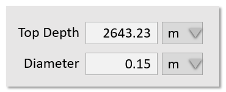
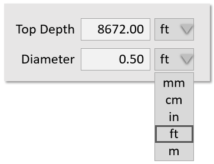
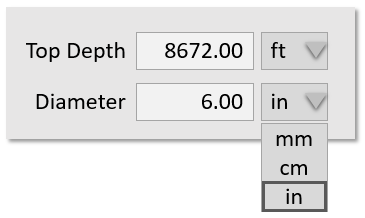
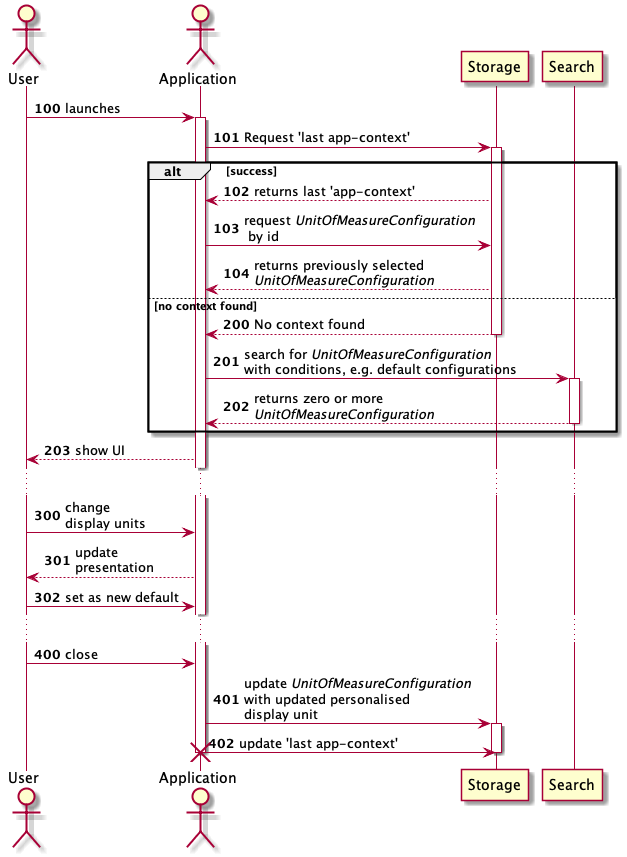

[[_TOC_]]

# Consistent Application Context using UnitOfMeasureConfiguration

The purpose of the `UnitOfMeasureConfiguration` is to provide an easy-to-use,
extensible configuration for display units in applications. For documentation, 
see [here](../../../E-R/reference-data/UnitOfMeasureConfiguration.1.0.0.md). 

## Display Units
Provide a default display unit
* given a `PropertyType` reference
* given a `UnitQuantity` reference
* given a list of property names - wildcards permitted.

## Choices
To enable quick changes of the display unit in applications, offer
a list of _**reasonable**_ units
* given a `PropertyType` reference
* given a `UnitQuantity` reference
* given a list of property names - wildcards permitted.

## Defaults
Operators (perhaps OSDU by default) can provide default configurations.
Applications can derive (if desired and necessary) application specific 
and even user specific configurations.

* Default [Operator Configuration record](./reference-data/UoMConfigurationOperator.json)
  <br>This configuration defaults every `UnitQuantity:length` to "ft".
  <br>from which one can derive
  * an app and/or [User specific Configuration record](./reference-data/UoMConfigurationAppUser.json).
    <br>This configuration distinguishes between depths and diameters

<details>

<summary markdown="span">"Operator" default configuration record (fragment).</summary>

<OsduImportJSON>[Complete operator Configuration record](./reference-data/UoMConfigurationOperator.json#only.data)</OsduImportJSON>

```json
{
  "data": {
    "Name": "Imperial OperatorABC",
    "Description": "Operator ABC default for length",
    "Code": "Imperial-OperatorABC",
    "Configurations": [
      {
        "Name": "Length",
        "UnitQuantityID": "namespace:reference-data--UnitQuantity:length:",
        "PropertyNames": [
          "*"
        ],
        "DefaultUnitID": "namespace:reference-data--UnitOfMeasure:ft:",
        "PreferredUnitIDs": [
          "namespace:reference-data--UnitOfMeasure:ft:",
          "namespace:reference-data--UnitOfMeasure:m:",
          "namespace:reference-data--UnitOfMeasure:in:",
          "namespace:reference-data--UnitOfMeasure:cm:",
          "namespace:reference-data--UnitOfMeasure:mm:"
        ],
        "NumericFormatType": "g",
        "NumericPrecision": 7
      }
    ],
    "ExtensionProperties": {}
  }
}
```
</details>

<details>

<summary markdown="span">User specific Configuration record (fragment).</summary>

<OsduImportJSON>[User specific Configuration record](./reference-data/UoMConfigurationAppUser.json#only.data)</OsduImportJSON>

```json
{
  "data": {
    "Name": "Imperial AppABC John",
    "Description": "Customized for AppABC and personalized by John.",
    "Code": "Imperial-AppABC-John",
    "ParentConfigurationID": "namespace:reference-data--UnitOfMeasureConfiguration:Imperial-OperatorABC:",
    "Configurations": [
      {
        "Name": "Depth",
        "UnitQuantityID": "namespace:reference-data--UnitQuantity:length:",
        "PropertyType": {
          "PropertyTypeID": "namespace:reference-data--PropertyType:4364b378-899a-403a-8401-b06abd4fc0cf:",
          "Name": "depth"
        },
        "PropertyNames": [
          "*Depth*",
          "*MD",
          "*TVD",
          "VerticalDatumOffset",
          "*VerticalDelta"
        ],
        "DefaultUnitID": "namespace:reference-data--UnitOfMeasure:ft:",
        "PreferredUnitIDs": [
          "namespace:reference-data--UnitOfMeasure:ft:",
          "namespace:reference-data--UnitOfMeasure:m:"
        ],
        "NumericFormatType": "f",
        "NumericPrecision": 2
      },
      {
        "Name": "Diameter",
        "UnitQuantityID": "namespace:reference-data--UnitQuantity:length:",
        "PropertyType": {
          "PropertyTypeID": "namespace:reference-data--PropertyType:a391d150-5f9d-43ec-be44-b3e020e8e0b9:",
          "Name": "inside diameter"
        },
        "PropertyNames": [
          "TubularComponentNominalSize",
          "*Diameter*"
        ],
        "DefaultUnitID": "namespace:reference-data--UnitOfMeasure:in:",
        "PreferredUnitIDs": [
          "namespace:reference-data--UnitOfMeasure:in:",
          "namespace:reference-data--UnitOfMeasure:cm:",
          "namespace:reference-data--UnitOfMeasure:mm:"
        ],
        "NumericFormatType": "f",
        "NumericPrecision": 2
      }
    ],
    "ExtensionProperties": {}
  }
}
```
</details>

The examples are deliberately short - and practically of limited use.

## Application Use Case
Let`s assume we have a data record which contains a depth and a diameter measurement, which
is presented in some application's user interface. For a consistent presentation one could 
fall back to the SI base units, i.e., meter for length:


    
In some regions imperial or English units are preferred as default. Here 
the operator can provide the proper default settings as in this example configuration. 

<details>

<summary markdown="span">Example "operator" configuration (fragment).</summary>

<OsduImportJSON>[example configuration](./reference-data/UoMConfigurationOperator.json#only.data)</OsduImportJSON>

```json
{
  "data": {
    "Name": "Imperial OperatorABC",
    "Description": "Operator ABC default for length",
    "Code": "Imperial-OperatorABC",
    "Configurations": [
      {
        "Name": "Length",
        "UnitQuantityID": "namespace:reference-data--UnitQuantity:length:",
        "PropertyNames": [
          "*"
        ],
        "DefaultUnitID": "namespace:reference-data--UnitOfMeasure:ft:",
        "PreferredUnitIDs": [
          "namespace:reference-data--UnitOfMeasure:ft:",
          "namespace:reference-data--UnitOfMeasure:m:",
          "namespace:reference-data--UnitOfMeasure:in:",
          "namespace:reference-data--UnitOfMeasure:cm:",
          "namespace:reference-data--UnitOfMeasure:mm:"
        ],
        "NumericFormatType": "g",
        "NumericPrecision": 7
      }
    ],
    "ExtensionProperties": {}
  }
}
```
</details>

The schema identifies TopDepth and Diameter as properties with the extension tag
`"x-osdu-frame-of-reference": "UOM:length"`. The [configuration](./reference-data/UoMConfigurationOperator.json)
associates a default unit 'ft', and a subset of all possible length 
units (87 by default in Energistics UoM v1.0) - 'mm', 'cm', 'in', 'ft', 'm'.



This setting is still not satisfactory because the magnitude of the measurements 
differs. It is desirable to use a different unit for diameter than for depth.

The operator's default can be customized for an application or even to the preferences 
of a single user by augmenting a reference configuration. The 'parent' configuration is
recorded and can be used to reset or update the defaults at a later point in time.
The [application or user configuration](./reference-data/UoMConfigurationAppUser.json) 
defines two different settings, one for depths and one for diameters. This example also demonstrates
the association with [PropertyType](../../../E-R/reference-data/PropertyType.1.0.0.md)
values, which are much more scoped than [UnitQuantity](../../../E-R/reference-data/UnitQuantity.1.0.0.md).

<details>

<summary markdown="span">An application or user configuration referring to the "operator" configuration (fragment).</summary>

<OsduImportJSON>[application or user configuration](./reference-data/UoMConfigurationAppUser.json#only.data)</OsduImportJSON>

```json
{
  "data": {
    "Name": "Imperial AppABC John",
    "Description": "Customized for AppABC and personalized by John.",
    "Code": "Imperial-AppABC-John",
    "ParentConfigurationID": "namespace:reference-data--UnitOfMeasureConfiguration:Imperial-OperatorABC:",
    "Configurations": [
      {
        "Name": "Depth",
        "UnitQuantityID": "namespace:reference-data--UnitQuantity:length:",
        "PropertyType": {
          "PropertyTypeID": "namespace:reference-data--PropertyType:4364b378-899a-403a-8401-b06abd4fc0cf:",
          "Name": "depth"
        },
        "PropertyNames": [
          "*Depth*",
          "*MD",
          "*TVD",
          "VerticalDatumOffset",
          "*VerticalDelta"
        ],
        "DefaultUnitID": "namespace:reference-data--UnitOfMeasure:ft:",
        "PreferredUnitIDs": [
          "namespace:reference-data--UnitOfMeasure:ft:",
          "namespace:reference-data--UnitOfMeasure:m:"
        ],
        "NumericFormatType": "f",
        "NumericPrecision": 2
      },
      {
        "Name": "Diameter",
        "UnitQuantityID": "namespace:reference-data--UnitQuantity:length:",
        "PropertyType": {
          "PropertyTypeID": "namespace:reference-data--PropertyType:a391d150-5f9d-43ec-be44-b3e020e8e0b9:",
          "Name": "inside diameter"
        },
        "PropertyNames": [
          "TubularComponentNominalSize",
          "*Diameter*"
        ],
        "DefaultUnitID": "namespace:reference-data--UnitOfMeasure:in:",
        "PreferredUnitIDs": [
          "namespace:reference-data--UnitOfMeasure:in:",
          "namespace:reference-data--UnitOfMeasure:cm:",
          "namespace:reference-data--UnitOfMeasure:mm:"
        ],
        "NumericFormatType": "f",
        "NumericPrecision": 2
      }
    ],
    "ExtensionProperties": {}
  }
}
```
</details>

Depending on an available PropertyType context, it is possible to associate the 
correct display unit with the correct property. If this context is not present, 
the appropriate configuration can be found by examining the `PropertyNames[]` array content. 

The Diameter property is matched to the configuration named "Diameter" and finds 'in' 
as display unit. The meaningful diameter unit list is reduced to just 3 elements, 'mm', 
'cm', 'in', the one for the Depth configuration to just 2 elements, 'm' and 'ft'.



# Application - Service Interaction
Below a simplified sequence diagram exploring the interaction of an application
with the core services Storage and Search. The `UnitOfMeasureConfiguration` acts as
the persistence mechanism for display unit settings.

There is a lot more to the initial discovery of a default configuration - we hope that 
the predefined configurations delivered with the OSDU reference values can be used. In
a perfect world, the User may want to select the preferred configuration through a 
selection process in the application.

