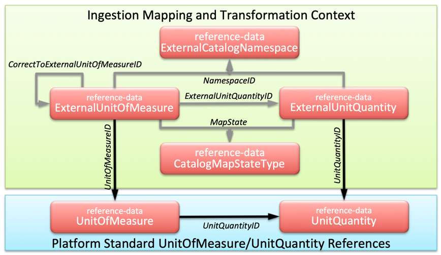
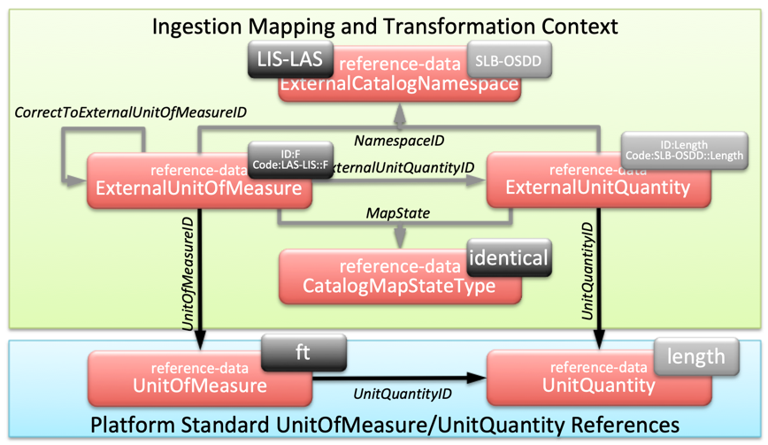
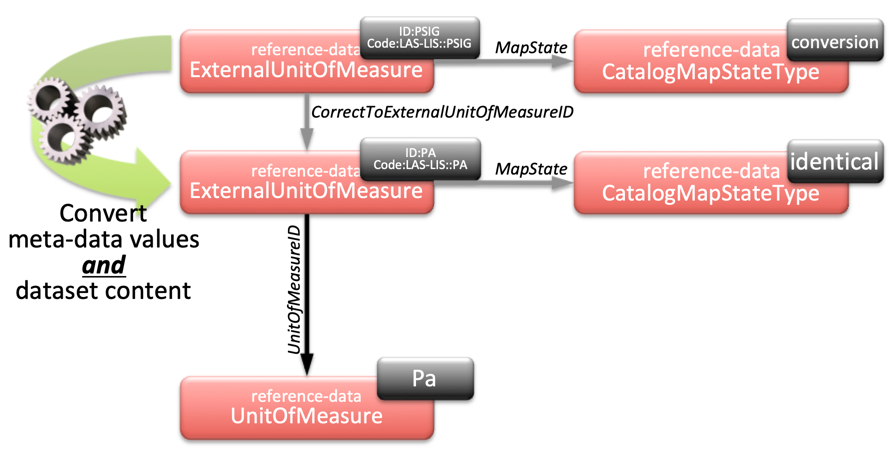

<a name="TOC"></a>

[[_TOC_]]

# UnitOfMeasure Look-Up/Association

Typical ingestion use cases are challenged by receiving unit symbols, which have to be translated into platform standard
`UnitOfMeasure` references. The well-known OSDU schemas demand relationships to the platform standard
type [`osdu:wks:reference-data--UnitOfMeasure:1.0.0`](../../../E-R/reference-data/UnitOfMeasure.1.0.0.md) kind. The
incoming data may contain only a symbolic reference string, which must be translated.

This guide provides guidance to this user story.

## Select Context

The incoming unit symbols can be ambiguous. Without context the wrong unit relationship may be selected causing data
corruption; in the best case no matching standard unit is found.

In the selected context the unit symbols and unit quantity names are unique keys to a full description, which is
mappable to the standard unit or unit quantity.



[Back to TOC](#TOC)

## Use Cases

### LAS File with Legacy Unit Symbols

A [LAS 1.2 formatted file](https://www.cwls.org/wp-content/uploads/2014/09/LAS12_Standards.txt) containing well logs is
to be ingested. The unit information for the vertical sampling is contained in the following block:

```
~WELL INFORMATION BLOCK
#MNEM.UNIT       DATA TYPE    INFORMATION
#---------    -------------   ------------------------------
 STRT.F        5479.000000:
 STOP.F        7446.000000:
 STEP.F            -0.5000:
 NULL.           -999.2500:
```

The extracted unit symbol is a capital `F`. A direct look-up in the platform UnitOfMeasure catalog would succeed,
however, associating the SI unit `F` farad for capacitance, which would be wrong.

Instead, the contextual knowledge is exploited: The appropriate namespace for this would be
the [LIS-LAS Catalog namespace](./records/LOCAL/LIS-LAS-namespace.json). Searching through
the [`osdu:wks:reference-data--ExternalUnitOfMeasure:*`](../../../E-R/reference-data/ExternalUnitOfMeasure.1.0.0.md)
records with the following query

```json
{
  "kind": "osdu:wks:reference-data--ExternalUnitOfMeasure:*.*.*",
  "query": "data.NamespaceID:\"partition-id:reference-data--ExternalCatalogNamespace:LIS-LAS:\" AND data.ID:\"F\""
}
```

The unique response contains this record describing
the [`partition-id:reference-data--ExternalUnitOfMeasure:LIS-LAS::F`](./records/LOCAL/LIS-LAS--F.json). This record
associates the  [platform standard UnitOfMeasure ft](./records/OPEN/PlatformStandardUoM-ft.json)
with [MapStateID identical](./records/FIXED/MapState-identical.json):

```json
{
  "MapStateID": "partition-id:reference-data--CatalogMapStateType:identical:",
  "UnitOfMeasureID": "partition-id:reference-data--UnitOfMeasure:ft:"
}
```

In other words, the symbol `F` matches exactly the UnitOfMeasure record
with `"id": "partition-id:reference-data--UnitOfMeasure:ft"`; the Energistics platform standard unit can be assigned
without any further effort. The diagram below shows the instance diagram with the codes:



[Back to TOC](#TOC)

### Legacy or non-standard Units with corrections/conversions

The next level of complexity covers external unit symbols, which are not identically mapped to a platform standard
unit (`reference-data--UnitOfMeasure`). As an example we select the legacy unit symbol `PSIG` representing "_pound per
square inch (gauge)_"

The query

```json
{
  "kind": "osdu:wks:reference-data--ExternalUnitOfMeasure:*.*.*",
  "query": "data.NamespaceID:\"partition-id:reference-data--ExternalCatalogNamespace:LIS-LAS:\" AND data.ID:\"PSIG\""
}
```

will return the record id `partition-id:reference-data--ExternalUnitOfMeasure:LIS-LAS::PSIG`,
see [record example](./records/LOCAL/LIS-LAS--PSIG.json). This record contains the following critical properties in
the `"data"` block:

```json
{
  "CorrectToExternalUnitOfMeasureID": "partition-id:reference-data--ExternalUnitOfMeasure:LIS-LAS::PA:",
  "MapStateID": "partition-id:reference-data--CatalogMapStateType:conversion:"
}
```
**Note the absence of `"UnitOfMeasureID"`!**
This means there is **_no direct mapping_**. The `CorrectToExternalUnitOfMeasureID` refers however to another
legacy `reference-data--ExternalUnitOfMeasure` [record](./records/LOCAL/LIS-LAS--PA.json), which is mapped to a standard
platform unit:

```json
{
  "MapStateID": "partition-id:reference-data--CatalogMapStateType:identical:",
  "UnitOfMeasureID": "partition-id:reference-data--UnitOfMeasure:Pa:"
}
```

The data have to undergo conversion (scaling), which has to apply both to

* meta data values, **_and_**
* for work-product-components, values in the associated dataset which refer originally to the `PSIG` unit.

The instance diagram below shows the sequence:



Note that the conversion happens in the external unit context. The governance of the actual conversion is entirely
LOCAL, i.e., under the operator's control.

### Legacy or non-standard Units with `ExternalUnitOfMeasure` Augmentation

In certain cases it is possible to avoid conversions or corrections by changing the `ExternalUnitOfMeasure` record
definitions to a better `UnitOfMeasureID` relation. This can also cover cases where the conversion coefficient slightly
differ. The LOCAL governance can decide to create direct mappings, which may not be academically correct.

Finally, new platform standard definitions can be added to the `OPEN` governance `UnitOfMeasure` platform standard. In
the given example this can mean replicating a `psi[gauge]` pressure unit in the platform standard as
new `reference-data--UnitOfMeasure` record, see [next section](#unsupported-legacy-or-non-standard-units)

[Back to TOC](#TOC)

### Unsupported Legacy or non-standard Units

There are known PWLS 3 property type codes, which do not lead to Energistics UoM V1 UnitQuantity codes. One example is
"_volume per time per pressure per pressure_" associated to the property type "_compressible fluid productivity index_" and
more.

In this case, the creation of a new `reference-data--UnitQuantity` record for "_volume per time per pressure per
pressure_" is required. This enables subsequently the creation of `reference-data--UnitOfMeasure` records for the actual
units.

It is recommended to use a namespace prefix to separate the definitions from future Energistics standard updates, which
may add a conflicting definition. This mitigates the risk of data corruption.

See also the Schema Usage Guide section [4.3 Ingestion, Mapping to Platform Unit of Measure Standard](../../../Guides/Chapters/04-FrameOfReference.md#44-ingestion-mapping-to-platform-unit-of-measure-standard).


[Back to TOC](#TOC)