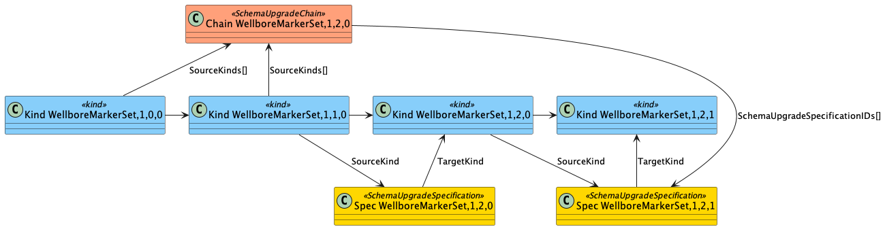
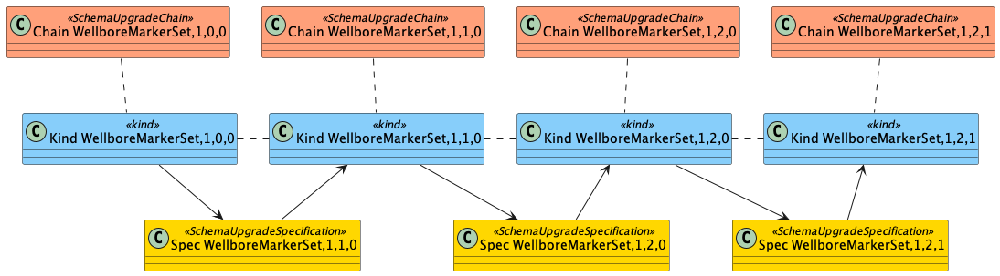

<a name="TOC"></a>

[[_TOC_]]

# Upgrades

## Schema Upgrades

OSDU uses JOLT record transformation operations as upgrade specifications. The specifications are defaulted to updating
the kind. Any further specifications must be hand-crafted. The specifications are consumed by the
[**Schema Upgrade** helper service](https://community.opengroup.org/osdu/platform/system/reference/schema-upgrade).

### JOLT Configurations for `WellboreMarkerSet:1.2.0` (Default)

<details>

<summary>Default for <code>WellboreMarkerSet:1.2.0</code> to update the kind.</summary>

<OsduImportJSON>[UpgradeSpecification, WellboreMarkerSet:1.2.0](../../../SchemaUpgradeResources/work-product-component/WellboreMarkerSet.1.2.0.json)</OsduImportJSON>

```json
{
  "SourceKind": "osdu:wks:work-product-component--WellboreMarkerSet:1.1.0",
  "TargetKind": "osdu:wks:work-product-component--WellboreMarkerSet:1.2.0",
  "JoltConfigurations": [
    {
      "operation": "remove",
      "spec": {
        "kind": ""
      }
    },
    {
      "operation": "shift",
      "spec": {
        "*": "&",
        "#osdu:wks:work-product-component--WellboreMarkerSet:1\\.2\\.0": "kind"
      }
    }
  ],
  "ExpectedResults": {
    "kind": "osdu:wks:work-product-component--WellboreMarkerSet:1.2.0"
  }
}
```
</details>

### JOLT Configurations for `RockSampleAnalysis:1.1.0` (Non-Default)

<details>

<summary>Handcrafted example for for <code>RockSampleAnalysis:1.1.0</code> to default a new property..</summary>

Note: The example uses `{{NAMESPACE}}` as variable for the data partition-id, which has to be substituted.

<OsduImportJSON>[UpgradeSpecification, RockSampleAnalysis:1.1.0](../../../SchemaUpgradeResources/work-product-component/RockSampleAnalysis.1.1.0.json)</OsduImportJSON>

```json
{
  "SourceKind": "osdu:wks:work-product-component--RockSampleAnalysis:1.0.0",
  "TargetKind": "osdu:wks:work-product-component--RockSampleAnalysis:1.1.0",
  "JoltConfigurations": [
    {
      "operation": "remove",
      "spec": {
        "kind": ""
      }
    },
    {
      "operation": "shift",
      "spec": {
        "*": "&",
        "#osdu:wks:work-product-component--RockSampleAnalysis:1\\.1\\.0": "kind"
      }
    },
    {
      "operation": "default",
      "spec": {
        "data": {
          "AnalysisTypeIDs": [
            "{{NAMESPACE}}:reference-data--RockSampleAnalysisType:RoutineCoreAnalysis:"
          ]
        }
      }
    }
  ],
  "ExpectedResults": {
    "kind": "osdu:wks:work-product-component--RockSampleAnalysis:1.1.0",
    "data": {
      "AnalysisTypeIDs": [
        "{{NAMESPACE}}:reference-data--RockSampleAnalysisType:RoutineCoreAnalysis:"
      ]
    }
  }
}
```
</details>


**Figure 1: One Upgrade Chain Definition and their relations**


Figure 1 shows the upgrade chain specification to the kind `osdu:wks:work-product-component--WellboreMarkerSet:1.2.0`:

* Backward link: "previous"  `SourceKinds` lists the kinds, which are sources for upgrades.
* Forward link: "next" `SchemaUpgradeSpecificationIDs` indicates that
  `osdu:wks:work-product-component--WellboreMarkerSet:1.2.0` is not the latest schema version and identifies
  the `SchemaUpgradeSpecification` to the younger versions.

[Back to TOC](#TOC)

---

### Example Chain for `WellboreMarkerSet:1.2.0`

<details>

<summary>Example Chain for <code>WellboreMarkerSet:1.2.0</code>.</summary>

Note: The example uses `{{NAMESPACE}}` as variable for the data partition-id, which has to be substituted.

<OsduImportJSON>[SchemaUpgradeChain; open in Reference Value Manifest](../../../ReferenceValues/Manifests/reference-data/LOCAL/SchemaUpgradeChain.1.json#only.ReferenceData[id={{NAMESPACE}}:reference-data--SchemaUpgradeChain:osdu:wks:work-product-component--WellboreMarkerSet:1.2.0].data)</OsduImportJSON>

```json
{
  "ReferenceData": {
    "data": {
      "Name": "osdu:wks:work-product-component--WellboreMarkerSet:1.2.0",
      "Description": "Schema upgrade chain(s) for Storage records from and to kind osdu:wks:work-product-component--WellboreMarkerSet:1.2.0. SourceKinds specify the sourced, from which upgrades are possible (empty for initial versions). SchemaUpgradeSpecificationIDs specify the upgrade record IDs, wo which upgrade specifications are available (empty for latest schema versions).",
      "Code": "osdu:wks:work-product-component--WellboreMarkerSet:1.2.0",
      "SchemaUpgradeSpecificationIDs": [
        "{{NAMESPACE}}:reference-data--SchemaUpgradeSpecification:osdu:wks:work-product-component--WellboreMarkerSet:1.2.1:",
        "{{NAMESPACE}}:reference-data--SchemaUpgradeSpecification:osdu:wks:work-product-component--WellboreMarkerSet:1.3.0:",
        "{{NAMESPACE}}:reference-data--SchemaUpgradeSpecification:osdu:wks:work-product-component--WellboreMarkerSet:1.4.0:",
        "{{NAMESPACE}}:reference-data--SchemaUpgradeSpecification:osdu:wks:work-product-component--WellboreMarkerSet:1.5.0:",
        "{{NAMESPACE}}:reference-data--SchemaUpgradeSpecification:osdu:wks:work-product-component--WellboreMarkerSet:1.5.1:"
      ],
      "SourceKinds": [
        "osdu:wks:work-product-component--WellboreMarkerSet:1.0.0",
        "osdu:wks:work-product-component--WellboreMarkerSet:1.1.0"
      ],
      "Source": "Workbook ReferenceValues/Authoring/SchemaUpgradeChain.1.xlsx; commit SHA 2a87e520.",
      "CommitDate": "2025-04-09T12:06:30+00:00"
    }
  }
}
```

</details>

**Figure 2: All Upgrade Chain and Upgrade Specification instances**


Figure 2 shows all instances of schema versions for WellboreMarkerSet (4), SchemaUpgradeChains (4) and
SchemaUpgradeSpecifications (3).

[Back to TOC](#TOC)

---

## Reference Value Upgrades

Sometimes it happens that reference values change. Typical examples in the OSDU context are original OSDU proposed
reference value lists, which are taken over by PPDM governance. Following such events it happens the previous codes,
names and descriptions are improved. In the process — where applicable — values are deprecated and superseded. This is
the simple case. Typical cases are represented by `BitType`, here with two deprecation examples:

* `partition-id:reference-data--BitType:diamond%20core:` (OSDU) &rarr; superseded by <br>
  `partition-id:reference-data--BitType:Core:` (PPDM)
* `partition-id:reference-data--BitType:insert%20roller%20cone:` (OSDU) &rarr; superseded
  by <br> `partition-id:reference-data--BitType:RollerCone:` (PPDM)

More complex cases arise when PPDM, for example, decides that one reference-value catalog is indeed a mixture and should
be split into non-overlapping, normalised code sets. In this case, it can be required to migrate an 'old code' to a new
value, which need to be assigned to different, likely new properties. An example is the OSDU list
`AdditiveType`, which is split into two lists `AdditiveType` and `AdditiveRole`. A number of values previously
in `AdditiveType` move to `AdditiveRole` instead. Such upgrades are complex as they require the upgrade process to not
only find the values to change but also to figure out **_where_** the updated value needs to be assigned to, should the
reference value **_type_** change.

For both use cases the content for such operations is provided by the
[ReferenceValueUpgradeLookUp](../../../E-R/reference-data/ReferenceValueUpgradeLookUp.1.0.0.md) entity.

### Simple Reference Value Upgrade

The ReferenceValueUpgradeLookUp for BitType (and other reference value types) consists of two parts:

---

#### What?

<details>

<summary>Reference Value Upgrade LookUp for <code>BitType</code> in <code>data.LookUp</code>.</summary>

Note: The example uses `{{NAMESPACE}}` as variable for the data partition-id, which has to be substituted.

<OsduImportJSON>[Reference Value Upgrade Specification, BitType; open in Reference Value Manifest](../../../ReferenceValues/Manifests/reference-data/LOCAL/ReferenceValueUpgradeLookUp.2.json#only.ReferenceData[id={{NAMESPACE}}:reference-data--ReferenceValueUpgradeLookUp:BitType].data.LookUp)</OsduImportJSON>

```json
{
  "ReferenceData": {
    "data": {
      "LookUp": {
        "{{NAMESPACE}}:reference-data--BitType:PDC%20core:": {
          "SupersededBy": "{{NAMESPACE}}:reference-data--BitType:PDC:"
        },
        "{{NAMESPACE}}:reference-data--BitType:diamond%20core:": {
          "SupersededBy": "{{NAMESPACE}}:reference-data--BitType:Core:"
        },
        "{{NAMESPACE}}:reference-data--BitType:insert%20roller%20cone:": {
          "SupersededBy": "{{NAMESPACE}}:reference-data--BitType:RollerCone:"
        },
        "{{NAMESPACE}}:reference-data--BitType:roller%20cone:": {
          "SupersededBy": "{{NAMESPACE}}:reference-data--BitType:RollerCone:"
        },
        "{{NAMESPACE}}:reference-data--BitType:unknown:": {
          "SupersededBy": "{{NAMESPACE}}:reference-data--BitType:Unknown:"
        }
      }
    }
  }
}
```
</details>

This `LookUp` dictionary is used to look up the 'old' values (as key) to retrieve the new value. The previous examples
can be found as second and third item:

* `partition-id:reference-data--BitType:diamond%20core:` (OSDU) &rarr; superseded by <br>
  `partition-id:reference-data--BitType:Core:` (PPDM)
* `partition-id:reference-data--BitType:insert%20roller%20cone:` (OSDU) &rarr; superseded
  by <br> `partition-id:reference-data--BitType:RollerCone:` (PPDM)

[Back to TOC](#TOC)

---

#### Where?

The `data.UsingKinds` provides a dictionary of entity `kind` (all semantic versions) and the cumulative property names
as they could be found in the record structure. The dot-notation refers to nested object structures and the `[]` symbol
indicates usage in arrays.

<details>

<summary>Reference Value Usage of <code>BitType</code> in <code>data.UsingKinds</code>.</summary>

Note: The example uses `{{NAMESPACE}}` as variable for the data partition-id, which has to be substituted.

<OsduImportJSON>[Reference Value Usage, BitType; open in Reference Value Manifest](../../../ReferenceValues/Manifests/reference-data/LOCAL/ReferenceValueUpgradeLookUp.2.json#only.ReferenceData[id={{NAMESPACE}}:reference-data--ReferenceValueUpgradeLookUp:BitType].data.UsingKinds)</OsduImportJSON>

```json
{
  "ReferenceData": {
    "data": {
      "UsingKinds": {
        "osdu:wks:master-data--OperationsReport:1.0.0": [
          {
            "Path": "data.BitRecord[].TypeBit",
            "SearchModeIDs": [
              "{{NAMESPACE}}:reference-data--DiscoverabilityBySearch:None:"
            ]
          }
        ],
        "osdu:wks:master-data--OperationsReport:1.1.0": [
          {
            "Path": "data.BitRecord[].TypeBit",
            "SearchModeIDs": [
              "{{NAMESPACE}}:reference-data--DiscoverabilityBySearch:None:"
            ]
          }
        ],
        "osdu:wks:master-data--OperationsReport:1.2.0": [
          {
            "Path": "data.BitRecord[].TypeBit",
            "SearchModeIDs": [
              "{{NAMESPACE}}:reference-data--DiscoverabilityBySearch:None:"
            ]
          }
        ],
        "osdu:wks:master-data--OperationsReport:1.3.0": [
          {
            "Path": "data.BitRecord[].TypeBit",
            "SearchModeIDs": [
              "{{NAMESPACE}}:reference-data--DiscoverabilityBySearch:None:"
            ]
          }
        ],
        "osdu:wks:master-data--OperationsReport:1.4.0": [
          {
            "Path": "data.BitRecord[].TypeBit",
            "SearchModeIDs": [
              "{{NAMESPACE}}:reference-data--DiscoverabilityBySearch:None:"
            ]
          }
        ],
        "osdu:wks:master-data--TubularComponent:2.4.0": [
          {
            "Path": "data.BitRecord.TypeBitID",
            "SearchModeIDs": [
              "{{NAMESPACE}}:reference-data--DiscoverabilityBySearch:QuerySimple:"
            ]
          }
        ],
        "osdu:wks:master-data--TubularComponent:2.5.0": [
          {
            "Path": "data.BitRecord.TypeBitID",
            "SearchModeIDs": [
              "{{NAMESPACE}}:reference-data--DiscoverabilityBySearch:QuerySimple:"
            ]
          }
        ],
        "osdu:wks:work-product-component--WellOperationsReport:2.0.0": [
          {
            "Path": "data.BitRecord[].TypeBit",
            "SearchModeIDs": [
              "{{NAMESPACE}}:reference-data--DiscoverabilityBySearch:None:"
            ]
          }
        ],
        "osdu:wks:work-product-component--WellOperationsReport:2.1.0": [
          {
            "Path": "data.BitRecord[].TypeBit",
            "SearchModeIDs": [
              "{{NAMESPACE}}:reference-data--DiscoverabilityBySearch:None:"
            ]
          }
        ]
      }
    }
  }
}
```
</details>

`BitType` has been selected for its conciseness — other reference types with widespread usage will show as large arrays
of potential usages. In this case the usage is limited to one single entity, `OperationReport`, which exists in multiple
minor schema version variants; the example only lists the latest version. The property name is the same, located in the
BitRecord array, see [Well Execution](../WellExecution/README.md#operations-report-overview).

[Back to TOC](#TOC)

---

### Complex Reference Value Upgrade

A complex reference value update is required when, for example, a reference value list is normalized and split into
multiple lists or deprecated and renamed to another reference value list. Such cases carry a flag
`"IsComplexUpgrade": true`, as in this example:

<details>

<summary>Reference Value LookUp of <code>AdditiveType</code>, Complex Reassignment.</summary>

<OsduImportJSON>[Reference Value Usage, AdditiveType; open in Reference Value Manifest](../../../ReferenceValues/Manifests/reference-data/LOCAL/ReferenceValueUpgradeLookUp.2.json#only.ReferenceData[id={{NAMESPACE}}:reference-data--ReferenceValueUpgradeLookUp:AdditiveType].data.Code|Description|IsComplexUpgrade)</OsduImportJSON>

```json
{
  "ReferenceData": {
    "data": {
      "Code": "AdditiveType",
      "Description": "Reference value upgrade look-up table and usage references for AdditiveType.",
      "IsComplexUpgrade": true
    }
  }
}
```
</details>

On an individual value level, there can still be simple swaps and complex swap-and-reassign cases or exclusive
swap-and-reassign. Both cases are exercised by PPDM revisions:
1. Reference list normalization: AdditiveType reworked to AdditiveType and AdditiveRole (new).
2. Deprecation of DrillingReasonType to LaheeClass (new).

The following section uses the use case 1 as example. The second use case works exactly the same way.

Here is the sequence of actions given a request to update/translate the reference values for AdditiveType:

#### 1. Search ReferenceValueUpgradeLookUp

Search for a ReferenceValueUpgradeLookUp record containing the upgrade instructions for AdditiveType. Such a record
will have the `"id": "partition-id:reference-data--ReferenceValueUpgradeLookUp:AdditiveType"`.

[Back to TOC](#TOC)

---

#### 2. Inspect `UsingKinds`

The record is then checked for the `UsingKinds`. This section identifies the potential locations where value
designated for upgrade are found.

<details>

<summary>Reference Value Usage of <code>AdditiveType</code> in <code>data.UsingKinds</code>.</summary>

Note: The example uses `{{NAMESPACE}}` as variable for the data partition-id, which has to be substituted.

<OsduImportJSON>[Reference Value Usage, AdditiveType; open in Reference Value Manifest](../../../ReferenceValues/Manifests/reference-data/LOCAL/ReferenceValueUpgradeLookUp.2.json#only.ReferenceData[id={{NAMESPACE}}:reference-data--ReferenceValueUpgradeLookUp:AdditiveType].data.UsingKinds)</OsduImportJSON>

```json
{
  "ReferenceData": {
    "data": {
      "UsingKinds": {
        "osdu:wks:master-data--PlannedCementJob:1.0.0": [
          {
            "Path": "data.CementStages[].CementingFluid.CementAdditives[].AdditiveTypeID",
            "SearchModeIDs": [
              "{{NAMESPACE}}:reference-data--DiscoverabilityBySearch:None:",
              "{{NAMESPACE}}:reference-data--DiscoverabilityBySearch:None:"
            ]
          }
        ],
        "osdu:wks:master-data--PlannedCementJob:1.1.0": [
          {
            "Path": "data.CementStages[].CementingFluid.CementAdditives[].AdditiveTypeID",
            "SearchModeIDs": [
              "{{NAMESPACE}}:reference-data--DiscoverabilityBySearch:None:",
              "{{NAMESPACE}}:reference-data--DiscoverabilityBySearch:None:"
            ]
          }
        ],
        "osdu:wks:master-data--PlannedCementJob:1.2.0": [
          {
            "Path": "data.CementStages[].CementingFluid.CementAdditives[].AdditiveTypeID",
            "SearchModeIDs": [
              "{{NAMESPACE}}:reference-data--DiscoverabilityBySearch:None:",
              "{{NAMESPACE}}:reference-data--DiscoverabilityBySearch:None:"
            ]
          }
        ],
        "osdu:wks:master-data--PlannedCementJob:1.3.0": [
          {
            "Path": "data.CementStages[].CementingFluid.CementAdditives[].AdditiveTypeID",
            "SearchModeIDs": [
              "{{NAMESPACE}}:reference-data--DiscoverabilityBySearch:None:",
              "{{NAMESPACE}}:reference-data--DiscoverabilityBySearch:None:"
            ]
          }
        ],
        "osdu:wks:master-data--PlannedCementJob:1.4.0": [
          {
            "Path": "data.CementStages[].CementingFluid.CementAdditives[].AdditiveTypeID",
            "SearchModeIDs": [
              "{{NAMESPACE}}:reference-data--DiscoverabilityBySearch:None:",
              "{{NAMESPACE}}:reference-data--DiscoverabilityBySearch:None:"
            ]
          }
        ],
        "osdu:wks:reference-data--FluidAdditiveName:1.0.0": [
          {
            "Path": "data.AdditiveTypeID",
            "SearchModeIDs": [
              "{{NAMESPACE}}:reference-data--DiscoverabilityBySearch:QuerySimple:"
            ]
          }
        ],
        "osdu:wks:work-product-component--CementJob:1.0.0": [
          {
            "Path": "data.CementStages[].CementingFluid[].CementAdditives[].AdditiveTypeID",
            "SearchModeIDs": [
              "{{NAMESPACE}}:reference-data--DiscoverabilityBySearch:None:",
              "{{NAMESPACE}}:reference-data--DiscoverabilityBySearch:None:",
              "{{NAMESPACE}}:reference-data--DiscoverabilityBySearch:None:"
            ]
          }
        ],
        "osdu:wks:work-product-component--CementJob:1.1.0": [
          {
            "Path": "data.CementStages[].CementingFluid[].CementAdditives[].AdditiveTypeID",
            "SearchModeIDs": [
              "{{NAMESPACE}}:reference-data--DiscoverabilityBySearch:None:",
              "{{NAMESPACE}}:reference-data--DiscoverabilityBySearch:None:",
              "{{NAMESPACE}}:reference-data--DiscoverabilityBySearch:None:"
            ]
          }
        ],
        "osdu:wks:work-product-component--CementJob:1.2.0": [
          {
            "Path": "data.CementStages[].CementingFluid[].CementAdditives[].AdditiveTypeID",
            "SearchModeIDs": [
              "{{NAMESPACE}}:reference-data--DiscoverabilityBySearch:None:",
              "{{NAMESPACE}}:reference-data--DiscoverabilityBySearch:None:",
              "{{NAMESPACE}}:reference-data--DiscoverabilityBySearch:None:"
            ]
          }
        ],
        "osdu:wks:work-product-component--CementJob:1.3.0": [
          {
            "Path": "data.CementStages[].CementingFluid[].CementAdditives[].AdditiveTypeID",
            "SearchModeIDs": [
              "{{NAMESPACE}}:reference-data--DiscoverabilityBySearch:None:",
              "{{NAMESPACE}}:reference-data--DiscoverabilityBySearch:None:",
              "{{NAMESPACE}}:reference-data--DiscoverabilityBySearch:None:"
            ]
          }
        ]
      }
    }
  }
}
```
</details>

`UsingKinds` is a dictionary (key: value pairs) where the kinds containing AdditiveType references are listed as keys,
the values identify the cumulative `Path` to the property holding the AdditiveType value and a `SearchModeID`. In the
example, the using kinds are two versions of `PlannedCementJob`. The `Path` is the same for both because the property
was part of the initial schema definition. The `[]` symbol denotes usage in arrays. In such cases it becomes critical
to inspect the `SearchModeIDs`. There are four different possible values:

| `id`                                                                | Name            | Description                                                                                                                                                                                                                               |
|---------------------------------------------------------------------|-----------------|-------------------------------------------------------------------------------------------------------------------------------------------------------------------------------------------------------------------------------------------|
| partition-id:reference-data--DiscoverabilityBySearch:None           | None            | The property in context is located in an object inside an array, which is not indexed, see https://community.opengroup.org/osdu/platform/system/search-service/-/blob/master/docs/docs/ArrayOfObjects.md#default-1.                   |
| partition-id:reference-data--DiscoverabilityBySearch:QueryFlattened | Query Flattened | The property in context is located in an object inside an array, which is indexed as flattened', see https://community.opengroup.org/osdu/platform/system/search-service/-/blob/master/docs/docs/ArrayOfObjects.md#flattened-queries. |
| partition-id:reference-data--DiscoverabilityBySearch:QueryNested    | Query Nested    | The property in context is located in an object inside an array, which is indexed as 'nested', see https://community.opengroup.org/osdu/platform/system/search-service/-/blob/master/docs/docs/ArrayOfObjects.md#nested-queries.      |
| partition-id:reference-data--DiscoverabilityBySearch:QuerySimple    | Query Simple    | The property in context is not part of an array of objects and is discoverable via simple queries, see https://community.opengroup.org/osdu/platform/system/search-service/-/blob/master/docs/docs/api.md#text-queries.     |

In the AdditiveType example, `SearchModeIDs` is set to `partition-id:reference-data--DiscoverabilityBySearch:None:`,
which means the values to be treated cannot be found via Search at all. The upgrade must crawl through all records of
kind `osdu:wks:master-data--PlannedCementJob:1.0.0` and `osdu:wks:master-data--PlannedCementJob:1.1.0` and check whether
a value in the cumulative path and nested arrays
of `data.CementStages[].CementingFluid.CementAdditives[].AdditiveTypeID` exists.

Any upgrade specifications with `DiscoverabilityBySearch` not equal `None` will allow for direct queries instead of
crawling though all records.

[Back to TOC](#TOC)

---

#### 3. What to Change

The `data.LookUp` dictionary describes what needs to be upgraded. The AgreementType serves as example for simple value
swap replacements. The entire LookUp dictionary has to be iterated through, key by key, in order to check
whether any of the values needs to be replaced.

##### 3.1 Simple Swap

<details>

<summary>Reference Value LookUp of <code>AgreementType</code> in <code>data.LookUp</code>, simple swap.</summary>

Note: The example uses `{{NAMESPACE}}` as variable for the data partition-id, which has to be substituted.

<OsduImportJSON>[Reference Value Lookup, AgreementType; open in Reference Value Manifest](../../../ReferenceValues/Manifests/reference-data/LOCAL/ReferenceValueUpgradeLookUp.2.json#only.ReferenceData[id={{NAMESPACE}}:reference-data--ReferenceValueUpgradeLookUp:AgreementType].data.LookUp[{{NAMESPACE}}:reference-data--AgreementType:AssetSalePurchase:])</OsduImportJSON>

```json
{
  "ReferenceData": {
    "data": {
      "LookUp": {
        "{{NAMESPACE}}:reference-data--AgreementType:AssetSalePurchase:": {
          "SupersededBy": "{{NAMESPACE}}:reference-data--AgreementType:AssetSaleAndPurchase:"
        }
      }
    }
  }
}
```
</details>

##### 3.2 Complex Reassignment

AdditiveType serves as example for complex upgrades, which involves 'moving' a value to another property name with a
different value. First the complex upgrade has to be detected.

<details>

<summary>Reference Value LookUp of <code>AdditiveType</code> in <code>data.LookUp</code>, Complex Reassignment.</summary>

<OsduImportJSON>[Reference Value Lookup, AdditiveType; open in Reference Value Manifest](../../../ReferenceValues/Manifests/reference-data/LOCAL/ReferenceValueUpgradeLookUp.2.json#only.ReferenceData[id={{NAMESPACE}}:reference-data--ReferenceValueUpgradeLookUp:AdditiveType].data.LookUp[{{NAMESPACE}}:reference-data--AdditiveType:Fe%20sequestering:])</OsduImportJSON>

```json
{
  "ReferenceData": {
    "data": {
      "LookUp": {
        "{{NAMESPACE}}:reference-data--AdditiveType:Fe%20sequestering:": {
          "MigrateToKind": "osdu:wks:reference-data--AdditiveRole:",
          "SupersededBy": "{{NAMESPACE}}:reference-data--AdditiveRole:Chelant:"
        }
      }
    }
  }
}
```
</details>

In this case `MigrateToKind` marks the reference-data kind, wto which this value needs to be transformed, in this case
to `reference-data--AdditiveRole` (the schema version does not matter in this case as the reference is by record `id`,
which does not contain the schema version). The `SupersededBy` denotes the value the `AdditiveType:Fe%20sequestering`
needs to be transformed, i.e., assigned to a property referring to `reference-data--AdditiveRoleID` instead. The next
paragraph explains how.

[Back to TOC](#TOC)

---

##### 3.3 Target Property Discovery

In complex upgrades the values are **_not_** swapped out in place. Instead, it is necessary to find the exact property
to place the `SupersededBy` value. This is done by looking up the ReferenceValueUpgradeLookUp record with id
`partition-id:reference-data--ReferenceValueUpgradeLookUp:AdditiveRole` — AdditiveRole was given in `MigrateToKind`.

<details>

<summary>Reference Property LookUp of <code>AdditiveRole</code> in <code>data.UsingKinds</code>, Complex Reassignment.</summary>

Note: The example uses `{{NAMESPACE}}` as variable for the data partition-id, which has to be substituted.

<OsduImportJSON>[Reference Value Lookup, AdditiveType; open in Reference Value Manifest](../../../ReferenceValues/Manifests/reference-data/LOCAL/ReferenceValueUpgradeLookUp.2.json#only.ReferenceData[id={{NAMESPACE}}:reference-data--ReferenceValueUpgradeLookUp:AdditiveRole].data.UsingKinds)</OsduImportJSON>

```json
{
  "ReferenceData": {
    "data": {
      "UsingKinds": {
        "osdu:wks:master-data--PlannedCementJob:1.1.0": [
          {
            "Path": "data.CementStages[].CementingFluid.CementAdditives[].AdditiveRoleID",
            "SearchModeIDs": [
              "{{NAMESPACE}}:reference-data--DiscoverabilityBySearch:None:",
              "{{NAMESPACE}}:reference-data--DiscoverabilityBySearch:None:"
            ]
          }
        ],
        "osdu:wks:master-data--PlannedCementJob:1.2.0": [
          {
            "Path": "data.CementStages[].CementingFluid.CementAdditives[].AdditiveRoleID",
            "SearchModeIDs": [
              "{{NAMESPACE}}:reference-data--DiscoverabilityBySearch:None:",
              "{{NAMESPACE}}:reference-data--DiscoverabilityBySearch:None:"
            ]
          }
        ],
        "osdu:wks:master-data--PlannedCementJob:1.3.0": [
          {
            "Path": "data.CementStages[].CementingFluid.CementAdditives[].AdditiveRoleID",
            "SearchModeIDs": [
              "{{NAMESPACE}}:reference-data--DiscoverabilityBySearch:None:",
              "{{NAMESPACE}}:reference-data--DiscoverabilityBySearch:None:"
            ]
          }
        ],
        "osdu:wks:master-data--PlannedCementJob:1.4.0": [
          {
            "Path": "data.CementStages[].CementingFluid.CementAdditives[].AdditiveRoleID",
            "SearchModeIDs": [
              "{{NAMESPACE}}:reference-data--DiscoverabilityBySearch:None:",
              "{{NAMESPACE}}:reference-data--DiscoverabilityBySearch:None:"
            ]
          }
        ],
        "osdu:wks:reference-data--FluidAdditiveName:1.0.0": [
          {
            "Path": "data.AdditiveRoleID",
            "SearchModeIDs": [
              "{{NAMESPACE}}:reference-data--DiscoverabilityBySearch:QuerySimple:"
            ]
          }
        ],
        "osdu:wks:work-product-component--CementJob:1.0.0": [
          {
            "Path": "data.CementStages[].CementingFluid[].CementAdditives[].AdditiveRoleID",
            "SearchModeIDs": [
              "{{NAMESPACE}}:reference-data--DiscoverabilityBySearch:None:",
              "{{NAMESPACE}}:reference-data--DiscoverabilityBySearch:None:",
              "{{NAMESPACE}}:reference-data--DiscoverabilityBySearch:None:"
            ]
          }
        ],
        "osdu:wks:work-product-component--CementJob:1.1.0": [
          {
            "Path": "data.CementStages[].CementingFluid[].CementAdditives[].AdditiveRoleID",
            "SearchModeIDs": [
              "{{NAMESPACE}}:reference-data--DiscoverabilityBySearch:None:",
              "{{NAMESPACE}}:reference-data--DiscoverabilityBySearch:None:",
              "{{NAMESPACE}}:reference-data--DiscoverabilityBySearch:None:"
            ]
          }
        ],
        "osdu:wks:work-product-component--CementJob:1.2.0": [
          {
            "Path": "data.CementStages[].CementingFluid[].CementAdditives[].AdditiveRoleID",
            "SearchModeIDs": [
              "{{NAMESPACE}}:reference-data--DiscoverabilityBySearch:None:",
              "{{NAMESPACE}}:reference-data--DiscoverabilityBySearch:None:",
              "{{NAMESPACE}}:reference-data--DiscoverabilityBySearch:None:"
            ]
          }
        ],
        "osdu:wks:work-product-component--CementJob:1.3.0": [
          {
            "Path": "data.CementStages[].CementingFluid[].CementAdditives[].AdditiveRoleID",
            "SearchModeIDs": [
              "{{NAMESPACE}}:reference-data--DiscoverabilityBySearch:None:",
              "{{NAMESPACE}}:reference-data--DiscoverabilityBySearch:None:",
              "{{NAMESPACE}}:reference-data--DiscoverabilityBySearch:None:"
            ]
          }
        ]
      }
    }
  }
}
```
</details>

This time there not all versions of PlannedCementJob are listed because the AdditiveRoleID was only introduced with
version 1.1.0. The cumulative property path to which the new value
`partition-id:reference-data--AdditiveRole:Chelant` is to be assigned is then
`data.CementStages[].CementingFluid.CementAdditives[].AdditiveRoleID`. Similarly, for other entities referring to old
`AdditiveType` values

This concludes the upgrade of `AdditiveType` for this particular record. The upgrade can proceed to the next record.

### How to deprecate/supersede a reference value?

#### 1. Supersession Definition

Deprecations are indicated by a standardised text in the reference value's `data.Description` property value, for OSDU
governed lists these are editable in the reference value workbooks, column Description,
under [ReferenceValues/Authoring](../../../ReferenceValues/Authoring)
and [ReferenceValues/Published](../../../ReferenceValues/Published). During the manifest generation, these prefixes are
inspected using a fixed regular expression. The hints for supersession are extracted automatically. The format is as
follows:

```text
DEPRECATED: Please use Code="{{optional-DifferentType:}}{data.Code-value}" with Name="{data.Name-value}" instead.{optional-other-text}
```

Example for the reference-data--AdditiveType record data.Code=Accelerator, which is superseded by a value belonging to a different reference value list reference-data--AdditiveRole with data.Code=Accelerator :

```text
DEPRECATED: Please use Code="AdditiveRole:Accelerator" with Name="Accelerator" instead.  A chemical that speeds up the rate of a reaction...
```

All characters are relevant due to the regular expression:
```regexp
'DEPRECATED: Please use Code=\"([^\]]+)\" with Name=\"([^\]]+)\" instead.'
```
The period after instead is required as well as single blanks and exact casing.

See also [Appendix D.4.2 Reference Value Upgrade](../../../Guides/Chapters/93-OSDU-Schemas.md#appendix-d42-reference-value-upgrade).

#### 2. Creating Supersession Resources (Member GitLab)

The sequence of actions is as follows:

1. Update the value **Description** reference-value workbooks as explained
   in [Simple Reference Value Upgrade](#simple-reference-value-upgrade)
   and [Complex Reference Value Upgrade](#complex-reference-value-upgrade).
2. In the OsduSchemaComposer
   app ([member GitLab only](https://gitlab.opengroup.org/osdu/subcommittees/data-def/work-products/schema/-/blob/master/_doc/OsduSchemaComposer.md#6-schema-upgrades)),
   execute the "Schema Upgrades" step, which performs upgrade resource generation for both schemas and reference values.
   * If the extraction of the supersession data was successful, a JSON file with the reference value list name will be
     created in the
     [member GitLab folder ReferenceValues/Resources/OSDU/SchemaAndValueUpgrade/ValueUpgradeResources/Configurations](https://gitlab.opengroup.org/osdu/subcommittees/data-def/work-products/schema/-/tree/master/ReferenceValues/Resources/OSDU/SchemaAndValueUpgrade/ValueUpgradeResources/Configurations), or as [relative link (only working on member Gitlab site)](../../../ReferenceValues/Resources/OSDU/SchemaAndValueUpgrade/ValueUpgradeResources/Configurations).

#### 3. Supersession Validation

1. **_Please validate_** that the file for superseded values exists. It is supposed to contain the LookUp dictionary
   as explained in sections
   [3.1 Simple Swap](#31-simple-swap) and [3.2 Complex Reassignment](#32-complex-reassignment).
2. If no such file is created or some look-up definitions are missing, please review the exact Description text, which
   needs to match the pattern defined in section [1. Supersession Definition](#1-supersession-definition).
3. These resources are now ready to generate/update the [ReferenceValueUpgrade manifest](../../../ReferenceValues/Manifests/reference-data/LOCAL/ReferenceValueUpgradeLookUp.2.json), via the [Authoring/ReferenceValueUpgradeLookUp.2.xlsx](../../../ReferenceValues/Authoring/ReferenceValueUpgradeLookUp.2.xlsx).
4. In the OsduSchemaComposer
   app, ([member GitLab only](https://gitlab.opengroup.org/osdu/subcommittees/data-def/work-products/schema/-/blob/master/_doc/OsduSchemaComposer.md#2-reference-values)),
   re-run the "Reference Values". **_Make
   sure that the option "Run Integrity Tests on Reference Value Manifests" is checked._** This will validate that
   the superseded codes actually exist as reference value record ids. <br>Continue only if this succeeds.

#### 4. Commit Reference Value Workbooks

* Commit the modified reference value
   workbooks in [ReferenceValues/Authoring](../../../ReferenceValues/Authoring)
   and/or [ReferenceValues/Published](../../../ReferenceValues/Published).

#### 5. Finalise

1. Uncheck the "Run Integrity Tests on Reference Value Manifests", since the validation was successful in step 3.
2. Finally, rerun the "Reference Values" step in the OsduSchemaComposer to create the final version of the manifests.
3. Under the Functions menu, please run "Update AllReferenceValues.xlsx and AllEntitiesProperties.xlsx".
4. Commit the manifests and changed resources. If necessary, add the new markdown files under MigrationGuides and commit them. These documentation files will list all the relevant changes to the list(s), including ReferenceValueUpgradeLookUp.

[Back to TOC](#TOC)

---