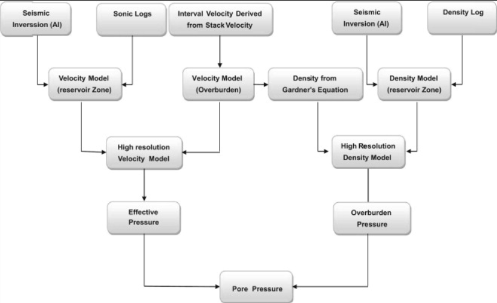

<a name="TOC"></a>
**Table of Contents**

[[_TOC_]]

# How to describe Velocity data

Velocity data plays a critical role in the seismic domain and is commonly encountered across seismic processing, interpretation, and reservoir modelling workflows.
The data may exist in various formats such as **SEG-Y**, **ASCII**, **HDF5**, or vendor-specific structures.

You can find simple example (partial) [here](content/Sample-data-3D-RMS-or-Interval-velocity.txt).

**Applications of Velocity Data**

Velocity models are essential for:

- Imaging seismic reflectors during seismic processing.
- Time-to-depth conversion in interpretation workflows.
- Building models for seismic inversion and reservoir characterization.
- Supporting advanced analyses such as pore pressure prediction.

**Purpose of This Document**

This example aims to guide users on how to associate **contextual information** with velocity models through rich metadata. Such metadata ensures clarity on:

- **Provenance**: How was the velocity model created? Is it trusted corporate data?
- **Source Linkage**: Which acquisition survey and processing project are associated with the imaging velocity field?
- **Derivation Method**: How did the interpreter derive the velocity information?
- **Type of Velocity Field**: Does the data represent interval velocities, RMS velocities, or migration (imaging) velocities?

Capturing this contextual information is essential for any consumer of velocity data, as it improves trust, usability, and integration within OSDU.

Data Model is described [here](https://community.opengroup.org/osdu/data/data-definitions/-/blob/master/E-R/work-product-component/VelocityModeling.1.4.0.md).

The OSDU Data Model provides a comprehensive schema with numerous fields to capture rich metadata associated with velocity models.
The examples below illustrate how these fields can be populated to support specific workflows and guide users in selecting appropriate values for their use cases.
The primary scenarios demonstrated include:

- Imaging Velocity Field Transfer - from seismic processor to interpreter for accurate subsurface imaging.
- Pore Pressure Prediction for Well Planning - deriving pre-drill mud weight estimates using seismically derived velocity data.
- Seismic Inversion - leveraging velocity models as inputs for reservoir characterization and property estimation.

Please note the following details, simply as "indicative".

Exhaustive "list of values" can be seen from respective Reference data.
Example - Velocity type values can be seen [here](https://community.opengroup.org/osdu/data/data-definitions/-/blob/master/E-R/reference-data/VelocityType.1.0.1.md).

- `"ObjectiveType"` - The purpose or intended use of the velocity model, such as Stacking|Depth Migration|Time Migration|Time-depth..
- `"VelocityType"` - Name of the Velocity Type describing the statistic represented, such as RMS|Average|Interval|Instantaneous|Stacking|Migration..
- `"VelocityAnalysisMethodID"` - Type of algorithm used to derive velocities such as Stacking NMO, Tomography, etc.
- `"VelocityDirectionType"` - Direction associated with the velocity. Orientation of velocity specification such as vertical, dip and azimuth.
- `"DimensionType"` - Is this model defined along a line, on a surface, for a volume, for a time series?
- `"InterpolationMethodID"` - For discretely sampled models, the mathematical form of interpolation between nodes, such as linear in space, bicubic spline, linear in time, trilinear, horizon-based.

# Use case 1 - Imaging velocity field from processor

An interval velocity field created by stratigraphically constraining the migration velocity field without over-smoothing it and delivered by the Seismic processing team to the Seismic Interpreter. This product is further used by the interpreter as a starting point for workflows related to depth conversion of seismic products from two-way time domain to depth domain.

Volve sample SegY file (ST10010ZC11_MIG_VEL.MIG_VEL.VELOCITY.3D.JS-017527.segy) has been used for this.
Actual SegY file is not loaded in "content" folder for the size.
The reader, if interested, can download from AWS using S3 client.

aws s3 ls --recursive s3://osdu-seismic-test-data/volve --no-sign-request

Next use "cp" command to actually copy desired file for your work.

A [companion file](content/SeismicOrderSummaryHeader.txt) is however loaded in "content" folder as this provides supporting information.


<details>

<summary>Json payload for this use case</summary>

Please note that the values selected for each field below match up with described use case.

<OsduImportJSON>[Velocity from Processor, Full record](records/From-Processor-VelocityModeling.1.4.0.json#only.data)</OsduImportJSON>

```json
{
  "data": {
    "ResourceHomeRegionID": "namespace:reference-data--OSDURegion:AWSEastUSA:",
    "ResourceHostRegionIDs": [
      "namespace:reference-data--OSDURegion:AWSEastUSA:"
    ],
    "ResourceCurationStatus": "namespace:reference-data--ResourceCurationStatus:Created:",
    "ResourceLifecycleStatus": "namespace:reference-data--ResourceLifecycleStatus:Loading:",
    "Source": "Example Data Source",
    "ExistenceKind": "namespace:reference-data--ExistenceKind:Prototype:",
    "Datasets": [
      "namespace:dataset--AnyDataset:SomeUniqueAnyDatasetID:"
    ],
    "DDMSDatasets": [
      "urn://wddms-3/uuid:20840361-adc0-4842-999b-5639bd07bb38",
      "eml://rddms-1/dataspace('demo/Volve')/resqml20.obj_ContinuousProperty(1615d8d2-2a2d-482c-885e-14225b89e90c)"
    ],
    "Artefacts": [
      {
        "RoleID": "namespace:reference-data--ArtefactRole:AdaptedContent:",
        "ResourceKind": "namespace:source_name:group_type--IndividualType:0.0.0",
        "ResourceID": "namespace:dataset--AnyDataset:SomeUniqueAnyDatasetID:"
      }
    ],
    "IsExtendedLoad": true,
    "IsDiscoverable": true,
    "TechnicalAssurances": [
      {
        "TechnicalAssuranceTypeID": "namespace:reference-data--TechnicalAssuranceType:Trusted:",
        "Reviewers": [
          {
            "RoleTypeID": "namespace:reference-data--ContactRoleType:AccountOwner:",
            "DataGovernanceRoleTypeID": "namespace:reference-data--DataGovernanceRoleType:SME:",
            "WorkflowPersonaTypeID": "namespace:reference-data--WorkflowPersonaType:SeismicProcessor:",
            "OrganisationID": "namespace:master-data--Organisation:SomeUniqueOrganisationID:",
            "Name": "John Smith"
          }
        ],
        "AcceptableUsage": [
          {
            "WorkflowUsageTypeID": "namespace:reference-data--WorkflowUsageType:SeismicProcessing:",
            "WorkflowPersonaTypeID": "namespace:reference-data--WorkflowPersonaType:SeismicProcessor:",
            "DataQualityRuleSetID": "namespace:reference-data--DataQualityRuleSet:SeismicProcessingQCRuleSet:",
            "DataQualityID": "namespace:work-product-component--DataQuality:6a433d16-07c8-4f4d-9ddc-5608e2ec4234:1562066077849221",
            "ValueChainStatusTypeID": "namespace:reference-data--ValueChainStatusType:Exploration:"
          }
        ],
        "UnacceptableUsage": [
          {
            "WorkflowUsageTypeID": "namespace:reference-data--WorkflowUsageType:SeismicInterpretation:",
            "WorkflowPersonaTypeID": "namespace:reference-data--WorkflowPersonaType:SeismicInterpreter:",
            "DataQualityRuleSetID": "namespace:reference-data--DataQualityRuleSet:SeismicInterpretationQCRuleSet:",
            "DataQualityID": "namespace:work-product-component--DataQuality:d79bf97c-ff7c-4b82-89b5-c88520c15017:1562066009929332",
            "ValueChainStatusTypeID": "namespace:reference-data--ValueChainStatusType:FieldDevelopment:"
          }
        ],
        "EffectiveDate": "2020-02-13",
        "Comment": "This is free form text from reviewer, e.g. restrictions on use"
      }
    ],
    "NameAliases": [
      {
        "AliasName": "Example AliasName",
        "AliasNameTypeID": "namespace:reference-data--AliasNameType:RegulatoryIdentifier:",
        "DefinitionOrganisationID": "namespace:master-data--Organisation:SomeUniqueOrganisationID:",
        "EffectiveDateTime": "2020-02-13T09:13:15.55Z",
        "TerminationDateTime": "2020-02-13T09:13:15.55Z"
      }
    ],
    "Name": "Example Name",
    "Description": "Example Description",
    "CreationDateTime": "2020-02-13T09:13:15.55Z",
    "Tags": [
      "Example Tags"
    ],
    "SpatialPoint": {
      "SpatialLocationCoordinatesDate": "2020-02-13T09:13:15.55Z",
      "QuantitativeAccuracyBandID": "namespace:reference-data--QuantitativeAccuracyBand:Length.LessThan1m:",
      "QualitativeSpatialAccuracyTypeID": "namespace:reference-data--QualitativeSpatialAccuracyType:Assumed:",
      "CoordinateQualityCheckPerformedBy": "Example CoordinateQualityCheckPerformedBy",
      "CoordinateQualityCheckDateTime": "2020-02-13T09:13:15.55Z",
      "CoordinateQualityCheckRemarks": [
        "Example CoordinateQualityCheckRemarks"
      ],
      "AsIngestedCoordinates": {
        "type": "AnyCrsFeatureCollection",
        "CoordinateReferenceSystemID": "namespace:reference-data--CoordinateReferenceSystem:BoundProjected:EPSG::32021_EPSG::15851:",
        "VerticalCoordinateReferenceSystemID": "namespace:reference-data--CoordinateReferenceSystem:Vertical:EPSG::5714:",
        "VerticalUnitID": "namespace:reference-data--UnitOfMeasure:m:",
        "persistableReferenceCrs": "{\"authCode\":{\"auth\":\"OSDU\",\"code\":\"32021079\"},\"lateBoundCRS\":{\"authCode\":{\"auth\":\"EPSG\",\"code\":\"32021\"},\"name\":\"NAD_1927_StatePlane_North_Dakota_South_FIPS_3302\",\"type\":\"LBC\",\"ver\":\"PE_10_9_1\",\"wkt\":\"PROJCS[\\\"NAD_1927_StatePlane_North_Dakota_South_FIPS_3302\\\",GEOGCS[\\\"GCS_North_American_1927\\\",DATUM[\\\"D_North_American_1927\\\",SPHEROID[\\\"Clarke_1866\\\",6378206.4,294.9786982]],PRIMEM[\\\"Greenwich\\\",0.0],UNIT[\\\"Degree\\\",0.0174532925199433]],PROJECTION[\\\"Lambert_Conformal_Conic\\\"],PARAMETER[\\\"False_Easting\\\",2000000.0],PARAMETER[\\\"False_Northing\\\",0.0],PARAMETER[\\\"Central_Meridian\\\",-100.5],PARAMETER[\\\"Standard_Parallel_1\\\",46.18333333333333],PARAMETER[\\\"Standard_Parallel_2\\\",47.48333333333333],PARAMETER[\\\"Latitude_Of_Origin\\\",45.66666666666666],UNIT[\\\"Foot_US\\\",0.3048006096012192],AUTHORITY[\\\"EPSG\\\",32021]]\"},\"name\":\"NAD27 * OGP-Usa Conus / North Dakota CS27 South zone [32021,15851]\",\"singleCT\":{\"authCode\":{\"auth\":\"EPSG\",\"code\":\"15851\"},\"name\":\"NAD_1927_To_WGS_1984_79_CONUS\",\"type\":\"ST\",\"ver\":\"PE_10_9_1\",\"wkt\":\"GEOGTRAN[\\\"NAD_1927_To_WGS_1984_79_CONUS\\\",GEOGCS[\\\"GCS_North_American_1927\\\",DATUM[\\\"D_North_American_1927\\\",SPHEROID[\\\"Clarke_1866\\\",6378206.4,294.9786982]],PRIMEM[\\\"Greenwich\\\",0.0],UNIT[\\\"Degree\\\",0.0174532925199433]],GEOGCS[\\\"GCS_WGS_1984\\\",DATUM[\\\"D_WGS_1984\\\",SPHEROID[\\\"WGS_1984\\\",6378137.0,298.257223563]],PRIMEM[\\\"Greenwich\\\",0.0],UNIT[\\\"Degree\\\",0.0174532925199433]],METHOD[\\\"NADCON\\\"],PARAMETER[\\\"Dataset_conus\\\",0.0],OPERATIONACCURACY[5.0],AUTHORITY[\\\"EPSG\\\",15851]]\"},\"type\":\"EBC\",\"ver\":\"PE_10_9_1\"}",
        "persistableReferenceVerticalCrs": "{\"authCode\":{\"auth\":\"EPSG\",\"code\":\"5714\"},\"name\":\"MSL_Height\",\"type\":\"LBC\",\"ver\":\"PE_10_9_1\",\"wkt\":\"VERTCS[\\\"MSL_Height\\\",VDATUM[\\\"Mean_Sea_Level\\\"],PARAMETER[\\\"Vertical_Shift\\\",0.0],PARAMETER[\\\"Direction\\\",1.0],UNIT[\\\"Meter\\\",1.0],AUTHORITY[\\\"EPSG\\\",5714]]\"}",
        "persistableReferenceUnitZ": "{\"scaleOffset\":{\"scale\":1.0,\"offset\":0.0},\"symbol\":\"m\",\"baseMeasurement\":{\"ancestry\":\"Length\",\"type\":\"UM\"},\"type\":\"USO\"}",
        "features": [
          {
            "type": "AnyCrsFeature",
            "properties": {},
            "geometry": {
              "type": "AnyCrsPoint",
              "coordinates": [
                12345.6,
                12345.6
              ],
              "bbox": [
                12345.6,
                12345.6,
                12345.6,
                12345.6
              ]
            },
            "bbox": [
              12345.6,
              12345.6,
              12345.6,
              12345.6
            ]
          }
        ],
        "bbox": [
          12345.6,
          12345.6,
          12345.6,
          12345.6
        ]
      },
      "Wgs84Coordinates": {
        "type": "FeatureCollection",
        "features": [
          {
            "type": "Feature",
            "properties": {},
            "geometry": {
              "type": "Point",
              "coordinates": [
                12345.6,
                12345.6
              ],
              "bbox": [
                12345.6,
                12345.6,
                12345.6,
                12345.6
              ]
            },
            "bbox": [
              12345.6,
              12345.6,
              12345.6,
              12345.6
            ]
          }
        ],
        "bbox": [
          12345.6,
          12345.6,
          12345.6,
          12345.6
        ]
      },
      "AppliedOperations": [
        "conversion from ED_1950_UTM_Zone_31N to GCS_European_1950; 1 points converted",
        "transformation GCS_European_1950 to GCS_WGS_1984 using ED_1950_To_WGS_1984_24; 1 points successfully transformed"
      ],
      "SpatialParameterTypeID": "namespace:reference-data--SpatialParameterType:Outline:",
      "SpatialGeometryTypeID": "namespace:reference-data--SpatialGeometryType:Point:"
    },
    "SpatialArea": {
      "SpatialLocationCoordinatesDate": "2020-02-13T09:13:15.55Z",
      "QuantitativeAccuracyBandID": "namespace:reference-data--QuantitativeAccuracyBand:Length.LessThan1m:",
      "QualitativeSpatialAccuracyTypeID": "namespace:reference-data--QualitativeSpatialAccuracyType:Assumed:",
      "CoordinateQualityCheckPerformedBy": "Example CoordinateQualityCheckPerformedBy",
      "CoordinateQualityCheckDateTime": "2020-02-13T09:13:15.55Z",
      "CoordinateQualityCheckRemarks": [
        "Example CoordinateQualityCheckRemarks"
      ],
      "AsIngestedCoordinates": {
        "type": "AnyCrsFeatureCollection",
        "CoordinateReferenceSystemID": "namespace:reference-data--CoordinateReferenceSystem:BoundProjected:EPSG::32021_EPSG::15851:",
        "VerticalCoordinateReferenceSystemID": "namespace:reference-data--CoordinateReferenceSystem:Vertical:EPSG::5714:",
        "VerticalUnitID": "namespace:reference-data--UnitOfMeasure:m:",
        "persistableReferenceCrs": "{\"authCode\":{\"auth\":\"OSDU\",\"code\":\"32021079\"},\"lateBoundCRS\":{\"authCode\":{\"auth\":\"EPSG\",\"code\":\"32021\"},\"name\":\"NAD_1927_StatePlane_North_Dakota_South_FIPS_3302\",\"type\":\"LBC\",\"ver\":\"PE_10_9_1\",\"wkt\":\"PROJCS[\\\"NAD_1927_StatePlane_North_Dakota_South_FIPS_3302\\\",GEOGCS[\\\"GCS_North_American_1927\\\",DATUM[\\\"D_North_American_1927\\\",SPHEROID[\\\"Clarke_1866\\\",6378206.4,294.9786982]],PRIMEM[\\\"Greenwich\\\",0.0],UNIT[\\\"Degree\\\",0.0174532925199433]],PROJECTION[\\\"Lambert_Conformal_Conic\\\"],PARAMETER[\\\"False_Easting\\\",2000000.0],PARAMETER[\\\"False_Northing\\\",0.0],PARAMETER[\\\"Central_Meridian\\\",-100.5],PARAMETER[\\\"Standard_Parallel_1\\\",46.18333333333333],PARAMETER[\\\"Standard_Parallel_2\\\",47.48333333333333],PARAMETER[\\\"Latitude_Of_Origin\\\",45.66666666666666],UNIT[\\\"Foot_US\\\",0.3048006096012192],AUTHORITY[\\\"EPSG\\\",32021]]\"},\"name\":\"NAD27 * OGP-Usa Conus / North Dakota CS27 South zone [32021,15851]\",\"singleCT\":{\"authCode\":{\"auth\":\"EPSG\",\"code\":\"15851\"},\"name\":\"NAD_1927_To_WGS_1984_79_CONUS\",\"type\":\"ST\",\"ver\":\"PE_10_9_1\",\"wkt\":\"GEOGTRAN[\\\"NAD_1927_To_WGS_1984_79_CONUS\\\",GEOGCS[\\\"GCS_North_American_1927\\\",DATUM[\\\"D_North_American_1927\\\",SPHEROID[\\\"Clarke_1866\\\",6378206.4,294.9786982]],PRIMEM[\\\"Greenwich\\\",0.0],UNIT[\\\"Degree\\\",0.0174532925199433]],GEOGCS[\\\"GCS_WGS_1984\\\",DATUM[\\\"D_WGS_1984\\\",SPHEROID[\\\"WGS_1984\\\",6378137.0,298.257223563]],PRIMEM[\\\"Greenwich\\\",0.0],UNIT[\\\"Degree\\\",0.0174532925199433]],METHOD[\\\"NADCON\\\"],PARAMETER[\\\"Dataset_conus\\\",0.0],OPERATIONACCURACY[5.0],AUTHORITY[\\\"EPSG\\\",15851]]\"},\"type\":\"EBC\",\"ver\":\"PE_10_9_1\"}",
        "persistableReferenceVerticalCrs": "{\"authCode\":{\"auth\":\"EPSG\",\"code\":\"5714\"},\"name\":\"MSL_Height\",\"type\":\"LBC\",\"ver\":\"PE_10_9_1\",\"wkt\":\"VERTCS[\\\"MSL_Height\\\",VDATUM[\\\"Mean_Sea_Level\\\"],PARAMETER[\\\"Vertical_Shift\\\",0.0],PARAMETER[\\\"Direction\\\",1.0],UNIT[\\\"Meter\\\",1.0],AUTHORITY[\\\"EPSG\\\",5714]]\"}",
        "persistableReferenceUnitZ": "{\"scaleOffset\":{\"scale\":1.0,\"offset\":0.0},\"symbol\":\"m\",\"baseMeasurement\":{\"ancestry\":\"Length\",\"type\":\"UM\"},\"type\":\"USO\"}",
        "features": [
          {
            "type": "AnyCrsFeature",
            "properties": {},
            "geometry": {
              "type": "AnyCrsPoint",
              "coordinates": [
                12345.6,
                12345.6
              ],
              "bbox": [
                12345.6,
                12345.6,
                12345.6,
                12345.6
              ]
            },
            "bbox": [
              12345.6,
              12345.6,
              12345.6,
              12345.6
            ]
          }
        ],
        "bbox": [
          12345.6,
          12345.6,
          12345.6,
          12345.6
        ]
      },
      "Wgs84Coordinates": {
        "type": "FeatureCollection",
        "features": [
          {
            "type": "Feature",
            "properties": {},
            "geometry": {
              "type": "Point",
              "coordinates": [
                12345.6,
                12345.6
              ],
              "bbox": [
                12345.6,
                12345.6,
                12345.6,
                12345.6
              ]
            },
            "bbox": [
              12345.6,
              12345.6,
              12345.6,
              12345.6
            ]
          }
        ],
        "bbox": [
          12345.6,
          12345.6,
          12345.6,
          12345.6
        ]
      },
      "AppliedOperations": [
        "conversion from ED_1950_UTM_Zone_31N to GCS_European_1950; 1 points converted",
        "transformation GCS_European_1950 to GCS_WGS_1984 using ED_1950_To_WGS_1984_24; 1 points successfully transformed"
      ],
      "SpatialParameterTypeID": "namespace:reference-data--SpatialParameterType:Outline:",
      "SpatialGeometryTypeID": "namespace:reference-data--SpatialGeometryType:Point:"
    },
    "GeoContexts": [
      {
        "GeoPoliticalEntityID": "namespace:master-data--GeoPoliticalEntity:SomeUniqueGeoPoliticalEntityID:",
        "GeoTypeID": "namespace:reference-data--GeoPoliticalEntityType:Area:"
      },
      {
        "BasinID": "namespace:master-data--Basin:SomeUniqueBasinID:",
        "GeoTypeID": "namespace:reference-data--BasinType:ArcWrenchOceanContinent:"
      },
      {
        "FieldID": "namespace:master-data--Field:SomeUniqueFieldID:",
        "GeoTypeID": "Field"
      },
      {
        "PlayID": "namespace:master-data--Play:SomeUniquePlayID:",
        "GeoTypeID": "namespace:reference-data--PlayType:CarbonCaptureAndStorage:"
      },
      {
        "ProspectID": "namespace:master-data--Prospect:SomeUniqueProspectID:",
        "GeoTypeID": "namespace:reference-data--ProspectType:Structural.Anticline:"
      }
    ],
    "SubmitterName": "Example SubmitterName",
    "BusinessActivities": [
      "Example BusinessActivities"
    ],
    "AuthorIDs": [
      "Example AuthorIDs"
    ],
    "LineageAssertions": [
      {
        "ID": "namespace:any-group-type--AnyIndividualType:SomeUniqueAnyIndividualTypeID:",
        "LineageRelationshipType": "namespace:reference-data--LineageRelationshipType:Direct:"
      }
    ],
    "Remark": "Example Remark",
    "ObjectiveType": "namespace:reference-data--ObjectiveType:DepthMigration:",
    "VelocityType": "namespace:reference-data--VelocityType:Migration:",
    "VelocityDirectionType": "namespace:reference-data--VelocityDirectionType:DipAzimuth:",
    "AnisotropyType": "namespace:reference-data--AnisotropyType:Anisotropic:",
    "DimensionType": "namespace:reference-data--DimensionType:3D:",
    "PropertyFieldRepresentationType": "namespace:reference-data--PropertyFieldRepresentationType:Grid:",
    "DimensionNodeCounts": [
      481,
      961,
      1
    ],
    "AverageNodeSpacings": [
      12.5,
      12.5,
      20
    ],
    "TotalNodeCount": 462241,
    "PropertyNameTypes": [
      "namespace:reference-data--PropertyNameType:V0:"
    ],
    "ValuesPerNodeOrCell": 1,
    "CellValueTypes": [
      "Velocity"
    ],
    "DiscretisationSchemeType": "namespace:reference-data--DiscretisationSchemeType:Vertex:",
    "DataSourceReferenceKeys": [
      8496077127
    ],
    "DataSourceSystem": "ProMAX",
    "InterpolationMethodID": "namespace:reference-data--InterpolationMethod:LinearInSpace:",
    "PropertyUOMIDs": [
      "namespace:reference-data--UnitOfMeasure:m:"
    ],
    "SeismicDomainTypeID": "namespace:reference-data--SeismicDomainType:Depth:",
    "SeismicDomainUOM": "namespace:reference-data--UnitOfMeasure:m:",
    "RecordLength": 4500.0,
    "HorizontalCRSID": "namespace:reference-data--CoordinateReferenceSystem:BoundProjected:EPSG::32021_EPSG::15851:",
    "VelocityAnalysisMethodID": "namespace:reference-data--VelocityAnalysisMethod:DiffractionTomography:",
    "FloatingDatumIndicator": false,
    "VerticalDatumOffset": 0.0,
    "VerticalMeasurementTypeID": "namespace:reference-data--VerticalMeasurementType:SeismicReferenceDatum:",
    "ReplacementVelocity": -9999.0,
    "BinGridID": "namespace:work-product-component--SeismicBinGrid:SeismicBinGrid-911bb71f-06ab-4deb-8e68-b8c9229dc76b:",
    "SeismicLineGeometries": [],
    "SeismicAcquisitionSurveyID": "namespace:master-data--SeismicAcquisitionSurvey:SomeUniqueSeismicAcquisitionSurveyID:",
    "SeismicProcessingProjectID": "namespace:master-data--SeismicProcessingProject:SomeUniqueSeismicProcessingProjectID:",
    "Seismic2DInterpretationSetID": "namespace:master-data--Seismic2DInterpretationSet:SomeUniqueSeismic2DInterpretationSetID:",
    "Seismic3DInterpretationSetID": "namespace:master-data--Seismic3DInterpretationSet:SomeUniqueSeismic3DInterpretationSetID:",
    "ExtensionProperties": {}
  }
}
```
</details>

## Property Field Descriptions

The table below provides detailed guidance for populating key velocity modeling properties based on this use case. These descriptions explain the rationale behind field selections and help data loaders understand the contextual meaning of each property.

| Property | Description |
|----------|-------------|
| `LineageAssertions` | No need for this since there are dedicated fields to link to Seismic Acquisition Survey, and also ProcessingProject |
| `ObjectiveType` | It all depends upon the deliverable - it could be the velocity field used for migrating the seismic data (Vimaging) or for stacking (Vstacking) gathers. |
| `VelocityType` | Selected this value to be consistent with "VImaging". |
| `VelocityAnalysisMethodID` | Appropriate for Migration Velocities. We could have used other values if it was Stacking velocity. |
| `VelocityDirectionType` | It is relevant for migration velocity analysis sensitive to structural dip. "DipAzimuth" means the velocity varies with direction and is associated with the dip direction of geological structures, and is not isotropic. |
| `AnisotropyType` | This value is consistent with selection of "DipAzimuth" for Velocity Direction Type |
| `DimensionType` | 3D Imaging Velocity Field for this use case |
| `InterpolationMethodID` | "LinearInSpace" means simple gridding between picks. |
| `PropertyFieldRepresentationType` | "Grid" signifies that velocities are defined on a regular, discrete sampled nodes, indexed by i-j-k in space (or time) and the data is explicitly discretized. |
| `DiscretisationSchemeType` | This addresses the query at what geometric location is each velocity value defined relative to the grid. Is it at the vertices? Or the cell centres? For our use case, we stick to Vertex |
| `DimensionNodeCounts` | Based on the EBCDIC, it looks like 481 (no of Ils)* 961 (no.of XLs) = 462,241 for the Migration Velocity Volume from Volve. k = 20m (sample interval) |
| `AverageNodeSpacings` | From SegY EBCDIC header. C14 "INLINE  BIN SIZE: 12.5M   CROSSLINE BIN SIZE: 12.5M", C11 "SAMPLE INTERVAL: 20 M" |
| `TotalNodeCount` | Based on the EBCDIC, it looks like 481 (no of Ils)* 961 (no.of XLs) = 462,241 for the Migration Velocity Volume from Volve. |
| `PropertyNameTypes` | (A) This signifies what physical property the grid represents. Ideally it should be "Velocity" instead of "V0". But since that is not valid Reference value, we use "V0" instead. (B) A common mistake would be to use MigrationVelocity, StackingVelocity as property names. Those belong in VelocityModelType, not here. |
| `ValuesPerNodeOrCell` | Just "1" as imaging velocity fields are scalars and anisotropy parameters are described in separate fields not here. |
| `CellValueTypes` | It signifies what the numeric value represents at each node so let us keep semantics explicit and call it "Velocity"; this will enable validation and discovery. |
| `DataSourceReferenceKeys` | Captured from Supporting text file from Equinor. Must be integer values only (e.g., 8496077127) without additional text. |
| `DataSourceSystem` | This is the System of record that produced the velocity e.g. Omega, GeoDepth, ProMAX, ImagingAnywhere etc |
| `SeismicDomainTypeID` | "Depth" as stated in the SEGY record. Note: Must include trailing colon (e.g., "namespace:reference-data--SeismicDomainType:Depth:") |
| `RecordLength` | Clearly stated in EBCDIC header. One can also check from the SegY file summary/structure, or by inspecting random trace data. |
| `HorizontalCRSID` | SegY header tells us this is ED50, UTM zone 31 (hence EPSG code 23031). Picked suitable CRS transform for the area |
| `FloatingDatumIndicator` | Floating datums are rare. Let us use "false" for our use case |
| `VerticalDatumOffset` | This signifies numeric offset between velocity reference and datum. Imaging velocities normally assume zero offset. So let us go with "0.0" |
| `VerticalMeasurementTypeID` | A plane that is above the highest elevation in a seismic survey and is assigned a time of zero milliseconds. In marine surveys, the SRD is usually equal to mean sea level. |
| `ReplacementVelocity` | This is used to define fallback velocity used when values are missing or undefined. Usually we go for "null" or "-9999" to prevent Imaging workflows from "silently" replacing gaps in velocities. |
| `BinGridID` | This is very important and should be filled |
| `SeismicLineGeometries` | Not applicable because this is 3D use case |
| `SeismicAcquisitionSurveyID` | This is very important and should be filled |
| `SeismicProcessingProjectID` | This is very important and should be filled |
| `Seismic2DInterpretationSetID` | Not applicable because this is 3D use case |
| `Seismic3DInterpretationSetID` | A 3D Interpretation set links to interpreted faults, horizons and shouldn't be relevant for an imaging velocity cube which is a processing artifact produced before interpretation. |

Data loader needs to consult SME, as needed, and fill values of above fields as accurately as possible in order to convey
contextual information about associated velocity data.


# Pore pressure prediction for well planning with seismic velocities (to be expanded later as use case)

Velocity model is created by combining stacking velocities from seismic data with existing well driven velocities from sonic logs and post stack 3D seismic inversion. For detailed schematic of the workflow, please refer to the diagram (ref: Hamidreza Soleymani, Mohamad-Ali Riahi,Velocity based pore pressure prediction—A case study at one of the Iranian southwest oil fields,Journal of Petroleum Science and Engineering,Volumes 94–95,2012,Pages 40-46,ISSN 0920-4105,https://doi.org/10.1016/j.petrol.2012.06.024.
(https://www.sciencedirect.com/science/article/pii/S0920410512001660)




# Seismic Inversion (to be expanded later as use case)
There are several uses for velocity models for Seismic inversion:
1. Full waveform (FWI) tomography driven velocity models are used as starting points for more advanced inversion techniques (e.g. controlled-source electromagnetic (CSEM) resistivity-regularized seismic velocity inversion for enhancing the velocity model in a techtonically complex area with laterally varying velocity field)
2. For constraining other inversion processes like density inversion
3. For Velocity inversion based on deep learning (DL) methods, particularly convolutional neural networks (CNNs) from raw seismograms using a well-trained model.(ref:https://doi.org/10.1190/geo2022-0283.1)