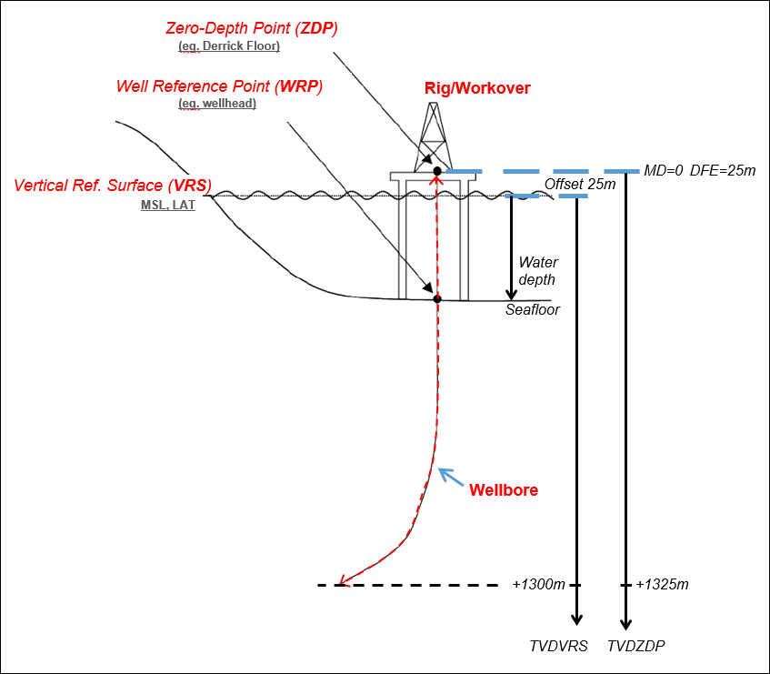
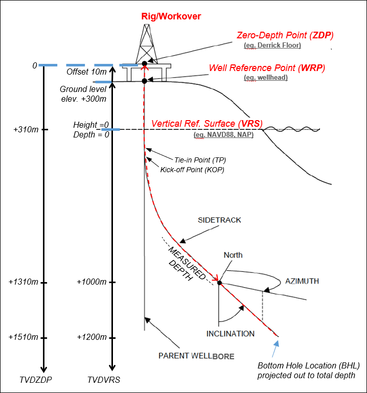

<a name="TOC"></a>

[[_TOC_]]

# Vertical References Usage

## Usage

### `osdu:wks:master-data--Wellbore:1.*`

Below the Wellbore `VerticalMeasurements[]` array. Each array object can have the following properties:

| Cumulative Name                                                                                                                                                                                                               | Value Type | Description                                                                                                                                                                                                                                                                                                                                                                                                                                                                                                                                                                                            |
|-------------------------------------------------------------------------------------------------------------------------------------------------------------------------------------------------------------------------------|------------|--------------------------------------------------------------------------------------------------------------------------------------------------------------------------------------------------------------------------------------------------------------------------------------------------------------------------------------------------------------------------------------------------------------------------------------------------------------------------------------------------------------------------------------------------------------------------------------------------------|
| data.VerticalMeasurements[].VerticalMeasurementID                                                                                                                                                                             | string     | The ID for a distinct vertical measurement within the Wellbore VerticalMeasurements array so that it may be referenced by other vertical measurements if necessary.                                                                                                                                                                                                                                                                                                                                                                                                                                    |
| data.VerticalMeasurements[].EffectiveDateTime                                                                                                                                                                                 | string     | The date and time at which a vertical measurement instance becomes effective.                                                                                                                                                                                                                                                                                                                                                                                                                                                                                                                          |
| data.VerticalMeasurements[].VerticalMeasurement                                                                                                                                                                               | number     | The value of the elevation or depth. Depth is positive downwards from a vertical reference or geodetic datum along a path, which can be vertical; elevation is positive upwards from a geodetic datum along a vertical path. Either can be negative.                                                                                                                                                                                                                                                                                                                                                   |
| data.VerticalMeasurements[].TerminationDateTime                                                                                                                                                                               | string     | The date and time at which a vertical measurement instance is no longer in effect.                                                                                                                                                                                                                                                                                                                                                                                                                                                                                                                     |
| data.VerticalMeasurements[].VerticalMeasurementTypeID &rarr; [VerticalMeasurementType](../../../E-R/reference-data/VerticalMeasurementType.1.0.3.md)                                                                          | string     | Specifies the type of vertical measurement (TD, Plugback, Kickoff, Drill Floor, Rotary Table...).                                                                                                                                                                                                                                                                                                                                                                                                                                                                                                      |
| data.VerticalMeasurements[].VerticalMeasurementPathID &rarr; [VerticalMeasurementPath](../../../E-R/reference-data/VerticalMeasurementPath.1.0.1.md)                                                                          | string     | Specifies Measured Depth, True Vertical Depth, or Elevation. key)                                                                                                                                                                                                                                                                                                                                                                                                                                                                                                                                      |
| data.VerticalMeasurements[].VerticalMeasurementSourceID &rarr; [VerticalMeasurementSource](../../../E-R/reference-data/VerticalMeasurementSource.1.0.0.md)                                                                    | string     | Specifies Driller vs Logger.                                                                                                                                                                                                                                                                                                                                                                                                                                                                                                                                                                           |
| data.VerticalMeasurements[].WellboreTVDTrajectoryID &rarr; [WellboreTrajectory](../../../E-R/work-product-component/WellboreTrajectory.1.4.0.md)                                                                              | string     | Specifies what directional survey or wellpath was used to calculate the TVD.                                                                                                                                                                                                                                                                                                                                                                                                                                                                                                                           |
| data.VerticalMeasurements[].VerticalMeasurementUnitOfMeasureID &rarr; [UnitOfMeasure](../../../E-R/reference-data/UnitOfMeasure.1.0.0.md)                                                                                     | string     | The unit of measure for the vertical measurement. If a unit of measure and a vertical CRS are provided, the unit of measure provided is taken over the unit of measure from the CRS.                                                                                                                                                                                                                                                                                                                                                                                                                   |
| data.VerticalMeasurements[].VerticalCRSID &rarr; [CoordinateReferenceSystem](../../../E-R/reference-data/CoordinateReferenceSystem.1.2.0.md)                                                                                  | string     | A vertical coordinate reference system defines the origin for height or depth values. It is expected that either VerticalCRSID or VerticalReferenceID reference is provided in a given vertical measurement array object, but not both.                                                                                                                                                                                                                                                                                                                                                                |
| data.VerticalMeasurements[].VerticalReferenceID                                                                                                                                                                               | string     | The reference point from which the relative vertical measurement is made. This is only populated if the measurement has no VerticalCRSID specified. The value entered must match the VerticalMeasurementID for another vertical measurement array element in Wellbore or Well or in a related parent facility. The relationship should be  declared explicitly in VerticalReferenceEntityID. Any chain of measurements must ultimately resolve to a Vertical CRS. It is expected that a VerticalCRSID or a VerticalReferenceID is provided in a given vertical measurement array object, but not both. |
| data.VerticalMeasurements[].VerticalReferenceEntityID &rarr; [Wellbore](../../../E-R/master-data/Wellbore.1.5.1.md) &rarr; [Well](../../../E-R/master-data/Well.1.5.0.md) &rarr; [Rig](../../../E-R/master-data/Rig.1.2.0.md) | string     | This relationship identifies the alternative entity the VerticalReferenceID is found in, when not referencing a measurement contained within its own array; for example, a wellbore referencing a vertical measurement from its parent well.                                                                                                                                                                                                                                                                                                                                                           |
| data.VerticalMeasurements[].VerticalMeasurementDescription                                                                                                                                                                    | string     | Text which describes a vertical measurement in detail.                                                                                                                                                                                                                                                                                                                                                                                                                                                                                                                                                 |

[Back to TOC](#TOC)

### `osdu:wks:work-product-component--WellboreMarkerSet:1.*` (as WPC Example)

Traditionally WellboreMarkerSet only carried a pointer `VerticalReferenceID`. When loading data (
work-product-components)
it was assumed that all required vertical references were already recorded with the `Wellbore` so that the references
could be established.

If this is not the case the Wellbore instance must be augmented prior to loading the work-product-components with new
vertical references.

To overcome this the work-product-components change to include a `AbstractFacilityVerticalMeasurement` named
`VerticalMeasurement` replacing the `VerticalMeasurementID`. References to Wellbore VerticalMeasurements[] are still
possible via data.`VerticalMeasurement.VerticalMeasurementID`.

| Cumulative Name                                                                                                                                                                                                               | Parent Type | Value Type                                                                                                                                                                                                                                                                                                                                                                                                                                                                                                                                                                                             | Description |
|-------------------------------------------------------------------------------------------------------------------------------------------------------------------------------------------------------------------------------|-------------|--------------------------------------------------------------------------------------------------------------------------------------------------------------------------------------------------------------------------------------------------------------------------------------------------------------------------------------------------------------------------------------------------------------------------------------------------------------------------------------------------------------------------------------------------------------------------------------------------------|-------------|
| data.VerticalMeasurement.EffectiveDateTime                                                                                                                                                                                    | string      | The date and time at which a vertical measurement instance becomes effective.                                                                                                                                                                                                                                                                                                                                                                                                                                                                                                                          |             |
| data.VerticalMeasurement.VerticalMeasurement                                                                                                                                                                                  | number      | The value of the elevation or depth. Depth is positive downwards from a vertical reference or geodetic datum along a path, which can be vertical; elevation is positive upwards from a geodetic datum along a vertical path. Either can be negative.                                                                                                                                                                                                                                                                                                                                                   |             |
| data.VerticalMeasurement.TerminationDateTime                                                                                                                                                                                  | string      | The date and time at which a vertical measurement instance is no longer in effect.                                                                                                                                                                                                                                                                                                                                                                                                                                                                                                                     |             |
| data.VerticalMeasurement.VerticalMeasurementTypeID &rarr; [VerticalMeasurementType](../../../E-R/reference-data/VerticalMeasurementType.1.0.3.md)                                                                             | string      | Specifies the type of vertical measurement (TD, Plugback, Kickoff, Drill Floor, Rotary Table...).                                                                                                                                                                                                                                                                                                                                                                                                                                                                                                      |             |
| data.VerticalMeasurement.VerticalMeasurementPathID &rarr; [VerticalMeasurementPath](../../../E-R/reference-data/VerticalMeasurementPath.1.0.1.md)                                                                             | string      | Specifies Measured Depth, True Vertical Depth, or Elevation. key)                                                                                                                                                                                                                                                                                                                                                                                                                                                                                                                                      |             |
| data.VerticalMeasurement.VerticalMeasurementSourceID &rarr; [VerticalMeasurementSource](../../../E-R/reference-data/VerticalMeasurementSource.1.0.0.md)                                                                       | string      | Specifies Driller vs Logger.                                                                                                                                                                                                                                                                                                                                                                                                                                                                                                                                                                           |             |
| data.VerticalMeasurement.WellboreTVDTrajectoryID &rarr; [WellboreTrajectory](../../../E-R/work-product-component/WellboreTrajectory.1.4.0.md)                                                                                 | string      | Specifies what directional survey or wellpath was used to calculate the TVD.                                                                                                                                                                                                                                                                                                                                                                                                                                                                                                                           |             |
| data.VerticalMeasurement.VerticalMeasurementUnitOfMeasureID &rarr; [UnitOfMeasure](../../../E-R/reference-data/UnitOfMeasure.1.0.0.md)                                                                                        | string      | The unit of measure for the vertical measurement. If a unit of measure and a vertical CRS are provided, the unit of measure provided is taken over the unit of measure from the CRS.                                                                                                                                                                                                                                                                                                                                                                                                                   |             |
| data.VerticalMeasurement.VerticalCRSID &rarr; [CoordinateReferenceSystem](../../../E-R/reference-data/CoordinateReferenceSystem.1.2.0.md)                                                                                     | string      | A vertical coordinate reference system defines the origin for height or depth values. It is expected that either VerticalCRSID or VerticalReferenceID reference is provided in a given vertical measurement array object, but not both.                                                                                                                                                                                                                                                                                                                                                                |             |
| data.VerticalMeasurements[].VerticalReferenceID                                                                                                                                                                               | string      | The reference point from which the relative vertical measurement is made. This is only populated if the measurement has no VerticalCRSID specified. The value entered must match the VerticalMeasurementID for another vertical measurement array element in Wellbore or Well or in a related parent facility. The relationship should be  declared explicitly in VerticalReferenceEntityID. Any chain of measurements must ultimately resolve to a Vertical CRS. It is expected that a VerticalCRSID or a VerticalReferenceID is provided in a given vertical measurement array object, but not both. |
| data.VerticalMeasurements[].VerticalReferenceEntityID &rarr; [Wellbore](../../../E-R/master-data/Wellbore.1.5.1.md) &rarr; [Well](../../../E-R/master-data/Well.1.5.0.md) &rarr; [Rig](../../../E-R/master-data/Rig.1.2.0.md) | string      | This relationship identifies the alternative entity the VerticalReferenceID is found in, when not referencing a measurement contained within its own array; for example, a wellbore referencing a vertical measurement from its parent well.                                                                                                                                                                                                                                                                                                                                                           |
| data.VerticalMeasurement.VerticalMeasurementDescription                                                                                                                                                                       | string      | Text which describes a vertical measurement in detail.                                                                                                                                                                                                                                                                                                                                                                                                                                                                                                                                                 |             |

[Back to TOC](#TOC)

### Scope of `VerticalMeasurementPathID`

The `VerticalMeasurementPathID` property carries the notion of a direction. Examples:

* `VerticalMeasurementPath:TrueVerticalHeight` is an Elevation positive upwards (a height),
* `VerticalMeasurementPath:TrueVerticalDepth` is True Vertical Depth positive downwards (a depth).

The direction only applies to the `VerticalMeasurement`. It does not apply to the data referring to this
`AbstractFacilityVerticalMeasurement`.

# Examples

The examples are based on the appendix C in
[Geomatics Conceptual Technical Solutions Architecture draft](https://gitlab.opengroup.org/osdu/subcommittees/ea/projects/geomatics/docs/-/blob/master/Design%20Documents/TechnicalSolutionArchitecture/Geomatics_Conceptual_Technical_Solution_Architecture_DRAFT.docx)
. Courtesy Bert Kampes.

[Back to TOC](#TOC)

## Offshore Example



### Records

* [Well](Records/WellOffshore.json) only keeps the shared references, in this case only the MSL reference. The internal
  ID is `MSL EPSG:5714`
  The [`VerticalCRS::EPSG::5714`](Records/WellOffshore.json#L12) id refers to a CoordinateReferenceSystem record
  describing Mean Sea Level Height reference surface.
* The [Wellbore](Records/WellboreOffshore.json) contains a list of vertical depths, some of them reusable by other
  work-product-components. Members of the list are identified by `VerticalMeasurementID`. The value
  of `VerticalMeasurementID` **_must not be changed_** unless an error is corrected. The examples use human-friendly
  values. When the list of `data.VerticalMeasurements[]` is augmented, it must be ensured that no duplicate value
  for `VerticalMeasurementID` is added.
    1. The root element is [`MSL EPSG:5714`](Records/WellboreOffshore.json#L10), which represents the Mean Sea Level
       height reference. The `VerticalCRS::EPSG::5714`  represents the Vertical Reference Surface (VRS).
    2. Drill floor is represented with [`DF 25 m`](Records/WellboreOffshore.json#L17).
    3. Seafloor is represented with [`SF 76.5 m`](Records/WellboreOffshore.json#L25).
    4. TVDSS is represented with [`TD TVDVRS`](Records/WellboreOffshore.json#L33).
    5. TD from DF is represented with [`TD TVDZDP`](Records/WellboreOffshore.json#L41).
* [WellboreMarkerSet](Records/WellboreMarkerOffshoreReferencingWellboreVR.json#L7)
  a well marker set, which refers through the parent `Wellbore` to the
  [`DF 25 m`](Records/WellboreOffshore.json#L17)
  named element in the `VerticalMeasurements` array.
* [WellboreMarkerSet](Records/WellboreMarkerOffshoreStandaloneVR.json)
  a well marker set, which is independent of the parent `Wellbore`'s `VerticalMeasurements` array. Instead, it contains
  a [different vertical reference point](Records/WellboreMarkerOffshoreStandaloneVR.json#L7) - with the same vertical
  position as in the previous example.

Below, please find extracted record fragments from an example well record:

<details>

<summary markdown="span">Offshore <code>Well</code> example record fragment with one MSL reference, representing the Vertical Reference Surface (VRS).</summary>

<OsduImportJSON>[Complete Well offshore example record](Records/WellOffshore.json#only.data.VerticalMeasurements)</OsduImportJSON>

```json
{
  "data": {
    "VerticalMeasurements": [
      {
        "VerticalMeasurementID": "MSL EPSG:5714",
        "VerticalMeasurement": 0,
        "VerticalMeasurementTypeID": "partition-id:reference-data--VerticalMeasurementType:MeanSeaLevel:",
        "VerticalMeasurementPathID": "partition-id:reference-data--VerticalMeasurementPath:TrueVerticalHeight:",
        "VerticalCRSID": "partition-id:reference-data--CoordinateReferenceSystem:Vertical:EPSG::5714:"
      }
    ]
  }
}
```

</details>

<details>

<summary markdown="span">Offshore <code>Wellbore</code> example record with multiple VerticalMeasurements (fragment).</summary>

<OsduImportJSON>[Complete offshore Wellbore ≈example record](Records/WellboreOffshore.json#only.data.VerticalMeasurements)</OsduImportJSON>

```json
{
  "data": {
    "VerticalMeasurements": [
      {
        "VerticalMeasurementID": "MSL EPSG:5714",
        "VerticalMeasurement": 0,
        "VerticalMeasurementTypeID": "partition-id:reference-data--VerticalMeasurementType:MeanSeaLevel:",
        "VerticalMeasurementPathID": "partition-id:reference-data--VerticalMeasurementPath:TrueVerticalHeight:",
        "VerticalCRSID": "partition-id:reference-data--CoordinateReferenceSystem:Vertical:EPSG::5714:"
      },
      {
        "VerticalMeasurementID": "DF 25 m",
        "VerticalMeasurement": 25.0,
        "VerticalMeasurementUnitOfMeasureID": "partition-id:reference-data--UnitOfMeasure:m:",
        "VerticalMeasurementTypeID": "partition-id:reference-data--VerticalMeasurementType:DrillFloor:",
        "VerticalMeasurementPathID": "partition-id:reference-data--VerticalMeasurementPath:TrueVerticalHeight:",
        "VerticalReferenceEntityID": "partition-id:master-data--Wellbore:WellboreOffshore-1:",
        "VerticalReferenceID": "MSL EPSG:5714"
      },
      {
        "VerticalMeasurementID": "SF 76.5 m",
        "VerticalMeasurement": 76.5,
        "VerticalMeasurementUnitOfMeasureID": "partition-id:reference-data--UnitOfMeasure:m:",
        "VerticalMeasurementTypeID": "partition-id:reference-data--VerticalMeasurementType:Seafloor:",
        "VerticalMeasurementPathID": "partition-id:reference-data--VerticalMeasurementPath:TrueVerticalDepth:",
        "VerticalReferenceEntityID": "partition-id:master-data--Wellbore:WellboreOffshore-1:",
        "VerticalReferenceID": "MSL EPSG:5714"
      },
      {
        "VerticalMeasurementID": "TD TVDVRS",
        "VerticalMeasurement": 1300.0,
        "VerticalMeasurementUnitOfMeasureID": "partition-id:reference-data--UnitOfMeasure:m:",
        "VerticalMeasurementTypeID": "partition-id:reference-data--VerticalMeasurementType:TotalDepth:",
        "VerticalMeasurementPathID": "partition-id:reference-data--VerticalMeasurementPath:TrueVerticalDepth:",
        "VerticalReferenceEntityID": "partition-id:master-data--Wellbore:WellboreOffshore-1:",
        "VerticalReferenceID": "MSL EPSG:5714"
      },
      {
        "VerticalMeasurementID": "TD TVDZDP",
        "VerticalMeasurement": 1325.0,
        "VerticalMeasurementUnitOfMeasureID": "partition-id:reference-data--UnitOfMeasure:m:",
        "VerticalMeasurementTypeID": "partition-id:reference-data--VerticalMeasurementType:TotalDepth:",
        "VerticalMeasurementPathID": "partition-id:reference-data--VerticalMeasurementPath:TrueVerticalDepth:",
        "VerticalReferenceEntityID": "partition-id:master-data--Wellbore:WellboreOffshore-1:",
        "VerticalReferenceID": "DF 25 m"
      }
    ]
  }
}
```

</details>

<details>

<summary markdown="span">Offshore <code>Wellbore</code> example with <code>MSL EPSG:5714</code> as the Mean Sea Level height reference VerticalMeasurementID representing the Vertical Reference Surface (VRS).</summary>

<OsduImportJSON>[Wellbore offshore example, full record](Records/WellboreOffshore.json#only.data.VerticalMeasurements[0])</OsduImportJSON>

```json
{
  "data": {
    "VerticalMeasurements": [
      {
        "VerticalMeasurementID": "MSL EPSG:5714",
        "VerticalMeasurement": 0,
        "VerticalMeasurementTypeID": "partition-id:reference-data--VerticalMeasurementType:MeanSeaLevel:",
        "VerticalMeasurementPathID": "partition-id:reference-data--VerticalMeasurementPath:TrueVerticalHeight:",
        "VerticalCRSID": "partition-id:reference-data--CoordinateReferenceSystem:Vertical:EPSG::5714:"
      }
    ]
  }
}
```

</details>

<details>

<summary markdown="span">Offshore <code>Wellbore</code> example with <code>DF 25 m</code> as the drill floor VerticalMeasurementID.</summary>

<OsduImportJSON>[Wellbore offshore example, full record](Records/WellboreOffshore.json#only.data.VerticalMeasurements[1])</OsduImportJSON>

```json
{
  "data": {
    "VerticalMeasurements": [
      {
        "VerticalMeasurementID": "DF 25 m",
        "VerticalMeasurement": 25.0,
        "VerticalMeasurementUnitOfMeasureID": "partition-id:reference-data--UnitOfMeasure:m:",
        "VerticalMeasurementTypeID": "partition-id:reference-data--VerticalMeasurementType:DrillFloor:",
        "VerticalMeasurementPathID": "partition-id:reference-data--VerticalMeasurementPath:TrueVerticalHeight:",
        "VerticalReferenceEntityID": "partition-id:master-data--Wellbore:WellboreOffshore-1:",
        "VerticalReferenceID": "MSL EPSG:5714"
      }
    ]
  }
}
```
</details>

<details>

<summary markdown="span">Offshore <code>Wellbore</code> example with <code>SF 76.5 m</code> as the seafloor VerticalMeasurementID.</summary>

<OsduImportJSON>[Wellbore offshore example, Full record](Records/WellboreOffshore.json#only.data.VerticalMeasurements[2])</OsduImportJSON>

```json
{
  "data": {
    "VerticalMeasurements": [
      {
        "VerticalMeasurementID": "SF 76.5 m",
        "VerticalMeasurement": 76.5,
        "VerticalMeasurementUnitOfMeasureID": "partition-id:reference-data--UnitOfMeasure:m:",
        "VerticalMeasurementTypeID": "partition-id:reference-data--VerticalMeasurementType:Seafloor:",
        "VerticalMeasurementPathID": "partition-id:reference-data--VerticalMeasurementPath:TrueVerticalDepth:",
        "VerticalReferenceEntityID": "partition-id:master-data--Wellbore:WellboreOffshore-1:",
        "VerticalReferenceID": "MSL EPSG:5714"
      }
    ]
  }
}
```

</details>

<details>

<summary markdown="span">Offshore <code>Wellbore</code> example with <code>TD TVDVRS</code> as VerticalMeasurementID.</summary>

<OsduImportJSON>[Wellbore offshore example, full record](Records/WellboreOffshore.json#only.data.VerticalMeasurements[3])</OsduImportJSON>

```json
{
  "data": {
    "VerticalMeasurements": [
      {
        "VerticalMeasurementID": "TD TVDVRS",
        "VerticalMeasurement": 1300.0,
        "VerticalMeasurementUnitOfMeasureID": "partition-id:reference-data--UnitOfMeasure:m:",
        "VerticalMeasurementTypeID": "partition-id:reference-data--VerticalMeasurementType:TotalDepth:",
        "VerticalMeasurementPathID": "partition-id:reference-data--VerticalMeasurementPath:TrueVerticalDepth:",
        "VerticalReferenceEntityID": "partition-id:master-data--Wellbore:WellboreOffshore-1:",
        "VerticalReferenceID": "MSL EPSG:5714"
      }
    ]
  }
}
```

</details>

<details>

<summary markdown="span">Offshore <code>Wellbore</code> example with <code>TD TVDZDP</code> as VerticalMeasurementID.</summary>

<OsduImportJSON>[Wellbore offshore example, full record](Records/WellboreOffshore.json#only.data.VerticalMeasurements[4])</OsduImportJSON>

```json
{
  "data": {
    "VerticalMeasurements": [
      {
        "VerticalMeasurementID": "TD TVDZDP",
        "VerticalMeasurement": 1325.0,
        "VerticalMeasurementUnitOfMeasureID": "partition-id:reference-data--UnitOfMeasure:m:",
        "VerticalMeasurementTypeID": "partition-id:reference-data--VerticalMeasurementType:TotalDepth:",
        "VerticalMeasurementPathID": "partition-id:reference-data--VerticalMeasurementPath:TrueVerticalDepth:",
        "VerticalReferenceEntityID": "partition-id:master-data--Wellbore:WellboreOffshore-1:",
        "VerticalReferenceID": "DF 25 m"
      }
    ]
  }
}
```

</details>

<details>

<summary markdown="span">Offshore <code>WellboreMarkerSet</code> example fragment, which refers through the parent <code>Wellbore</code> to the <code>DF 25 m</code> element in the <code>VerticalMeasurements</code> array.</summary>

<OsduImportJSON>[WellboreMarkerSet offshore example, full record](Records/WellboreMarkerOffshoreReferencingWellboreVR.json#only.data.VerticalMeasurement)</OsduImportJSON>

```json
{
  "data": {
    "VerticalMeasurement": {
      "VerticalReferenceID": "DF 25 m",
      "VerticalReferenceEntityID": "partition-id:master-data--Wellbore:WellboreOffshore-1:"
    }
  }
}
```

</details>

<details>

<summary markdown="span">Offshore <code>WellboreMarkerSet</code> example fragment with a different vertical reference point, independent of the Wellbore, referenced from the Vertical Reference Surface (VRS), VerticalCRS::EPSG::5714.</summary>

<OsduImportJSON>[WellboreMarkerSet offshore example, full record](Records/WellboreMarkerOffshoreStandaloneVR.json#only.data.VerticalMeasurement)</OsduImportJSON>

```json
{
  "data": {
    "VerticalMeasurement": {
      "VerticalMeasurement": 27.5,
      "VerticalMeasurementUnitOfMeasureID": "partition-id:reference-data--UnitOfMeasure:m:",
      "VerticalMeasurementTypeID": "partition-id:reference-data--VerticalMeasurementType:DrillFloor:",
      "VerticalMeasurementPathID": "partition-id:reference-data--VerticalMeasurementPath:TrueVerticalHeight:",
      "VerticalCRSID": "partition-id:reference-data--CoordinateReferenceSystem:Vertical:EPSG::5714"
    }
  }
}
```

</details>

[Back to TOC](#TOC)

### Vertical Reference Chains

The following chains are constructed, all eventually referring to the Vertical Reference Surface (VRS) given by the
Mean Sea Level VerticalCRS::EPSG::5714:

1. [`DF 25 m`](Records/WellboreOffshore.json#L18) &rarr; [`MSL EPSG:5714`](Records/WellboreOffshore.json#L10)
1. [`SF 76.5 m`](Records/WellboreOffshore.json#L26) &rarr; [`MSL EPSG:5714`](Records/WellboreOffshore.json#L10) - this
   is an invented number, not found in the figure above
1. [`TD TVDVRS`](Records/WellboreOffshore.json#L34) &rarr; [`MSL EPSG:5714`](Records/WellboreOffshore.json#L10) - Total
   Depth TVD below MSL
1. [`TD TVDZDP`](Records/WellboreOffshore.json#L42) &rarr; [`DF 25 m`](Records/WellboreOffshore.json#L17)
   &rarr; [`MSL EPSG:5714`](Records/WellboreOffshore.json#L10) - Total Depth TVD below DF

The links open the example records, the expandable sections above show the fragments.

[Back to TOC](#TOC)

## Onshore Example



### Records

* [Well](Records/WellOnshore.json) only keeps the shared references, in this case only the MSL reference and Ground
  Level. The internal IDs are `NAVD88 EPSG:5703` and `GL 984.3 ft`. The `VerticalCRS:EPSG:5703` id refers to a
  CoordinateReferenceSystem record describing Mean Sea Level Height for the North American Vertical Datum of 1988 (
  vertical reference surface VRS in the figure above). <br> `GL 984.3 ft` is defining the well's reference point WRP.
  This reference is also expressed as absolute reference.
* [Wellbore](Records/WellboreOffshore.json) contains a list of vertical depths, some of them reusable by
  work-product-components.
    1. The root element is [`NAVD88 EPSG:5703`](Records/WellboreOnshore.json#L11), which represents the NADV88 height
       reference as in the parent well (VRS in the figure above).
    1. Ground Level [`GL 984.25 ft`](Records/WellboreOnshore.json#L18) (WRP in the figure above). This reference is actually defined in the Parent wellbore defined by the `VerticalReferenceEntityID`, see [reference in Wellbore here](Records/WellboreOnshore.json#23) and [definition in Well](Records/WellOnshore.json#16).
    1. Rotary Table [`RT 10 m`](Records/WellboreOnshore.json#L27) (ZDP in the figure above).
    1. TD from VRS [`TD TVDVRS`](Records/WellboreOnshore.json#L36).
    1. TD from RT [`TD TVDZDP`](Records/WellboreOnshore.json#L45).

**_Note:_** The example demonstrates what is **possible**, **not what is recommended**. For recommendations see the [Schema Usage Guide](../../../Guides/Chapters/03-VerticalMeasurements.md#34-recommendations-best-practice).

[Back to TOC](#TOC)

<details>

<summary markdown="span">Onshore <code>Well</code> example record fragment.</summary>

<OsduImportJSON>[Onshore Well example, full record](Records/WellOnshore.json#only.data.VerticalMeasurements)</OsduImportJSON>

```json
{
  "data": {
    "VerticalMeasurements": [
      {
        "VerticalMeasurementID": "NAVD88 EPSG:5703",
        "VerticalMeasurement": 0,
        "VerticalMeasurementUnitOfMeasureID": "partition-id:reference-data--UnitOfMeasure:Energistics:m:",
        "VerticalMeasurementTypeID": "partition-id:reference-data--VerticalMeasurementType:MeanSeaLevel:",
        "VerticalMeasurementPathID": "partition-id:reference-data--VerticalMeasurementPath:TrueVerticalHeight:",
        "VerticalCRSID": "partition-id:reference-data--CoordinateReferenceSystem:Vertical:EPSG::5703:"
      },
      {
        "VerticalMeasurementID": "GL 984.25 ft",
        "VerticalMeasurement": 984.25,
        "VerticalMeasurementUnitOfMeasureID": "partition-id:reference-data--UnitOfMeasure:Energistics:ft:",
        "VerticalMeasurementTypeID": "partition-id:reference-data--VerticalMeasurementType:GroundLevel:",
        "VerticalMeasurementPathID": "partition-id:reference-data--VerticalMeasurementPath:TrueVerticalHeight:",
        "VerticalCRSID": "partition-id:reference-data--CoordinateReferenceSystem:Vertical:EPSG::5703:"
      }
    ]
  }
}
```

</details>

<details>

<summary markdown="span">Onshore <code>Wellbore</code> record fragment with <code>NAVD88 EPSG:5703</code> NAVD88 height reference as VerticalMeasurementID, representing the Vertical Reference Surface (VRS).</summary>

<OsduImportJSON>[Onshore Wellbore example, full record](Records/WellboreOnshore.json#only.data.VerticalMeasurements[0])</OsduImportJSON>

```json
{
  "data": {
    "VerticalMeasurements": [
      {
        "VerticalMeasurementID": "NAVD88 EPSG:5703",
        "VerticalMeasurement": 0,
        "VerticalMeasurementUnitOfMeasureID": "partition-id:reference-data--UnitOfMeasure:Energistics:m:",
        "VerticalMeasurementTypeID": "partition-id:reference-data--VerticalMeasurementType:MeanSeaLevel:",
        "VerticalMeasurementPathID": "partition-id:reference-data--VerticalMeasurementPath:TrueVerticalHeight:",
        "VerticalCRSID": "partition-id:reference-data--CoordinateReferenceSystem:Vertical:EPSG::5703:"
      }
    ]
  }
}
```

</details>

<details>

<summary markdown="span">Onshore <code>Wellbore</code> record fragment with <code>GL 984.25 ft</code> Ground Level as VerticalMeasurementID above VRS.</summary>

<OsduImportJSON>[Onshore Wellbore example, full record](Records/WellboreOnshore.json#only.data.VerticalMeasurements[1])</OsduImportJSON>

```json
{
  "data": {
    "VerticalMeasurements": [
      {
        "VerticalMeasurementID": "GL 984.25 ft",
        "VerticalMeasurement": 0.0,
        "VerticalMeasurementUnitOfMeasureID": "partition-id:reference-data--UnitOfMeasure:ft:",
        "VerticalMeasurementTypeID": "partition-id:reference-data--VerticalMeasurementType:GroundLevel:",
        "VerticalMeasurementPathID": "partition-id:reference-data--VerticalMeasurementPath:TrueVerticalHeight:",
        "VerticalReferenceEntityID": "partition-id:master-data--Well:WellOnshore-1:",
        "VerticalReferenceID": "GL 984.25 ft"
      }
    ]
  }
}
```

</details>

<details>

<summary markdown="span">Onshore <code>Wellbore</code> record fragment with <code>RT 10 m</code> Rotary Table as VerticalMeasurementID.</summary>

<OsduImportJSON>[Onshore Wellbore example, full record](Records/WellboreOnshore.json#only.data.VerticalMeasurements[2])</OsduImportJSON>

```json
{
  "data": {
    "VerticalMeasurements": [
      {
        "VerticalMeasurementID": "RT 10 m",
        "VerticalMeasurement": 10.0,
        "VerticalMeasurementUnitOfMeasureID": "partition-id:reference-data--UnitOfMeasure:m:",
        "VerticalMeasurementTypeID": "partition-id:reference-data--VerticalMeasurementType:RotaryTable:",
        "VerticalMeasurementPathID": "partition-id:reference-data--VerticalMeasurementPath:TrueVerticalHeight:",
        "VerticalReferenceEntityID": "partition-id:master-data--Well:WellOnshore-1:",
        "VerticalReferenceID": "GL 984.25 ft"
      }
    ]
  }
}
```

</details>

<details>

<summary markdown="span">Onshore <code>Wellbore</code> record fragment with <code>TD TVDVRS</code> TD from VRS as VerticalMeasurementID.</summary>

<OsduImportJSON>[Onshore Wellbore example, full record](Records/WellboreOnshore.json#only.data.VerticalMeasurements[3])</OsduImportJSON>

```json
{
  "data": {
    "VerticalMeasurements": [
      {
        "VerticalMeasurementID": "TD TVDVRS",
        "VerticalMeasurement": 1200.0,
        "VerticalMeasurementUnitOfMeasureID": "partition-id:reference-data--UnitOfMeasure:m:",
        "VerticalMeasurementTypeID": "partition-id:reference-data--VerticalMeasurementType:TotalDepth:",
        "VerticalMeasurementPathID": "partition-id:reference-data--VerticalMeasurementPath:TrueVerticalDepth:",
        "VerticalReferenceEntityID": "partition-id:master-data--Well:WellOnshore-1:",
        "VerticalReferenceID": "NAVD88 EPSG:5703"
      }
    ]
  }
}
```

</details>

<details>

<summary markdown="span">Onshore <code>Wellbore</code> record fragment with <code>TD TVDZDP</code> TD from RT as VerticalMeasurementID.</summary>

<OsduImportJSON>[Onshore Wellbore example, full record](Records/WellboreOnshore.json#only.data.VerticalMeasurements[4])</OsduImportJSON>

```json
{
  "data": {
    "VerticalMeasurements": [
      {
        "VerticalMeasurementID": "TD TVDZDP",
        "VerticalMeasurement": 1510.0,
        "VerticalMeasurementUnitOfMeasureID": "partition-id:reference-data--UnitOfMeasure:m:",
        "VerticalMeasurementTypeID": "partition-id:reference-data--VerticalMeasurementType:TotalDepth:",
        "VerticalMeasurementPathID": "partition-id:reference-data--VerticalMeasurementPath:TrueVerticalDepth:",
        "VerticalReferenceEntityID": "partition-id:master-data--Wellbore:DemoWellbore:",
        "VerticalReferenceID": "RT 10 m"
      }
    ]
  }
}
```

</details>

[Back to TOC](#TOC)

### Vertical Reference Chains

The following chains are constructed, all eventually referring to the Vertical Reference Surface (VRS) given by the
NAVD88 VerticalCRS::EPSG::5703:

1. [`RT 10 m`](Records/WellboreOnshore.json#L27) &rarr; [`GL 984.25 ft`](Records/WellboreOnshore.json#L19) (Wellbore) referring to [`GL 984.25 ft`](Records/WellOnshore.json#L16) (Well)
   &rarr; absolutely referencing CRS `EPSG:5703` in the Well as [`NAVD88 EPSG:5703`](Records/WellOnshore.json#L8)
1. [`TD TVDVRS`](Records/WellboreOnshore.json#L36) &rarr; [`NAVD88 EPSG:5703`](Records/WellboreOnshore.json#L11) - TVDSS
1. [`TD TVDZDP`](Records/WellboreOnshore.json#L45) &rarr; [`RT 10 m`](Records/WellboreOnshore.json#L27) &rarr;
   [`NAVD88 EPSG:5703`](Records/WellboreOnshore.json#L11) - Total Depth TVD below RT

The links open the example records, the expandable sections above show the fragments. Again, note that the example demonstrates what is **possible**, **not what is recommended**. For recommendations see the [Schema Usage Guide](../../../Guides/Chapters/03-VerticalMeasurements.md#34-recommendations-best-practice).

[Back to TOC](#TOC)