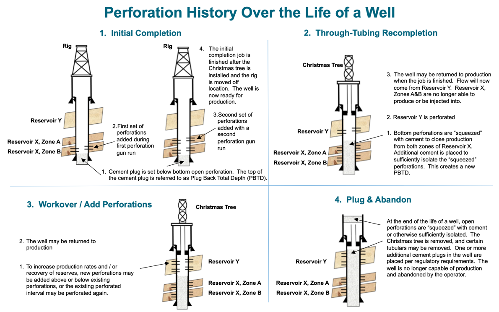
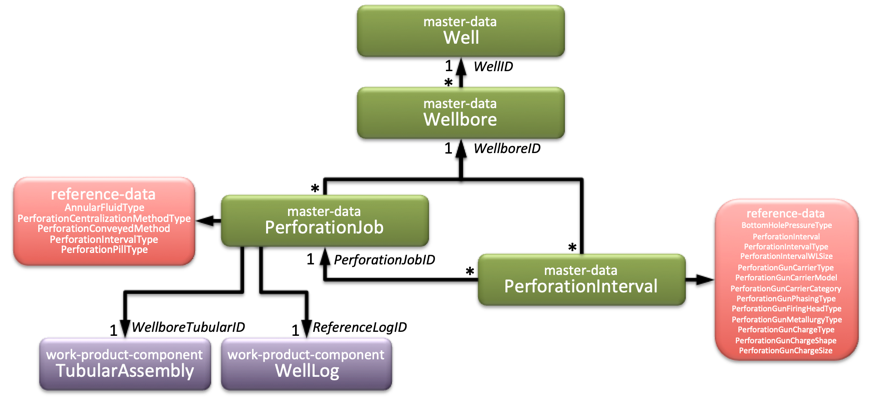
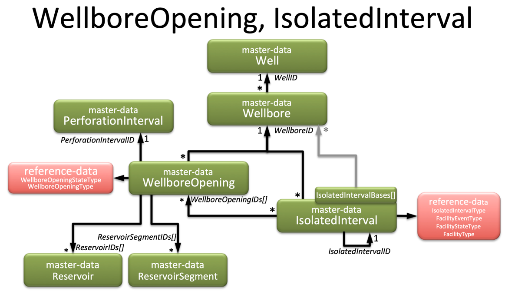
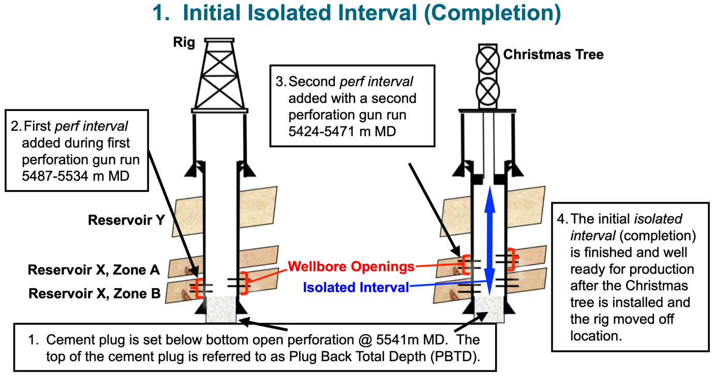

<a name="TOC"></a>

[[_TOC_]]

# Well Completion Life Cycle

<a name="LifeCycleFigure"></a>


<center><b>Figure 1: Life Cycle</b></center>

Figure 1. above illustrates four different stages in the lifecycle of a wellbore. The figure serves as the background
for the example records, which demonstrate the usage of the data model.

## Conceptual Perforation Data Model

<a name="PerforationsModel"></a>


<center><b>Figure 2: Perforations, Conceptual Model</b></center>


## PerforationJob (1.2)

The `PerforationJob` documentation  [can be found here](../../../E-R/master-data/PerforationJob.1.2.0.md). The example
below reflects the job in the in step number
"_2. First set of perforations added during first perforation gun run_"  in "_1. Initial Completion_"
as shown in [Figure 1](#LifeCycleFigure).

<details>

<summary markdown="span">PerforationJob SampleJob-Zone-B Example Record</summary>

<OsduImportJSON>[Perforation SampleJob-Zone-B, full record](master-data/PerforationJob-Res-X-Zone-B.json#only.data)</OsduImportJSON>

```json
{
  "data": {
    "ResourceHomeRegionID": "partition-id:reference-data--OSDURegion:AWSEastUSA:",
    "ResourceHostRegionIDs": [
      "partition-id:reference-data--OSDURegion:AWSEastUSA:"
    ],
    "ResourceCurationStatus": "partition-id:reference-data--ResourceCurationStatus:CREATED:",
    "ResourceLifecycleStatus": "partition-id:reference-data--ResourceLifecycleStatus:LOADING:",
    "Source": "Example Data Source",
    "ExistenceKind": "partition-id:reference-data--ExistenceKind:Actual:",
    "NameAliases": [],
    "GeoContexts": [],
    "VersionCreationReason": "Example VersionCreationReason",
    "TechnicalAssuranceTypeID": "partition-id:reference-data--TechnicalAssuranceType:Certified:",
    "WellboreID": "partition-id:master-data--Wellbore:11000091175501:",
    "Name": "Plug & Perf Reservoir X, Zone B",
    "VerticalMeasurement": {
      "VerticalMeasurement": 954.1,
      "VerticalMeasurementTypeID": "partition-id:reference-data--VerticalMeasurementType:DrillFloor:",
      "VerticalMeasurementPathID": "partition-id:reference-data--VerticalMeasurementPath:TrueVerticalHeight:",
      "VerticalMeasurementUnitOfMeasureID": "partition-id:reference-data--UnitOfMeasure:m:",
      "VerticalCRSID": "partition-id:reference-data--CoordinateReferenceSystem:Vertical:EPSG::5714:"
    },
    "WellboreTubularID": "partition-id:master-data--TubularAssembly:TubularAssembly-911bb71f-06ab-4deb-8e68-b8c9229dc76b:",
    "ContractorID": "partition-id:master-data--Organisation:Schlumberger:",
    "ContractorSupervisor": "Joe Bloggs",
    "MethodID": "partition-id:reference-data--PerforationIntervalType:JetPerforate:",
    "ConveyedMethodID": "partition-id:reference-data--PerforationConveyedMethod:ElecLine:",
    "IsTractorUsed": false,
    "JobStartDateTime": "2022-06-14T10:36:00.000Z",
    "JobEndDateTime": "2022-06-14T11:35:00.000Z",
    "BottomHoleTemperature": 218.0,
    "SurfacePressureInitial": 14.5,
    "ReservoirTVD": 5530.0,
    "ReservoirPressureEstimated": 4800.0,
    "AnticipatedReservoirPressure": 4800.0,
    "AnnulusFluidTypeID": "partition-id:reference-data--AnnularFluidType:CACL2WATER:",
    "AnnulusFluidDensity": 9.8,
    "AnnulusFluidTopTVD": 200.0,
    "Underbalanced": false,
    "HydrostaticReservoirPressureDifference": 14227.0,
    "FinalSurfacePressure": 4775.0,
    "SurfacePressureFinalDateTime": "2022-06-14T12:05:00.00Z",
    "AfterPillFluidLossRate": 0.0,
    "PostJobFluidLossRate": 0.0,
    "PillVolume": 10.0,
    "PillTypeID": "partition-id:reference-data--PerforationPillType:HydroxyethylCellulose:",
    "ReferenceLogDate": "2022-04-12T00:00:00.00Z",
    "ReferenceLogID": "partition-id:work-product-component--WellLog:WellLog-911bb71f-06ab-4deb-8e68-b8c9229dc76b:",
    "ReferenceLogDescription": "GR-SP Log 1 20220412",
    "PerfJobMDTop": 5487.31,
    "PerfJobMDBase": 5534.56,
    "PerfGrossIntervalLength": 47.24,
    "PerfNetIntervalLength": 1.22,
    "NoIntervals": 4,
    "TotalShots": 24,
    "ShotDensityAverage": 19.69,
    "CentralizationMethodID": "partition-id:reference-data--PerforationCentralizationMethodType:None:",
    "Comment": "Perforate Zone B as follows: 18157' - 18158', 18106' - 18107', 18054' - 18055', 18003' - 18004'",
    "ExtensionProperties": {}
  }
}
```
</details>


[Back to TOC](#TOC)

---

## PerforationInterval (1.2)

The PerforationInterval documentation [can be found here](../../../E-R/master-data/PerforationInterval.1.2.0.md). The
four intervals also correspond to step number
"_2. First set of perforations added during first perforation gun run_"  in "_1. Initial Completion_"
as shown in [Figure 1](#LifeCycleFigure). There are four separate `PerforationInterval` record instances created to
reflect the outcome of the job. For convenience, they are combined in one manifest, a single JSON structure, containing
multiple MasterData[] record members.

<details>

<summary markdown="span">PerforationInterval Example Record, Zone B, Sequence No. 1</summary>

<OsduImportJSON>[PerforationInterval, full record](master-data/PerforationInterval-Res-X-Zone-B.json#only.MasterData[0].data)</OsduImportJSON>

```json
{
  "MasterData": {
    "data": {
      "ResourceHomeRegionID": "partition-id:reference-data--OSDURegion:AWSEastUSA:",
      "ResourceHostRegionIDs": [
        "partition-id:reference-data--OSDURegion:AWSEastUSA:"
      ],
      "ResourceCurationStatus": "partition-id:reference-data--ResourceCurationStatus:CREATED:",
      "ResourceLifecycleStatus": "partition-id:reference-data--ResourceLifecycleStatus:LOADING:",
      "Source": "Example Data Source",
      "ExistenceKind": "partition-id:reference-data--ExistenceKind:Actual:",
      "NameAliases": [],
      "GeoContexts": [],
      "VersionCreationReason": "Example VersionCreationReason",
      "TechnicalAssuranceTypeID": "partition-id:reference-data--TechnicalAssuranceType:Certified:",
      "Name": "Reservoir X Zone B Interval #1",
      "WellboreID": "partition-id:master-data--Wellbore:11000091175501:",
      "PerforationJobID": "partition-id:master-data--PerforationJob:PerforationSampleJobID:",
      "SequenceNumber": 1,
      "ClusterRefNo": 1.1,
      "IntervalDateTime": "2022-06-14T10:45:00.00Z",
      "IntervalTypeID": "partition-id:reference-data--PerforationIntervalType:Abrasive-HP-FluidJet:",
      "VerticalMeasurement": {
        "VerticalMeasurement": 954.1,
        "VerticalMeasurementTypeID": "partition-id:reference-data--VerticalMeasurementType:DrillFloor:",
        "VerticalMeasurementPathID": "partition-id:reference-data--VerticalMeasurementPath:TrueVerticalHeight:",
        "VerticalMeasurementUnitOfMeasureID": "partition-id:reference-data--UnitOfMeasure:m:",
        "VerticalCRSID": "partition-id:reference-data--CoordinateReferenceSystem:Vertical:EPSG::5714:"
      },
      "IntervalTopMD": 5534.25,
      "IntervalBaseMD": 5534.56,
      "IntervalLength": 0.31,
      "WirelineDiameterTypeID": "partition-id:reference-data--PerforationIntervalWLSize:0.082:",
      "IntervalReasonTypeID": "partition-id:reference-data--PerforationIntervalReason:Production:",
      "GunDiameter": 2.75,
      "GunCarrierManufacturerID": "partition-id:master-data--Organisation:Schlumberger:",
      "GunCarrierTypeID": "partition-id:reference-data--PerforationGunCarrierType:HollowCarrier:",
      "GunCarrierModelID": "partition-id:reference-data--PerforationGunCarrierModel:PortPlug:",
      "GunCarrierCategoryTypeID": "partition-id:reference-data--PerforationGunCarrierCategory:Retrievable:",
      "GunCarrierPhasing": "partition-id:reference-data--PerforationGunPhasingType:60-deg:",
      "GunFiringHeadTypeID": "partition-id:reference-data--PerforationGunFiringHeadType:Hydraulic:",
      "GunMetallurgyTypeID": "partition-id:reference-data--PerforationGunMetallurgyType:JST110Q:",
      "ChargeManufacturerID": "partition-id:master-data--Organisation:Schlumberger:",
      "ChargeTypeID": "partition-id:reference-data--PerforationGunChargeType:RDX:",
      "ChargeShapeID": "partition-id:reference-data--PerforationGunChargeShape:DeepPenetrating:",
      "ChargeSize": "partition-id:reference-data--PerforationGunChargeSize:23:",
      "GunSwellDiameter": 1.2,
      "ShotDensity": 19.69,
      "EntranceHoleDiameter": 7.5,
      "PenetrationDepth": 0.4,
      "IsAdditionalShot": false,
      "Misfires": 0,
      "ReservoirTemperature": 210.0,
      "CasingCollarLocatorMD": 3770.0,
      "CCLTopShotDistance": 100.61,
      "FluidBeforeMD": 45.0,
      "FluidAfterMD": 45.0,
      "GaugeMD": 5100.0,
      "BHPressureTypeID": "partition-id:reference-data--BottomHolePressureType:Gauge:",
      "DuringPerfGaugePressure": 4651.0,
      "InitialSurfPressure": 4000.0,
      "FinalSurfPressure": 4775,
      "MPPPressure": 4650.0,
      "FluidLossBeforeRate": 0.0,
      "FluidLossAfterRate": 0.0,
      "FrictionFactor": 0.1,
      "FrictionPressure": 100,
      "DischargeCoefficient": 0.8,
      "CrushZoneDiameter": 2.8,
      "CrushDamageRatio": 0.7,
      "TechnicalResult": "Good",
      "IntervalComments": "Reservoir X, Zone B 1st Interval. All Shots Fired",
      "ExtensionProperties": {}
    }
  }
}
```
</details>
<details>

<summary markdown="span">PerforationInterval Example Record, Zone B, Sequence No. 2</summary>

<OsduImportJSON>[PerforationInterval, full manifest record](master-data/PerforationInterval-Res-X-Zone-B.json#only.MasterData[1].data)</OsduImportJSON>

```json
{
  "MasterData": {
    "data": {
      "ResourceHomeRegionID": "partition-id:reference-data--OSDURegion:AWSEastUSA:",
      "ResourceHostRegionIDs": [
        "partition-id:reference-data--OSDURegion:AWSEastUSA:"
      ],
      "ResourceCurationStatus": "partition-id:reference-data--ResourceCurationStatus:CREATED:",
      "ResourceLifecycleStatus": "partition-id:reference-data--ResourceLifecycleStatus:LOADING:",
      "Source": "Example Data Source",
      "ExistenceKind": "partition-id:reference-data--ExistenceKind:Actual:",
      "NameAliases": [],
      "GeoContexts": [],
      "VersionCreationReason": "Example VersionCreationReason",
      "TechnicalAssuranceTypeID": "partition-id:reference-data--TechnicalAssuranceType:Certified:",
      "Name": "Reservoir X Zone B Interval #2",
      "WellboreID": "partition-id:master-data--Wellbore:11000091175501:",
      "PerforationJobID": "partition-id:master-data--PerforationJob:PerforationSampleJobID:",
      "SequenceNumber": 2,
      "ClusterRefNo": 1.2,
      "IntervalDateTime": "2022-06-14T11:00:00.00Z",
      "IntervalTypeID": "partition-id:reference-data--PerforationIntervalType:Abrasive-HP-FluidJet:",
      "VerticalMeasurement": {
        "VerticalMeasurement": 954.1,
        "VerticalMeasurementTypeID": "partition-id:reference-data--VerticalMeasurementType:DrillFloor:",
        "VerticalMeasurementPathID": "partition-id:reference-data--VerticalMeasurementPath:TrueVerticalHeight:",
        "VerticalMeasurementUnitOfMeasureID": "partition-id:reference-data--UnitOfMeasure:m:",
        "VerticalCRSID": "partition-id:reference-data--CoordinateReferenceSystem:Vertical:EPSG::5714:"
      },
      "IntervalTopMD": 5518.71,
      "IntervalBaseMD": 5519.01,
      "IntervalLength": 0.31,
      "WirelineDiameterTypeID": "partition-id:reference-data--PerforationIntervalWLSize:0.082:",
      "IntervalReasonTypeID": "partition-id:reference-data--PerforationIntervalReason:Production:",
      "GunDiameter": 2.75,
      "GunCarrierManufacturerID": "partition-id:master-data--Organisation:Schlumberger:",
      "GunCarrierTypeID": "partition-id:reference-data--PerforationGunCarrierType:HollowCarrier:",
      "GunCarrierModelID": "partition-id:reference-data--PerforationGunCarrierModel:PortPlug:",
      "GunCarrierCategoryTypeID": "partition-id:reference-data--PerforationGunCarrierCategory:Retrievable:",
      "GunCarrierPhasing": "partition-id:reference-data--PerforationGunPhasingType:60-deg:",
      "GunFiringHeadTypeID": "partition-id:reference-data--PerforationGunFiringHeadType:Hydraulic:",
      "GunMetallurgyTypeID": "partition-id:reference-data--PerforationGunMetallurgyType:JST110Q:",
      "ChargeManufacturerID": "partition-id:master-data--Organisation:Schlumberger:",
      "ChargeTypeID": "partition-id:reference-data--PerforationGunChargeType:RDX:",
      "ChargeShapeID": "partition-id:reference-data--PerforationGunChargeShape:DeepPenetrating:",
      "ChargeSize": "partition-id:reference-data--PerforationGunChargeSize:23:",
      "GunSwellDiameter": 1.2,
      "ShotDensity": 19.69,
      "EntranceHoleDiameter": 7.5,
      "PenetrationDepth": 0.4,
      "IsAdditionalShot": false,
      "Misfires": 0,
      "ReservoirTemperature": 210.0,
      "CasingCollarLocatorMD": 3770.0,
      "CCLTopShotDistance": 100.31,
      "FluidBeforeMD": 45.0,
      "FluidAfterMD": 45.0,
      "GaugeMD": 5100.0,
      "BHPressureTypeID": "partition-id:reference-data--BottomHolePressureType:Gauge:",
      "DuringPerfGaugePressure": 4601.0,
      "InitialSurfPressure": 3980.0,
      "FinalSurfPressure": 4705,
      "MPPPressure": 4610.0,
      "FluidLossBeforeRate": 0.0,
      "FluidLossAfterRate": 0.0,
      "FrictionFactor": 0.1,
      "FrictionPressure": 100,
      "DischargeCoefficient": 0.8,
      "CrushZoneDiameter": 2.8,
      "CrushDamageRatio": 0.7,
      "TechnicalResult": "Good",
      "IntervalComments": "Reservoir X, Zone B Interval 2. All Shots Fired",
      "ExtensionProperties": {}
    }
  }
}
```
</details>
<details>

<summary markdown="span">PerforationInterval Example Record, Zone B, Sequence No. 3</summary>

<OsduImportJSON>[PerforationInterval, full manifest record](master-data/PerforationInterval-Res-X-Zone-B.json#only.MasterData[2].data)</OsduImportJSON>

```json
{
  "MasterData": {
    "data": {
      "ResourceHomeRegionID": "partition-id:reference-data--OSDURegion:AWSEastUSA:",
      "ResourceHostRegionIDs": [
        "partition-id:reference-data--OSDURegion:AWSEastUSA:"
      ],
      "ResourceCurationStatus": "partition-id:reference-data--ResourceCurationStatus:CREATED:",
      "ResourceLifecycleStatus": "partition-id:reference-data--ResourceLifecycleStatus:LOADING:",
      "Source": "Example Data Source",
      "ExistenceKind": "partition-id:reference-data--ExistenceKind:Actual:",
      "NameAliases": [],
      "GeoContexts": [],
      "VersionCreationReason": "Example VersionCreationReason",
      "TechnicalAssuranceTypeID": "partition-id:reference-data--TechnicalAssuranceType:Certified:",
      "Name": "Reservoir X Zone B Interval #3",
      "WellboreID": "partition-id:master-data--Wellbore:11000091175501:",
      "PerforationJobID": "partition-id:master-data--PerforationJob:PerforationSampleJobID:",
      "SequenceNumber": 3,
      "ClusterRefNo": 1.3,
      "IntervalDateTime": "2022-06-14T11:15:00.00Z",
      "IntervalTypeID": "partition-id:reference-data--PerforationIntervalType:Abrasive-HP-FluidJet:",
      "VerticalMeasurement": {
        "VerticalMeasurement": 954.1,
        "VerticalMeasurementTypeID": "partition-id:reference-data--VerticalMeasurementType:DrillFloor:",
        "VerticalMeasurementPathID": "partition-id:reference-data--VerticalMeasurementPath:TrueVerticalHeight:",
        "VerticalMeasurementUnitOfMeasureID": "partition-id:reference-data--UnitOfMeasure:m:",
        "VerticalCRSID": "partition-id:reference-data--CoordinateReferenceSystem:Vertical:EPSG::5714:"
      },
      "IntervalTopMD": 5502.86,
      "IntervalBaseMD": 5503.16,
      "IntervalLength": 0.31,
      "WirelineDiameterTypeID": "partition-id:reference-data--PerforationIntervalWLSize:0.082:",
      "IntervalReasonTypeID": "partition-id:reference-data--PerforationIntervalReason:Production:",
      "GunDiameter": 2.75,
      "GunCarrierManufacturerID": "partition-id:master-data--Organisation:Schlumberger:",
      "GunCarrierTypeID": "partition-id:reference-data--PerforationGunCarrierType:HollowCarrier:",
      "GunCarrierModelID": "partition-id:reference-data--PerforationGunCarrierModel:PortPlug:",
      "GunCarrierCategoryTypeID": "partition-id:reference-data--PerforationGunCarrierCategory:Retrievable:",
      "GunCarrierPhasing": "partition-id:reference-data--PerforationGunPhasingType:60-deg:",
      "GunFiringHeadTypeID": "partition-id:reference-data--PerforationGunFiringHeadType:Hydraulic:",
      "GunMetallurgyTypeID": "partition-id:reference-data--PerforationGunMetallurgyType:JST110Q:",
      "ChargeManufacturerID": "partition-id:master-data--Organisation:Schlumberger:",
      "ChargeTypeID": "partition-id:reference-data--PerforationGunChargeType:RDX:",
      "ChargeShapeID": "partition-id:reference-data--PerforationGunChargeShape:DeepPenetrating:",
      "ChargeSize": "partition-id:reference-data--PerforationGunChargeSize:23:",
      "GunSwellDiameter": 1.2,
      "ShotDensity": 19.69,
      "EntranceHoleDiameter": 7.5,
      "PenetrationDepth": 0.4,
      "IsAdditionalShot": false,
      "Misfires": 0,
      "ReservoirTemperature": 210.0,
      "CasingCollarLocatorMD": 3770.0,
      "CCLTopShotDistance": 97.3,
      "FluidBeforeMD": 45.0,
      "FluidAfterMD": 45.0,
      "GaugeMD": 5100.0,
      "BHPressureTypeID": "partition-id:reference-data--BottomHolePressureType:Gauge:",
      "DuringPerfGaugePressure": 4555.0,
      "InitialSurfPressure": 3950.0,
      "FinalSurfPressure": 4555,
      "MPPPressure": 4555.0,
      "FluidLossBeforeRate": 0.0,
      "FluidLossAfterRate": 0.0,
      "FrictionFactor": 0.1,
      "FrictionPressure": 100,
      "DischargeCoefficient": 0.8,
      "CrushZoneDiameter": 2.8,
      "CrushDamageRatio": 0.7,
      "TechnicalResult": "Good",
      "IntervalComments": "Reservoir X, Zone B Interval 3. All Shots Fired",
      "ExtensionProperties": {}
    }
  }
}
```
</details>
<details>

<summary markdown="span">PerforationInterval Example Record, Zone B, Sequence No. 4</summary>

<OsduImportJSON>[PerforationInterval, full manifest record](master-data/PerforationInterval-Res-X-Zone-B.json#only.MasterData[3].data)</OsduImportJSON>

```json
{
  "MasterData": {
    "data": {
      "ResourceHomeRegionID": "partition-id:reference-data--OSDURegion:AWSEastUSA:",
      "ResourceHostRegionIDs": [
        "partition-id:reference-data--OSDURegion:AWSEastUSA:"
      ],
      "ResourceCurationStatus": "partition-id:reference-data--ResourceCurationStatus:CREATED:",
      "ResourceLifecycleStatus": "partition-id:reference-data--ResourceLifecycleStatus:LOADING:",
      "Source": "Example Data Source",
      "ExistenceKind": "partition-id:reference-data--ExistenceKind:Actual:",
      "NameAliases": [],
      "GeoContexts": [],
      "VersionCreationReason": "Example VersionCreationReason",
      "TechnicalAssuranceTypeID": "partition-id:reference-data--TechnicalAssuranceType:Certified:",
      "Name": "Reservoir X Zone B Interval #4",
      "WellboreID": "partition-id:master-data--Wellbore:11000091175501:",
      "PerforationJobID": "partition-id:master-data--PerforationJob:PerforationSampleJobID:",
      "SequenceNumber": 4,
      "ClusterRefNo": 1.4,
      "IntervalDateTime": "2022-06-14T11:30:00.00Z",
      "IntervalTypeID": "partition-id:reference-data--PerforationIntervalType:Abrasive-HP-FluidJet:",
      "VerticalMeasurement": {
        "VerticalMeasurement": 954.1,
        "VerticalMeasurementTypeID": "partition-id:reference-data--VerticalMeasurementType:DrillFloor:",
        "VerticalMeasurementPathID": "partition-id:reference-data--VerticalMeasurementPath:TrueVerticalHeight:",
        "VerticalMeasurementUnitOfMeasureID": "partition-id:reference-data--UnitOfMeasure:m:",
        "VerticalCRSID": "partition-id:reference-data--CoordinateReferenceSystem:Vertical:EPSG::5714:"
      },
      "IntervalTopMD": 5487.31,
      "IntervalBaseMD": 5487.62,
      "IntervalLength": 0.31,
      "WirelineDiameterTypeID": "partition-id:reference-data--PerforationIntervalWLSize:0.082:",
      "IntervalReasonTypeID": "partition-id:reference-data--PerforationIntervalReason:Production:",
      "GunDiameter": 2.75,
      "GunCarrierManufacturerID": "partition-id:master-data--Organisation:Schlumberger:",
      "GunCarrierTypeID": "partition-id:reference-data--PerforationGunCarrierType:HollowCarrier:",
      "GunCarrierModelID": "partition-id:reference-data--PerforationGunCarrierModel:PortPlug:",
      "GunCarrierCategoryTypeID": "partition-id:reference-data--PerforationGunCarrierCategory:Retrievable:",
      "GunCarrierPhasing": "partition-id:reference-data--PerforationGunPhasingType:60-deg:",
      "GunFiringHeadTypeID": "partition-id:reference-data--PerforationGunFiringHeadType:Hydraulic:",
      "GunMetallurgyTypeID": "partition-id:reference-data--PerforationGunMetallurgyType:JST110Q:",
      "ChargeManufacturerID": "partition-id:master-data--Organisation:Schlumberger:",
      "ChargeTypeID": "partition-id:reference-data--PerforationGunChargeType:RDX:",
      "ChargeShapeID": "partition-id:reference-data--PerforationGunChargeShape:DeepPenetrating:",
      "ChargeSize": "partition-id:reference-data--PerforationGunChargeSize:23:",
      "GunSwellDiameter": 1.2,
      "ShotDensity": 19.69,
      "EntranceHoleDiameter": 7.5,
      "PenetrationDepth": 0.4,
      "IsAdditionalShot": false,
      "Misfires": 0,
      "ReservoirTemperature": 210.0,
      "CasingCollarLocatorMD": 3770.0,
      "CCLTopShotDistance": 100.0,
      "FluidBeforeMD": 45.0,
      "FluidAfterMD": 45.0,
      "GaugeMD": 5100.0,
      "BHPressureTypeID": "partition-id:reference-data--BottomHolePressureType:Gauge:",
      "DuringPerfGaugePressure": 3980.0,
      "InitialSurfPressure": 3980.0,
      "FinalSurfPressure": 4755,
      "MPPPressure": 4610.0,
      "FluidLossBeforeRate": 0.0,
      "FluidLossAfterRate": 0.0,
      "FrictionFactor": 0.1,
      "FrictionPressure": 100,
      "DischargeCoefficient": 0.8,
      "CrushZoneDiameter": 2.8,
      "CrushDamageRatio": 0.7,
      "TechnicalResult": "Good",
      "IntervalComments": "Reservoir X, Zone B Interval 4. All Shots Fired",
      "ExtensionProperties": {}
    }
  }
}
```
</details>

[Back to TOC](#TOC)

---

## PerforationJob (1.3)

The example
below reflects the job in the in step number
"_Second set of perforations added with a second perforation gun run_"  in "_1. Initial Completion_"
as shown in [Figure 1](#LifeCycleFigure).

<details>

<summary markdown="span">PerforationJob SampleJob-Zone-A Example Record</summary>

<OsduImportJSON>[Perforation SampleJob-Zone-A, full record](master-data/PerforationJob-Res-X-Zone-A.json#only.data)</OsduImportJSON>

```json
{
  "data": {
    "ResourceHomeRegionID": "partition-id:reference-data--OSDURegion:AWSEastUSA:",
    "ResourceHostRegionIDs": [
      "partition-id:reference-data--OSDURegion:AWSEastUSA:"
    ],
    "ResourceCurationStatus": "partition-id:reference-data--ResourceCurationStatus:CREATED:",
    "ResourceLifecycleStatus": "partition-id:reference-data--ResourceLifecycleStatus:LOADING:",
    "Source": "Example Data Source",
    "ExistenceKind": "partition-id:reference-data--ExistenceKind:Actual:",
    "NameAliases": [],
    "GeoContexts": [],
    "VersionCreationReason": "Example VersionCreationReason",
    "TechnicalAssuranceTypeID": "partition-id:reference-data--TechnicalAssuranceType:Certified:",
    "WellboreID": "partition-id:master-data--Wellbore:11000091175501:",
    "Name": "Plug & Perf Reservoir X, Zone A",
    "VerticalMeasurement": {
      "VerticalMeasurement": 954.1,
      "VerticalMeasurementTypeID": "partition-id:reference-data--VerticalMeasurementType:DrillFloor:",
      "VerticalMeasurementPathID": "partition-id:reference-data--VerticalMeasurementPath:TrueVerticalHeight:",
      "VerticalMeasurementUnitOfMeasureID": "partition-id:reference-data--UnitOfMeasure:m:",
      "VerticalCRSID": "partition-id:reference-data--CoordinateReferenceSystem:Vertical:EPSG::5714:"
    },
    "WellboreTubularID": "partition-id:master-data--TubularAssembly:TubularAssembly-911bb71f-06ab-4deb-8e68-b8c9229dc76b:",
    "ContractorID": "partition-id:master-data--Organisation:Schlumberger:",
    "ContractorSupervisor": "Joe Bloggs",
    "MethodID": "partition-id:reference-data--PerforationIntervalType:JetPerforate:",
    "ConveyedMethodID": "partition-id:reference-data--PerforationConveyedMethod:ElecLine:",
    "IsTractorUsed": false,
    "JobStartDateTime": "2022-06-14T16:31:00.000Z",
    "JobEndDateTime": "2022-06-14T17:57:00.000Z",
    "BottomHoleTemperature": 218.0,
    "SurfacePressureInitial": 14.5,
    "ReservoirTVD": 5530.0,
    "ReservoirPressureEstimated": 4800.0,
    "AnticipatedReservoirPressure": 4800.0,
    "AnnulusFluidTypeID": "partition-id:reference-data--AnnularFluidType:CACL2WATER:",
    "AnnulusFluidDensity": 9.81,
    "AnnulusFluidTopTVD": 200.0,
    "Underbalanced": false,
    "HydrostaticReservoirPressureDifference": 14227.0,
    "FinalSurfacePressure": 4695.0,
    "SurfacePressureFinalDateTime": "2022-06-14T18:15:00.00Z",
    "AfterPillFluidLossRate": 0.0,
    "PostJobFluidLossRate": 0.0,
    "PillVolume": 10.0,
    "PillTypeID": "partition-id:reference-data--PerforationPillType:HydroxyethylCellulose:",
    "ReferenceLogDate": "2022-04-12T00:00:00.00Z",
    "ReferenceLogID": "partition-id:work-product-component--WellLog:WellLog-911bb71f-06ab-4deb-8e68-b8c9229dc76b:",
    "ReferenceLogDescription": "GR-SP Log 1 20220412",
    "PerfJobMDTop": 5424.22,
    "PerfJobMDBase": 5471.77,
    "PerfGrossIntervalLength": 47.55,
    "PerfNetIntervalLength": 1.22,
    "NoIntervals": 4,
    "TotalShots": 24,
    "ShotDensityAverage": 19.69,
    "CentralizationMethodID": "partition-id:reference-data--PerforationCentralizationMethodType:None:",
    "Comment": "Perforate Zone A as follows: 17951' - 17952', 17900' - 17901', 17848' - 17849', 17796' - 17797'",
    "ExtensionProperties": {}
  }
}
```
</details>


[Back to TOC](#TOC)

## PerforationInterval (1.3)

After executing the PerforationJon (1.3), four more PerforationInterval record instances are created.

<details>

<summary markdown="span">PerforationInterval Example Record, Zone A, Sequence No. 1</summary>

<OsduImportJSON>[PerforationInterval, full record](master-data/PerforationInterval-Res-X-Zone-A.json#only.MasterData[0].data)</OsduImportJSON>

```json
{
  "MasterData": {
    "data": {
      "ResourceHomeRegionID": "partition-id:reference-data--OSDURegion:AWSEastUSA:",
      "ResourceHostRegionIDs": [
        "partition-id:reference-data--OSDURegion:AWSEastUSA:"
      ],
      "ResourceCurationStatus": "partition-id:reference-data--ResourceCurationStatus:CREATED:",
      "ResourceLifecycleStatus": "partition-id:reference-data--ResourceLifecycleStatus:LOADING:",
      "Source": "Example Data Source",
      "ExistenceKind": "partition-id:reference-data--ExistenceKind:Actual:",
      "NameAliases": [],
      "GeoContexts": [],
      "VersionCreationReason": "Example VersionCreationReason",
      "TechnicalAssuranceTypeID": "partition-id:reference-data--TechnicalAssuranceType:Certified:",
      "Name": "Reservoir X Zone A Interval #1",
      "WellboreID": "partition-id:master-data--Wellbore:11000091175501:",
      "PerforationJobID": "partition-id:master-data--PerforationJob:PerforationSampleJobID:",
      "SequenceNumber": 1,
      "ClusterRefNo": 2.1,
      "IntervalDateTime": "2022-06-14T16:45:00.00Z",
      "IntervalTypeID": "partition-id:reference-data--PerforationIntervalType:Abrasive-HP-FluidJet:",
      "VerticalMeasurement": {
        "VerticalMeasurement": 954.1,
        "VerticalMeasurementTypeID": "partition-id:reference-data--VerticalMeasurementType:DrillFloor:",
        "VerticalMeasurementPathID": "partition-id:reference-data--VerticalMeasurementPath:TrueVerticalHeight:",
        "VerticalMeasurementUnitOfMeasureID": "partition-id:reference-data--UnitOfMeasure:m:",
        "VerticalCRSID": "partition-id:reference-data--CoordinateReferenceSystem:Vertical:EPSG::5714:"
      },
      "IntervalTopMD": 5471.46,
      "IntervalBaseMD": 5471.77,
      "IntervalLength": 0.31,
      "WirelineDiameterTypeID": "partition-id:reference-data--PerforationIntervalWLSize:0.082:",
      "IntervalReasonTypeID": "partition-id:reference-data--PerforationIntervalReason:Production:",
      "GunDiameter": 2.75,
      "GunCarrierManufacturerID": "partition-id:master-data--Organisation:Schlumberger:",
      "GunCarrierTypeID": "partition-id:reference-data--PerforationGunCarrierType:HollowCarrier:",
      "GunCarrierModelID": "partition-id:reference-data--PerforationGunCarrierModel:PortPlug:",
      "GunCarrierCategoryTypeID": "partition-id:reference-data--PerforationGunCarrierCategory:Retrievable:",
      "GunCarrierPhasing": "partition-id:reference-data--PerforationGunPhasingType:60-deg:",
      "GunFiringHeadTypeID": "partition-id:reference-data--PerforationGunFiringHeadType:Hydraulic:",
      "GunMetallurgyTypeID": "partition-id:reference-data--PerforationGunMetallurgyType:JST110Q:",
      "ChargeManufacturerID": "partition-id:master-data--Organisation:Schlumberger:",
      "ChargeTypeID": "partition-id:reference-data--PerforationGunChargeType:RDX:",
      "ChargeShapeID": "partition-id:reference-data--PerforationGunChargeShape:DeepPenetrating:",
      "ChargeSize": "partition-id:reference-data--PerforationGunChargeSize:23:",
      "GunSwellDiameter": 1.2,
      "ShotDensity": 19.69,
      "EntranceHoleDiameter": 7.5,
      "PenetrationDepth": 2.0,
      "IsAdditionalShot": false,
      "Misfires": 0,
      "ReservoirTemperature": 210.0,
      "CasingCollarLocatorMD": 3770.0,
      "CCLTopShotDistance": 1701.77,
      "FluidBeforeMD": 45.0,
      "FluidAfterMD": 45.0,
      "GaugeMD": 5100.0,
      "BHPressureTypeID": "partition-id:reference-data--BottomHolePressureType:Gauge:",
      "DuringPerfGaugePressure": 4651.0,
      "InitialSurfPressure": 4000.0,
      "FinalSurfPressure": 4695,
      "MPPPressure": 4485.0,
      "FluidLossBeforeRate": 0.0,
      "FluidLossAfterRate": 0.0,
      "FrictionFactor": 0.1,
      "FrictionPressure": 100,
      "DischargeCoefficient": 0.8,
      "CrushZoneDiameter": 2.8,
      "CrushDamageRatio": 0.7,
      "TechnicalResult": "Good",
      "IntervalComments": "Reservoir X, Zone A 1st Interval. All Shots Fired",
      "ExtensionProperties": {}
    }
  }
}
```
</details>
<details>

<summary markdown="span">PerforationInterval Example Record, Zone A, Sequence No. 2</summary>

<OsduImportJSON>[PerforationInterval, full manifest record](master-data/PerforationInterval-Res-X-Zone-A.json#only.MasterData[1].data)</OsduImportJSON>

```json
{
  "MasterData": {
    "data": {
      "ResourceHomeRegionID": "partition-id:reference-data--OSDURegion:AWSEastUSA:",
      "ResourceHostRegionIDs": [
        "partition-id:reference-data--OSDURegion:AWSEastUSA:"
      ],
      "ResourceCurationStatus": "partition-id:reference-data--ResourceCurationStatus:CREATED:",
      "ResourceLifecycleStatus": "partition-id:reference-data--ResourceLifecycleStatus:LOADING:",
      "Source": "Example Data Source",
      "ExistenceKind": "partition-id:reference-data--ExistenceKind:Actual:",
      "NameAliases": [],
      "GeoContexts": [],
      "VersionCreationReason": "Example VersionCreationReason",
      "TechnicalAssuranceTypeID": "partition-id:reference-data--TechnicalAssuranceType:Certified:",
      "Name": "Reservoir X Zone A Interval #2",
      "WellboreID": "partition-id:master-data--Wellbore:11000091175501:",
      "PerforationJobID": "partition-id:master-data--PerforationJob:PerforationSampleJobID:",
      "SequenceNumber": 2,
      "ClusterRefNo": 2.2,
      "IntervalDateTime": "2022-06-14T17:00:00.00Z",
      "IntervalTypeID": "partition-id:reference-data--PerforationIntervalType:Abrasive-HP-FluidJet:",
      "VerticalMeasurement": {
        "VerticalMeasurement": 954.1,
        "VerticalMeasurementTypeID": "partition-id:reference-data--VerticalMeasurementType:DrillFloor:",
        "VerticalMeasurementPathID": "partition-id:reference-data--VerticalMeasurementPath:TrueVerticalHeight:",
        "VerticalMeasurementUnitOfMeasureID": "partition-id:reference-data--UnitOfMeasure:m:",
        "VerticalCRSID": "partition-id:reference-data--CoordinateReferenceSystem:Vertical:EPSG::5714:"
      },
      "IntervalTopMD": 5455.92,
      "IntervalBaseMD": 5456.23,
      "IntervalLength": 0.31,
      "WirelineDiameterTypeID": "partition-id:reference-data--PerforationIntervalWLSize:0.082:",
      "IntervalReasonTypeID": "partition-id:reference-data--PerforationIntervalReason:Production:",
      "GunDiameter": 2.75,
      "GunCarrierManufacturerID": "partition-id:master-data--Organisation:Schlumberger:",
      "GunCarrierTypeID": "partition-id:reference-data--PerforationGunCarrierType:HollowCarrier:",
      "GunCarrierModelID": "partition-id:reference-data--PerforationGunCarrierModel:PortPlug:",
      "GunCarrierCategoryTypeID": "partition-id:reference-data--PerforationGunCarrierCategory:Retrievable:",
      "GunCarrierPhasing": "partition-id:reference-data--PerforationGunPhasingType:60-deg:",
      "GunFiringHeadTypeID": "partition-id:reference-data--PerforationGunFiringHeadType:Hydraulic:",
      "GunMetallurgyTypeID": "partition-id:reference-data--PerforationGunMetallurgyType:JST110Q:",
      "ChargeManufacturerID": "partition-id:master-data--Organisation:Schlumberger:",
      "ChargeTypeID": "partition-id:reference-data--PerforationGunChargeType:RDX:",
      "ChargeShapeID": "partition-id:reference-data--PerforationGunChargeShape:DeepPenetrating:",
      "ChargeSize": "partition-id:reference-data--PerforationGunChargeSize:23:",
      "GunSwellDiameter": 1.2,
      "ShotDensity": 19.69,
      "EntranceHoleDiameter": 7.5,
      "PenetrationDepth": 2.0,
      "IsAdditionalShot": false,
      "Misfires": 0,
      "ReservoirTemperature": 210.0,
      "CasingCollarLocatorMD": 3770.0,
      "CCLTopShotDistance": 1685.92,
      "FluidBeforeMD": 45.0,
      "FluidAfterMD": 45.0,
      "GaugeMD": 5100.0,
      "BHPressureTypeID": "partition-id:reference-data--BottomHolePressureType:Gauge:",
      "DuringPerfGaugePressure": 4601.0,
      "InitialSurfPressure": 3980.0,
      "FinalSurfPressure": 4705,
      "MPPPressure": 4485.0,
      "FluidLossBeforeRate": 0.0,
      "FluidLossAfterRate": 0.0,
      "FrictionFactor": 0.1,
      "FrictionPressure": 100,
      "DischargeCoefficient": 0.8,
      "CrushZoneDiameter": 2.8,
      "CrushDamageRatio": 0.7,
      "TechnicalResult": "Good",
      "IntervalComments": "Reservoir X, Zone B Interval 2. All Shots Fired",
      "ExtensionProperties": {}
    }
  }
}
```
</details>
<details>

<summary markdown="span">PerforationInterval Example Record, Zone A, Sequence No. 3</summary>

<OsduImportJSON>[PerforationInterval, full manifest record](master-data/PerforationInterval-Res-X-Zone-A.json#only.MasterData[2].data)</OsduImportJSON>

```json
{
  "MasterData": {
    "data": {
      "ResourceHomeRegionID": "partition-id:reference-data--OSDURegion:AWSEastUSA:",
      "ResourceHostRegionIDs": [
        "partition-id:reference-data--OSDURegion:AWSEastUSA:"
      ],
      "ResourceCurationStatus": "partition-id:reference-data--ResourceCurationStatus:CREATED:",
      "ResourceLifecycleStatus": "partition-id:reference-data--ResourceLifecycleStatus:LOADING:",
      "Source": "Example Data Source",
      "ExistenceKind": "partition-id:reference-data--ExistenceKind:Actual:",
      "NameAliases": [],
      "GeoContexts": [],
      "VersionCreationReason": "Example VersionCreationReason",
      "TechnicalAssuranceTypeID": "partition-id:reference-data--TechnicalAssuranceType:Certified:",
      "Name": "Reservoir X Zone A Interval #3",
      "WellboreID": "partition-id:master-data--Wellbore:11000091175501:",
      "PerforationJobID": "partition-id:master-data--PerforationJob:PerforationSampleJobID:",
      "SequenceNumber": 3,
      "ClusterRefNo": 1.3,
      "IntervalDateTime": "2022-06-14T17:15:00.00Z",
      "IntervalTypeID": "partition-id:reference-data--PerforationIntervalType:Abrasive-HP-FluidJet:",
      "VerticalMeasurement": {
        "VerticalMeasurement": 954.1,
        "VerticalMeasurementTypeID": "partition-id:reference-data--VerticalMeasurementType:DrillFloor:",
        "VerticalMeasurementPathID": "partition-id:reference-data--VerticalMeasurementPath:TrueVerticalHeight:",
        "VerticalMeasurementUnitOfMeasureID": "partition-id:reference-data--UnitOfMeasure:m:",
        "VerticalCRSID": "partition-id:reference-data--CoordinateReferenceSystem:Vertical:EPSG::5714:"
      },
      "IntervalTopMD": 5440.07,
      "IntervalBaseMD": 5440.38,
      "IntervalLength": 0.31,
      "WirelineDiameterTypeID": "partition-id:reference-data--PerforationIntervalWLSize:0.082:",
      "IntervalReasonTypeID": "partition-id:reference-data--PerforationIntervalReason:Production:",
      "GunDiameter": 2.75,
      "GunCarrierManufacturerID": "partition-id:master-data--Organisation:Schlumberger:",
      "GunCarrierTypeID": "partition-id:reference-data--PerforationGunCarrierType:HollowCarrier:",
      "GunCarrierModelID": "partition-id:reference-data--PerforationGunCarrierModel:PortPlug:",
      "GunCarrierCategoryTypeID": "partition-id:reference-data--PerforationGunCarrierCategory:Retrievable:",
      "GunCarrierPhasing": "partition-id:reference-data--PerforationGunPhasingType:60-deg:",
      "GunFiringHeadTypeID": "partition-id:reference-data--PerforationGunFiringHeadType:Hydraulic:",
      "GunMetallurgyTypeID": "partition-id:reference-data--PerforationGunMetallurgyType:JST110Q:",
      "ChargeManufacturerID": "partition-id:master-data--Organisation:Schlumberger:",
      "ChargeTypeID": "partition-id:reference-data--PerforationGunChargeType:RDX:",
      "ChargeShapeID": "partition-id:reference-data--PerforationGunChargeShape:DeepPenetrating:",
      "ChargeSize": "partition-id:reference-data--PerforationGunChargeSize:23:",
      "GunSwellDiameter": 1.2,
      "ShotDensity": 2,
      "EntranceHoleDiameter": 7.5,
      "PenetrationDepth": 2.0,
      "IsAdditionalShot": false,
      "Misfires": 0,
      "ReservoirTemperature": 210.0,
      "CasingCollarLocatorMD": 3770.0,
      "CCLTopShotDistance": 1670.07,
      "FluidBeforeMD": 45.0,
      "FluidAfterMD": 45.0,
      "GaugeMD": 5100.0,
      "BHPressureTypeID": "partition-id:reference-data--BottomHolePressureType:Gauge:",
      "DuringPerfGaugePressure": 4555.0,
      "InitialSurfPressure": 3950.0,
      "FinalSurfPressure": 4555,
      "MPPPressure": 4485.0,
      "FluidLossBeforeRate": 0.0,
      "FluidLossAfterRate": 0.0,
      "FrictionFactor": 0.1,
      "FrictionPressure": 100,
      "DischargeCoefficient": 0.8,
      "CrushZoneDiameter": 2.8,
      "CrushDamageRatio": 0.7,
      "TechnicalResult": "Good",
      "IntervalComments": "Reservoir X, Zone A Interval 3. All Shots Fired",
      "ExtensionProperties": {}
    }
  }
}
```
</details>
<details>

<summary markdown="span">PerforationInterval Example Record, Zone A, Sequence No. 4</summary>

<OsduImportJSON>[PerforationInterval, full manifest record](master-data/PerforationInterval-Res-X-Zone-A.json#only.MasterData[3].data)</OsduImportJSON>

```json
{
  "MasterData": {
    "data": {
      "ResourceHomeRegionID": "partition-id:reference-data--OSDURegion:AWSEastUSA:",
      "ResourceHostRegionIDs": [
        "partition-id:reference-data--OSDURegion:AWSEastUSA:"
      ],
      "ResourceCurationStatus": "partition-id:reference-data--ResourceCurationStatus:CREATED:",
      "ResourceLifecycleStatus": "partition-id:reference-data--ResourceLifecycleStatus:LOADING:",
      "Source": "Example Data Source",
      "ExistenceKind": "partition-id:reference-data--ExistenceKind:Actual:",
      "NameAliases": [],
      "GeoContexts": [],
      "VersionCreationReason": "Example VersionCreationReason",
      "TechnicalAssuranceTypeID": "partition-id:reference-data--TechnicalAssuranceType:Certified:",
      "Name": "Zone A Interval #4",
      "WellboreID": "partition-id:master-data--Wellbore:11000091175501:",
      "PerforationJobID": "partition-id:master-data--PerforationJob:PerforationSampleJobID:",
      "SequenceNumber": 4,
      "ClusterRefNo": 2.4,
      "IntervalDateTime": "2022-06-14T17:30:00.00Z",
      "IntervalTypeID": "partition-id:reference-data--PerforationIntervalType:Abrasive-HP-FluidJet:",
      "VerticalMeasurement": {
        "VerticalMeasurement": 954.1,
        "VerticalMeasurementTypeID": "partition-id:reference-data--VerticalMeasurementType:DrillFloor:",
        "VerticalMeasurementPathID": "partition-id:reference-data--VerticalMeasurementPath:TrueVerticalHeight:",
        "VerticalMeasurementUnitOfMeasureID": "partition-id:reference-data--UnitOfMeasure:m:",
        "VerticalCRSID": "partition-id:reference-data--CoordinateReferenceSystem:Vertical:EPSG::5714:"
      },
      "IntervalTopMD": 5424.22,
      "IntervalBaseMD": 5424.53,
      "IntervalLength": 0.31,
      "WirelineDiameterTypeID": "partition-id:reference-data--PerforationIntervalWLSize:0.082:",
      "IntervalReasonTypeID": "partition-id:reference-data--PerforationIntervalReason:Production:",
      "GunDiameter": 2.75,
      "GunCarrierManufacturerID": "partition-id:master-data--Organisation:Schlumberger:",
      "GunCarrierTypeID": "partition-id:reference-data--PerforationGunCarrierType:HollowCarrier:",
      "GunCarrierModelID": "partition-id:reference-data--PerforationGunCarrierModel:PortPlug:",
      "GunCarrierCategoryTypeID": "partition-id:reference-data--PerforationGunCarrierCategory:Retrievable:",
      "GunCarrierPhasing": "partition-id:reference-data--PerforationGunPhasingType:60-deg:",
      "GunFiringHeadTypeID": "partition-id:reference-data--PerforationGunFiringHeadType:Hydraulic:",
      "GunMetallurgyTypeID": "partition-id:reference-data--PerforationGunMetallurgyType:JST110Q:",
      "ChargeManufacturerID": "partition-id:master-data--Organisation:Schlumberger:",
      "ChargeTypeID": "partition-id:reference-data--PerforationGunChargeType:RDX:",
      "ChargeShapeID": "partition-id:reference-data--PerforationGunChargeShape:DeepPenetrating:",
      "ChargeSize": "partition-id:reference-data--PerforationGunChargeSize:23:",
      "GunSwellDiameter": 1.2,
      "ShotDensity": 2,
      "EntranceHoleDiameter": 7.5,
      "PenetrationDepth": 2.0,
      "IsAdditionalShot": false,
      "Misfires": 0,
      "ReservoirTemperature": 210.0,
      "CasingCollarLocatorMD": 3770.0,
      "CCLTopShotDistance": 1654.22,
      "FluidBeforeMD": 45.0,
      "FluidAfterMD": 45.0,
      "GaugeMD": 5100.0,
      "BHPressureTypeID": "partition-id:reference-data--BottomHolePressureType:Gauge:",
      "DuringPerfGaugePressure": 3980.0,
      "InitialSurfPressure": 3980.0,
      "FinalSurfPressure": 4755,
      "MPPPressure": 4485.0,
      "FluidLossBeforeRate": 0.0,
      "FluidLossAfterRate": 0.0,
      "FrictionFactor": 0.1,
      "FrictionPressure": 100,
      "DischargeCoefficient": 0.8,
      "CrushZoneDiameter": 2.8,
      "CrushDamageRatio": 0.7,
      "TechnicalResult": "Good",
      "IntervalComments": "Reservoir X, Zone A Interval 4. All Shots Fired",
      "ExtensionProperties": {}
    }
  }
}
```
</details>

[Back to TOC](#TOC)

---

## Perforation - WellboreOpening - IsolatedInterval

A perforation is one type of Wellbore Opening. Each Perforation Interval created from a Gun Run would result in
equivalent Wellbore Opening records being created to enable the LifeCycleState (history) of each Opening to be captured
and managed as part of the Isolated Interval. A Wellbore Opening carries one or more associated Isolated Interval IDs
for each completion that the Opening belongs to through its history (only one at a time). The Lower Completion assembly
(Tubular) used to produce/inject fluids to/from the reservoir is often installed later than construction of the
Perforation Interval / Wellbore Opening. In this scenario, the Isolated Interval is created later at which time the
relevant Wellbore Openings can be associated to the new Isolated Interval. Additionally, the Isolated Interval can
manage its list of Wellbore Openings IDs.

---

## WellboreOpening



[WellboreOpening](../../../E-R/master-data/WellboreOpening.1.2.0.md) records link perforation intervals and isolated
intervals to reservoir elements, either the main [Reservoir](../../../E-R/master-data/Reservoir.0.0.0.md) or — in finer
granularity — [ReservoirSegment](../../../E-R/master-data/ReservoirSegment.0.0.0.md). WellboreOpening records do not
have to relate to both Reservoir and ReservoirSegment. ReservoirSegment refers to its (main) Reservoir itself, so that
the list of ReservoirIDs could be omitted to avoid redundancy and de-normalization.



The examples below refer to the sketch in the figure above.

<details>

The examples show **both** properties populated — which is not required. When referring to ReservoirSegments
via `ReservoirSegmentIDs`, populating `ReservoirIDs` can be omitted.

<summary markdown="span">WellboreOpening:1100009117550 to Reservoir/ReservoirSegment relationships.</summary>

<OsduImportJSON>[WellboreOpening, full manifest record](master-data/WellboreOpening-MSR.1.0.0.json#only.MasterData[7].data.ReservoirIDs|ReservoirSegmentIDs)</OsduImportJSON>

```json
{
  "MasterData": {
    "data": {
      "ReservoirIDs": [
        "partition-id:master-data--Reservoir:ReservoirXID:"
      ],
      "ReservoirSegmentIDs": [
        "partition-id:master-data--ReservoirSegment:ReservoirXZoneAID:"
      ]
    }
  }
}
```
</details>

Wellbore Openings in examples:

<details>

<summary markdown="span">WellboreOpening:11000091175501.B.1 Record, Zone B, No. 1</summary>

<OsduImportJSON>[WellboreOpening, full manifest record](master-data/WellboreOpening-MSR.1.0.0.json#only.MasterData[0].data)</OsduImportJSON>

```json
{
  "MasterData": {
    "data": {
      "ResourceHomeRegionID": "partition-id:reference-data--OSDURegion:AWSEastUSA:",
      "ResourceHostRegionIDs": [
        "partition-id:reference-data--OSDURegion:AWSEastUSA:"
      ],
      "ResourceCurationStatus": "partition-id:reference-data--ResourceCurationStatus:CREATED:",
      "ResourceLifecycleStatus": "partition-id:reference-data--ResourceLifecycleStatus:LOADING:",
      "Source": "Example Data Source",
      "ExistenceKind": "partition-id:reference-data--ExistenceKind:ACTUAL:",
      "GeoContexts": [
        {
          "BasinID": "partition-id:master-data--Basin:SomeUniqueBasinID:",
          "GeoTypeID": "partition-id:reference-data--BasinType:ArcWrenchOceanContinent:"
        }
      ],
      "VersionCreationReason": "Reservoir X Zone B Perforation",
      "TechnicalAssuranceTypeID": "partition-id:reference-data--TechnicalAssuranceType:Certified:",
      "WellboreID": "partition-id:master-data--Wellbore:11000091175501:",
      "Name": "X.B.1",
      "Description": "Reservoir X Zone B Stage #1",
      "WellboreOpeningStates": [
        {
          "EffectiveDateTime": "2022-08-14T10:45:00.000",
          "WellboreOpeningStateTypeID": "partition-id:reference-data--WellboreOpeningStateType:Open:",
          "Remark": "Zone B Perforation Stage #1"
        }
      ],
      "VerticalMeasurement": {
        "EffectiveDateTime": "2022-06-08T10:00:00.00Z",
        "VerticalMeasurement": 954.1,
        "VerticalMeasurementTypeID": "partition-id:reference-data--VerticalMeasurementType:DrillFloor:",
        "VerticalMeasurementPathID": "partition-id:reference-data--VerticalMeasurementPath:TrueVerticalHeight:",
        "VerticalMeasurementUnitOfMeasureID": "partition-id:reference-data--UnitOfMeasure:m:",
        "VerticalCRSID": "partition-id:reference-data--CoordinateReferenceSystem:Vertical:EPSG::5714:"
      },
      "IsGravelPack": false,
      "MeasuredDepthTop": 5534.25,
      "MeasuredDepthBase": 5534.56,
      "PerforationIntervalID": "partition-id:master-data--PerforationInterval:11000091175501.1:",
      "IsolatedIntervalIDs": [
        "partition-id:master-data--IsolatedInterval:11000091175501.1:"
      ],
      "ReservoirIDs": [
        "partition-id:master-data--Reservoir:ReservoirXID:"
      ],
      "ReservoirSegmentIDs": [
        "partition-id:master-data--ReservoirSegment:ReservoirXZoneBID:"
      ],
      "ExtensionProperties": {}
    }
  }
}
```
</details>
<details>

<summary markdown="span">WellboreOpening:11000091175501.B.2 Record, Zone B, No. 2</summary>

<OsduImportJSON>[WellboreOpening, full manifest record](master-data/WellboreOpening-MSR.1.0.0.json#only.MasterData[1].data)</OsduImportJSON>

```json
{
  "MasterData": {
    "data": {
      "ResourceHomeRegionID": "partition-id:reference-data--OSDURegion:AWSEastUSA:",
      "ResourceHostRegionIDs": [
        "partition-id:reference-data--OSDURegion:AWSEastUSA:"
      ],
      "ResourceCurationStatus": "partition-id:reference-data--ResourceCurationStatus:CREATED:",
      "ResourceLifecycleStatus": "partition-id:reference-data--ResourceLifecycleStatus:LOADING:",
      "Source": "Example Data Source",
      "ExistenceKind": "partition-id:reference-data--ExistenceKind:ACTUAL:",
      "GeoContexts": [
        {
          "BasinID": "partition-id:master-data--Basin:SomeUniqueBasinID:",
          "GeoTypeID": "partition-id:reference-data--BasinType:ArcWrenchOceanContinent:"
        }
      ],
      "VersionCreationReason": "Reservoir X Zone B Perforation",
      "TechnicalAssuranceTypeID": "partition-id:reference-data--TechnicalAssuranceType:Certified:",
      "WellboreID": "partition-id:master-data--Wellbore:11000091175501:",
      "Name": "X.B.2",
      "Description": "Reservoir X Zone B Stage #2",
      "WellboreOpeningStates": [
        {
          "EffectiveDateTime": "2022-08-14T11:00:00.000",
          "WellboreOpeningStateTypeID": "partition-id:reference-data--WellboreOpeningStateType:Open:",
          "Remark": "Zone B Perforation Stage #2"
        }
      ],
      "VerticalMeasurement": {
        "EffectiveDateTime": "2022-06-08T10:00:00.00Z",
        "VerticalMeasurement": 954.1,
        "VerticalMeasurementTypeID": "partition-id:reference-data--VerticalMeasurementType:DrillFloor:",
        "VerticalMeasurementPathID": "partition-id:reference-data--VerticalMeasurementPath:TrueVerticalHeight:",
        "VerticalMeasurementUnitOfMeasureID": "partition-id:reference-data--UnitOfMeasure:m:",
        "VerticalCRSID": "partition-id:reference-data--CoordinateReferenceSystem:Vertical:EPSG::5714:"
      },
      "IsGravelPack": false,
      "MeasuredDepthTop": 5518.71,
      "MeasuredDepthBase": 5519.01,
      "PerforationIntervalID": "partition-id:master-data--PerforationInterval:11000091175501.B.2:",
      "IsolatedIntervalIDs": [
        "partition-id:master-data--IsolatedInterval:11000091175501.1:"
      ],
      "ReservoirIDs": [
        "partition-id:master-data--Reservoir:ReservoirXID:"
      ],
      "ReservoirSegmentIDs": [
        "partition-id:master-data--ReservoirSegment:ReservoirXZoneBID:"
      ],
      "ExtensionProperties": {}
    }
  }
}
```
</details>
<details>

<summary markdown="span">WellboreOpening:11000091175501.B.3 Record, Zone B, No. 3</summary>

<OsduImportJSON>[WellboreOpening, full manifest record](master-data/WellboreOpening-MSR.1.0.0.json#only.MasterData[2].data)</OsduImportJSON>

```json
{
  "MasterData": {
    "data": {
      "ResourceHomeRegionID": "partition-id:reference-data--OSDURegion:AWSEastUSA:",
      "ResourceHostRegionIDs": [
        "partition-id:reference-data--OSDURegion:AWSEastUSA:"
      ],
      "ResourceCurationStatus": "partition-id:reference-data--ResourceCurationStatus:CREATED:",
      "ResourceLifecycleStatus": "partition-id:reference-data--ResourceLifecycleStatus:LOADING:",
      "Source": "Example Data Source",
      "ExistenceKind": "partition-id:reference-data--ExistenceKind:ACTUAL:",
      "GeoContexts": [
        {
          "BasinID": "partition-id:master-data--Basin:SomeUniqueBasinID:",
          "GeoTypeID": "partition-id:reference-data--BasinType:ArcWrenchOceanContinent:"
        }
      ],
      "VersionCreationReason": "Reservoir X Zone B Perforation",
      "TechnicalAssuranceTypeID": "partition-id:reference-data--TechnicalAssuranceType:Certified:",
      "WellboreID": "partition-id:master-data--Wellbore:11000091175501:",
      "Name": "X.B.3",
      "Description": "Reservoir X Zone B Stage #3",
      "WellboreOpeningStates": [
        {
          "EffectiveDateTime": "2022-08-14T11:15:00.000",
          "WellboreOpeningStateTypeID": "partition-id:reference-data--WellboreOpeningStateType:Open:",
          "Remark": "Zone B Perforation Stage #3"
        }
      ],
      "VerticalMeasurement": {
        "EffectiveDateTime": "2022-06-08T10:00:00.00Z",
        "VerticalMeasurement": 954.1,
        "VerticalMeasurementTypeID": "partition-id:reference-data--VerticalMeasurementType:DrillFloor:",
        "VerticalMeasurementPathID": "partition-id:reference-data--VerticalMeasurementPath:TrueVerticalHeight:",
        "VerticalMeasurementUnitOfMeasureID": "partition-id:reference-data--UnitOfMeasure:m:",
        "VerticalCRSID": "partition-id:reference-data--CoordinateReferenceSystem:Vertical:EPSG::5714:"
      },
      "IsGravelPack": false,
      "MeasuredDepthTop": 5502.86,
      "MeasuredDepthBase": 5503.16,
      "PerforationIntervalID": "partition-id:master-data--PerforationInterval:11000091175501.B.3:",
      "IsolatedIntervalIDs": [
        "partition-id:master-data--IsolatedInterval:11000091175501.1:"
      ],
      "ReservoirIDs": [
        "partition-id:master-data--Reservoir:ReservoirXID:"
      ],
      "ReservoirSegmentIDs": [
        "partition-id:master-data--ReservoirSegment:ReservoirXZoneBID:"
      ],
      "ExtensionProperties": {}
    }
  }
}
```
</details>
<details>

<summary markdown="span">WellboreOpening:11000091175501.B.4 Record, Zone B, No. 4</summary>

<OsduImportJSON>[WellboreOpening, full manifest record](master-data/WellboreOpening-MSR.1.0.0.json#only.MasterData[3].data)</OsduImportJSON>

```json
{
  "MasterData": {
    "data": {
      "ResourceHomeRegionID": "partition-id:reference-data--OSDURegion:AWSEastUSA:",
      "ResourceHostRegionIDs": [
        "partition-id:reference-data--OSDURegion:AWSEastUSA:"
      ],
      "ResourceCurationStatus": "partition-id:reference-data--ResourceCurationStatus:CREATED:",
      "ResourceLifecycleStatus": "partition-id:reference-data--ResourceLifecycleStatus:LOADING:",
      "Source": "Example Data Source",
      "ExistenceKind": "partition-id:reference-data--ExistenceKind:ACTUAL:",
      "GeoContexts": [
        {
          "BasinID": "partition-id:master-data--Basin:SomeUniqueBasinID:",
          "GeoTypeID": "partition-id:reference-data--BasinType:ArcWrenchOceanContinent:"
        }
      ],
      "VersionCreationReason": "Reservoir X Zone B Perforation",
      "TechnicalAssuranceTypeID": "partition-id:reference-data--TechnicalAssuranceType:Certified:",
      "WellboreID": "partition-id:master-data--Wellbore:11000091175501:",
      "Name": "X.B.4",
      "Description": "Reservoir X Zone B Stage #4",
      "WellboreOpeningStates": [
        {
          "EffectiveDateTime": "2022-08-14T11:30:00.000",
          "WellboreOpeningStateTypeID": "partition-id:reference-data--WellboreOpeningStateType:Open:",
          "Remark": "Zone B Perforation Stage #4"
        }
      ],
      "VerticalMeasurement": {
        "EffectiveDateTime": "2022-06-08T10:00:00.00Z",
        "VerticalMeasurement": 954.1,
        "VerticalMeasurementTypeID": "partition-id:reference-data--VerticalMeasurementType:DrillFloor:",
        "VerticalMeasurementPathID": "partition-id:reference-data--VerticalMeasurementPath:TrueVerticalHeight:",
        "VerticalMeasurementUnitOfMeasureID": "partition-id:reference-data--UnitOfMeasure:m:",
        "VerticalCRSID": "partition-id:reference-data--CoordinateReferenceSystem:Vertical:EPSG::5714:"
      },
      "IsGravelPack": false,
      "MeasuredDepthTop": 5487.31,
      "MeasuredDepthBase": 5487.62,
      "PerforationIntervalID": "partition-id:master-data--PerforationInterval:11000091175501.B.4:",
      "IsolatedIntervalIDs": [
        "partition-id:master-data--IsolatedInterval:11000091175501.1:"
      ],
      "ReservoirIDs": [
        "partition-id:master-data--Reservoir:ReservoirXID:"
      ],
      "ReservoirSegmentIDs": [
        "partition-id:master-data--ReservoirSegment:ReservoirXZoneBID:"
      ],
      "ExtensionProperties": {}
    }
  }
}
```
</details>
<details>

<summary markdown="span">WellboreOpening:11000091175501.A.1 Record, Zone A, No. 1</summary>

<OsduImportJSON>[WellboreOpening, full manifest record](master-data/WellboreOpening-MSR.1.0.0.json#only.MasterData[4].data)</OsduImportJSON>

```json
{
  "MasterData": {
    "data": {
      "ResourceHomeRegionID": "partition-id:reference-data--OSDURegion:AWSEastUSA:",
      "ResourceHostRegionIDs": [
        "partition-id:reference-data--OSDURegion:AWSEastUSA:"
      ],
      "ResourceCurationStatus": "partition-id:reference-data--ResourceCurationStatus:CREATED:",
      "ResourceLifecycleStatus": "partition-id:reference-data--ResourceLifecycleStatus:LOADING:",
      "Source": "Example Data Source",
      "ExistenceKind": "partition-id:reference-data--ExistenceKind:ACTUAL:",
      "GeoContexts": [
        {
          "BasinID": "partition-id:master-data--Basin:SomeUniqueBasinID:",
          "GeoTypeID": "partition-id:reference-data--BasinType:ArcWrenchOceanContinent:"
        }
      ],
      "VersionCreationReason": "Reservoir X Zone A Perforation",
      "TechnicalAssuranceTypeID": "partition-id:reference-data--TechnicalAssuranceType:Certified:",
      "WellboreID": "partition-id:master-data--Wellbore:11000091175501:",
      "Name": "X.A.1",
      "Description": "Reservoir X Zone A Stage #1",
      "WellboreOpeningStates": [
        {
          "EffectiveDateTime": "2022-08-14T16:45:00.000",
          "WellboreOpeningStateTypeID": "partition-id:reference-data--WellboreOpeningStateType:Open:",
          "Remark": "Zone A Perforation Stage #1"
        }
      ],
      "VerticalMeasurement": {
        "EffectiveDateTime": "2022-06-08T10:00:00.00Z",
        "VerticalMeasurement": 954.1,
        "VerticalMeasurementTypeID": "partition-id:reference-data--VerticalMeasurementType:DrillFloor:",
        "VerticalMeasurementPathID": "partition-id:reference-data--VerticalMeasurementPath:TrueVerticalHeight:",
        "VerticalMeasurementUnitOfMeasureID": "partition-id:reference-data--UnitOfMeasure:m:",
        "VerticalCRSID": "partition-id:reference-data--CoordinateReferenceSystem:Vertical:EPSG::5714:"
      },
      "IsGravelPack": false,
      "MeasuredDepthTop": 5471.46,
      "MeasuredDepthBase": 5471.77,
      "PerforationIntervalID": "partition-id:master-data--PerforationInterval:11000091175501.A.1:",
      "IsolatedIntervalIDs": [
        "partition-id:master-data--IsolatedInterval:11000091175501.1:"
      ],
      "ReservoirIDs": [
        "partition-id:master-data--Reservoir:ReservoirXID:"
      ],
      "ReservoirSegmentIDs": [
        "partition-id:master-data--ReservoirSegment:ReservoirXZoneAID:"
      ],
      "ExtensionProperties": {}
    }
  }
}
```
</details>
<details>

<summary markdown="span">WellboreOpening:11000091175501.A.2 Record, Zone A, No. 2</summary>

<OsduImportJSON>[WellboreOpening, full manifest record](master-data/WellboreOpening-MSR.1.0.0.json#only.MasterData[5].data)</OsduImportJSON>

```json
{
  "MasterData": {
    "data": {
      "ResourceHomeRegionID": "partition-id:reference-data--OSDURegion:AWSEastUSA:",
      "ResourceHostRegionIDs": [
        "partition-id:reference-data--OSDURegion:AWSEastUSA:"
      ],
      "ResourceCurationStatus": "partition-id:reference-data--ResourceCurationStatus:CREATED:",
      "ResourceLifecycleStatus": "partition-id:reference-data--ResourceLifecycleStatus:LOADING:",
      "Source": "Example Data Source",
      "ExistenceKind": "partition-id:reference-data--ExistenceKind:ACTUAL:",
      "GeoContexts": [
        {
          "BasinID": "partition-id:master-data--Basin:SomeUniqueBasinID:",
          "GeoTypeID": "partition-id:reference-data--BasinType:ArcWrenchOceanContinent:"
        }
      ],
      "VersionCreationReason": "Reservoir X Zone A Perforation",
      "TechnicalAssuranceTypeID": "partition-id:reference-data--TechnicalAssuranceType:Certified:",
      "WellboreID": "partition-id:master-data--Wellbore:11000091175501:",
      "Name": "X.A.2",
      "Description": "Reservoir X Zone A Stage #2",
      "WellboreOpeningStates": [
        {
          "EffectiveDateTime": "2022-08-14T17:00:00.000",
          "WellboreOpeningStateTypeID": "partition-id:reference-data--WellboreOpeningStateType:Open:",
          "Remark": "Zone A Perforation Stage #2"
        }
      ],
      "VerticalMeasurement": {
        "EffectiveDateTime": "2022-06-08T10:00:00.00Z",
        "VerticalMeasurement": 954.1,
        "VerticalMeasurementTypeID": "partition-id:reference-data--VerticalMeasurementType:DrillFloor:",
        "VerticalMeasurementPathID": "partition-id:reference-data--VerticalMeasurementPath:TrueVerticalHeight:",
        "VerticalMeasurementUnitOfMeasureID": "partition-id:reference-data--UnitOfMeasure:m:",
        "VerticalCRSID": "partition-id:reference-data--CoordinateReferenceSystem:Vertical:EPSG::5714:"
      },
      "IsGravelPack": false,
      "MeasuredDepthTop": 5455.92,
      "MeasuredDepthBase": 5456.23,
      "PerforationIntervalID": "partition-id:master-data--PerforationInterval:11000091175501.A.2:",
      "IsolatedIntervalIDs": [
        "partition-id:master-data--IsolatedInterval:11000091175501.1:"
      ],
      "ReservoirIDs": [
        "partition-id:master-data--Reservoir:ReservoirXID:"
      ],
      "ReservoirSegmentIDs": [
        "partition-id:master-data--ReservoirSegment:ReservoirXZoneAID:"
      ],
      "ExtensionProperties": {}
    }
  }
}
```
</details>
<details>

<summary markdown="span">WellboreOpening:11000091175501.A.3 Record, Zone A, No. 3</summary>

<OsduImportJSON>[WellboreOpening, full manifest record](master-data/WellboreOpening-MSR.1.0.0.json#only.MasterData[6].data)</OsduImportJSON>

```json
{
  "MasterData": {
    "data": {
      "ResourceHomeRegionID": "partition-id:reference-data--OSDURegion:AWSEastUSA:",
      "ResourceHostRegionIDs": [
        "partition-id:reference-data--OSDURegion:AWSEastUSA:"
      ],
      "ResourceCurationStatus": "partition-id:reference-data--ResourceCurationStatus:CREATED:",
      "ResourceLifecycleStatus": "partition-id:reference-data--ResourceLifecycleStatus:LOADING:",
      "Source": "Example Data Source",
      "ExistenceKind": "partition-id:reference-data--ExistenceKind:ACTUAL:",
      "GeoContexts": [
        {
          "BasinID": "partition-id:master-data--Basin:SomeUniqueBasinID:",
          "GeoTypeID": "partition-id:reference-data--BasinType:ArcWrenchOceanContinent:"
        }
      ],
      "VersionCreationReason": "Reservoir X Zone A Perforation",
      "TechnicalAssuranceTypeID": "partition-id:reference-data--TechnicalAssuranceType:Certified:",
      "WellboreID": "partition-id:master-data--Wellbore:11000091175501:",
      "Name": "X.A.3",
      "Description": "Reservoir X Zone A Stage #3",
      "WellboreOpeningStates": [
        {
          "EffectiveDateTime": "2022-08-14T17:15:00.000",
          "WellboreOpeningStateTypeID": "partition-id:reference-data--WellboreOpeningStateType:Open:",
          "Remark": "Zone A Perforation Stage #3"
        }
      ],
      "VerticalMeasurement": {
        "EffectiveDateTime": "2022-06-08T10:00:00.00Z",
        "VerticalMeasurement": 954.1,
        "VerticalMeasurementTypeID": "partition-id:reference-data--VerticalMeasurementType:DrillFloor:",
        "VerticalMeasurementPathID": "partition-id:reference-data--VerticalMeasurementPath:TrueVerticalHeight:",
        "VerticalMeasurementUnitOfMeasureID": "partition-id:reference-data--UnitOfMeasure:m:",
        "VerticalCRSID": "partition-id:reference-data--CoordinateReferenceSystem:Vertical:EPSG::5714:"
      },
      "IsGravelPack": false,
      "MeasuredDepthTop": 5440.07,
      "MeasuredDepthBase": 5440.38,
      "PerforationIntervalID": "partition-id:master-data--PerforationInterval:11000091175501.A.3:",
      "IsolatedIntervalIDs": [
        "partition-id:master-data--IsolatedInterval:11000091175501.1:"
      ],
      "ReservoirIDs": [
        "partition-id:master-data--Reservoir:ReservoirXID:"
      ],
      "ReservoirSegmentIDs": [
        "partition-id:master-data--ReservoirSegment:ReservoirXZoneAID:"
      ],
      "ExtensionProperties": {}
    }
  }
}
```
</details>
<details>

<summary markdown="span">WellboreOpening:11000091175501.A.4 Record, Zone A, No. 4</summary>

<OsduImportJSON>[WellboreOpening, full manifest record](master-data/WellboreOpening-MSR.1.0.0.json#only.MasterData[7].data)</OsduImportJSON>

```json
{
  "MasterData": {
    "data": {
      "ResourceHomeRegionID": "partition-id:reference-data--OSDURegion:AWSEastUSA:",
      "ResourceHostRegionIDs": [
        "partition-id:reference-data--OSDURegion:AWSEastUSA:"
      ],
      "ResourceCurationStatus": "partition-id:reference-data--ResourceCurationStatus:CREATED:",
      "ResourceLifecycleStatus": "partition-id:reference-data--ResourceLifecycleStatus:LOADING:",
      "Source": "Example Data Source",
      "ExistenceKind": "partition-id:reference-data--ExistenceKind:ACTUAL:",
      "GeoContexts": [
        {
          "BasinID": "partition-id:master-data--Basin:SomeUniqueBasinID:",
          "GeoTypeID": "partition-id:reference-data--BasinType:ArcWrenchOceanContinent:"
        }
      ],
      "VersionCreationReason": "Reservoir X Zone A Perforation",
      "TechnicalAssuranceTypeID": "partition-id:reference-data--TechnicalAssuranceType:Certified:",
      "WellboreID": "partition-id:master-data--Wellbore:11000091175501:",
      "Name": "X.A.4",
      "Description": "Reservoir X Zone A Stage #4",
      "WellboreOpeningStates": [
        {
          "EffectiveDateTime": "2022-08-14T17:30:00.000",
          "WellboreOpeningStateTypeID": "partition-id:reference-data--WellboreOpeningStateType:Open:",
          "Remark": "Zone A Perforation Stage #4"
        }
      ],
      "VerticalMeasurement": {
        "EffectiveDateTime": "2022-06-08T10:00:00.00Z",
        "VerticalMeasurement": 954.1,
        "VerticalMeasurementTypeID": "partition-id:reference-data--VerticalMeasurementType:DrillFloor:",
        "VerticalMeasurementPathID": "partition-id:reference-data--VerticalMeasurementPath:TrueVerticalHeight:",
        "VerticalMeasurementUnitOfMeasureID": "partition-id:reference-data--UnitOfMeasure:m:",
        "VerticalCRSID": "partition-id:reference-data--CoordinateReferenceSystem:Vertical:EPSG::5714:"
      },
      "IsGravelPack": false,
      "MeasuredDepthTop": 5424.22,
      "MeasuredDepthBase": 5424.53,
      "PerforationIntervalID": "partition-id:master-data--PerforationInterval:11000091175501.A.4:",
      "IsolatedIntervalIDs": [
        "partition-id:master-data--IsolatedInterval:11000091175501.1:"
      ],
      "ReservoirIDs": [
        "partition-id:master-data--Reservoir:ReservoirXID:"
      ],
      "ReservoirSegmentIDs": [
        "partition-id:master-data--ReservoirSegment:ReservoirXZoneAID:"
      ],
      "ExtensionProperties": {}
    }
  }
}
```
</details>


[Back to TOC](#TOC)

---

## IsolatedInterval

For convenience, the conceptual model is repeated here. An [IsolatedInterval](../../../E-R/master-data/IsolatedInterval.1.2.0.md)
is related to the main wellbore by `data.MeasuredDepthTop` and most commonly by a single element in
`data.IsolatedIntervalBases[].MeasuredDepthBase` in the **_same_** wellbore. In exceptional cases, it is, however,
possible define multiple `data.IsolatedIntervalBases[].MeasuredDepthBase` in different lateral wellbore (indicated by
the gray relationship to Wellbore).


<details>

<summary markdown="span">IsolatedInterval:11000091175501.1 (excerpt)</summary>

<OsduImportJSON>[IsolatedInterval 11000091175501.1, full record](master-data/IsolatedInterval-MSR.1.0.0.json#only.data.WellboreID|FacilityName|FacilityStates|FacilityEvents|Description|SequenceNumber|MeasuredDepthTop|TrueVerticalDepthTop|IsolatedIntervalBases)</OsduImportJSON>

```json
{
  "data": {
    "WellboreID": "partition-id:master-data--Wellbore:11000091175501:",
    "FacilityName": "Initial Completion",
    "FacilityStates": [
      {
        "EffectiveDateTime": "2022-09-01T00:00:00.00Z",
        "FacilityStateTypeID": "partition-id:reference-data--FacilityStateType:Active:"
      }
    ],
    "FacilityEvents": [
      {
        "FacilityEventTypeID": "partition-id:reference-data--FacilityEventType:Creation:",
        "EffectiveDateTime": "2022-09-01T00:00:00.00Z"
      }
    ],
    "Description": "Initial Completion",
    "SequenceNumber": 1,
    "MeasuredDepthTop": 5400.0,
    "TrueVerticalDepthTop": 5100.0,
    "IsolatedIntervalBases": [
      {
        "WellboreID": "partition-id:master-data--Wellbore:11000091175501:",
        "MeasuredDepthBase": 5550.0,
        "TrueVerticalDepthBase": 5250.0
      }
    ]
  }
}
```
</details>

<details>

<summary markdown="span">IsolatedInterval:11000091175501.1 with WellboreOpeningIDs in the scenario where the IsolatedInterval is created <i>after</i> the WellboreOpenings.</summary>

<OsduImportJSON>[IsolatedInterval 11000091175501.1, full record](master-data/IsolatedInterval-MSR.1.0.0.json#only.data.WellboreOpeningIDs)</OsduImportJSON>

```json
{
  "data": {
    "WellboreOpeningIDs": [
      "partition-id:master-data--WellboreOpening:11000091175501.B.1:",
      "partition-id:master-data--WellboreOpening:11000091175501.B.2:",
      "partition-id:master-data--WellboreOpening:11000091175501.B.3:",
      "partition-id:master-data--WellboreOpening:11000091175501.B.4:",
      "partition-id:master-data--WellboreOpening:11000091175501.A.1:",
      "partition-id:master-data--WellboreOpening:11000091175501.A.2:",
      "partition-id:master-data--WellboreOpening:11000091175501.A.3:",
      "partition-id:master-data--WellboreOpening:11000091175501.A.4:"
    ]
  }
}
```
</details>

<details>

<summary markdown="span">IsolatedInterval:11000091175501.1 with IsolatedInterval classifications.</summary>

<OsduImportJSON>[IsolatedInterval 11000091175501.1, full record](master-data/IsolatedInterval-MSR.1.0.0.json#only.data.ClassificationID|TubularAssemblyTypeID|CementOptionID|ZoneAccessMechanismID|IsolationMechanismID|IsCommingled)</OsduImportJSON>

```json
{
  "data": {
    "ClassificationID": "namespace:reference-data--IsolatedIntervalClassification:SweetOilProduction:",
    "TubularAssemblyTypeID": "namespace:reference-data--TubularAssemblyType:CompletionStringLong:",
    "CementOptionID": "namespace:reference-data--IsolatedIntervalCementOption:Cemented:",
    "ZoneAccessMechanismID": "namespace:reference-data--IsolatedIntervalZoneAccessMechanism:TubingConveyedPerforation:",
    "IsolationMechanismID": "namespace:reference-data--IsolatedIntervalIsolationMechanism:InflatablePackers:",
    "IsCommingled": false
  }
}
```
</details>

[Back to TOC](#TOC)

---