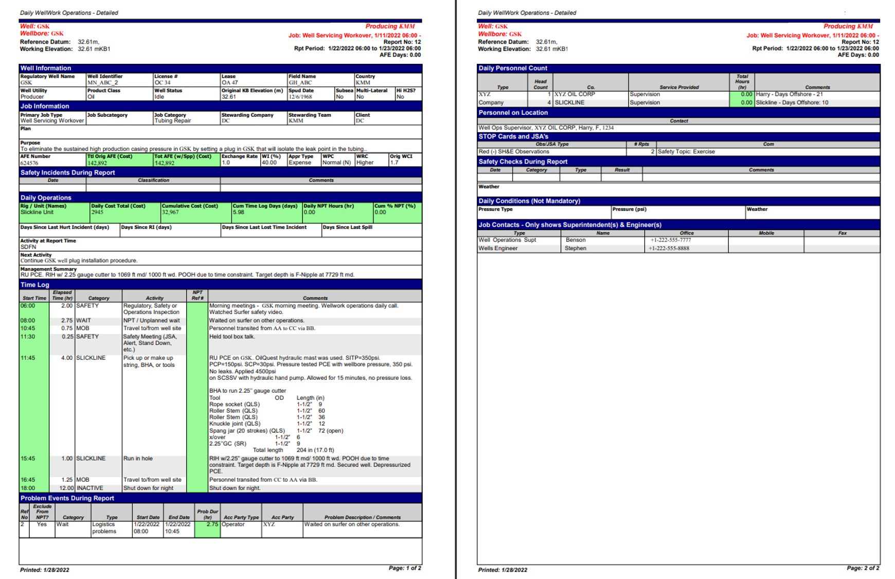
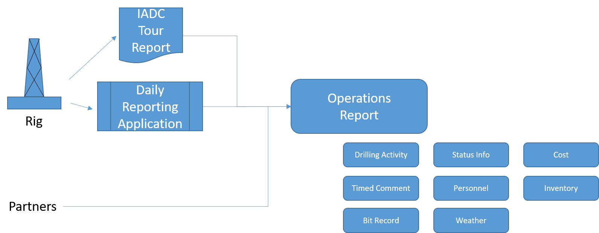

<a name="TOC"></a>

[[_TOC_]]
# Well Execution

## Well Activity Overview
A Well Activity is a operation performed on a well to accomplish a predetermined objective. This may be as short as a few hours in duration, or may last several days, weeks or even months. It will have one or more associated daily Operations Reports, and may have other associated data as well. 

Depending on the commercial or in-house-developed well operations reporting system used, a Well Activity may be referred to as a Job, Well Activity, Well Program, or Well Event. Each of these names can be problematic since the nomenclature is not exclusive and may be confused with other concepts with the same name.

(In the case of the chosen name, Well Activity, care must be taken not to confuse this with the more discrete "Activity" which occurs over a distinct time interval within a single Operations Report.)

A Well Activity may be comprised of multiple Operations Reports; hence, a Well Activity is a “collection of operations reports” that pertain to a single objective.

As shown in the diagram below, a Well Activity can only be associated with a single Well, but may be associated with multiple Wellbores through the Operations Reports that comprise the Well Activity.


<hr>

## Example of a Well Activity
The illustration below shows a typical Operations Report that could be generated from a commercial well operations reporting system.  Note that the section entitled "Job Information" contains data that can be mapped into an OSDU Well Activity object.


<details>

<summary markdown="span"><code>WellID</code> = MN_ABC_2 JSON Schema Fragment Example</summary>

<OsduImportJSON>[WellActivity:1.0.0 JSON, Full](master-data/WellActivity.1.0.0.json#only.data.WellID)</OsduImportJSON>

```json
{
  "data": {
    "WellID": "partition-id:master-data--Well:MN_ABC_2:"
  }
}
```
</details>
 
<details>

<summary markdown="span"><code>WellActivityType</code> = Workover JSON Schema Fragment Example</summary>

<OsduImportJSON>[WellActivity:1.0.0 JSON, Full](master-data/WellActivity.1.0.0.json#only.data.WellActivityType)</OsduImportJSON>

```json
{
  "data": {
    "WellActivityType": "partition-id:reference-data--WellActivityType:Workover:"
  }
}
```
</details>

<details>

<summary markdown="span"><code>WellActivityDescription</code> = Tubing Repair JSON Schema Fragment Example</summary>

<OsduImportJSON>[WellActivity:1.0.0 JSON, Full](master-data/WellActivity.1.0.0.json#only.data.WellActivityDescription)</OsduImportJSON>

```json
{
  "data": {
    "WellActivityDescription": "Tubing Repair"
  }
}
```
</details>

<details>

<summary markdown="span"><code>WellActivityObjective</code> = JSON Schema Fragment Example</summary>

<OsduImportJSON>[WellActivity:1.0.0 JSON, Full](master-data/WellActivity.1.0.0.json#only.data.WellActivityObjective)</OsduImportJSON>

```json
{
  "data": {
    "WellActivityObjective": [
      "To eliminate the sustained high production casing pressure in GSK by setting a plug in GSK that will isolate the leak point in the tubing."
    ]
  }
}
```
</details>

<details>

<summary markdown="span"><code>WellheadConnection</code> = H4 JSON Schema Fragment Example</summary>

<OsduImportJSON>[WellActivity:1.0.0 JSON, Full](master-data/WellActivity.1.0.0.json#only.data.WellheadConnection)</OsduImportJSON>

```json
{
  "data": {
    "WellheadConnection": "partition-id:reference-data--WellheadConnection:H4:"
  }
}
```
</details>

<details>

<summary markdown="span"><code>StartDateTime</code> = 2022-01-22T06:00:00.00Z JSON Schema Fragment Example</summary>

<OsduImportJSON>[WellActivity:1.0.0 JSON, Full](master-data/WellActivity.1.0.0.json#only.data.StartDateTime)</OsduImportJSON>

```json
{
  "data": {
    "StartDateTime": "2022-01-22T06:00:00.00Z"
  }
}
```
</details>

<details>

<summary markdown="span"><code>OffProductionDateTime</code> = 2022-01-22T12:00:00.00Z JSON Schema Fragment Example</summary>

<OsduImportJSON>[WellActivity:1.0.0 JSON, Full](master-data/WellActivity.1.0.0.json#only.data.OffProductionDateTime)</OsduImportJSON>

```json
{
  "data": {
    "OffProductionDateTime": "2022-01-22T12:00:00.00Z"
  }
}
```
</details>

<details>

<summary markdown="span"><code>Comments</code> = Example Comments JSON Schema Fragment Example</summary>

<OsduImportJSON>[WellActivity:1.0.0 JSON, Full](master-data/WellActivity.1.0.0.json#only.data.Comments)</OsduImportJSON>

```json
{
  "data": {
    "Comments": "Example Comments"
  }
}
```
</details>

<details>

<summary markdown="span"><code>StewardingCompany</code> = DC JSON Schema Fragment Example</summary>

<OsduImportJSON>[WellActivity:1.0.0 JSON, Full](master-data/WellActivity.1.0.0.json#only.data.StewardingCompany)</OsduImportJSON>

```json
{
  "data": {
    "StewardingCompany": "DC"
  }
}
```
</details>

<details>

<summary markdown="span"><code>StewardingCompanyTeam</code> = KMM JSON Schema Fragment Example</summary>

<OsduImportJSON>[WellActivity:1.0.0 JSON, Full](master-data/WellActivity.1.0.0.json#only.data.StewardingCompanyTeam)</OsduImportJSON>

```json
{
  "data": {
    "StewardingCompanyTeam": "KMM"
  }
}
```
</details>

<details>

<summary markdown="span"><code>Customer</code> = DC JSON Schema Fragment Example</summary>

<OsduImportJSON>[WellActivity:1.0.0 JSON, Full](master-data/WellActivity.1.0.0.json#only.data.Customer)</OsduImportJSON>

```json
{
  "data": {
    "Customer": "DC"
  }
}
```
</details>

<details>

<summary markdown="span"><code>RigAssignments</code> Example</summary>

<OsduImportJSON>[WellActivity JSON, Full](master-data/WellActivity.1.0.0.json#only.data.RigAssignments)</OsduImportJSON>

```json
{
  "data": {
    "RigAssignments": [
      {
        "RigID": "partition-id:master-data--Rig:R-5394485a-a20b-49ae-bfe1-4220c5b694aa:",
        "StartDateTime": "2022-01-19T06:00:00.00Z",
        "EndDateTime": "2020-02-15T15:00:00.00Z",
        "Remark": "Tubing repair rig deployment"
      }
    ]
  }
}
```
</details>

<p>
<hr>

## Operations Report Overview

### Example of an Operations Report
This is what a typical operations report might look like:


### Typical Usage

An Operations Report is primarily intended to be used as a daily report for drilling, completions or well maintenance activities, although it is flexible to use for any time duration and for other work activities beyond drilling, completions or well maintenance.



In the case of drilling, completions or wellwork operations, the Operations Report would contain an entry at the main level along with the appropriate sections that correspond to the day's activities.

An Operations Report may reference one or more wellbores but usually only a single well. 

> **_NOTE:_** Currently the model only allows for a single wellbore reference, and no well reference. This is expected to 
> be corrected in the next iteration of the model with the introduction of a Well Activity object linking a collection 
> of Operations Reports to a Well.

> **_NOTE:_** When the Operations Report object was initially created, there was a heavy focus on drilling activity. 
> Some of the object and property names are overly "drilling-centric" today - an oversight that is expected to be 
> addressed in future releases.

[Back to TOC](#TOC)

### What an Operations Report is NOT

An Operations Report is not the **_PLAN_** of operations for a particular scope of work. For this, use
WellActivityProgram.

An Operations Report is not intended to capture multiple days for a single well or activities that span across multiple
wells. The WellActivity object may be used
for this purpose.

[Back to TOC](#TOC)

### Operations Report Elements

#### Main

Primarily for identifying the Start and End Date/Time for the report and relationships to other master objects. Some of
the "header" information on an Operations Report will be sourced from the corresponding Well Activity, Well or Wellbore object rather
than being stored in the Operations Report directly.

> **_NOTE:_** A number of the elements currently associated with the "Main" Ops Report element have been moved to the Well Activity object with the current release. Specifically, items 
> referencing the customer, stewarding company and team,  and target days are now associated 
> with the WellActivity object. Total authorized costs are expected to be incorporated into the WellActivity in a future iteration.

<details>

<summary markdown="span"><code>StartDateTime</code> = 2022-01-22T06:00:00.00Z JSON Schema Fragment Example</summary>

<OsduImportJSON>[OperationsReport JSON, Full](master-data/OperationsReport.json#only.data.StartDateTime)</OsduImportJSON>

```json
{
  "data": {
    "StartDateTime": "2022-01-22T06:00:00.00Z"
  }
}
```
</details>


<details>

<summary markdown="span"><code>EndDateTime</code> = 2022-01-23T06:00:00.00Z JSON Schema Fragment Example</summary>

<OsduImportJSON>[OperationsReport JSON, Full](master-data/OperationsReport.json#only.data.EndDateTime)</OsduImportJSON>

```json
{
  "data": {
    "EndDateTime": "2022-02-23T00:00:00.00Z"
  }
}
```
</details>


<details>

<summary markdown="span"><code>WellboreID</code> = GSK JSON Schema Fragment Example</summary>

<OsduImportJSON>[OperationsReport JSON, Full](master-data/OperationsReport.json#only.data.WellboreID)</OsduImportJSON>

```json
{
  "data": {
    "WellboreID": "partition-id:master-data--Wellbore:GSK:"
  }
}
```
</details>


<details>

<summary markdown="span"><code>TotalCost</code> = 32967 JSON Schema Fragment Example</summary>

<OsduImportJSON>[OperationsReport JSON, Full](master-data/OperationsReport.json#only.data.TotalCost)</OsduImportJSON>

```json
{
  "data": {
    "TotalCost": 12345.6
  }
}
```
</details>

<details>

<summary markdown="span"><code>TotalDays</code> = 5.98 JSON Schema Fragment Example</summary>

<OsduImportJSON>[OperationsReport JSON, Full](master-data/OperationsReport.json#only.data.TotalDays)</OsduImportJSON>

```json
{
  "data": {
    "TotalDays": 12345.6
  }
}
```

</details>


<details>

<summary markdown="span"><code>TotalNPT</code> = 0.00 JSON Schema Fragment Example</summary>

<OsduImportJSON>[OperationsReport JSON, Full](master-data/OperationsReport.json#only.data.TotalNPT)</OsduImportJSON>

```json
{
  "data": {
    "TotalNPT": 12345.6
  }
}
```

</details>

<details>

<summary markdown="span"><code>CostDay</code> = 2945 JSON Schema Fragment Example</summary>

<OsduImportJSON>[OperationsReport JSON, Full](master-data/OperationsReport.json#only.data.CostDay)</OsduImportJSON>

```json
{
  "data": {
    "CostDay": 2945
  }
}
```

</details>

<details>

<summary markdown="span"><code>Name</code> = SDFN JSON Schema Fragment Example</summary>

<OsduImportJSON>[OperationsReport JSON, Full](master-data/OperationsReport.json#only.data.Name)</OsduImportJSON>

```json
{
  "data": {
    "Name": "SDFN"
  }
}
```

</details>

<details>

<summary markdown="span"><code>WellActivityID</code> = JSON Schema Fragment Example</summary>

<OsduImportJSON>[OperationsReport JSON, Full](master-data/OperationsReport.json#only.data.WellActivityID)</OsduImportJSON>

```json
{
  "data": {
    "WellActivityID": "partition-id:master-data--WellActivity:GlobalUniqueID1234.1:"
  }
}
```

</details>

<details>

<summary markdown="span"><code>ReportNumber</code> = 12 JSON Schema Fragment Example</summary>

<OsduImportJSON>[OperationsReport JSON, Full](master-data/OperationsReport.json#only.data.ReportNumber)</OsduImportJSON>

```json
{
  "data": {
    "ReportNumber": "12"
  }
}
```

</details>

<details>

<summary markdown="span"><code>ReportDescription</code> = Well Servicing Workover JSON Schema Fragment Example</summary>

<OsduImportJSON>[OperationsReport JSON, Full](master-data/OperationsReport.json#only.data.ReportDescription)</OsduImportJSON>

```json
{
  "data": {
    "ReportDescription": "Well Servicing Workover"
  }
}
```

</details>

<details>

<summary markdown="span"><code>ReportRemarks</code> = JSON Schema Fragment Example</summary>

<OsduImportJSON>[OperationsReport JSON, Full](master-data/OperationsReport.json#only.data.ReportRemarks)</OsduImportJSON>

```json
{
  "data": {
    "ReportRemarks": "Example Report Remarks"
  }
}
```

</details>


[Back to TOC](#TOC)

#### Status Info

Status Info contains information related to the overall period that the report covers. Start and end depths, report
summary and anticipated activity for the next report period, personnel counts and key contacts, and other status summary
information goes here.


<details>

<summary markdown="span"><code>StatusInfo</code> for <code>Rig</code> = Slickline Unit JSON Schema Fragment Example</summary>

<OsduImportJSON>[OperationsReport JSON, Full](master-data/OperationsReport.json#only.data.StatusInfo)</OsduImportJSON>

```json
{
  "data": {
    "StatusInfo": [
      {
        "StatusDateTime": "2022-01-22T06:00:00.00Z",
        "ReportEndMD": 12345.6,
        "ReportEndTVD": 12345.6,
        "PlugTopMD": 12345.6,
        "DiameterHole": 12345.6,
        "DiameterHoleStartMD": 12345.6,
        "DiameterPilot": 12345.6,
        "DiameterPilotPlanMD": 12345.6,
        "DiameterPilotPlanTVD": 12345.6,
        "TypeWellbore": "Example Wellbore Type",
        "KickoffMD": 12345.6,
        "KickoffTVD": 12345.6,
        "FormationStrength": 12345.6,
        "FormationStrengthMD": 12345.6,
        "FormationStrengthTVD": 12345.6,
        "CasingDiameterLast": 12345.6,
        "CasingMDLast": 12345.6,
        "CasingTVDLast": 12345.6,
        "PresTestType": "Example Pressure Test Type",
        "MdPlanned": 12345.6,
        "DrilledDistance": 12345.6,
        "Summary24Hr": "RU PCE. RIH w/ 2.25 gauge cutter to 1069 ft md/ 1000 ft wd. POOH due to time constraint. Target depth is F-Nipple at 7729 ft md.",
        "Forecast24Hr": "Continue GSK well plug installation procedure.",
        "Rig": "Slickline Unit",
        "Engineer": "Well Ops Supervisor, XYZ OIL CORP, Harry, F, 1234",
        "RopCurrent": 12345.6,
        "ElapsedTimeStart": 12345.6,
        "ElapsedTimeSpud": 12345.6,
        "ElapsedTimeLoc": 12345.6,
        "ElapsedTimeDrill": 12345.6,
        "RopAverage": 12345.6,
        "Supervisor": "Example Supervisor",
        "Geologist": "Example Geologist",
        "ElapsedTimeDrillRot": 12345.6,
        "ElapsedTimeDrillSlid": 12345.6,
        "ElapsedTimeCirc": 12345.6,
        "ElapsedTimeReam": 12345.6,
        "ElapsedTimeHold": 12345.6,
        "ElapsedTimeSteering": 12345.6,
        "DistDrillRot": 12345.6,
        "DistDrillSlid": 12345.6,
        "DistReam": 12345.6,
        "DistHold": 12345.6,
        "DistSteering": 12345.6,
        "NumPOB": 2,
        "NumContract": 2,
        "NumOperator": 2,
        "NumService": 2,
        "NumAFE": "Example AFE number",
        "ConditionHole": "Example Hole Condition",
        "TvdLot": 12345.6,
        "PresLotEmw": 12345.6,
        "PresKickTol": 12345.6,
        "VolKickTol": 12345.6,
        "MAASP": 12345.6,
        "CostDayMud": 12345.6
      }
    ]
  }
}
```
</details>


[Back to TOC](#TOC)

#### Operations Activity

Most operations reports will have an associated "time log" that details specific activities with the start and end time,
duration, and a narrative text comment. These activities may also have metadata related to depths, proprietary activity
codes, and flags for whether an activity was on the critical path and whether it was considered productive or
non-productive.

The Operations Activity object also has other properties that are particularly relevant to drilling operations, but this
object is definitely NOT restricted to just drilling operations.

> **_NOTE:_** Proprietary activity codes specific to a given operator may be cross-referenced to individual activity 
> entries using the ProprietaryActivityCode object.

<details>

<summary markdown="span">Listing of All <code>OperationsActivity</code> JSON Schema Fragment Example</summary>

<OsduImportJSON>[OperationsReport JSON, Full](master-data/OperationsReport.json#only.data.OperationsActivity)</OsduImportJSON>

```json
{
  "data": {
    "OperationsActivity": [
      {
        "ActivityID": "Example Activity ID",
        "StartDateTime": "2022-01-22T06:00:00.00Z",
        "EndDateTime": "2022-01-22T08:00:00.00Z",
        "ActualDuration": 12345.6,
        "Phase": "Example Phase",
        "ActivityCodeID": "partition-id:reference-data--ActivityCode:Safetymeeting_wa_sw_cs_cw_wcic:",
        "DetailActivity": "Example Detail Activity",
        "TypeActivityClassID": "partition-id:reference-data--DrillingActivityClassType:planned:",
        "ActivityMDTop": 12345.6,
        "ActivityMDBase": 12345.6,
        "ActivityTVDTop": 12345.6,
        "ActivityTVDBase": 12345.6,
        "BitMDTop": 12345.6,
        "BitMDBase": 12345.6,
        "ActivityOutcomeID": "partition-id:reference-data--ActivityOutcome:OK:",
        "ActivityOutcomeDetailID": "partition-id:reference-data--ActivityOutcomeDetail:success:",
        "OperatorID": "partition-id:master-data--Organisation:SomeUniqueOrganisationID:",
        "ServiceProviderID": "partition-id:master-data--Organisation:SomeUniqueOrganisationID:",
        "TubularID": "partition-id:master-data--TubularAssembly:TubularAssembly-911bb71f-06ab-4deb-8e68-b8c9229dc76b:",
        "IsOptimum": true,
        "IsProductive": true,
        "IsOffline": true,
        "ItemState": "Example Item State",
        "Comments": "Morning meetings - GSK morning meeting. Wellwork operations daily call. Watched Surfer safety video.",
        "ProprietaryActivityCode": [
          {
            "Identifier": "Example Identifier",
            "Description": "Example Description",
            "Authority": "Example Authority"
          }
        ],
        "ParentID": "Example Parent ID",
        "PredecessorID": "Example Predecessor ID",
        "PlannedHoleDepthIn": 12345.6,
        "PlannedHoleDepthOut": 12345.6,
        "PlannedDuration": 12345.6,
        "TargetDepth": 12345.6,
        "OperationalNotes": "Example Operational Notes",
        "AttachmentIDs": [
          "partition-id:work-product-component--Document:Document-911bb71f-06ab-4deb-8e68-b8c9229dc76b:"
        ],
        "SectionDiameter": 12345.6,
        "ObjectReference": "Example Object Reference",
        "WellboreID": "partition-id:master-data--Wellbore:SomeUniqueWellboreID:"
      },
      {
        "StartDateTime": "2022-01-22T11:30:00.00Z",
        "EndDateTime": "2022-01-22T11:45:00.00Z",
        "ActivityCodeID": "partition-id:reference-data--ActivityCode:Safetymeeting_wa_sw_cs_cw_wcic:",
        "IsProductive": true,
        "Comments": "Held tool box talk."
      },
      {
        "StartDateTime": "2022-01-22T11:45:00.00Z",
        "EndDateTime": "2022-01-22T15:45:00.00Z",
        "ActivityCodeID": "partition-id:reference-data--ActivityCode:Makeupslicklinetoolstring_dr_ds_cs_cw_wcic:",
        "IsProductive": true,
        "Comments": "RU PCE on GSK. OilQuest hydraulic mast was used. SITP=350psi. PCP = 150psi. SCP=30psi. Pressure tested PCE with wellbore pressure, 350 psi. No leaks. Applied 4500psi on SCSSV with hydraulic hand pump. Allowed for 15 minutes, no pressure loss BHA to run 2.25 \" gauge cutter Tool OD Length (in) Rope socket (QLS) 1-1/2 \" 9 Roller Stem (QLS) 1-1/2 \" 60 Roller Stem (QLS) 1-1/2 \" 36 Knuckle joint (QLS) 1-1/2 \" 12 Spang jar (20 strokes) (QLS) 1-1/2 \" 72 (open) x/over 1-1/2 \" 6 2.25 \" GC (SR) 1-1/2 \" 9 Total length 204 in (17.0 ft)."
      },
      {
        "StartDateTime": "2022-01-22T15:45:00.00Z",
        "EndDateTime": "2022-01-22T16:45:00.00Z",
        "ActivityCodeID": "partition-id:reference-data--ActivityCode:Runinslicklinetodepth_driftr_ds_cs_cw_wcic:",
        "IsProductive": true,
        "Comments": "RIH w/2.25\u201d gauge cutter to 1069 ft md/ 1000 ft wd. POOH due to time constraint. Target depth is F-Nipple at 7729 ft md. Secured well. Depressurized PCE. "
      },
      {
        "StartDateTime": "2022-01-22T16:45:00.00Z",
        "EndDateTime": "2022-01-22T18:00:00.00Z",
        "ActivityCodeID": "partition-id:reference-data--ActivityCode:Transportrigtonewlocation_mrnl_rmnl_irm_cw_wcic:",
        "IsProductive": true,
        "Comments": "Personnel transited from CC to AA via BB."
      },
      {
        "StartDateTime": "2022-01-22T10:45:00.00Z",
        "EndDateTime": "2022-01-22T11:30:00.00Z",
        "ActivityCodeID": "partition-id:reference-data--ActivityCode:Transportrigtonewlocation_mrnl_rmnl_irm_cw_wcic:",
        "IsProductive": true,
        "Comments": "Personnel transited from AA to CC via BB. "
      }
    ]
  }
}
```
</details>


[Back to TOC](#TOC)

#### Timed Comment

The Timed Comment object is included to allow capture of comments at specific times during the reporting period. This is
NOT intended to be used as a replacement for the operations report's time log (Drill Activity) object.

[Back to TOC](#TOC)

#### Bit Record

On days, where one or more bits are run, the Bit Record object may be used to capture details of the bit run and the
IADC dull grading codes.

[Back to TOC](#TOC)

#### Weather

A common aspect of the Operations Report is capturing details of the weather conditions as this may have significant
impact on operations and safety. The Weather object is used to capture details related to the current weather conditions
at report time.

[Back to TOC](#TOC)

#### Personnel

While high-level personnel data is captured on the StatusInfo object, some organizations may need to report personnel
headcounts and hours by organization or by service type. The Personnel object allows for this more detailed capture of
personnel info.


<details>

<summary markdown="span"><code>Personnel</code> data as captured in Status Info JSON Schema Fragment Example</summary>

<OsduImportJSON>[OperationsReport JSON, Full](master-data/OperationsReport.json#only.data.Personnel)</OsduImportJSON>

```json
{
  "data": {
    "Personnel": [
      {
        "OrganizationID": "partition-id:master-data--Organisation:SomeUniqueOrganisationID:",
        "HeadCount": 4,
        "TotalTime": 12345.6,
        "OrganizationRole": "partition-id:reference-data--PersonnelOrganisationRole:rig_contractor:",
        "ServiceType": "partition-id:reference-data--PersonnelServiceType:cementing:",
        "Comments": "Example Comments"
      }
    ]
  }
}
```
</details>

[Back to TOC](#TOC)

#### Job Contact

Some organizations capture contact information for key personnel on site and include this detail on an Operations Report
so that the information is on hand should these contacts need to be reached by phone or email. This information may be
captured in the Job Contact object.

<details>

<summary markdown="span"><code>JobContact</code> information for Key Personnel On Site JSON Schema Fragment Example</summary>

<OsduImportJSON>[OperationsReport JSON, Full](master-data/OperationsReport.json#only.data.JobContact)</OsduImportJSON>

```json
{
  "data": {
    "JobContact": [
      {
        "EmailAddress": "support@company.com",
        "PhoneNumber": "1-222-555-7777",
        "RoleTypeID": "partition-id:reference-data--ContactRoleType:TechnicalSupport:",
        "Comment": "Example Comment",
        "OrganisationID": "partition-id:master-data--Organisation:SomeUniqueOrganisationID:",
        "Name": "Example Name"
      }
    ]
  }
}
```
</details>

[Back to TOC](#TOC)

#### Mud Volume

On a drilling operation, it is important to keep track of mud volumes in order to identify downhole problems and to
maintain sufficient mud on hand to react in the case of emergencies. The Mud Volume object provides the ability to
report the mud volumes for the reporting period.

[Back to TOC](#TOC)

#### Mud Losses

From a material balance perspective, it is important to know where losses are occurring in the mud system. This is
captured in the Mud Losses object.

[Back to TOC](#TOC)

#### Pump Operation

Mud Pump operational parameters are recorded in the Pump Operation object.

[Back to TOC](#TOC)

#### Gas Reading

Gas Readings provide an indication of hydrocarbons from the reservoir as drilling operations progress. The Gas Reading
object is where these are recorded.

[Back to TOC](#TOC)

#### Inventory

The Inventory object is used to track consumables on location for an operation.

[Back to TOC](#TOC)

#### Cost

The Cost object is used to capture daily one-off and recurring costs for an operation.

[Back to TOC](#TOC)

#### HSE (Health, Safety and Environment)

The HSE object is used to track key safety statistics, operating pressures, and inspection and safety meeting dates. It
is used to track Incident Free days, but is NOT for capturing details of a safety incident; for this, the Incident
object should be used.


<details>

<summary markdown="span"><code>HSE</code> related to Safety Topic: Exercise JSON Schema Fragment Example</summary>

<OsduImportJSON>[OperationsReport JSON, Full](master-data/OperationsReport.json#only.data.HSE)</OsduImportJSON>

```json
{
  "data": {
    "HSE": [
      {
        "Comments": "Example Comments",
        "DaysIncidentFree": 2,
        "VolumeFluidDischarged": 12345.6,
        "LastAbandonDrillDate": "2020-02-13T09:13:15.55Z",
        "LastBopDrillDate": "2020-02-13T09:13:15.55Z",
        "LastBopPressureTestDate": "2020-02-13T09:13:15.55Z",
        "LastCasingPressureTestDate": "2020-02-13T09:13:15.55Z",
        "LastDiverterDrillDate": "2020-02-13T09:13:15.55Z",
        "LastFireBoatDrillDate": "2020-02-13T09:13:15.55Z",
        "LastRigInspectionDate": "2020-02-13T09:13:15.55Z",
        "LastSafetyInspectionDate": "2020-02-13T09:13:15.55Z",
        "LastSafetyMeetingDate": "2020-02-13T09:13:15.55Z",
        "LastTripDrillDate": "2020-02-13T09:13:15.55Z",
        "NextBopPresTestDate": "2020-02-13T09:13:15.55Z",
        "NonComplianceIssued": true,
        "TotalStopCards": 2,
        "PressureAnnular": 12345.6,
        "PressureChokeLine": 12345.6,
        "PressureChokeMan": 12345.6,
        "PressureDiverter": 12345.6,
        "PressureKellyHose": 12345.6,
        "PressureLastCasing": 12345.6,
        "PressureBOPRam": 12345.6,
        "PressureStandPipeManifold": 12345.6,
        "RegulatoryAgencyInspection": true,
        "VolumeCuttingDischarged": 12345.6,
        "VolumeOilCuttingDischarge": 12345.6,
        "VolumeWasteDischarged": 12345.6
      }
    ]
  }
}
```
</details>

[Back to TOC](#TOC)

#### Incident

The Incident object should be used to capture the details of any safety or operational incident that occurs during the
reporting period.

[Back to TOC](#TOC)

#### Well Alias

This object may be relocated to be with the Well object in a future release.

<details>

<summary markdown="span"><code>WellAlias.Identifier</code> = MN_ABC_2 JSON Schema Fragment Example</summary>

<OsduImportJSON>[OperationsReport JSON, Full](master-data/OperationsReport.json#only.data.WellAlias)</OsduImportJSON>

```json
{
  "data": {
    "WellAlias": {
      "Identifier": "MN_ABC_2",
      "Description": "GSK",
      "Authority": "Producing KMM"
    }
  }
}
```
</details>

[Back to TOC](#TOC)

#### Wellbore Alias

This object may be relocated to be with the Wellbore object in a future release.


<details>

<summary markdown="span"><code>WellboreAlias.Identifier</code> = MN_ABC_2 JSON Schema Fragment Example</summary>

<OsduImportJSON>[OperationsReport JSON, Full](master-data/OperationsReport.json#only.data.WellboreAlias)</OsduImportJSON>

```json
{
  "data": {
    "WellboreAlias": [
      {
        "Identifier": "MN_ABC_2",
        "Description": "GSK",
        "Authority": "Producing KMM"
      }
    ]
  }
}
```
</details>

[Back to TOC](#TOC)

### Other Elements Referenced by Operations Report

#### Fluids Report

A Fluids Report record is created for each fluid check performed during the period that the operations report covers.
This record contains information about the properties of the fluid including information on where and when and under 
what conditions the sample was taken.

<details>

<summary markdown="span"><code>master-data--FluidsReport:1.0.0</code> with <code>data.Fluid[].BrandName</code> Property JSON Schema Fragment Example</summary>

<OsduImportJSON>[`master-data--FluidsReport:1.1.0` with `data.Fluid[].BrandName` Property, Full](./master-data/FluidsReport.1.1.0.json#only.data.Fluid[0].BrandName)</OsduImportJSON>

```json
{
  "data": {
    "Fluid": {
      "BrandName": "Supply Company Magic Mud"
    }
  }
}
```
</details>

[Back to TOC](#TOC)

## BHARun Worked Example
The following is an example of BHARun:
  
<details>

<summary markdown="span"><code>master-data--BHARun:1.0.0</code> with <code>data.HoleSectionID</code> relationship JSON Schema Fragment Example</summary>

<OsduImportJSON>[`master-data--BHARun:1.0.0` with `data.HoleSectionID` relationship, Full](./master-data/BHARun-with-HoleSection.json#only.data.HoleSectionID)</OsduImportJSON>

```json
{
  "data": {
    "HoleSectionID": "namespace:master-data--HoleSection:da97410e-b8fb-447e-848b-dbe88ca442b3:1646080410496"
  }
}
```
</details>


[Back to TOC](#TOC)
