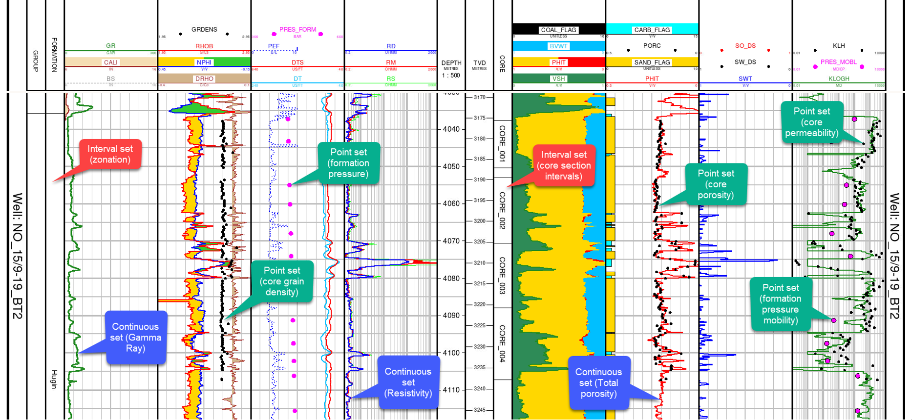
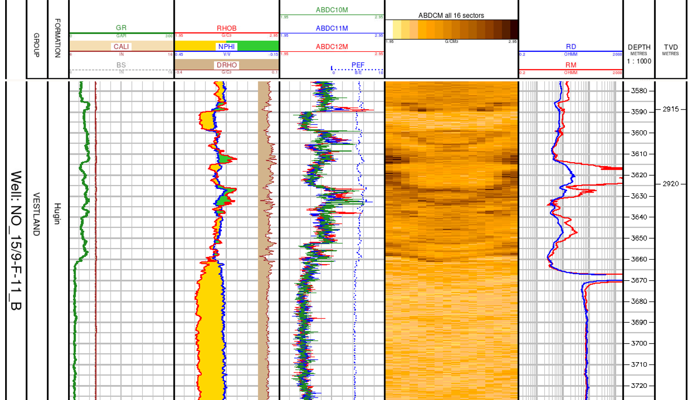
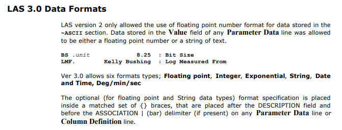
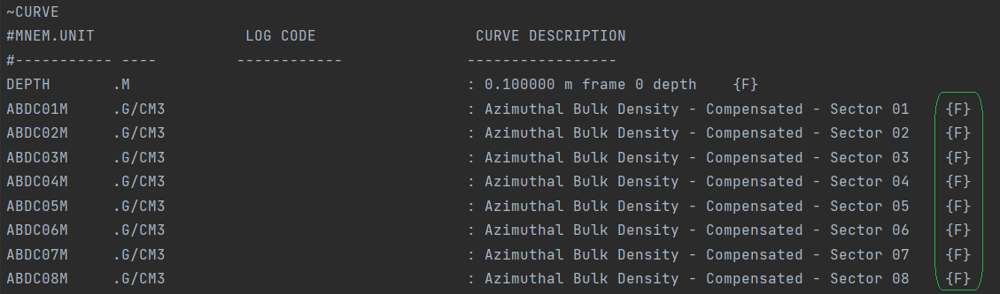
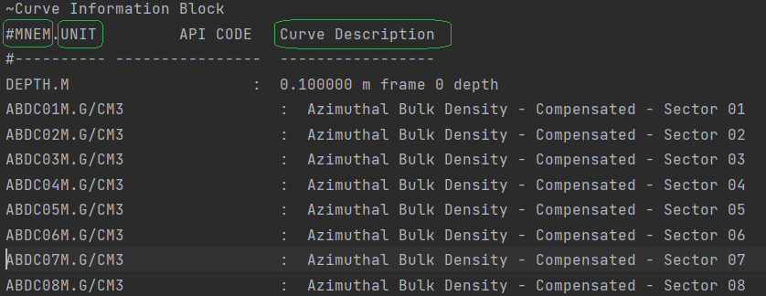
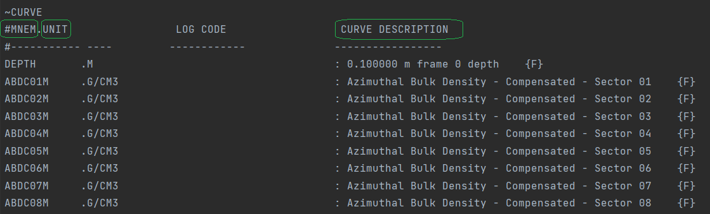
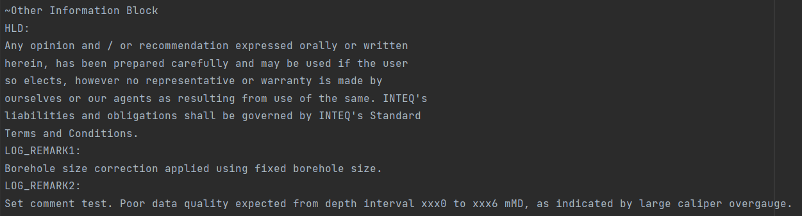
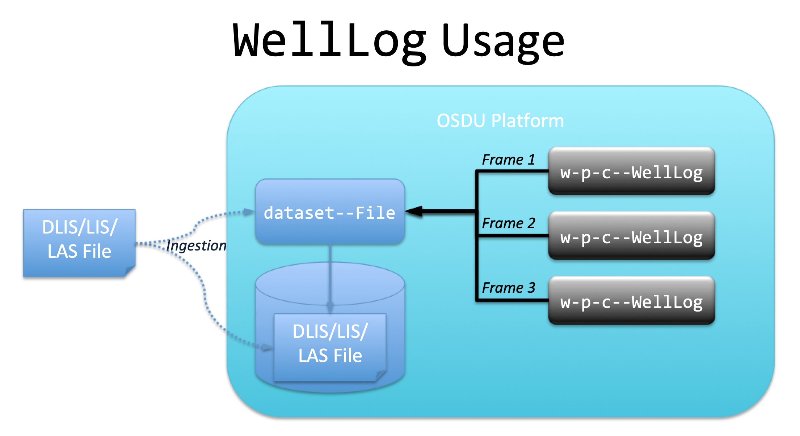

<a name="TOC"></a>

[[_TOC_]]

# Usage of `work-product-component--WellLog`

## `WellLog:1.2.0`

The changes for WellLog:1.2.0 are summarized in the [Migration Guide](../../../Guides/MigrationGuides/M11/WellLog.1.1.0.md).

The dataset examples (no_15!9-f-11_b_LWD85section_LAS2 and no_15!9-f-11_b_LWD85section_LAS3 LAS files) used in this
documentation are based on the [Volve field data village](https://data.equinor.com/) (courtesy of Equinor) to
demonstrate the new capabilities in [WellLog](../../../E-R/work-product-component/WellLog.1.5.0.md).

There could be different types of Sampling / Interpolation Method in a WellLog dataset, such as from the Well **
NO_15/9-19_BT2**:

- **Continuous Sets (Logs)** (blue-colored callout in picture), e.g. Gamma Ray, Resistivity, Total Porosity.
- **Point Sets** (teal-colored callout in picture), e.g. Core Grain Density, Core Permeability, Core Porosity, Formation
  Pressure, Formation Pressure Mobility.
- **Interval Sets** (red-colored callout in picture), e.g. Core Section Intervals, Zonation.



> **_Note:_ `WellLog` can only provide simplified representations of Interval Sets or Marker Sets. OSDU offers explicit type definitions for `WellboreMarkerSet` and `WellboreIntervalSet`, see examples for
[WellboreMarkerSet](../Reservoir Data/Stratigraphy/README.md#wellboremarkerset)
and [WellboreIntervalSet](../Reservoir Data/Stratigraphy/README.md#wellboreintervalset) usage with complete relationships to stratigraphy.**

For simplification purpose, we use the Continuous Logs type of Sampling / Interpolation Method, which are exemplified
in ~Curves **ABDC10M**, **ABDC11M**, and **ABDC12M** from the Well **NO_15/9-F-11_B** in the Volve field LAS dataset
examples in this documentation.



### Changes compared to `work-product-component--WellLog:1.1.0`

The purpose of the new changes were:

#### 1. CurveSampleTypes

This is necessary for application development to be able to clearly distinguish if the measurement is text string or
integer number for example. As mentioned
in [LAS 3.0 File Structure Specifications, p. 23](https://www.cwls.org/wp-content/uploads/2014/09/LAS_3_File_Structure.pdf)
, LAS version 3.0 then allows multiple format types.



The OSDU Wellbore DDMS supports the following values accordingly (OSDU Schema Definitions
Issue [# 302](https://gitlab.opengroup.org/osdu/subcommittees/data-def/work-products/schema/-/issues/302)).

- float
- int
- double
- string
- datetime
- boolean

In [no_15!9-f-11_b_LWD85section_LAS3 (**LAS 3.0**, truncated)](datasets/no_15!9-f-11_b_LWD85section_LAS3_truncated.las)
Volve field LAS dataset example, the below Curves are indicated as `float` (**F**
inside a matched set of {} braces).



For `CurveID` = **ABDC10M**, **ABDC11M**, and **ABDC12M** with `float` data format indicator in the Volve field LAS 3.0
dataset example, please find below highlighting, for each Curve example, the corresponding JSON schema fragment
with `CurveSampleTypeID` = `float`.

<details>

<summary markdown="span"><code>CurveID</code> = ABDC10M with <code>CurveSampleTypeID</code> = <code>float</code> JSON Schema Fragment Example</summary>

<OsduImportJSON>[WellLog Volve LAS dataset JSON, Full](work-product-component/WellLog.Volve.LAS20.json#only.data.Curves[0].CurveSampleTypeID)</OsduImportJSON>

```json
{
  "data": {
    "Curves": {
      "CurveSampleTypeID": "partition-id:reference-data--CurveSampleType:float:"
    }
  }
}
```

</details>

<details>

<summary markdown="span"><code>CurveID</code> = ABDC11M with <code>CurveSampleTypeID</code> = <code>float</code> JSON Schema Fragment Example</summary>

<OsduImportJSON>[WellLog Volve LAS dataset JSON, Full](work-product-component/WellLog.Volve.LAS20.json#only.data.Curves[1].CurveSampleTypeID)</OsduImportJSON>

```json
{
  "data": {
    "Curves": {
      "CurveSampleTypeID": "partition-id:reference-data--CurveSampleType:float:"
    }
  }
}
```

</details>

<details>

<summary markdown="span"><code>CurveID</code> = ABDC12M with <code>CurveSampleTypeID</code> = <code>float</code> JSON Schema Fragment Example</summary>

<OsduImportJSON>[WellLog Volve LAS dataset JSON, Full](work-product-component/WellLog.Volve.LAS20.json#only.data.Curves[2].CurveSampleTypeID)</OsduImportJSON>

```json
{
  "data": {
    "Curves": {
      "CurveSampleTypeID": "partition-id:reference-data--CurveSampleType:float:"
    }
  }
}
```

</details>

Additional notes:

1. With respect to LAS 3.0's `Exponential` data format, the OSDU Wellbore DDMS LAS parser handles this and ends in
   a `float`.
2. As for LAS 3.0's `deg/min/sec` data format, assuming this is a coordinate representation, there are two options:

- The LAS parser understands the format and parses it as a decimal degree/grad `double` value, or
- The LAS parser does not understand it and takes it as `string`.

[Back to TOC](#TOC)

#### 2. CurveDescription

The **~C** (**Curve** information) section of a LAS file would, as an absolute minimum, contain the following:

- Mnemonic
- Curve Unit
- Curve Description

A curve description is technically not a requirement, but generally as the curve mnemonic or the curve's "variable name"
sometimes is truncated into a non-unique or generic name. The additional curve description would often provide that
crucial information needed to resolve the curve or measurement linage.

- What is the origin of that measurement?
- What sort of calibration, transformation, corrections, processing assumptions, filtering, rescaling etc. has been
  applied?

From a raw file, CurveDescription would hence as default be the curve's long name, describing the internal factors
related to the signal and data processing flow.

Mnemonic, Curve Unit and Curve Description as seen in LAS dataset files:

- In [no_15!9-f-11_b_LWD85section_LAS2 (**LAS
  2.0**, truncated)](datasets/no_15!9-f-11_b_LWD85section_LAS2_truncated.las) dataset example



- In [no_15!9-f-11_b_LWD85section_LAS3 (**LAS
  3.0**, truncated)](datasets/no_15!9-f-11_b_LWD85section_LAS3_truncated.las) dataset example



For `CurveID` = **ABDC10M**, **ABDC11M**, and **ABDC12M** in the Volve field LAS 3.0 dataset example, please find below
highlighting, for each Curve example, the corresponding JSON schema fragment with `CurveDescription` and `CurveUnit`
information as well.

<details>

<summary markdown="span"><code>CurveID</code> = ABDC10M with <code>CurveDescription</code> and <code>CurveUnit</code> JSON Schema Fragment Example</summary>

<OsduImportJSON>[WellLog Volve LAS dataset JSON, Full](work-product-component/WellLog.Volve.LAS20.json#only.data.Curves[0])</OsduImportJSON>

```json
{
  "data": {
    "Curves": [
      {
        "CurveID": "ABDC10M",
        "NullValue": true,
        "Interpolate": true,
        "TopDepth": 3227.8,
        "BaseDepth": 4747.5,
        "DepthUnit": "partition-id:reference-data--UnitOfMeasure:m:",
        "CurveUnit": "partition-id:reference-data--UnitOfMeasure:g%2Fcm3:",
        "Mnemonic": "ABDC10M",
        "LogCurveTypeID": "partition-id:reference-data--LogCurveType:BakerHughesInteq:ABDC10M:",
        "LogCurveMainFamilyID": "partition-id:reference-data--LogCurveMainFamily:Density:",
        "LogCurveFamilyID": "partition-id:reference-data--LogCurveFamily:Bulk%20Density:",
        "NumberOfColumns": 1,
        "CurveSampleTypeID": "partition-id:reference-data--CurveSampleType:float:",
        "CurveDescription": "Azimuthal Bulk Density - Compensated - Sector 10"
      }
    ]
  }
}
```

</details>

<details>

<summary markdown="span"><code>CurveID</code> = ABDC11M with <code>CurveDescription</code> and <code>CurveUnit</code> JSON Schema Fragment Example</summary>

<OsduImportJSON>[WellLog Volve LAS dataset JSON, Full](work-product-component/WellLog.Volve.LAS20.json#only.data.Curves[1])</OsduImportJSON>

```json
{
  "data": {
    "Curves": [
      {
        "CurveID": "ABDC11M",
        "NullValue": true,
        "Interpolate": true,
        "TopDepth": 3227.8,
        "BaseDepth": 4747.5,
        "DepthUnit": "partition-id:reference-data--UnitOfMeasure:m:",
        "CurveUnit": "partition-id:reference-data--UnitOfMeasure:g%2Fcm3:",
        "Mnemonic": "ABDC11M",
        "LogCurveTypeID": "partition-id:reference-data--LogCurveType:BakerHughesInteq:ABDC11M:",
        "LogCurveMainFamilyID": "partition-id:reference-data--LogCurveMainFamily:Density:",
        "LogCurveFamilyID": "partition-id:reference-data--LogCurveFamily:Bulk%20Density:",
        "NumberOfColumns": 1,
        "CurveSampleTypeID": "partition-id:reference-data--CurveSampleType:float:",
        "CurveDescription": "Azimuthal Bulk Density - Compensated - Sector 11"
      }
    ]
  }
}
```

</details>

<details>

<summary markdown="span"><code>CurveID</code> = ABDC12M with <code>CurveDescription</code> and <code>CurveUnit</code> JSON Schema Fragment Example</summary>

<OsduImportJSON>[WellLog Volve LAS dataset JSON, Full](work-product-component/WellLog.Volve.LAS20.json#only.data.Curves[2])</OsduImportJSON>

```json
{
  "data": {
    "Curves": [
      {
        "CurveID": "ABDC12M",
        "NullValue": true,
        "Interpolate": true,
        "TopDepth": 3227.8,
        "BaseDepth": 4747.5,
        "DepthUnit": "partition-id:reference-data--UnitOfMeasure:m:",
        "CurveUnit": "partition-id:reference-data--UnitOfMeasure:g%2Fcm3:",
        "Mnemonic": "ABDC12M",
        "LogCurveTypeID": "partition-id:reference-data--LogCurveType:BakerHughesInteq:ABDC12M:",
        "LogCurveMainFamilyID": "partition-id:reference-data--LogCurveMainFamily:Density:",
        "LogCurveFamilyID": "partition-id:reference-data--LogCurveFamily:Bulk%20Density:",
        "NumberOfColumns": 192,
        "CurveSampleTypeID": "partition-id:reference-data--CurveSampleType:float:",
        "CurveDescription": "Azimuthal Bulk Density - Compensated - Sector 12"
      }
    ]
  }
}
```

</details>

[Back to TOC](#TOC)

#### 3. LogRemark

Log remarks are also sometimes provided in the raw formats, typically as free text in the **~O** (**Other** Information)
section of a LAS file. Log remarks are however not required in a log format file.

- In LAS 2.0



LogRemarks are commonly used to describe the external factors affecting the response, resolution, quality, accuracy and
precision of one or several log curves or measurements, typically over a specified well interval.

Below is JSON schema fragment example having `LogRemark` in the Volve field LAS 2.0 dataset example.

<details>

<summary markdown="span"><code>LogRemark</code> in JSON Schema Fragment Example</summary>

<OsduImportJSON>[WellLog Volve LAS dataset JSON, Full](work-product-component/WellLog.Volve.LAS20.json#only.data.LogRemark)</OsduImportJSON>

```json
{
  "data": {
    "LogRemark": "Set comment test. Poor data quality expected from depth interval xxx0 to xxx6 mMD, as indicated by large caliper overgauge."
  }
}
```

</details>

Both CurveDescription and LogRemark are hence needed, but the terms should not be mixed up.

[Back to TOC](#TOC)

----

## `WellLog:1.1.0`

The example data sets are inspired by a TNO WellLog manifest content taken from
[here](https://community.opengroup.org/osdu/data/open-test-data/-/blob/master/rc--3.0.0/4-instances/TNO/work-products/well%20logs/load_log_1.0.0_1013_akm11_1978_comp_las.json)
. the list of curves has been augmented by hypothetical elapsed time and seismic travel time channels to demonstrate the
new capabilities in WellLog:1.1.0.

### Changes compared to `work-product-component--WellLog:1.0.0`

The purpose of the changes were

#### 1. Multi-Frame Datasets
Clarify dataset versus frame, and the relationship to a WellLog record.

   

A dataset may contain multiple sets of curves. Each set of curves shares a reference, or an index. Such a multi-frame
dataset causes the creation of multiple `work-product-component--WellLog`  instances. Each has a common reference
(or index) curve.</br>
As a consequence multiple `work-product-component--WellLog` refer to the same dataset, e.g. `dataset--File.LAS`
. </br>
**New:**
This is achieved by a `FrameIdentifier` string property. If the source dataset only contains a single frame,
the `FrameIdentifier` is omitted.

<details>

<summary markdown="span"><code>FrameIdentifier</code> string property</summary>

<OsduImportJSON>[`FrameIdentifier` string property](work-product-component/WellLog.in-depth.json#only.data.FrameIdentifier)</OsduImportJSON>

```json
{
  "data": {
    "FrameIdentifier": "0"
  }
}
```

</details>

[Back to TOC](#TOC)

#### 2. ReferenceCurveID

**New:** Introduce a `ReferenceCurveID`, identifying the CurveID, which represents the 'index'. This is typically the MD
curve.

<details>

<summary markdown="span">Example <code>"ReferenceCurveID": "MeasuredDepth"</code> depth indexed log</summary>

<OsduImportJSON>[`"ReferenceCurveID": "MeasuredDepth"` depth indexed log](work-product-component/WellLog.in-depth.json#only.data.ReferenceCurveID)</OsduImportJSON>

```json
{
  "data": {
    "ReferenceCurveID": "MeasuredDepth"
  }
}
```

</details>

<details>

<summary markdown="span">Example <code>"ReferenceCurveID": "ElapsedTime"</code> elapsed time indexed log</summary>

<OsduImportJSON>[`"ReferenceCurveID": "ElapsedTime"` elapsed time indexed log](work-product-component/WellLog.in-elapsed-time.json#only.data.ReferenceCurveID)</OsduImportJSON>

```json
{
  "data": {
    "ReferenceCurveID": "ElapsedTime"
  }
}
```

</details>

<details>

<summary markdown="span">Example <code>"ReferenceCurveID": "TravelTime"</code> seismic time indexed log</summary>

<OsduImportJSON>[`"ReferenceCurveID": "TravelTime"` seismic time indexed log](work-product-component/WellLog.in-seismic-time.json#only.data.ReferenceCurveID)</OsduImportJSON>

```json
{
  "data": {
    "ReferenceCurveID": "TravelTime"
  }
}
```

</details>

<details>

<summary markdown="span">Curve with <code>"CurveID": "TravelTime"</code> defining the reference</summary>

<OsduImportJSON>[Curve with CurveID `"CurveID": "TravelTime"` seismic time index curve](work-product-component/WellLog.in-seismic-time.json#only.data.Curves[7])</OsduImportJSON>

```json
{
  "data": {
    "Curves": [
      {
        "CurveID": "TravelTime",
        "Mnemonic": "TIME",
        "LogCurveTypeID": "partition-id:reference-data--LogCurveType:Schlumberger:TIME:",
        "CurveUnit": "partition-id:reference-data--UnitOfMeasure:ms:",
        "LogCurveFamilyID": "namespace:reference-data--LogCurveFamily:Two-Way%20Time:"
      }
    ]
  }
}
```

</details>

#### 3. Indexing Domains other than Depth

Support multiple indexing domains. This is achieved by the **new**
`SamplingDomainTypeID` property, which refers to
[WellLogSamplingDomainType](../../../E-R/reference-data/WellLogSamplingDomainType.1.0.0.md)

<details>

<summary markdown="span">Example <code>"SamplingDomainTypeID"</code> depth indexed log</summary>

<OsduImportJSON>[`"SamplingDomainTypeID"` depth indexed log](work-product-component/WellLog.in-depth.json#only.data.SamplingDomainTypeID)</OsduImportJSON>

```json
{
  "data": {
    "SamplingDomainTypeID": "partition-id:reference-data--WellLogSamplingDomainType:Depth:"
  }
}
```

</details>

<details>

<summary markdown="span">Example <code>"SamplingDomainTypeID"</code> elapsed time indexed log</summary>

<OsduImportJSON>[`"SamplingDomainTypeID"` elapsed time indexed log](work-product-component/WellLog.in-elapsed-time.json#only.data.SamplingDomainTypeID)</OsduImportJSON>

```json
{
  "data": {
    "SamplingDomainTypeID": "partition-id:reference-data--WellLogSamplingDomainType:TimePast-1970-01-01:"
  }
}
```

</details>

<details>

<summary markdown="span">Example <code>"SamplingDomainTypeID"</code> seismic time indexed log</summary>

<OsduImportJSON>[`"SamplingDomainTypeID"` seismic time indexed log](work-product-component/WellLog.in-seismic-time.json#only.data.SamplingDomainTypeID)</OsduImportJSON>

```json
{
  "data": {
    "SamplingDomainTypeID": "partition-id:reference-data--WellLogSamplingDomainType:SeismicTwoWayTravelTime:"
  }
}
```

</details>

[Back to TOC](#TOC)

#### 4. Sampling
Replace the depth coding by the new flag `IsRegular`.

Given a strict, regular sampling, the following properties have been added:

* **new** `SamplingInterval` (only populated for regular sampling `"IsRegular": true`)</br>
* **new** `SamplingStart`</br>
* **new** `SamplingStop`</br>

The unit context is associated via the meta[] elements, which refer to the property names.

<details>

<summary markdown="span">Example depth indexed log sampling</summary>

<OsduImportJSON>[Example depth indexed log sampling, full record](work-product-component/WellLog.in-depth.json#only.data.SamplingInterval|SamplingStart|SamplingStop)</OsduImportJSON>

```json
{
  "data": {
    "SamplingInterval": 0.0254,
    "SamplingStart": 2182.0,
    "SamplingStop": 2481.0088
  }
}
```

</details>

<details>

<summary markdown="span">Example depth indexed log sampling, unit context</summary>

<OsduImportJSON>[Example depth indexed log sampling, unit context, full record](work-product-component/WellLog.in-depth.json#only.meta[0])</OsduImportJSON>

```json
{
  "meta": [
    {
      "kind": "Unit",
      "name": "m",
      "persistableReference": "{\"abcd\":{\"a\":0.0,\"b\":1.0,\"c\":1.0,\"d\":0.0},\"symbol\":\"m\",\"baseMeasurement\":{\"ancestry\":\"L\",\"type\":\"UM\"},\"type\":\"UAD\"}",
      "unitOfMeasureID": "partition-id:reference-data--UnitOfMeasure:m:",
      "propertyNames": [
        "TopMeasuredDepth",
        "BottomMeasuredDepth",
        "SamplingInterval",
        "SamplingStart",
        "SamplingStop",
        "Curves[].TopDepth",
        "Curves[].BaseDepth"
      ]
    }
  ]
}
```

</details>

<details>

<summary markdown="span">Example elapsed time indexed log sampling</summary>

<OsduImportJSON>[Example elapsed time indexed log sampling, full record](work-product-component/WellLog.in-elapsed-time.json#only.data.SamplingInterval|SamplingStart|SamplingStop)</OsduImportJSON>

```json
{
  "data": {
    "SamplingInterval": 10.0,
    "SamplingStart": 0.0,
    "SamplingStop": 1200210016
  }
}
```

</details>

<details>

<summary markdown="span">Example elapsed time indexed log sampling, unit context</summary>

<OsduImportJSON>[Example elapsed time indexed log sampling, unit context, full record](work-product-component/WellLog.in-elapsed-time.json#only.meta[1])</OsduImportJSON>

```json
{
  "meta": [
    {
      "kind": "Unit",
      "name": "us",
      "persistableReference": "{\"abcd\":{\"a\":0.0,\"b\":1e-06,\"c\":1.0,\"d\":0.0},\"symbol\":\"us\",\"baseMeasurement\":{\"ancestry\":\"T\",\"type\":\"UM\"},\"type\":\"UAD\"}",
      "unitOfMeasureID": "partition-id:reference-data--UnitOfMeasure:us:",
      "propertyNames": [
        "SamplingInterval",
        "SamplingStart",
        "SamplingStop",
        "Curves[].TopDepth",
        "Curves[].BaseDepth"
      ]
    }
  ]
}
```

</details>

<details>

<summary markdown="span">Example seismic time indexed log sampling</summary>

<OsduImportJSON>[Example seismic time indexed log sampling, full record](work-product-component/WellLog.in-seismic-time.json#only.data.SamplingInterval|SamplingStart|SamplingStop)</OsduImportJSON>

```json
{
  "data": {
    "SamplingInterval": 0.1,
    "SamplingStart": 2213.5,
    "SamplingStop": 2471.4
  }
}
```

</details>

<details>

<summary markdown="span">Example seismic time indexed log sampling, unit context</summary>

<OsduImportJSON>[Example seismic time indexed log sampling, unit context, full record](work-product-component/WellLog.in-seismic-time.json#only.meta[1])</OsduImportJSON>

```json
{
  "meta": [
    {
      "kind": "Unit",
      "name": "ms",
      "persistableReference": "{\"abcd\":{\"a\":0.0,\"b\":0.001,\"c\":1.0,\"d\":0.0},\"symbol\":\"ms\",\"baseMeasurement\":{\"ancestry\":\"T\",\"type\":\"UM\"},\"type\":\"UAD\"}",
      "unitOfMeasureID": "partition-id:reference-data--UnitOfMeasure:ms:",
      "propertyNames": [
        "SamplingInterval",
        "SamplingStart",
        "SamplingStop"
      ]
    }
  ]
}
```

</details>

#### 5. Alternative Index Curves

Indicate multiple index candidates via the new `CandidateReferenceCurveIDs` string array, which lists the `CurveID`s,
which can act as alternative reference or index curves. The hypothetical example below lists all candidates. In simple,
single reference or index curve cases the array can be omitted.

<details>

<summary markdown="span">hypothetical example</summary>

<OsduImportJSON>[hypothetical example](work-product-component/WellLog.in-depth.json#only.data.CandidateReferenceCurveIDs)</OsduImportJSON>

```json
{
  "data": {
    "CandidateReferenceCurveIDs": [
      "MeasuredDepth",
      "ElapsedLoggingTime",
      "TravelTime"
    ]
  }
}
```

</details>

[Back to TOC](#TOC)

#### 6. Index Reference Points

Special, extra reference points for index values are clarified.

##### 6.1. Vertical References

Vertical references for depth measurements are continued to be defined via the `VerticalMeasurement` referring to
[AbstractFacilityVerticalMeasurement](../../../E-R/abstract/AbstractFacilityVerticalMeasurement.1.0.0.md)
(unchanged). The example below uses an absolute reference from NAP (_VerticalCRS::EPSG::5709_) as used in the TNO dataset.

<details>

<summary markdown="span">Vertical Reference Example</summary>

<OsduImportJSON>[Vertical Reference Example, full record](work-product-component/WellLog.in-depth.json#only.data.VerticalMeasurement.VerticalCRSID)</OsduImportJSON>

```json
{
  "data": {
    "VerticalMeasurement": {
      "VerticalCRSID": "partition-id:reference-data--CoordinateReferenceSystem:Vertical:EPSG::5709:"
    }
  }
}
```

</details>

For elapsed times with offset **new** property `ZeroTime`: Example elapsed time indexed log. The value is given as date
time string.

<details>

<summary markdown="span">Elapsed, relative time reference example</summary>

<OsduImportJSON>[Elapsed, relative time reference example, full record](work-product-component/WellLog.in-elapsed-time.json#only.data.ZeroTime)</OsduImportJSON>

```json
{
  "data": {
    "ZeroTime": "2020-02-13T09:13:15.55Z"
  }
}
```

</details>

##### 6.2 Time References
For elapsed times with absolute reference, the `ZeroTime` is omitted. The absolute reference is implied by
the `WellLogSamplingDomainType`, e.g.
`"SamplingDomainTypeID": "...WellLogSamplingDomainType:TimePast-1970-01-01:"`.
The unit context is provided in both cases via `meta[]`:

<details>

<summary markdown="span">Relative or absolute time reference, unit context</summary>

<OsduImportJSON>[Relative time reference, unit context, full record](work-product-component/WellLog.in-elapsed-time.json#only.meta[1])</OsduImportJSON>

```json
{
  "meta": [
    {
      "kind": "Unit",
      "name": "us",
      "persistableReference": "{\"abcd\":{\"a\":0.0,\"b\":1e-06,\"c\":1.0,\"d\":0.0},\"symbol\":\"us\",\"baseMeasurement\":{\"ancestry\":\"T\",\"type\":\"UM\"},\"type\":\"UAD\"}",
      "unitOfMeasureID": "partition-id:reference-data--UnitOfMeasure:us:",
      "propertyNames": [
        "SamplingInterval",
        "SamplingStart",
        "SamplingStop",
        "Curves[].TopDepth",
        "Curves[].BaseDepth"
      ]
    }
  ]
}
```
</details>

##### 6.3. Seismic Travel Time References

Seismic travel-times require a separated reference where the travel time is zero. The
**new** `SeismicReferenceDatum` takes this responsibility, represented by
[AbstractFacilityVerticalMeasurement](../../../E-R/abstract/AbstractFacilityVerticalMeasurement.1.0.0.md). See
the [example SRD](work-product-component/WellLog.in-seismic-time.json#L74), which places SRD at NAP (_VerticalCRS::EPSG::5709_).

<details>

<summary markdown="span">Seismic Reference Datum example</summary>

<OsduImportJSON>[Seismic Reference Datum example, full record](work-product-component/WellLog.in-seismic-time.json#only.data.SeismicReferenceElevation)</OsduImportJSON>

```json
{
  "data": {
    "SeismicReferenceElevation": {
      "VerticalMeasurement": 0.0,
      "VerticalMeasurementTypeID": "partition-id:reference-data--VerticalMeasurementType:SeismicReferenceDatum:",
      "VerticalMeasurementPathID": "partition-id:reference-data--VerticalMeasurementPath:TrueVerticalHeight:",
      "VerticalMeasurementSourceID": "partition-id:reference-data--VerticalMeasurementSource:LOG:",
      "VerticalMeasurementUnitOfMeasureID": "partition-id:reference-data--UnitOfMeasure:m:",
      "VerticalCRSID": "partition-id:reference-data--CoordinateReferenceSystem:Vertical:EPSG::5709:",
      "VerticalMeasurementDescription": "Example for an absolute reference at Normaal Amsterdams Peil, EPSG 5709."
    }
  }
}
```

</details>

[Back to TOC](#TOC)

#### 7. Multichannel Curves

Support multichannel curves like images or value series. The **new**
Curve property `NumberOfColumns` can carry e.g. the number of columns in an FMI image.
See `NumberOfColumns` in context of the auto-generated example record:

<details>

<summary markdown="span">NumberOfColumns example</summary>

<OsduImportJSON>[NumberOfColumns example, auto-generated example record](../../../Examples/work-product-component/WellLog.1.1.0.json#only.data.Curves[0].NumberOfColumns)</OsduImportJSON>

```json
{
  "data": {
    "Curves": {
      "NumberOfColumns": 192
    }
  }
}
```

</details>


#### 8. CompanyID

**New** decoration `CompanyID` to allow recording other relationships that those of the `ServiceCompanyID`.

<details>

<summary markdown="span">Company reference example</summary>

<OsduImportJSON>[Company reference example, full record](work-product-component/WellLog.in-depth.json#only.data.CompanyID|ServiceCompanyID)</OsduImportJSON>

```json
{
  "data": {
    "CompanyID": "partition-id:master-data--Organisation:SomeUniqueOrganisationID:",
    "ServiceCompanyID": "partition-id:master-data--Organisation:SomeUniqueOrganisationID:"
  }
}
```

</details>

[Back to TOC](#TOC)

### Deprecations

1. `data.VerticalMeasurementID` duplicate of data.VerticalMeasurement.VerticalReferenceID
1. `data.Curves[].DepthCoding` - moved out of Curves into boolean `data.IsRegular`

[Back to TOC](#TOC)