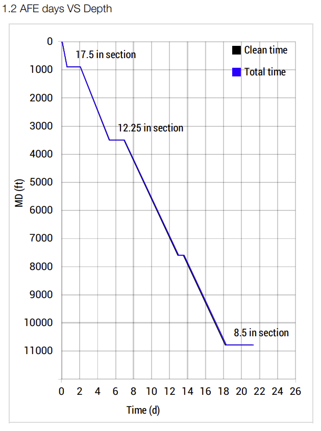
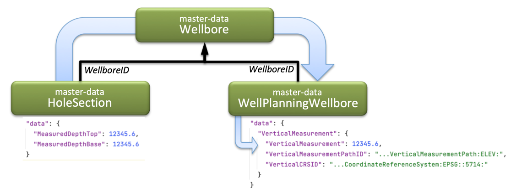

[[_TOC_]]

# Well Planning Worked Examples

The worked example included with this donation is a scenario where we have a single borehole being drilled in 3 sections
to 3290m in a total of 4 BHA runs.



Once the planning of the project is completed in the drill planning system the output as a DDP (Digital Drilling Plan).

Once transferred to OSDU it is stored as a series of objects as described below.

## Depths in the Well Planning DDMS

All depths in OSDU need to be expressed relative to a Zero Depth Point (ZDP). All depths stored in the Well Planning
DDMS are recorded with respect to the Vertical Reference associated with the WellPlanningWellbore with the type of "
Planned ZDP". For example there are 2 depths in a HoleSection (MeasuredDepthTop and MeasuredDepthBase). To identify the
ZDP value associated with these depths you need to navigate to the side-car WellPlanningWellbore via Wellbore to find
the VerticalMeasurement.



## WellActivityProgram

The main class to hold the information on the DDP is WellActivityProgram. This object holds a link to the Rig that is
planned to perform the activities as well as any risks that you might encounter at the wellbore level. It also holds
details on the multiple phases in this WellActivityProgram. At the Phase level there are links to the planned activities
to accomplish the objective of this phase. In addition, you also have links to the objects that hold the information on
the planned BHA Runs, Planned Lithology you intend to drill through, any Cementjobs planned, the fluid plan for the
program, any evaluation tests planned and any WellBarrierEvaluation tests that are planned as part of this
ActivityProgram. In the worked example below, you can see this WellActivityProgram has all the activities consolidated
into 1 phase which has 4 BHARuns planned.

<details>

<summary markdown="span">WellActivityProgram Example Record</summary>

<OsduImportJSON>[WellActivityProgram Example Record, Full](./master-data/WellActivityProgram.json#only.data)</OsduImportJSON>

```json
{
  "data": {
    "ExistenceKind": "namespace:reference-data--ExistenceKind:planned:",
    "RigID": "namespace:master-data--Rig:3eb7eadb-439e-f0ed-918f-b8fbf091c75e:1646080400945",
    "Phases": [
      {
        "TypeID": "namespace:reference-data--WellActivityPhaseType:Primary:",
        "WellActivityPlanID": "namespace:master-data--ActivityPlan:1ab94d56-12c1-4406-bdd4-911be2ce21ac:1646080455072",
        "WellboreID": "namespace:master-data--Wellbore:bfa6c73d-4b12-4980-be91-80ce7cdb3291:1646080398012",
        "RiskIDs": [
          "namespace:master-data--Risk:db7697ae-27e2-414d-a487-b79863c81d2f:1646080420775",
          "namespace:master-data--Risk:dfe532ed-11eb-4771-a96d-62263bd81106:1646080451725",
          "namespace:master-data--Risk:537ec368-cef4-454b-a735-29ea839b0a75:1646080452191",
          "namespace:master-data--Risk:c2c6b607-53ad-4412-b588-5eff7f3a5c54:1646080452597",
          "namespace:master-data--Risk:96058261-d41a-4d6d-bae0-3cfddb7e6c13:1646080452928",
          "namespace:master-data--Risk:c7ae46a0-4e30-46ce-acba-ecb22110859c:1646080453554",
          "namespace:master-data--Risk:dae638f8-b3c0-4c0c-a21d-edad4fb1f165:1646080453863",
          "namespace:master-data--Risk:6388af58-0b70-4acf-9b36-d51b25c3dcf9:1646080454192",
          "namespace:master-data--Risk:c3ec9d97-248d-415c-a8bd-3ee8653746ad:1646080454511"
        ],
        "BHARunIDs": [
          "namespace:master-data--BHARun:8edbb259-e01e-4c25-afe9-b99ed1d2d376:1646080404015",
          "namespace:master-data--BHARun:efb3865e-da7b-4c75-ba62-edd7b95c81ed:1646080407025",
          "namespace:master-data--BHARun:4ca984f6-dd40-473d-bd78-42494c8f948e:1646080411604",
          "namespace:master-data--BHARun:74c7e8ac-e8ab-4a0f-ba24-39ac0f59596c:1646080412781"
        ],
        "WellboreArchitectureID": "namespace:master-data--WellboreArchitecture:wa_bfa6c73d-4b12-4980-be91-80ce7cdb3291:1646080413992"
      }
    ],
    "TypeID": "namespace:reference-data--WellActivityProgramType:Primary:"
  }
}
```
</details>

## ActivityPlan

This class contains details on all the activities that are planned to accomplish the objective along with the order in
which they are planned to be accomplished. In the worked example below, the ActivityPlan lists all the activities in
this phase and the order in which they should be performed.

<details>

<summary markdown="span">ActivityPlan Example Record</summary>

<OsduImportJSON>[ActivityPlan Example Record, Full](./master-data/ActivityPlan.1.1.0.json#only.data)</OsduImportJSON>

```json
{
  "data": {
    "ResourceHomeRegionID": "namespace:reference-data--OSDURegion:AWSEastUSA:",
    "ResourceHostRegionIDs": [
      "namespace:reference-data--OSDURegion:AWSEastUSA:"
    ],
    "ResourceCurationStatus": "namespace:reference-data--ResourceCurationStatus:CREATED:",
    "ResourceLifecycleStatus": "namespace:reference-data--ResourceLifecycleStatus:LOADING:",
    "Source": "Example Data Source",
    "ExistenceKind": "namespace:reference-data--ExistenceKind:Prototype:",
    "NameAliases": [
      {
        "AliasName": "Example AliasName",
        "AliasNameTypeID": "namespace:reference-data--AliasNameType:RegulatoryIdentifier:",
        "DefinitionOrganisationID": "namespace:master-data--Organisation:SomeUniqueOrganisationID:",
        "EffectiveDateTime": "2020-02-13T09:13:15.55Z",
        "TerminationDateTime": "2020-02-13T09:13:15.55Z"
      }
    ],
    "GeoContexts": [
      {
        "BasinID": "namespace:master-data--Basin:SomeUniqueBasinID:",
        "GeoTypeID": "namespace:reference-data--BasinType:ArcWrenchOceanContinent:"
      }
    ],
    "SpatialLocation": {
      "SpatialLocationCoordinatesDate": "2020-02-13T09:13:15.55Z",
      "QuantitativeAccuracyBandID": "namespace:reference-data--QuantitativeAccuracyBand:Length.LessThan1m:",
      "QualitativeSpatialAccuracyTypeID": "namespace:reference-data--QualitativeSpatialAccuracyType:Assumed:",
      "CoordinateQualityCheckPerformedBy": "Example CoordinateQualityCheckPerformedBy",
      "CoordinateQualityCheckDateTime": "2020-02-13T09:13:15.55Z",
      "CoordinateQualityCheckRemarks": [
        "Example CoordinateQualityCheckRemarks"
      ],
      "AsIngestedCoordinates": {
        "type": "AnyCrsFeatureCollection",
        "CoordinateReferenceSystemID": "namespace:reference-data--CoordinateReferenceSystem:BoundProjected:EPSG::32021_EPSG::15851:",
        "VerticalCoordinateReferenceSystemID": "namespace:reference-data--CoordinateReferenceSystem:Vertical:EPSG::5714:",
        "VerticalUnitID": "namespace:reference-data--UnitOfMeasure:m:",
        "persistableReferenceCrs": "{\"authCode\":{\"auth\":\"OSDU\",\"code\":\"32021079\"},\"lateBoundCRS\":{\"authCode\":{\"auth\":\"EPSG\",\"code\":\"32021\"},\"name\":\"NAD_1927_StatePlane_North_Dakota_South_FIPS_3302\",\"type\":\"LBC\",\"ver\":\"PE_10_9_1\",\"wkt\":\"PROJCS[\\\"NAD_1927_StatePlane_North_Dakota_South_FIPS_3302\\\",GEOGCS[\\\"GCS_North_American_1927\\\",DATUM[\\\"D_North_American_1927\\\",SPHEROID[\\\"Clarke_1866\\\",6378206.4,294.9786982]],PRIMEM[\\\"Greenwich\\\",0.0],UNIT[\\\"Degree\\\",0.0174532925199433]],PROJECTION[\\\"Lambert_Conformal_Conic\\\"],PARAMETER[\\\"False_Easting\\\",2000000.0],PARAMETER[\\\"False_Northing\\\",0.0],PARAMETER[\\\"Central_Meridian\\\",-100.5],PARAMETER[\\\"Standard_Parallel_1\\\",46.18333333333333],PARAMETER[\\\"Standard_Parallel_2\\\",47.48333333333333],PARAMETER[\\\"Latitude_Of_Origin\\\",45.66666666666666],UNIT[\\\"Foot_US\\\",0.3048006096012192],AUTHORITY[\\\"EPSG\\\",32021]]\"},\"name\":\"NAD27 * OGP-Usa Conus / North Dakota CS27 South zone [32021,15851]\",\"singleCT\":{\"authCode\":{\"auth\":\"EPSG\",\"code\":\"15851\"},\"name\":\"NAD_1927_To_WGS_1984_79_CONUS\",\"type\":\"ST\",\"ver\":\"PE_10_9_1\",\"wkt\":\"GEOGTRAN[\\\"NAD_1927_To_WGS_1984_79_CONUS\\\",GEOGCS[\\\"GCS_North_American_1927\\\",DATUM[\\\"D_North_American_1927\\\",SPHEROID[\\\"Clarke_1866\\\",6378206.4,294.9786982]],PRIMEM[\\\"Greenwich\\\",0.0],UNIT[\\\"Degree\\\",0.0174532925199433]],GEOGCS[\\\"GCS_WGS_1984\\\",DATUM[\\\"D_WGS_1984\\\",SPHEROID[\\\"WGS_1984\\\",6378137.0,298.257223563]],PRIMEM[\\\"Greenwich\\\",0.0],UNIT[\\\"Degree\\\",0.0174532925199433]],METHOD[\\\"NADCON\\\"],PARAMETER[\\\"Dataset_conus\\\",0.0],OPERATIONACCURACY[5.0],AUTHORITY[\\\"EPSG\\\",15851]]\"},\"type\":\"EBC\",\"ver\":\"PE_10_9_1\"}",
        "persistableReferenceVerticalCrs": "{\"authCode\":{\"auth\":\"EPSG\",\"code\":\"5714\"},\"name\":\"MSL_Height\",\"type\":\"LBC\",\"ver\":\"PE_10_9_1\",\"wkt\":\"VERTCS[\\\"MSL_Height\\\",VDATUM[\\\"Mean_Sea_Level\\\"],PARAMETER[\\\"Vertical_Shift\\\",0.0],PARAMETER[\\\"Direction\\\",1.0],UNIT[\\\"Meter\\\",1.0],AUTHORITY[\\\"EPSG\\\",5714]]\"}",
        "persistableReferenceUnitZ": "{\"scaleOffset\":{\"scale\":1.0,\"offset\":0.0},\"symbol\":\"m\",\"baseMeasurement\":{\"ancestry\":\"Length\",\"type\":\"UM\"},\"type\":\"USO\"}",
        "features": [
          {
            "type": "AnyCrsFeature",
            "properties": {},
            "geometry": {
              "type": "AnyCrsPoint",
              "coordinates": [
                12345.6,
                12345.6
              ],
              "bbox": [
                12345.6,
                12345.6,
                12345.6,
                12345.6
              ]
            },
            "bbox": [
              12345.6,
              12345.6,
              12345.6,
              12345.6
            ]
          }
        ],
        "bbox": [
          12345.6,
          12345.6,
          12345.6,
          12345.6
        ]
      },
      "Wgs84Coordinates": {
        "type": "FeatureCollection",
        "features": [
          {
            "type": "Feature",
            "properties": {},
            "geometry": {
              "type": "Point",
              "coordinates": [
                12345.6,
                12345.6
              ],
              "bbox": [
                12345.6,
                12345.6,
                12345.6,
                12345.6
              ]
            },
            "bbox": [
              12345.6,
              12345.6,
              12345.6,
              12345.6
            ]
          }
        ],
        "bbox": [
          12345.6,
          12345.6,
          12345.6,
          12345.6
        ]
      },
      "AppliedOperations": [
        "conversion from ED_1950_UTM_Zone_31N to GCS_European_1950; 1 points converted",
        "transformation GCS_European_1950 to GCS_WGS_1984 using ED_1950_To_WGS_1984_24; 1 points successfully transformed"
      ],
      "SpatialParameterTypeID": "namespace:reference-data--SpatialParameterType:Outline:",
      "SpatialGeometryTypeID": "namespace:reference-data--SpatialGeometryType:Point:"
    },
    "VersionCreationReason": "Example VersionCreationReason",
    "TechnicalAssuranceTypeID": "namespace:reference-data--TechnicalAssuranceType:Certified:",
    "ProjectID": "Example External Project Identifier",
    "ProjectName": "Example ProjectName",
    "Purpose": "Example Purpose",
    "ProjectBeginDate": "2020-02-13T09:13:15.55Z",
    "ProjectEndDate": "2020-02-13T09:13:15.55Z",
    "FundsAuthorizations": [
      {
        "AuthorizationID": "Example AuthorizationID",
        "EffectiveDateTime": "2020-02-13T09:13:15.55Z",
        "FundsAmount": 12345.6,
        "CurrencyID": "namespace:reference-data--Currency:AFN:"
      }
    ],
    "ContractIDs": [
      "namespace:master-data--Agreement:SomeUniqueAgreementID:"
    ],
    "Operator": "namespace:master-data--Organisation:SomeUniqueOrganisationID:",
    "Contractors": [
      {
        "ContractorOrganisationID": "namespace:master-data--Organisation:SomeUniqueOrganisationID:",
        "ContractorCrew": "Example ContractorCrew",
        "ContractorTypeID": "namespace:reference-data--ContractorType:Record:"
      }
    ],
    "Personnel": [
      {
        "PersonName": "Example PersonName",
        "CompanyOrganisationID": "namespace:master-data--Organisation:SomeUniqueOrganisationID:",
        "ProjectRoleID": "namespace:reference-data--ProjectRole:ProjMgr:"
      }
    ],
    "ProjectSpecifications": [
      {
        "EffectiveDateTime": "2020-02-13T09:13:15.55Z",
        "TerminationDateTime": "2020-02-13T09:13:15.55Z",
        "ProjectSpecificationQuantity": 12345.6,
        "ProjectSpecificationDateTime": "2020-02-13T09:13:15.55Z",
        "ProjectSpecificationIndicator": true,
        "ProjectSpecificationText": "Example ProjectSpecificationText",
        "UnitOfMeasureID": "namespace:reference-data--UnitOfMeasure:m:",
        "ParameterTypeID": "namespace:reference-data--ParameterType:SlotName:"
      }
    ],
    "ProjectStates": [
      {
        "EffectiveDateTime": "2020-02-13T09:13:15.55Z",
        "TerminationDateTime": "2020-02-13T09:13:15.55Z",
        "ProjectStateTypeID": "namespace:reference-data--ProjectStateType:Prop:"
      }
    ],
    "WellboreID": "namespace:master-data--Wellbore:SomeUniqueWellboreID:",
    "WellPlanningActivities": [
      {
        "Name": "Example Name",
        "ActivityID": "Example Activity ID",
        "DepthRange": {
          "HoleDepthStart": 12345.6,
          "HoleDepthEnd": 12345.6,
          "ActivityDepthStart": 12345.6,
          "ActivityDepthEnd": 12345.6
        },
        "ParentID": "Example Parent ID",
        "ActivityCodeID": "namespace:reference-data--ActivityCode:root:",
        "PredecessorsID": "Example Predecessors ID",
        "ProductiveTimeDuration": 12345.6,
        "NonProductiveTimeDuration": 12345.6,
        "ProductiveTimeStatistics": [
          {
            "StatisticRecord": 12345.6,
            "ProbabilityTypeID": "namespace:reference-data--PPFGCurveProbability:Most%20Likely:"
          }
        ],
        "NonProductiveTimeStatistics": [
          {
            "StatisticRecord": 12345.6,
            "ProbabilityTypeID": "namespace:reference-data--PPFGCurveProbability:Most%20Likely:"
          }
        ],
        "RateOfPenetrationStatistics": [
          {
            "StatisticRecord": 12345.6,
            "ProbabilityTypeID": "namespace:reference-data--PPFGCurveProbability:Most%20Likely:"
          }
        ],
        "Comment": "Example Comment",
        "ObjectReferenceIDs": [
          "Example ObjectReferenceIDs"
        ],
        "ActivityCodeCatalogVersion": "Example Catalog Version",
        "ActivityLevel": "namespace:reference-data--ActivityLevel:L1:",
        "PlannedStartTime": "2020-02-13T09:13:15.55Z",
        "PlannedEndTime": "2020-02-13T09:13:15.55Z",
        "RiskIDs": [
          "namespace:master-data--Risk:SomeUniqueRiskID:"
        ],
        "IsOptional": true,
        "EstimatedDuration": 12345.6
      }
    ],
    "Name": "Example Name",
    "ExtensionProperties": {}
  }
}
```
</details>

## HoleSection

HoleSection is a constant diameter section of the wellbore. In the worked example below, there are 3 HoleSections one of
which can be seen below.

<details>

<summary markdown="span">Planned HoleSection 1 Example Record</summary>

<OsduImportJSON>[Planned HoleSection 1 Example Record, Full](./master-data/HoleSection1.json#only.data)</OsduImportJSON>

```json
{
  "data": {
    "ExistenceKind": "namespace:reference-data--ExistenceKind:planned:",
    "WellboreID": "namespace:master-data--Wellbore:bfa6c73d-4b12-4980-be91-80ce7cdb3291:1635454816654",
    "Name": "0.4445 m",
    "Size": 0.4445,
    "Comment": "SURFACE",
    "MeasuredDepthTop": 9.144,
    "MeasuredDepthBase": 274.32
  }
}
```
</details>

<details>

<summary markdown="span">Planned HoleSection 2 Example Record</summary>

<OsduImportJSON>[Planned HoleSection 2 Example Record, Full](./master-data/HoleSection2.json#only.data)</OsduImportJSON>

```json
{
  "data": {
    "ExistenceKind": "namespace:reference-data--ExistenceKind:planned:",
    "WellboreID": "namespace:master-data--Wellbore:bfa6c73d-4b12-4980-be91-80ce7cdb3291:1635454816654",
    "Name": "0.311 m",
    "Size": 0.31115,
    "Comment": "INTERMEDIATE",
    "MeasuredDepthTop": 274.32,
    "MeasuredDepthBase": 1066.8
  }
}
```
</details>

<details>

<summary markdown="span">Planned HoleSection 3 Example Record</summary>

<OsduImportJSON>[Planned HoleSection 3 Example Record, Full](./master-data/HoleSection3.json#only.data)</OsduImportJSON>

```json
{
  "data": {
    "ExistenceKind": "namespace:reference-data--ExistenceKind:planned:",
    "WellboreID": "namespace:master-data--Wellbore:bfa6c73d-4b12-4980-be91-80ce7cdb3291:1635454816654",
    "Name": "0.216 m",
    "Size": 0.21589999999999998,
    "Comment": "PRODUCTION",
    "MeasuredDepthTop": 1066.8,
    "MeasuredDepthBase": 3304.374898
  }
}
```
</details>

With the following WellActivity record:

<details>

<summary markdown="span">WellActivity Record</summary>

<OsduImportJSON>[WellActivity 3 Example Record, Full](./master-data/WellActivity.json#only.data)</OsduImportJSON>

```json
{
  "data": {
    "ExistenceKind": "namespace:reference-data--ExistenceKind:Actual:",
    "Name": "Example exploration well Drilling operation",
    "WellID": "namespace:master-data--Well:920c7e6d-1e9f-496d-ba4f-fe5bf5503d57:",
    "WellActivityType": "namespace:reference-data--WellActivityType:DRO:",
    "WellActivityDescription": "Drill 'JORGE' exploration well to 8-1/2\" TD into Big Formation",
    "WellActivityObjective": [
      "Dryhole Activities"
    ],
    "EstimatedDuration": 60,
    "StartDateTime": "2023-01-15T17:30:00+0000",
    "EndDateTime": "2023-03-27T23:59:00+0000",
    "DataQCName": "Joe Bloggs",
    "DataQCDate": "2023-04-15T00:00:00+0000",
    "IsPerformanceBenchmarkSubmitted": true,
    "PerformanceBenchmarkSubmitter": "Joe Bloggs",
    "Comments": "Final Well Status Diagram submitted 15-April-2023 (JB)",
    "Customer": "Big Oil",
    "StewardingCompanyTeam": "An Operator Drilling Team"
  }
}
```
</details>

the actual HoleSections are drilled:

<details>

<summary markdown="span">Actual HoleSection 1 Example Record</summary>

<OsduImportJSON>[Actual HoleSection 1 Example Record, Full](./master-data/HoleSectionActual1.json#only.data)</OsduImportJSON>

```json
{
  "data": {
    "ExistenceKind": "namespace:reference-data--ExistenceKind:Actual:",
    "VerticalMeasurement.VerticalReferenceID": "KB",
    "StartDateTime": "2023-01-13T00:00:00+0000",
    "EndDateTime": "2023-03-15T02:30:00+0000",
    "DrillingActivityCode": "SURF",
    "IsPilotHole": false,
    "WellboreID": "namespace:master-data--Wellbore:bfa6c73d-4b12-4980-be91-80ce7cdb3291:",
    "Name": "17-1/2\" Surface Hole Section",
    "Size": 17.5,
    "MeasuredDepthTop": 10,
    "MeasuredDepthBase": 275,
    "PlannedMeasuredDepthBase": 274.32,
    "Comment": "16\" shoe set at 271.5m BRKB"
  }
}
```
</details>

<details>

<summary markdown="span">Actual HoleSection 2 Example Record</summary>

<OsduImportJSON>[Actual HoleSection 2 Example Record, Full](./master-data/HoleSectionActual2.json#only.data)</OsduImportJSON>

```json
{
  "data": {
    "ExistenceKind": "namespace:reference-data--ExistenceKind:Actual:",
    "VerticalMeasurement.VerticalReferenceID": "KB",
    "StartDateTime": "2023-01-16T06:00:00+0000",
    "EndDateTime": "2023-03-21T09:45:00+0000",
    "DrillingActivityCode": "INT",
    "IsPilotHole": false,
    "WellboreID": "namespace:master-data--Wellbore:bfa6c73d-4b12-4980-be91-80ce7cdb3291:",
    "Name": "12-1/4\" Intermediate Hole Section",
    "Size": 12.25,
    "MeasuredDepthTop": 175,
    "MeasuredDepthBase": 1075,
    "PlannedMeasuredDepthBase": 1066.8,
    "Comment": "FIT conducted at 278m - successful. 9-5/8\" shoe set at 1071m BRKB"
  }
}
```
</details>

<details>

<summary markdown="span">Actual HoleSection 3 Example Record</summary>

<OsduImportJSON>[Actual HoleSection 3 Example Record, Full](./master-data/HoleSectionActual3.json#only.data)</OsduImportJSON>

```json
{
  "data": {
    "ExistenceKind": "namespace:reference-data--ExistenceKind:Actual:",
    "VerticalMeasurement.VerticalReferenceID": "KB",
    "StartDateTime": "2023-01-22T17:30:00+0000",
    "EndDateTime": "2023-03-23T21:45:00+0000",
    "DrillingActivityCode": "PROD",
    "IsPilotHole": false,
    "WellboreID": "namespace:master-data--Wellbore:bfa6c73d-4b12-4980-be91-80ce7cdb3291:",
    "Name": "8-1/2\" Production Hole Section",
    "Size": 8.5,
    "MeasuredDepthTop": 1075,
    "MeasuredDepthBase": 3315,
    "PlannedMeasuredDepthBase": 3304.4,
    "Comment": "FIT conducted at 1078m - successful. Drilled into Big Formation at 3310m BRKB"
  }
}
```
</details>

## BHARun

BHARun contains all the information required for each BHA run. The main part of BHARun contains the information for the
planned run including a link to the tubular assembly that the run has planned to use. The TubularAssembly is stored in
the standard OSDU TubularAssembly class. You can also use the sub object of RunParameterPlan to store all the planned
drilling parameters you plan to use during the run. If you have multiple plans, then you would create multiple
RunParameterPlans within a single BHARun. The RunParameterPlan is further split into Operational, TorqueOnBottom, RPM,
ROP, WOB and FlowratePump parameters. Each of which is stored using a mechanism that allows each parameter to be
annotated as to if it was calculated or specified along with the unit of measure specified for the parameter. In the
worked example, there are 4 BHA runs planned, one of which can be seen below. Inside this JSON file you can see exactly
how the planned parameters are defined.

<details>

<summary markdown="span">BHARun Example Record</summary>

<OsduImportJSON>[BHARun Example Record, Full](./master-data/BHARun1.json#only.data)</OsduImportJSON>

```json
{
  "data": {
    "ExistenceKind": "namespace:reference-data--ExistenceKind:planned:",
    "WellboreID": "namespace:master-data--Wellbore:bfa6c73d-4b12-4980-be91-80ce7cdb3291:1635454816654",
    "Name": "Drilling run",
    "TubularID": "namespace:master-data--TubularAssembly:c04450c2-3255-45fc-9073-a6c1393e2664:1635454823791",
    "StatusBhaID": "namespace:reference-data--BhaStatus:final:",
    "StringRunNumber": 0.0,
    "TripReasonID": "namespace:reference-data--ReasonTripType:none:",
    "RunParameterPlans": [
      {
        "RunStartHoleMeasuredDepth": 1066.8,
        "RunEndHoleMeasuredDepth": 2316.48,
        "OperationParameterPlan": {
          "RealizationStrategy": "linearInterpolation",
          "TorqueOnBottomGroup": {
            "MaximumTorqueOnBottom": {
              "Point": [
                {
                  "ObservationMeasuredDepth": 1066.8,
                  "Value": 8134.9076899884,
                  "ValueUnitID": "namespace:reference-data--UnitOfMeasure:J:",
                  "PointsSources": [
                    {
                      "Name": "Manual Input",
                      "Value": 8134.9076899884,
                      "ValueUnitID": "namespace:reference-data--UnitOfMeasure:J:",
                      "Description": "System default"
                    }
                  ]
                },
                {
                  "ObservationMeasuredDepth": 2316.48,
                  "Value": 8134.9076899884,
                  "ValueUnitID": "namespace:reference-data--UnitOfMeasure:J:",
                  "PointsSources": [
                    {
                      "Name": "Manual Input",
                      "Value": 8134.9076899884,
                      "ValueUnitID": "namespace:reference-data--UnitOfMeasure:J:",
                      "Description": "System default"
                    }
                  ]
                }
              ]
            },
            "MinimumTorqueOnBottom": {
              "Point": [
                {
                  "ObservationMeasuredDepth": 1066.8,
                  "Value": 2711.6358966628,
                  "ValueUnitID": "namespace:reference-data--UnitOfMeasure:J:",
                  "PointsSources": [
                    {
                      "Name": "Manual Input",
                      "Value": 2711.6358966628,
                      "ValueUnitID": "namespace:reference-data--UnitOfMeasure:J:",
                      "Description": "System default"
                    }
                  ]
                },
                {
                  "ObservationMeasuredDepth": 2316.48,
                  "Value": 2711.6358966628,
                  "ValueUnitID": "namespace:reference-data--UnitOfMeasure:J:",
                  "PointsSources": [
                    {
                      "Name": "Manual Input",
                      "Value": 2711.6358966628,
                      "ValueUnitID": "namespace:reference-data--UnitOfMeasure:J:",
                      "Description": "System default"
                    }
                  ]
                }
              ]
            }
          },
          "RPMGroup": {
            "MaximumRPM": {
              "Point": [
                {
                  "ObservationMeasuredDepth": 1066.8,
                  "Value": 12.5663706143592,
                  "ValueUnitID": "namespace:reference-data--UnitOfMeasure:rad%2Fs:",
                  "PointsSources": [
                    {
                      "Name": "Manual Input",
                      "Value": 12.5663706143592,
                      "ValueUnitID": "namespace:reference-data--UnitOfMeasure:rad%2Fs:",
                      "Description": "Batch Input"
                    }
                  ]
                },
                {
                  "ObservationMeasuredDepth": 2316.48,
                  "Value": 12.5663706143592,
                  "ValueUnitID": "namespace:reference-data--UnitOfMeasure:rad%2Fs:",
                  "PointsSources": [
                    {
                      "Name": "Manual Input",
                      "Value": 12.5663706143592,
                      "ValueUnitID": "namespace:reference-data--UnitOfMeasure:rad%2Fs:",
                      "Description": "Batch Input"
                    }
                  ]
                }
              ]
            },
            "MinimumRPM": {
              "Point": [
                {
                  "ObservationMeasuredDepth": 1066.8,
                  "Value": 4.1887902047864,
                  "ValueUnitID": "namespace:reference-data--UnitOfMeasure:rad%2Fs:",
                  "PointsSources": [
                    {
                      "Name": "Tool Spec",
                      "Value": 0.0,
                      "ValueUnitID": "namespace:reference-data--UnitOfMeasure:rad%2Fs:",
                      "Description": "Comp#5: SlimPulse 675 - Bat. On bottom"
                    },
                    {
                      "Name": "Manual Input",
                      "Value": 4.1887902047864,
                      "ValueUnitID": "namespace:reference-data--UnitOfMeasure:rad%2Fs:",
                      "Description": "Batch Input"
                    }
                  ]
                },
                {
                  "ObservationMeasuredDepth": 2316.48,
                  "Value": 4.1887902047864,
                  "ValueUnitID": "namespace:reference-data--UnitOfMeasure:rad%2Fs:",
                  "PointsSources": [
                    {
                      "Name": "Tool Spec",
                      "Value": 0.0,
                      "ValueUnitID": "namespace:reference-data--UnitOfMeasure:rad%2Fs:",
                      "Description": "Comp#5: SlimPulse 675 - Bat. On bottom"
                    },
                    {
                      "Name": "Manual Input",
                      "Value": 4.1887902047864,
                      "ValueUnitID": "namespace:reference-data--UnitOfMeasure:rad%2Fs:",
                      "Description": "Batch Input"
                    }
                  ]
                }
              ]
            },
            "RecommendedRPM": {
              "Point": [
                {
                  "ObservationMeasuredDepth": 1066.8,
                  "Value": 10.471975511966,
                  "ValueUnitID": "namespace:reference-data--UnitOfMeasure:rad%2Fs:",
                  "PointsSources": [
                    {
                      "Name": "Manual Input",
                      "Value": 10.471975511966,
                      "ValueUnitID": "namespace:reference-data--UnitOfMeasure:rad%2Fs:",
                      "Description": "Batch Input"
                    }
                  ]
                },
                {
                  "ObservationMeasuredDepth": 2316.48,
                  "Value": 10.471975511966,
                  "ValueUnitID": "namespace:reference-data--UnitOfMeasure:rad%2Fs:",
                  "PointsSources": [
                    {
                      "Name": "Manual Input",
                      "Value": 10.471975511966,
                      "ValueUnitID": "namespace:reference-data--UnitOfMeasure:rad%2Fs:",
                      "Description": "Batch Input"
                    }
                  ]
                }
              ]
            }
          },
          "ROPGroup": {
            "MaximumROP": {
              "Point": [
                {
                  "ObservationMeasuredDepth": 1066.8,
                  "Value": 0.01016,
                  "ValueUnitID": "namespace:reference-data--UnitOfMeasure:m%2Fs:",
                  "PointsSources": [
                    {
                      "Name": "Manual Input",
                      "Value": 0.01016,
                      "ValueUnitID": "namespace:reference-data--UnitOfMeasure:m%2Fs:",
                      "Description": "Batch Input"
                    }
                  ]
                },
                {
                  "ObservationMeasuredDepth": 2316.48,
                  "Value": 0.01016,
                  "ValueUnitID": "namespace:reference-data--UnitOfMeasure:m%2Fs:",
                  "PointsSources": [
                    {
                      "Name": "Manual Input",
                      "Value": 0.01016,
                      "ValueUnitID": "namespace:reference-data--UnitOfMeasure:m%2Fs:",
                      "Description": "Batch Input"
                    }
                  ]
                }
              ]
            },
            "MinimumROP": {
              "Point": [
                {
                  "ObservationMeasuredDepth": 1066.8,
                  "Value": 0.0008466666666666668,
                  "ValueUnitID": "namespace:reference-data--UnitOfMeasure:m%2Fs:",
                  "PointsSources": [
                    {
                      "Name": "Manual Input",
                      "Value": 0.0008466666666666668,
                      "ValueUnitID": "namespace:reference-data--UnitOfMeasure:m%2Fs:",
                      "Description": "Batch Input"
                    }
                  ]
                },
                {
                  "ObservationMeasuredDepth": 2316.48,
                  "Value": 0.0008466666666666668,
                  "ValueUnitID": "namespace:reference-data--UnitOfMeasure:m%2Fs:",
                  "PointsSources": [
                    {
                      "Name": "Manual Input",
                      "Value": 0.0008466666666666668,
                      "ValueUnitID": "namespace:reference-data--UnitOfMeasure:m%2Fs:",
                      "Description": "Batch Input"
                    }
                  ]
                }
              ]
            },
            "RecommendedROP": {
              "Point": [
                {
                  "ObservationMeasuredDepth": 1066.8,
                  "Value": 0.008466666666666667,
                  "ValueUnitID": "namespace:reference-data--UnitOfMeasure:m%2Fs:",
                  "PointsSources": [
                    {
                      "Name": "Manual Input",
                      "Value": 0.008466666666666667,
                      "ValueUnitID": "namespace:reference-data--UnitOfMeasure:m%2Fs:",
                      "Description": "Batch Input"
                    }
                  ]
                },
                {
                  "ObservationMeasuredDepth": 2316.48,
                  "Value": 0.008466666666666667,
                  "ValueUnitID": "namespace:reference-data--UnitOfMeasure:m%2Fs:",
                  "PointsSources": [
                    {
                      "Name": "Manual Input",
                      "Value": 0.008466666666666667,
                      "ValueUnitID": "namespace:reference-data--UnitOfMeasure:m%2Fs:",
                      "Description": "Batch Input"
                    }
                  ]
                }
              ]
            }
          },
          "WOBGroup": {
            "MaximumWOB": {
              "Point": [
                {
                  "ObservationMeasuredDepth": 1066.8,
                  "Value": 44482.216152605,
                  "ValueUnitID": "namespace:reference-data--UnitOfMeasure:N:",
                  "PointsSources": [
                    {
                      "Name": "Manual Input",
                      "Value": 44482.216152605,
                      "ValueUnitID": "namespace:reference-data--UnitOfMeasure:N:",
                      "Description": "Batch Input"
                    }
                  ]
                },
                {
                  "ObservationMeasuredDepth": 2316.48,
                  "Value": 44482.216152605,
                  "ValueUnitID": "namespace:reference-data--UnitOfMeasure:N:",
                  "PointsSources": [
                    {
                      "Name": "Manual Input",
                      "Value": 44482.216152605,
                      "ValueUnitID": "namespace:reference-data--UnitOfMeasure:N:",
                      "Description": "Batch Input"
                    }
                  ]
                }
              ]
            },
            "MinimumWOB": {
              "Point": [
                {
                  "ObservationMeasuredDepth": 1066.8,
                  "Value": 22241.1080763025,
                  "ValueUnitID": "namespace:reference-data--UnitOfMeasure:N:",
                  "PointsSources": [
                    {
                      "Name": "Tool Spec",
                      "Value": 0.0,
                      "ValueUnitID": "namespace:reference-data--UnitOfMeasure:N:",
                      "Description": "Comp#5: SlimPulse 675 - Bat. On bottom"
                    },
                    {
                      "Name": "Manual Input",
                      "Value": 22241.1080763025,
                      "ValueUnitID": "namespace:reference-data--UnitOfMeasure:N:",
                      "Description": "Batch Input"
                    }
                  ]
                },
                {
                  "ObservationMeasuredDepth": 2316.48,
                  "Value": 22241.1080763025,
                  "ValueUnitID": "namespace:reference-data--UnitOfMeasure:N:",
                  "PointsSources": [
                    {
                      "Name": "Tool Spec",
                      "Value": 0.0,
                      "ValueUnitID": "namespace:reference-data--UnitOfMeasure:N:",
                      "Description": "Comp#5: SlimPulse 675 - Bat. On bottom"
                    },
                    {
                      "Name": "Manual Input",
                      "Value": 22241.1080763025,
                      "ValueUnitID": "namespace:reference-data--UnitOfMeasure:N:",
                      "Description": "Batch Input"
                    }
                  ]
                }
              ]
            },
            "RecommendedWOB": {
              "Point": [
                {
                  "ObservationMeasuredDepth": 1066.8,
                  "Value": 35585.772922084,
                  "ValueUnitID": "namespace:reference-data--UnitOfMeasure:N:",
                  "PointsSources": [
                    {
                      "Name": "Manual Input",
                      "Value": 35585.772922084,
                      "ValueUnitID": "namespace:reference-data--UnitOfMeasure:N:",
                      "Description": "Batch Input"
                    }
                  ]
                },
                {
                  "ObservationMeasuredDepth": 2316.48,
                  "Value": 35585.772922084,
                  "ValueUnitID": "namespace:reference-data--UnitOfMeasure:N:",
                  "PointsSources": [
                    {
                      "Name": "Manual Input",
                      "Value": 35585.772922084,
                      "ValueUnitID": "namespace:reference-data--UnitOfMeasure:N:",
                      "Description": "Batch Input"
                    }
                  ]
                }
              ]
            }
          },
          "FlowratePumpGroup": {
            "MaximumFlowratePump": {
              "Point": [
                {
                  "ObservationMeasuredDepth": 1066.8,
                  "Value": 0.03785412,
                  "ValueUnitID": "namespace:reference-data--UnitOfMeasure:m3%2Fs:",
                  "PointsSources": [
                    {
                      "Name": "Manual Input",
                      "Value": 0.03785412,
                      "ValueUnitID": "namespace:reference-data--UnitOfMeasure:m3%2Fs:",
                      "Description": "Batch Input"
                    },
                    {
                      "Name": "Tool Spec",
                      "Value": 0.048579,
                      "ValueUnitID": "namespace:reference-data--UnitOfMeasure:m3%2Fs:",
                      "Description": "Comp#5: SlimPulse 675 - Bat. On bottom"
                    }
                  ]
                },
                {
                  "ObservationMeasuredDepth": 2316.48,
                  "Value": 0.03785412,
                  "ValueUnitID": "namespace:reference-data--UnitOfMeasure:m3%2Fs:",
                  "PointsSources": [
                    {
                      "Name": "Manual Input",
                      "Value": 0.03785412,
                      "ValueUnitID": "namespace:reference-data--UnitOfMeasure:m3%2Fs:",
                      "Description": "Batch Input"
                    },
                    {
                      "Name": "Tool Spec",
                      "Value": 0.048579,
                      "ValueUnitID": "namespace:reference-data--UnitOfMeasure:m3%2Fs:",
                      "Description": "Comp#5: SlimPulse 675 - Bat. On bottom"
                    }
                  ]
                }
              ]
            },
            "MinimumFlowratePump": {
              "Point": [
                {
                  "ObservationMeasuredDepth": 1066.8,
                  "Value": 0.0315451,
                  "ValueUnitID": "namespace:reference-data--UnitOfMeasure:m3%2Fs:",
                  "PointsSources": [
                    {
                      "Name": "Tool Spec",
                      "Value": 0.004416,
                      "ValueUnitID": "namespace:reference-data--UnitOfMeasure:m3%2Fs:",
                      "Description": "Comp#5: SlimPulse 675 - Bat. On bottom"
                    },
                    {
                      "Name": "Manual Input",
                      "Value": 0.0315451,
                      "ValueUnitID": "namespace:reference-data--UnitOfMeasure:m3%2Fs:",
                      "Description": "Batch Input"
                    }
                  ]
                },
                {
                  "ObservationMeasuredDepth": 2316.48,
                  "Value": 0.0315451,
                  "ValueUnitID": "namespace:reference-data--UnitOfMeasure:m3%2Fs:",
                  "PointsSources": [
                    {
                      "Name": "Tool Spec",
                      "Value": 0.004416,
                      "ValueUnitID": "namespace:reference-data--UnitOfMeasure:m3%2Fs:",
                      "Description": "Comp#5: SlimPulse 675 - Bat. On bottom"
                    },
                    {
                      "Name": "Manual Input",
                      "Value": 0.0315451,
                      "ValueUnitID": "namespace:reference-data--UnitOfMeasure:m3%2Fs:",
                      "Description": "Batch Input"
                    }
                  ]
                }
              ]
            },
            "RecommendedFlowratePump": {
              "Point": [
                {
                  "ObservationMeasuredDepth": 1066.8,
                  "Value": 0.036592316,
                  "ValueUnitID": "namespace:reference-data--UnitOfMeasure:m3%2Fs:",
                  "PointsSources": [
                    {
                      "Name": "Manual Input",
                      "Value": 0.036592316,
                      "ValueUnitID": "namespace:reference-data--UnitOfMeasure:m3%2Fs:",
                      "Description": "Batch Input"
                    }
                  ]
                },
                {
                  "ObservationMeasuredDepth": 2316.48,
                  "Value": 0.036592316,
                  "ValueUnitID": "namespace:reference-data--UnitOfMeasure:m3%2Fs:",
                  "PointsSources": [
                    {
                      "Name": "Manual Input",
                      "Value": 0.036592316,
                      "ValueUnitID": "namespace:reference-data--UnitOfMeasure:m3%2Fs:",
                      "Description": "Batch Input"
                    }
                  ]
                }
              ]
            }
          }
        }
      }
    ],
    "HoleSectionID": "namespace:master-data--HoleSection:da97410e-b8fb-447e-848b-dbe88ca442b3:1635454823310"
  }
}
```
</details>

## Fluids Program

A fluid program is the specification of the fluids that will be used in an operation on a HoleSection within a wellbore
along with the depths at which they will be used. A Fluids Program is further broken down into Fluid Intervals which are
used to denote which fluids are used at which depths. This level also includes a link to the Hole Section that the
fluids are to be used on. It also includes a link to the tubular that is installed in the hole section. Each Fluid
Interval has a Fluid System associated with it which in turn has a series of sub objects to contain the properties of
the fluid in the fluid system as well as the BarrelFormulation of the fluids. A worked example of this object can be
found below.

<details>

<summary markdown="span">FluidsProgram Example Record</summary>

<OsduImportJSON>[FluidsProgram Example Record, Full](./master-data/FluidsProgram1.json#only.data)</OsduImportJSON>

```json
{
  "data": {
    "ExistenceKind": "namespace:reference-data--ExistenceKind:planned:",
    "WellboreID": "namespace:master-data--Wellbore:bfa6c73d-4b12-4980-be91-80ce7cdb3291:1635454816654",
    "FluidIntervals": [
      {
        "IntervalName": "Unknown",
        "IntervalTopMeasuredDepth": 1066.8,
        "IntervalBaseMeasuredDepth": 3335.0756571597562,
        "FluidsSystem": {
          "FluidProperties": []
        }
      }
    ],
    "ExtensionProperties": {
      "drillingFluids": [
        {
          "startMd": 1066.8,
          "endMd": 3335.0756571597562,
          "system": "megadril-obm",
          "mudClass": "oilbased",
          "fluidProperties": [
            {
              "md": 1066.8,
              "suctionTemperature": 310.9277777777778,
              "isWeighted": true,
              "density": {
                "recommendation": 1545.760824185056,
                "min": 1413.9517616576481,
                "max": 1545.760824185056
              },
              "weightReferenceTemperature": 299.8166666666667,
              "baseFluidType": "diesel-2-red-dyed",
              "saltType": "CaCl2",
              "brineSalinity": {
                "recommendation": 20.0,
                "min": 14.000000000000002,
                "max": 20.0
              },
              "excessLime": {
                "recommendation": 14.26505005707877,
                "min": 8.559030034247261,
                "max": 14.26505005707877
              },
              "oilRatio": {
                "recommendation": 80.0,
                "min": 75.0,
                "max": 80.0
              },
              "hthpFluidLoss": {
                "min": 2.222222222222224e-09,
                "max": 3.8888888888888926e-09
              },
              "electricalStability": {
                "min": 500.0,
                "max": 700.0
              },
              "solidsLowGravPc": {
                "min": 4.0,
                "max": 5.0
              },
              "nominalRheology": "Slb.DrillPlan.WitsmlSchema.V8.AutoGenerated.nominalRheologyPvYpFann36",
              "cuttingsInfo": {
                "cuttingsType": "shale",
                "cuttingsDensity": 2.4,
                "cuttingsSize": "small"
              }
            }
          ],
          "volumeInfo": {
            "surfaceActiveVolume": 119.240478,
            "solidsControlEfficiencyPc": 85.0,
            "washoutCoefficientPc": 0.0,
            "targetDrilledSolidsPc": 3.0,
            "fluidVolumeFromPlant": 119.240478,
            "fluidVolumeFromPreviousSection": 0.0,
            "drilledSolidsFromPlantPc": 3.0,
            "drilledSolidsFromPreviousSectionPc": 0.0,
            "contingencyVolume": 0.0,
            "sandTraps": 0.0,
            "surfaceLinesVolume": 0.0,
            "dilutionVolume": 0.0,
            "fluidLosses": 0.0
          },
          "recipe": {
            "productUsage": [
              {
                "productCode": "M0000075",
                "productName": "FRESH WATER",
                "productFunction": "freshwater",
                "productUnit": "galUS",
                "unitSize": 1.0,
                "unitPrice": 0.0,
                "usageFactor": 0.0,
                "packing": "N/A",
                "productSg": 1.0,
                "minConcentration": 152.19021825437486,
                "maxConcentration": 152.19021825437486
              },
              {
                "productCode": "M0004011",
                "productName": "CALCIUM CHLORIDE POWDER",
                "productFunction": "drysalt",
                "productUnit": "lbm",
                "unitSize": 80.0,
                "unitPrice": 0.0,
                "usageFactor": 0.0,
                "packing": "BG",
                "productSg": 2.2,
                "minConcentration": 38.11128410515857,
                "maxConcentration": 38.11128410515857
              },
              {
                "productCode": "M0001629",
                "productName": "VG-PLUS",
                "productFunction": "chemical",
                "productUnit": "lbm",
                "unitSize": 50.0,
                "unitPrice": 0.0,
                "usageFactor": 0.0,
                "packing": "BG",
                "productSg": 1.57,
                "minConcentration": 11.412040045663016,
                "maxConcentration": 11.412040045663016
              },
              {
                "productCode": "M0004603",
                "productName": "DIESEL #2 FUEL (RED DYED)",
                "productFunction": "baseoil",
                "productUnit": "galUS",
                "unitSize": 1.0,
                "unitPrice": 0.0,
                "usageFactor": 0.0,
                "packing": "N/A",
                "productSg": 0.84,
                "minConcentration": 511.35913333469955,
                "maxConcentration": 511.35913333469955
              },
              {
                "productCode": "M0004111",
                "productName": "LIME",
                "productFunction": "lime",
                "productUnit": "lbm",
                "unitSize": 50.0,
                "unitPrice": 0.0,
                "usageFactor": 0.0,
                "packing": "BG",
                "productSg": 2.2,
                "minConcentration": 14.26505005707877,
                "maxConcentration": 14.26505005707877
              },
              {
                "productCode": "M0014024",
                "productName": "MEGAMUL (GBL082)",
                "productFunction": "chemical",
                "productUnit": "galUS",
                "unitSize": 55.0,
                "unitPrice": 0.0,
                "usageFactor": 0.0,
                "packing": "DM",
                "productSg": 1.0,
                "minConcentration": 19.971070079910277,
                "maxConcentration": 19.971070079910277
              },
              {
                "productCode": "M0009473",
                "productName": "M-I WATE (BARITE) BULK",
                "productFunction": "weightagent",
                "productUnit": "tonUS",
                "unitSize": 1.0,
                "unitPrice": 0.0,
                "usageFactor": 0.0,
                "packing": "N/A",
                "productSg": 4.1,
                "minConcentration": 796.2909886098889,
                "maxConcentration": 796.2909886098889
              }
            ]
          }
        }
      ]
    }
  }
}
```
</details>

## GeometricTargetSet

This object contains all the geometric targets that the planned well trajectory is designed to pass through. In the
worked example 3 targets that have been identified for this plan are in the GeometricTargetSet and the worked example
can be found below.

<details>

<summary markdown="span">GeometricTargetSet Example Record</summary>

<OsduImportJSON>[GeometricTargetSet Example Record, Full](./master-data/GeometricTargetSet.json#only.data)</OsduImportJSON>

```json
{
  "data": {
    "ExistenceKind": "namespace:reference-data--ExistenceKind:planned:",
    "WellboreID": "namespace:master-data--Wellbore:bfa6c73d-4b12-4980-be91-80ce7cdb3291:1635454816654",
    "WellboreName": "Jorge_Well-01",
    "Targets": [
      {
        "Name": "Target # 1",
        "Type": "namespace:reference-data--TargetType:unknown:",
        "Location": {
          "AsIngestedCoordinates": {
            "type": "AnyCrsFeatureCollection",
            "CoordinateReferenceSystemID": "namespace:reference-data--CoordinateReferenceSystem:BoundProjected:EPSG::32039_EPSG::15851:",
            "VerticalCoordinateReferenceSystemID": "namespace:reference-data--CoordinateReferenceSystem:Vertical:EPSG::5714:",
            "persistableReferenceCrs": "{\"authCode\":{\"auth\":\"OSDU\",\"code\":\"32039079\"},\"lateBoundCRS\":{\"authCode\":{\"auth\":\"EPSG\",\"code\":\"32039\"},\"name\":\"NAD_1927_StatePlane_Texas_Central_FIPS_4203\",\"type\":\"LBC\",\"ver\":\"PE_10_9_1\",\"wkt\":\"PROJCS[\\\"NAD_1927_StatePlane_Texas_Central_FIPS_4203\\\",GEOGCS[\\\"GCS_North_American_1927\\\",DATUM[\\\"D_North_American_1927\\\",SPHEROID[\\\"Clarke_1866\\\",6378206.4,294.9786982]],PRIMEM[\\\"Greenwich\\\",0.0],UNIT[\\\"Degree\\\",0.0174532925199433]],PROJECTION[\\\"Lambert_Conformal_Conic\\\"],PARAMETER[\\\"False_Easting\\\",2000000.0],PARAMETER[\\\"False_Northing\\\",0.0],PARAMETER[\\\"Central_Meridian\\\",-100.3333333333333],PARAMETER[\\\"Standard_Parallel_1\\\",30.11666666666667],PARAMETER[\\\"Standard_Parallel_2\\\",31.88333333333333],PARAMETER[\\\"Latitude_Of_Origin\\\",29.66666666666667],UNIT[\\\"Foot_US\\\",0.3048006096012192],AUTHORITY[\\\"EPSG\\\",32039]]\"},\"name\":\"NAD27 * OGP-Usa Conus / Texas CS27 Central zone [32039,15851]\",\"singleCT\":{\"authCode\":{\"auth\":\"EPSG\",\"code\":\"15851\"},\"name\":\"NAD_1927_To_WGS_1984_79_CONUS\",\"type\":\"ST\",\"ver\":\"PE_10_9_1\",\"wkt\":\"GEOGTRAN[\\\"NAD_1927_To_WGS_1984_79_CONUS\\\",GEOGCS[\\\"GCS_North_American_1927\\\",DATUM[\\\"D_North_American_1927\\\",SPHEROID[\\\"Clarke_1866\\\",6378206.4,294.9786982]],PRIMEM[\\\"Greenwich\\\",0.0],UNIT[\\\"Degree\\\",0.0174532925199433]],GEOGCS[\\\"GCS_WGS_1984\\\",DATUM[\\\"D_WGS_1984\\\",SPHEROID[\\\"WGS_1984\\\",6378137.0,298.257223563]],PRIMEM[\\\"Greenwich\\\",0.0],UNIT[\\\"Degree\\\",0.0174532925199433]],METHOD[\\\"NADCON\\\"],PARAMETER[\\\"Dataset_conus\\\",0.0],OPERATIONACCURACY[5.0],AUTHORITY[\\\"EPSG\\\",15851]]\"},\"type\":\"EBC\",\"ver\":\"PE_10_9_1\"}",
            "persistableReferenceVerticalCrs": "{\"authCode\":{\"auth\":\"EPSG\",\"code\":\"5714\"},\"name\":\"MSL_Height\",\"type\":\"LBC\",\"ver\":\"PE_10_9_1\",\"wkt\":\"VERTCS[\\\"MSL_Height\\\",VDATUM[\\\"Mean_Sea_Level\\\"],PARAMETER[\\\"Vertical_Shift\\\",0.0],PARAMETER[\\\"Direction\\\",1.0],UNIT[\\\"Meter\\\",1.0],AUTHORITY[\\\"EPSG\\\",5714]]\"}",
            "persistableReferenceUnitZ": "{\"abcd\":{\"a\":0.0,\"b\":1.0,\"c\":1.0,\"d\":0.0},\"symbol\":\"m\",\"baseMeasurement\":{\"ancestry\":\"L\",\"type\":\"UM\"},\"type\":\"UAD\"}",
            "features": [
              {
                "type": "AnyCrsFeature",
                "geometry": {
                  "type": "AnyCrsPoint",
                  "coordinates": [
                    870321.0000000008,
                    912834.6299999874,
                    -1119.353616
                  ]
                },
                "properties": {}
              }
            ]
          },
          "Wgs84Coordinates": {
            "type": "FeatureCollection",
            "features": [
              {
                "type": "Feature",
                "geometry": {
                  "type": "Point",
                  "coordinates": [
                    -103.98303847043874,
                    32.125617879844235,
                    -1119.353616
                  ]
                },
                "properties": {}
              }
            ]
          },
          "AppliedOperations": [
            "conversion from NAD_1927_StatePlane_Texas_Central_FIPS_4203 to GCS_North_American_1927; 1 points converted",
            "transformation GCS_North_American_1927 to GCS_WGS_1984 using NAD_1927_To_WGS_1984_79_CONUS; 1 points successfully transformed",
            "No unit conversion for Z-axis"
          ]
        },
        "Geometry": {
          "Shape": "namespace:reference-data--TargetShape:Point:"
        }
      },
      {
        "Name": "Target #2",
        "Type": "namespace:reference-data--TargetType:unknown:",
        "Location": {
          "AsIngestedCoordinates": {
            "type": "AnyCrsFeatureCollection",
            "CoordinateReferenceSystemID": "namespace:reference-data--CoordinateReferenceSystem:BoundProjected:EPSG::32039_EPSG::15851:",
            "VerticalCoordinateReferenceSystemID": "namespace:reference-data--CoordinateReferenceSystem:Vertical:EPSG::5714:",
            "persistableReferenceCrs": "{\"authCode\":{\"auth\":\"OSDU\",\"code\":\"32039079\"},\"lateBoundCRS\":{\"authCode\":{\"auth\":\"EPSG\",\"code\":\"32039\"},\"name\":\"NAD_1927_StatePlane_Texas_Central_FIPS_4203\",\"type\":\"LBC\",\"ver\":\"PE_10_9_1\",\"wkt\":\"PROJCS[\\\"NAD_1927_StatePlane_Texas_Central_FIPS_4203\\\",GEOGCS[\\\"GCS_North_American_1927\\\",DATUM[\\\"D_North_American_1927\\\",SPHEROID[\\\"Clarke_1866\\\",6378206.4,294.9786982]],PRIMEM[\\\"Greenwich\\\",0.0],UNIT[\\\"Degree\\\",0.0174532925199433]],PROJECTION[\\\"Lambert_Conformal_Conic\\\"],PARAMETER[\\\"False_Easting\\\",2000000.0],PARAMETER[\\\"False_Northing\\\",0.0],PARAMETER[\\\"Central_Meridian\\\",-100.3333333333333],PARAMETER[\\\"Standard_Parallel_1\\\",30.11666666666667],PARAMETER[\\\"Standard_Parallel_2\\\",31.88333333333333],PARAMETER[\\\"Latitude_Of_Origin\\\",29.66666666666667],UNIT[\\\"Foot_US\\\",0.3048006096012192],AUTHORITY[\\\"EPSG\\\",32039]]\"},\"name\":\"NAD27 * OGP-Usa Conus / Texas CS27 Central zone [32039,15851]\",\"singleCT\":{\"authCode\":{\"auth\":\"EPSG\",\"code\":\"15851\"},\"name\":\"NAD_1927_To_WGS_1984_79_CONUS\",\"type\":\"ST\",\"ver\":\"PE_10_9_1\",\"wkt\":\"GEOGTRAN[\\\"NAD_1927_To_WGS_1984_79_CONUS\\\",GEOGCS[\\\"GCS_North_American_1927\\\",DATUM[\\\"D_North_American_1927\\\",SPHEROID[\\\"Clarke_1866\\\",6378206.4,294.9786982]],PRIMEM[\\\"Greenwich\\\",0.0],UNIT[\\\"Degree\\\",0.0174532925199433]],GEOGCS[\\\"GCS_WGS_1984\\\",DATUM[\\\"D_WGS_1984\\\",SPHEROID[\\\"WGS_1984\\\",6378137.0,298.257223563]],PRIMEM[\\\"Greenwich\\\",0.0],UNIT[\\\"Degree\\\",0.0174532925199433]],METHOD[\\\"NADCON\\\"],PARAMETER[\\\"Dataset_conus\\\",0.0],OPERATIONACCURACY[5.0],AUTHORITY[\\\"EPSG\\\",15851]]\"},\"type\":\"EBC\",\"ver\":\"PE_10_9_1\"}",
            "persistableReferenceVerticalCrs": "{\"authCode\":{\"auth\":\"EPSG\",\"code\":\"5714\"},\"name\":\"MSL_Height\",\"type\":\"LBC\",\"ver\":\"PE_10_9_1\",\"wkt\":\"VERTCS[\\\"MSL_Height\\\",VDATUM[\\\"Mean_Sea_Level\\\"],PARAMETER[\\\"Vertical_Shift\\\",0.0],PARAMETER[\\\"Direction\\\",1.0],UNIT[\\\"Meter\\\",1.0],AUTHORITY[\\\"EPSG\\\",5714]]\"}",
            "persistableReferenceUnitZ": "{\"abcd\":{\"a\":0.0,\"b\":1.0,\"c\":1.0,\"d\":0.0},\"symbol\":\"m\",\"baseMeasurement\":{\"ancestry\":\"L\",\"type\":\"UM\"},\"type\":\"UAD\"}",
            "features": [
              {
                "type": "AnyCrsFeature",
                "geometry": {
                  "type": "AnyCrsPoint",
                  "coordinates": [
                    868809.9399999961,
                    915863.0999999959,
                    -1141.113288
                  ]
                },
                "properties": {}
              }
            ]
          },
          "Wgs84Coordinates": {
            "type": "FeatureCollection",
            "features": [
              {
                "type": "Feature",
                "geometry": {
                  "type": "Point",
                  "coordinates": [
                    -103.98823788528102,
                    32.13380095986883,
                    -1141.113288
                  ]
                },
                "properties": {}
              }
            ]
          },
          "AppliedOperations": [
            "conversion from NAD_1927_StatePlane_Texas_Central_FIPS_4203 to GCS_North_American_1927; 1 points converted",
            "transformation GCS_North_American_1927 to GCS_WGS_1984 using NAD_1927_To_WGS_1984_79_CONUS; 1 points successfully transformed",
            "No unit conversion for Z-axis"
          ]
        },
        "Geometry": {
          "Shape": "namespace:reference-data--TargetShape:Point:"
        }
      },
      {
        "Name": "CP_SNudge (Katy Nov_USL_KF5.pet)",
        "Type": "namespace:reference-data--TargetType:unknown:",
        "Location": {
          "AsIngestedCoordinates": {
            "type": "AnyCrsFeatureCollection",
            "CoordinateReferenceSystemID": "namespace:reference-data--CoordinateReferenceSystem:BoundProjected:EPSG::32039_EPSG::15851:",
            "VerticalCoordinateReferenceSystemID": "namespace:reference-data--CoordinateReferenceSystem:Vertical:EPSG::5714:",
            "persistableReferenceCrs": "{\"authCode\":{\"auth\":\"OSDU\",\"code\":\"32039079\"},\"lateBoundCRS\":{\"authCode\":{\"auth\":\"EPSG\",\"code\":\"32039\"},\"name\":\"NAD_1927_StatePlane_Texas_Central_FIPS_4203\",\"type\":\"LBC\",\"ver\":\"PE_10_9_1\",\"wkt\":\"PROJCS[\\\"NAD_1927_StatePlane_Texas_Central_FIPS_4203\\\",GEOGCS[\\\"GCS_North_American_1927\\\",DATUM[\\\"D_North_American_1927\\\",SPHEROID[\\\"Clarke_1866\\\",6378206.4,294.9786982]],PRIMEM[\\\"Greenwich\\\",0.0],UNIT[\\\"Degree\\\",0.0174532925199433]],PROJECTION[\\\"Lambert_Conformal_Conic\\\"],PARAMETER[\\\"False_Easting\\\",2000000.0],PARAMETER[\\\"False_Northing\\\",0.0],PARAMETER[\\\"Central_Meridian\\\",-100.3333333333333],PARAMETER[\\\"Standard_Parallel_1\\\",30.11666666666667],PARAMETER[\\\"Standard_Parallel_2\\\",31.88333333333333],PARAMETER[\\\"Latitude_Of_Origin\\\",29.66666666666667],UNIT[\\\"Foot_US\\\",0.3048006096012192],AUTHORITY[\\\"EPSG\\\",32039]]\"},\"name\":\"NAD27 * OGP-Usa Conus / Texas CS27 Central zone [32039,15851]\",\"singleCT\":{\"authCode\":{\"auth\":\"EPSG\",\"code\":\"15851\"},\"name\":\"NAD_1927_To_WGS_1984_79_CONUS\",\"type\":\"ST\",\"ver\":\"PE_10_9_1\",\"wkt\":\"GEOGTRAN[\\\"NAD_1927_To_WGS_1984_79_CONUS\\\",GEOGCS[\\\"GCS_North_American_1927\\\",DATUM[\\\"D_North_American_1927\\\",SPHEROID[\\\"Clarke_1866\\\",6378206.4,294.9786982]],PRIMEM[\\\"Greenwich\\\",0.0],UNIT[\\\"Degree\\\",0.0174532925199433]],GEOGCS[\\\"GCS_WGS_1984\\\",DATUM[\\\"D_WGS_1984\\\",SPHEROID[\\\"WGS_1984\\\",6378137.0,298.257223563]],PRIMEM[\\\"Greenwich\\\",0.0],UNIT[\\\"Degree\\\",0.0174532925199433]],METHOD[\\\"NADCON\\\"],PARAMETER[\\\"Dataset_conus\\\",0.0],OPERATIONACCURACY[5.0],AUTHORITY[\\\"EPSG\\\",15851]]\"},\"type\":\"EBC\",\"ver\":\"PE_10_9_1\"}",
            "persistableReferenceVerticalCrs": "{\"authCode\":{\"auth\":\"EPSG\",\"code\":\"5714\"},\"name\":\"MSL_Height\",\"type\":\"LBC\",\"ver\":\"PE_10_9_1\",\"wkt\":\"VERTCS[\\\"MSL_Height\\\",VDATUM[\\\"Mean_Sea_Level\\\"],PARAMETER[\\\"Vertical_Shift\\\",0.0],PARAMETER[\\\"Direction\\\",1.0],UNIT[\\\"Meter\\\",1.0],AUTHORITY[\\\"EPSG\\\",5714]]\"}",
            "persistableReferenceUnitZ": "{\"abcd\":{\"a\":0.0,\"b\":1.0,\"c\":1.0,\"d\":0.0},\"symbol\":\"m\",\"baseMeasurement\":{\"ancestry\":\"L\",\"type\":\"UM\"},\"type\":\"UAD\"}",
            "features": [
              {
                "type": "AnyCrsFeature",
                "geometry": {
                  "type": "AnyCrsPoint",
                  "coordinates": [
                    870602.7699999982,
                    912115.1999999942,
                    -399.800064
                  ]
                },
                "properties": {}
              }
            ]
          },
          "Wgs84Coordinates": {
            "type": "FeatureCollection",
            "features": [
              {
                "type": "Feature",
                "geometry": {
                  "type": "Point",
                  "coordinates": [
                    -103.98205262630643,
                    32.12366695084148,
                    -399.800064
                  ]
                },
                "properties": {}
              }
            ]
          },
          "AppliedOperations": [
            "conversion from NAD_1927_StatePlane_Texas_Central_FIPS_4203 to GCS_North_American_1927; 1 points converted",
            "transformation GCS_North_American_1927 to GCS_WGS_1984 using NAD_1927_To_WGS_1984_79_CONUS; 1 points successfully transformed",
            "No unit conversion for Z-axis"
          ]
        },
        "Geometry": {
          "Shape": "namespace:reference-data--TargetShape:Point:"
        }
      }
    ]
  }
}
```
</details>

## Rig


The Rig object holds the information on the rig that performed the operation on the Well. In this example, all the work
has been performed by one rig and the rig object can be found below.

<details>

<summary markdown="span">Rig Example Record</summary>

<OsduImportJSON>[Rig Example Record, Full](./master-data/Rig.json#only.data)</OsduImportJSON>

```json
{
  "data": {
    "FacilityTypeID": "osdu:reference-data--FacilityType:Rig:",
    "FacilityName": "DEF-Lower-Capacity",
    "ExistenceKind": "osdu:reference-data--ExistenceKind:planned:",
    "TypeRig": "osdu:reference-data--RigType:land:",
    "ClassRig": "mobile",
    "ExtensionProperties": {}
  }
}
```
</details>

<details>

<summary markdown="span">RigUtilization Example Record</summary>

<OsduImportJSON>[RigUtilization Example Record, Full](./master-data/RigUtilization.json#only.data)</OsduImportJSON>

```json
{
  "data": {
    "ExistenceKind": "osdu:reference-data--ExistenceKind:planned:",
    "HoleSectionId": "osdu:master-data--HoleSection:da97410e-b8fb-447e-848b-dbe88ca442b3:1641329043509",
    "RigID": "osdu:master-data--Rig:3eb7eadb-439e-f0ed-918f-b8fbf091c75e:1641329035021",
    "StartHoleDepth": 1066.8,
    "StartDateActivity": "2021-02-15T09:13:15.55Z",
    "EndDateActivity": "2021-02-19T10:15:15.55Z",
    "EndHoleDepth": 3304.374898,
    "TopDriveTorqueRating": 61011.807674913,
    "RequiredHoistingCapacity": 1556877.5653411748
  }
}
```
</details>

## Risk

This object contains the risk or nonproductive time events that may be encountered while drilling this wellbore.
Information that are stored about a Risk are the start and end depths of the risk, it’s cause, consequences and
mitigation of that risk along with the severity and probability of that risk occurring. An example Risk record can be
found below.

<details>

<summary markdown="span">Risk Example Record</summary>

<OsduImportJSON>[Risk Example Record, Full](./master-data/Risk.json#only.data)</OsduImportJSON>

```json
{
  "data": {
    "ExistenceKind": "namespace:reference-data--ExistenceKind:planned:",
    "WellboreID": "namespace:master-data--Wellbore:bfa6c73d-4b12-4980-be91-80ce7cdb3291:1646080398012",
    "Preventions": [
      {
        "Name": "Unknown",
        "Description": "",
        "Status": "namespace:reference-data--RiskResponseStatus:Unknown:",
        "Responsibles": []
      }
    ],
    "ResidualSeverity": 3.0,
    "ResidualProbability": 1.0,
    "RiskCategoryID": "namespace:reference-data--RiskCategory:EquipmentFailure:",
    "RiskSubCategoryID": "namespace:reference-data--RiskSubCategory:HoistingEquipmentFailure:",
    "Name": "Top drive failure",
    "RiskStartDepth": 0.0,
    "RiskEndDepth": 0.0
  }
}
```
</details>

## SurveyProgram

The SurveyProgram object contains the SurveySections for this job. In this example there are 3 survey sections which
correspond to the 3 hole sections that form the objective of this drilling program. The information for these survey
sections, Start and End depths, Survey Company, Tool Type etc. can be seen at the example below.

<details>

<summary markdown="span">SurveyProgram Example Record</summary>

<OsduImportJSON>[SurveyProgram Example Record, Full](./master-data/SurveyProgram.json#only.data)</OsduImportJSON>

```json
{
  "data": {
    "ExistenceKind": "namespace:reference-data--ExistenceKind:planned:",
    "WellboreID": "namespace:master-data--Wellbore:bfa6c73d-4b12-4980-be91-80ce7cdb3291:1635454816654",
    "SurveySections": [
      {
        "Sequence": 1.0,
        "StartMeasuredDepth": 0.0,
        "EndMeasuredDepth": 3358.957180325152,
        "SurveyCompanyID": "namespace:master-data--Organisation:Schlumberger:",
        "SurveyToolName": "NAL_MWD_2.0_DEG",
        "SurveyToolTypeID": "namespace:reference-data--SurveyToolType:Unknown:",
        "IsOverwrite": false,
        "FrequencyMx": 30.48,
        "SurveySectionExistenceKind": "actual"
      }
    ]
  }
}
```
</details>

## WellboreArchitecture

This is a high-level object that ties the planned HoleSections and InstalledTubulars installed in a wellbore in a single
place. An example WellboreArchitecture file can be found below.

<details>

<summary markdown="span">WellboreArchitecture Example Record</summary>

<OsduImportJSON>[WellboreArchitecture Example Record, Full](./master-data/WellboreArchitecture.json#only.data)</OsduImportJSON>

```json
{
  "data": {
    "ExistenceKind": "namespace:reference-data--ExistenceKind:planned:",
    "WellboreID": "namespace:master-data--Wellbore:bfa6c73d-4b12-4980-be91-80ce7cdb3291:1635454816654",
    "HoleSectionIDs": [
      "namespace:master-data--HoleSection:341b6f97-8dc9-42bc-b825-0049d8753b51:1635454818831",
      "namespace:master-data--HoleSection:494566fd-8058-4f59-bae2-03953ac2707c:1635454821002",
      "namespace:master-data--HoleSection:da97410e-b8fb-447e-848b-dbe88ca442b3:1635454823310"
    ],
    "InstalledTubulars": []
  }
}
```
</details>

## WellboreMarkerSet

This object contains the markers that are of interest to the planned well path. In the worked example there are a total
of 12 markers defined which appear in the WellboreMarkerSet.
An example WellboreMarkerSet can be found below.

<details>

<summary markdown="span">WellboreMarkerSet Example Record</summary>

<OsduImportJSON>[WellboreMarkerSet Example Record, Full](./work-product-component/WellboreMarkerSet.json#only.data)</OsduImportJSON>

```json
{
  "data": {
    "ExistenceKind": "namespace:reference-data--ExistenceKind:planned:",
    "WellboreID": "namespace:master-data--Wellbore:bfa6c73d-4b12-4980-be91-80ce7cdb3291:1635454816654",
    "Markers": [
      {
        "MarkerName": "Formation A",
        "MarkerSubSeaVerticalDepth": 243.84
      },
      {
        "MarkerName": "Formation B",
        "MarkerSubSeaVerticalDepth": 335.28000000000003
      },
      {
        "MarkerName": "Formation C",
        "MarkerSubSeaVerticalDepth": 457.20000000000005
      },
      {
        "MarkerName": "Formation D",
        "MarkerSubSeaVerticalDepth": 609.6
      },
      {
        "MarkerName": "Formation E",
        "MarkerSubSeaVerticalDepth": 762.0
      },
      {
        "MarkerName": "Formation F",
        "MarkerSubSeaVerticalDepth": 975.36
      },
      {
        "MarkerName": "Formation G",
        "MarkerSubSeaVerticalDepth": 1158.24
      },
      {
        "MarkerName": "Formation H",
        "MarkerSubSeaVerticalDepth": 1402.0800000000002
      },
      {
        "MarkerName": "Formation I",
        "MarkerSubSeaVerticalDepth": 1584.96
      },
      {
        "MarkerName": "Formation J",
        "MarkerSubSeaVerticalDepth": 1798.3200000000002
      },
      {
        "MarkerName": "Formation K",
        "MarkerSubSeaVerticalDepth": 2097.3288000000002
      },
      {
        "MarkerName": "Formation L",
        "MarkerSubSeaVerticalDepth": 2111.3496
      }
    ]
  }
}
```
</details>

# SideCar objects

A new concept that this donation has introduced is the concept of “sidecar” entities. These are entities that extend the
definition of an existing entity in a specific functional area. In this donation 2 of these entities are introduced
WellPlanningWell and WellPlanningWellbore. The structure of WellPlanningWellbore is seen below and is available
from [here](../../../E-R/master-data/WellPlanningWellbore.1.4.0.md#4-table-of-wellplanningwellbore-data-properties-section-individualproperties)
. As you can see the properties that are added to the main object, Wellbore in this case, are WellPlanning specific. For
the purposes of writing data to this the Wellbore and WellPlanningWellbore should be treated as a single object and as
such the API that accompanies this donation does just that.

## WellPlanningWell

This object contains the WellPlanning specific information for a Well. In this case it is the additional data for the
Well (Geopolitical information and operator information) that is not available from the core OSDU Well object. The
worked example of this class can be found below.

<details>

<summary markdown="span">WellPlanningWell Example Record</summary>

<OsduImportJSON>[WellPlanningWell Example Record, Full](./master-data/WellPlanningWell.json#only.data)</OsduImportJSON>

```json
{
  "data": {
    "ExistenceKind": "namespace:reference-data--ExistenceKind:planned:",
    "Name": "Jorge_Well-01",
    "WellID": "namespace:master-data--Well:920c7e6d-1e9f-496d-ba4f-fe5bf5503d57:1635454815323",
    "TimeZone": "+00:00",
    "ExtensionProperties": {
      "Name": "Jorge_Well-01",
      "NameLegal": "Jorge_Well-01",
      "Field": "Big Field",
      "Country": "United States of America (the)",
      "Region": "Big Area",
      "TimeZone": "+00:00",
      "Operator": "Big Oil",
      "StatusWell": "namespace:reference-data--WellStatus:abandoned:",
      "PurposeWell": "namespace:reference-data--WellPurpose:unknown:",
      "FluidWell": "namespace:reference-data--WellFluid:oil:",
      "DirectionWell": "namespace:reference-data--WellDirection:huffnpuff:",
      "GroundElevation": 982.98,
      "WellDatum": [
        {
          "VerticalMeasurementID": "KB",
          "VerticalMeasurement": 9.144000000000005,
          "VerticalMeasurementPathID": "namespace:reference-data--VerticalMeasurementPath:Elevation:",
          "VerticalMeasurementDescription": "RKB"
        },
        {
          "VerticalMeasurementID": "SL",
          "VerticalMeasurementDescription": "Mean Sea Level"
        },
        {
          "VerticalMeasurementID": "GL",
          "VerticalMeasurement": 982.98,
          "VerticalMeasurementPathID": "namespace:reference-data--VerticalMeasurementPath:Elevation:",
          "VerticalMeasurementDescription": "Ground Level"
        }
      ],
      "WellLocation": [
        {
          "Coordinates": [
            {
              "y": 32.123457532416346,
              "x": -103.98126039256375
            }
          ]
        },
        {
          "Coordinates": [
            {
              "x": 870696.75,
              "y": 912081.0
            }
          ]
        },
        {
          "Coordinates": [
            {
              "y": 32.12358147091861,
              "x": -103.98174563044829
            }
          ]
        }
      ]
    }
  }
}
```
</details>

## WellPlanningWellbore

This object contains the WellPlanning specific information for a Wellbore. In this case it is the additional data for
the Wellbore that is not available from the core OSDU Well object. This includes links to the Definitive Trajectory,
SurveyProgram, Targets, WellboreGeometry and the PPFGDataset for the job. The worked example of this class can be found
below.

<details>

<summary markdown="span">WellPlanningWellbore Example Record</summary>

<OsduImportJSON>[WellPlanningWellbore Example Record, Full](./master-data/WellPlanningWellbore.json#only.data)</OsduImportJSON>

```json
{
  "data": {
    "ExistenceKind": "namespace:reference-data--ExistenceKind:planned:",
    "WellboreID": "namespace:master-data--Wellbore:bfa6c73d-4b12-4980-be91-80ce7cdb3291:1635454816654",
    "WellPlanningWellID": "namespace:master-data--WellPlanningWell:wp_well_920c7e6d-1e9f-496d-ba4f-fe5bf5503d57:1635454816060",
    "SurveyProgramIDs": [
      "namespace:master-data--SurveyProgram:sp_4b44b41a-6373-5373-8971-e16c99ec34f0:1635454828206"
    ],
    "TargetID": "namespace:master-data--GeometricTargetSet:056af576-8040-4ef9-9c88-f933f02a753a:1635454828841",
    "WellboreMarkerSetID": "namespace:work-product-component--WellboreMarkerSet:019bf7c3-feb9-49e9-afb5-aa88a7175f3f:1635454827754",
    "PPFGDatasetID": "namespace:work-product-component--PPFGDataset:ppfg_bfa6c73d-4b12-4980-be91-80ce7cdb3291:1635454829421"
  }
}
```
</details>