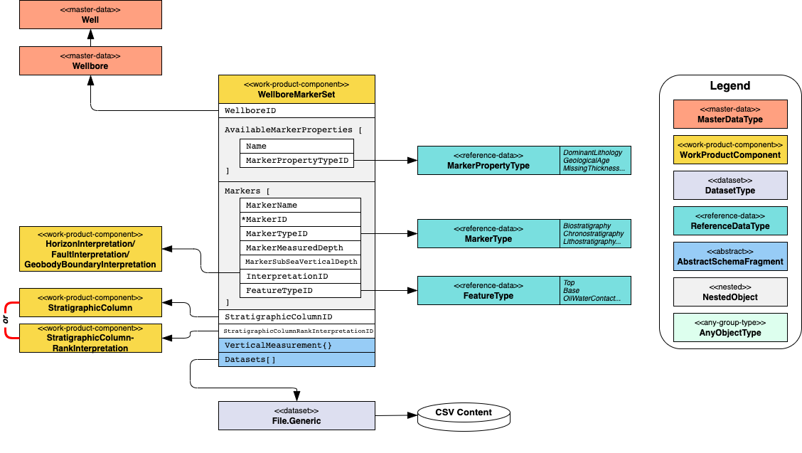
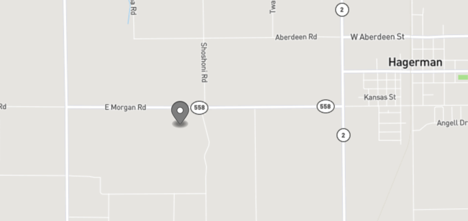
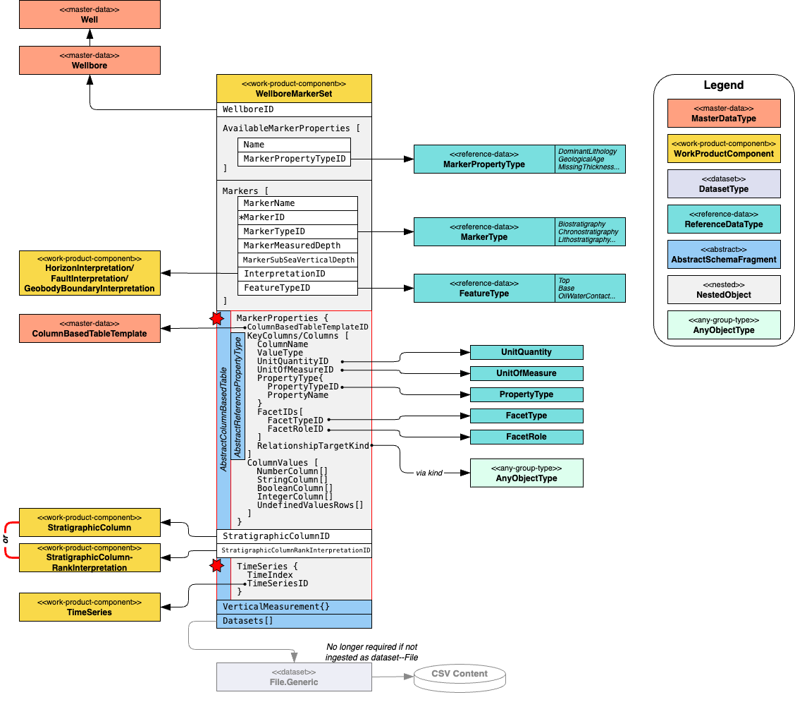

<a name="TOC"></a>

**Table of Contents**

[[_TOC_]]

# Usage of `work-product-component--WellboreMarkerSet`

## Overview, WellboreMarkerSet using Dataset



The starting point is a CSV file, which was used during the OSDU CSV template standardization:
[OSDU_WellboreMarkerSet_CSV_template_2021-Feb-19.xlsx](https://gitlab.opengroup.org/osdu/subcommittees/data-def/work-products/schema/-/wikis/uploads/1562efed22aa56faa743238faceb073f/OSDU_WellboreMarkerSet_CSV_template_2021-Feb-19.xlsx)
. The example sheet has been turned into a

* [CSV file](./dataset_and_wpc/MarkerSet-b8fd398a-5d74-45fa-8ecb-03b1ad927026.csv)

Assuming this CSV file is represented by a `dataset--File.Generic-CSV`. The schema does not exist, but it would look
very much like [`osdu:wks:dataset--File.Generic:1.0.0`](../../../E-R/dataset/File.Generic.1.1.0.md). The example record
referring to the file would look like

* `dataset--File.Generic.CSV` [MarkerSet](dataset_and_wpc/File.Generic.CSV.MarkerSet.raw.json)

<details>

<summary markdown="span"><code>dataset--File.Generic.CSV</code> MarkerSet</summary>

<OsduImportJSON>[`dataset--File.Generic.CSV` MarkerSet](dataset_and_wpc/File.Generic.CSV.MarkerSet.raw.json)</OsduImportJSON>

```json
{
  "id": "partition_id:dataset--File.Generic.CSV:4ed93e20-7f2e-4fb7-b265-1bf1e3bd5b36",
  "kind": "osdu:wks:dataset--File.Generic.CSV:1.0.0",
  "version": 1562066009929332,
  "acl": {
    "owners": [
      "someone@company.com"
    ],
    "viewers": [
      "someone@company.com"
    ]
  },
  "legal": {
    "legaltags": [
      "Example legaltags"
    ],
    "otherRelevantDataCountries": [
      "US"
    ],
    "status": "compliant"
  },
  "tags": {
    "NameOfKey": "String value"
  },
  "createTime": "2020-12-16T11:46:20.163Z",
  "createUser": "some-user@some-company-cloud.com",
  "modifyTime": "2020-12-16T11:52:24.477Z",
  "modifyUser": "some-user@some-company-cloud.com",
  "ancestry": {
    "parents": []
  },
  "meta": [],
  "data": {
    "Name": "Dataset WellboreMarkerSet raw",
    "TotalSize": "14742",
    "EncodingFormatTypeID": "partition_id:reference-data--EncodingFormatType:text%2Fcsv:",
    "DatasetProperties": {
      "FileSourceInfo": {
        "FileSource": "s3://default_bucket/r1/data/provided/documents/trajectories/MarkerSet-b8fd398a-5d74-45fa-8ecb-03b1ad927026.csv",
        "PreloadFilePath": "s3://staging-area/r7/raw-data/provided/documents/MarkerSet-b8fd398a-5d74-45fa-8ecb-03b1ad927026.csv",
        "PreloadFileCreateUser": "somebody@acme.org",
        "PreloadFileCreateDate": "2019-12-16T11:46:20.163Z",
        "PreloadFileModifyUser": "somebody.else@acme.org",
        "PreloadFileModifyDate": "2019-12-20T17:20:05.356Z",
        "Name": "8816.raw.csv",
        "FileSize": "10125"
      }
    },
    "ExtensionProperties": {}
  }
}
```

</details>

To make this dataset discoverable, it needs to be referred to by a

* `work-product-component--WellboreMarkerSet` [record](dataset_and_wpc/MarkerSet-d5303b79-7904-5bfe-9c44-9a3ff41b6d6c.json).
  This record follows the
  schema [WellboreMarkerSet](../../../E-R/work-product-component/WellboreMarkerSet.1.5.1.md) or higher.

<details>

<summary markdown="span"><code>work-product-component--WellboreMarkerSet</code> record</summary>

<OsduImportJSON>[`work-product-component--WellboreMarkerSet` record](dataset_and_wpc/MarkerSet-d5303b79-7904-5bfe-9c44-9a3ff41b6d6c.json)</OsduImportJSON>

```json
{
  "id": "partition-id:work-product-component--WellboreMarkerSet:d5303b79-7904-5bfe-9c44-9a3ff41b6d6c",
  "kind": "osdu:wks:work-product-component--WellboreMarkerSet:1.5.1",
  "version": 1562066009929332,
  "acl": {
    "owners": [
      "someone@company.com"
    ],
    "viewers": [
      "someone@company.com"
    ]
  },
  "legal": {
    "legaltags": [
      "Example legaltags"
    ],
    "otherRelevantDataCountries": [
      "US"
    ],
    "status": "compliant"
  },
  "tags": {
    "NameOfKey": "String value"
  },
  "meta": [
    {
      "kind": "Unit",
      "name": "ft[US]",
      "persistableReference": "{\"abcd\":{\"a\":0.0,\"b\":1200.0,\"c\":3937.0,\"d\":0.0},\"symbol\":\"ft[US]\",\"baseMeasurement\":{\"ancestry\":\"L\",\"type\":\"UM\"},\"type\":\"UAD\"}",
      "unitOfMeasureID": "partition-id:reference-data--UnitOfMeasure:ft%5BUS%5D:",
      "propertyNames": [
        "Markers[].MarkerMeasuredDepth",
        "Markers[].MarkerSubSeaVerticalDepth",
        "Markers[].PositiveVerticalDelta",
        "Markers[].NegativeVerticalDelta",
        "VerticalMeasurement.VerticalMeasurement"
      ]
    },
    {
      "kind": "Unit",
      "name": "dega",
      "persistableReference": "{\"abcd\":{\"a\":0.0,\"b\":3.141592653589793,\"c\":180.0,\"d\":0.0},\"symbol\":\"dega\",\"baseMeasurement\":{\"ancestry\":\"A\",\"type\":\"UM\"},\"type\":\"UAD\"}",
      "unitOfMeasureID": "partition-id:reference-data--UnitOfMeasure:dega:",
      "propertyNames": [
        "Markers[].SurfaceDipAngle",
        "Markers[].SurfaceDipAzimuth"
      ]
    }
  ],
  "data": {
    "Datasets": [
      "partition_id:dataset--File.Generic.CSV:4ed93e20-7f2e-4fb7-b265-1bf1e3bd5b36:"
    ],
    "IsExtendedLoad": false,
    "IsDiscoverable": true,
    "Name": "USA Stratigraphy",
    "Description": "Example Description",
    "CreationDateTime": "2020-02-13T09:13:15.55Z",
    "SpatialArea": {
      "SpatialLocationCoordinatesDate": "2020-02-13T09:13:15.55Z",
      "QuantitativeAccuracyBandID": "partition-id:reference-data--QuantitativeAccuracyBand:Length.LessThan1m:",
      "QualitativeSpatialAccuracyTypeID": "partition-id:reference-data--QualitativeSpatialAccuracyType:Confirmed:",
      "CoordinateQualityCheckPerformedBy": "Example CoordinateQualityCheckPerformedBy",
      "CoordinateQualityCheckDateTime": "2020-02-13T09:13:15.55Z",
      "CoordinateQualityCheckRemarks": [
        "Example CoordinateQualityCheckRemarks"
      ],
      "AsIngestedCoordinates": {
        "type": "AnyCrsFeatureCollection",
        "CoordinateReferenceSystemID": "partition-id:reference-data--CoordinateReferenceSystem:BoundProjected:EPSG::32012_EPSG::15851:",
        "VerticalCoordinateReferenceSystemID": "partition-id:reference-data--CoordinateReferenceSystem:Vertical:EPSG::5714:",
        "persistableReferenceCrs": "{\"authCode\":{\"auth\":\"OSDU\",\"code\":\"32012079\"},\"lateBoundCRS\":{\"authCode\":{\"auth\":\"EPSG\",\"code\":\"32012\"},\"name\":\"NAD_1927_StatePlane_New_Mexico_East_FIPS_3001\",\"type\":\"LBC\",\"ver\":\"PE_10_9_1\",\"wkt\":\"PROJCS[\\\"NAD_1927_StatePlane_New_Mexico_East_FIPS_3001\\\",GEOGCS[\\\"GCS_North_American_1927\\\",DATUM[\\\"D_North_American_1927\\\",SPHEROID[\\\"Clarke_1866\\\",6378206.4,294.9786982]],PRIMEM[\\\"Greenwich\\\",0.0],UNIT[\\\"Degree\\\",0.0174532925199433]],PROJECTION[\\\"Transverse_Mercator\\\"],PARAMETER[\\\"False_Easting\\\",500000.0],PARAMETER[\\\"False_Northing\\\",0.0],PARAMETER[\\\"Central_Meridian\\\",-104.333333333333],PARAMETER[\\\"Scale_Factor\\\",0.999909090909091],PARAMETER[\\\"Latitude_Of_Origin\\\",31.0],UNIT[\\\"Foot_US\\\",0.304800609601219],AUTHORITY[\\\"EPSG\\\",32012]]\"},\"name\":\"NAD27 * OGP-Usa Conus / New Mexico CS27 East zone [32012,15851]\",\"singleCT\":{\"authCode\":{\"auth\":\"EPSG\",\"code\":\"15851\"},\"name\":\"NAD_1927_To_WGS_1984_79_CONUS\",\"type\":\"ST\",\"ver\":\"PE_10_9_1\",\"wkt\":\"GEOGTRAN[\\\"NAD_1927_To_WGS_1984_79_CONUS\\\",GEOGCS[\\\"GCS_North_American_1927\\\",DATUM[\\\"D_North_American_1927\\\",SPHEROID[\\\"Clarke_1866\\\",6378206.4,294.9786982]],PRIMEM[\\\"Greenwich\\\",0.0],UNIT[\\\"Degree\\\",0.0174532925199433]],GEOGCS[\\\"GCS_WGS_1984\\\",DATUM[\\\"D_WGS_1984\\\",SPHEROID[\\\"WGS_1984\\\",6378137.0,298.257223563]],PRIMEM[\\\"Greenwich\\\",0.0],UNIT[\\\"Degree\\\",0.0174532925199433]],METHOD[\\\"NADCON\\\"],PARAMETER[\\\"Dataset_conus\\\",0.0],AUTHORITY[\\\"EPSG\\\",15851]]\"},\"type\":\"EBC\",\"ver\":\"PE_10_9_1\"}",
        "persistableReferenceVerticalCrs": "{\"authCode\":{\"auth\":\"EPSG\",\"code\":\"5714\"},\"name\":\"MSL_Height\",\"type\":\"LBC\",\"ver\":\"PE_10_9_1\",\"wkt\":\"VERTCS[\\\"MSL_Height\\\",VDATUM[\\\"Mean_Sea_Level\\\"],PARAMETER[\\\"Vertical_Shift\\\",0.0],PARAMETER[\\\"Direction\\\",1.0],UNIT[\\\"Meter\\\",1.0],AUTHORITY[\\\"EPSG\\\",5714]]\"}",
        "persistableReferenceUnitZ": "{\"abcd\":{\"a\":0.0,\"b\":1200.0,\"c\":3937.0,\"d\":0.0},\"symbol\":\"ft[US]\",\"baseMeasurement\":{\"ancestry\":\"L\",\"type\":\"UM\"},\"type\":\"UAD\"}",
        "features": [
          {
            "type": "AnyCrsFeature",
            "properties": {},
            "geometry": {
              "type": "AnyCrsMultiPoint",
              "coordinates": [
                [
                  493056.7,
                  493055.811,
                  -9800
                ],
                [
                  766937.22,
                  766939.557,
                  -10000
                ]
              ]
            }
          }
        ],
        "bbox": [
          493055.811,
          766937.22,
          -10000.0,
          493056.7,
          766939.557,
          -9800.0
        ]
      },
      "Wgs84Coordinates": {
        "features": [
          {
            "geometry": {
              "coordinates": [
                [
                  -104.35652742826903,
                  33.10846882734614,
                  -2987.045974091948
                ],
                [
                  -104.35653033329845,
                  33.10847525015146,
                  -3048.006096012192
                ]
              ],
              "type": "MultiPoint",
              "bbox": [
                -104.35653033329845,
                33.10846882734614,
                -3048.006096012192,
                -104.35652742826903,
                33.10847525015146,
                -2987.045974091948
              ]
            },
            "properties": {},
            "type": "Feature",
            "bbox": [
              -104.35653033329845,
              33.10846882734614,
              -3048.006096012192,
              -104.35652742826903,
              33.10847525015146,
              -2987.045974091948
            ]
          }
        ],
        "properties": {},
        "type": "FeatureCollection",
        "bbox": [
          -104.35653033329845,
          33.10846882734614,
          -3048.006096012192,
          -104.35652742826903,
          33.10847525015146,
          -2987.045974091948
        ]
      },
      "AppliedOperations": [
        "conversion from NAD_1927_StatePlane_New_Mexico_East_FIPS_3001 to GCS_North_American_1927; 2 points converted",
        "transformation GCS_North_American_1927 to GCS_WGS_1984 using NAD_1927_To_WGS_1984_79_CONUS; 2 points successfully transformed",
        "Z-axis unit conversion from ft[US] to m"
      ],
      "SpatialParameterTypeID": "partition-id:reference-data--SpatialParameterType:Outline:",
      "SpatialGeometryTypeID": "partition-id:reference-data--SpatialGeometryType:Point:"
    },
    "GeoContexts": [
      {
        "BasinID": "partition-id:master-data--Basin:SomeUniqueBasinID:",
        "GeoTypeID": "partition-id:reference-data--BasinType:ArcWrenchOceanContinent:"
      }
    ],
    "SubmitterName": "Example SubmitterName",
    "WellboreID": "partition-id:master-data--Wellbore:300251234500:",
    "VerticalMeasurement": {
      "VerticalMeasurement": 200.0,
      "VerticalMeasurementTypeID": "partition_id:reference-data--VerticalMeasurementType:KellyBushing:",
      "VerticalMeasurementPathID": "partition_id:reference-data--VerticalMeasurementPath:TrueVerticalHeight:",
      "VerticalMeasurementUnitOfMeasureID": "partition_id:reference-data--UnitOfMeasure:ft%5BUS%5D:",
      "VerticalCRSID": "partition_id:reference-data--CoordinateReferenceSystem:Vertical:EPSG::5714:",
      "VerticalReferenceID": "KB Feb 2020 New Drill"
    },
    "AvailableMarkerProperties": [
      {
        "MarkerPropertyTypeID": "partition-id:reference-data--MarkerPropertyType:WellboreID:",
        "Name": "WellboreID"
      },
      {
        "MarkerPropertyTypeID": "partition-id:reference-data--MarkerPropertyType:MarkerNameSet:",
        "Name": "MarkerNameSet"
      },
      {
        "MarkerPropertyTypeID": "partition-id:reference-data--MarkerPropertyType:MarkerNameSetType:",
        "Name": "MarkerNameSetType"
      },
      {
        "MarkerPropertyTypeID": "partition-id:reference-data--MarkerPropertyType:MarkerAbbreviation:",
        "Name": "MarkerAbbreviation"
      },
      {
        "MarkerPropertyTypeID": "partition-id:reference-data--MarkerPropertyType:MarkerShortName:",
        "Name": "MarkerShortName"
      },
      {
        "MarkerPropertyTypeID": "partition-id:reference-data--MarkerPropertyType:MarkerName:",
        "Name": "MarkerName"
      },
      {
        "MarkerPropertyTypeID": "partition-id:reference-data--MarkerPropertyType:FeatureType:",
        "Name": "FeatureType"
      },
      {
        "MarkerPropertyTypeID": "partition-id:reference-data--MarkerPropertyType:FeatureName:",
        "Name": "FeatureName"
      },
      {
        "MarkerPropertyTypeID": "partition-id:reference-data--MarkerPropertyType:MarkerStratUnitRemark:",
        "Name": "MarkerStratUnitRemark"
      },
      {
        "MarkerPropertyTypeID": "partition-id:reference-data--MarkerPropertyType:GeologicalAge:",
        "Name": "GeologicalAge"
      },
      {
        "MarkerPropertyTypeID": "partition-id:reference-data--MarkerPropertyType:MarkerTypeID:",
        "Name": "MarkerTypeID"
      },
      {
        "MarkerPropertyTypeID": "partition-id:reference-data--MarkerPropertyType:OrdinalSequenceNumber:",
        "Name": "OrdinalSequenceNumber"
      },
      {
        "MarkerPropertyTypeID": "partition-id:reference-data--MarkerPropertyType:MarkerActiveIndicator:",
        "Name": "MarkerActiveIndicator"
      },
      {
        "MarkerPropertyTypeID": "partition-id:reference-data--MarkerPropertyType:CertifiedIndicator:",
        "Name": "CertifiedIndicator"
      },
      {
        "MarkerPropertyTypeID": "partition-id:reference-data--MarkerPropertyType:SurfaceDipAngle:",
        "MarkerPropertyUnitID": "partition-id:reference-data--UnitOfMeasure:dega:",
        "Name": "SurfaceDipAngle"
      },
      {
        "MarkerPropertyTypeID": "partition-id:reference-data--MarkerPropertyType:SurfaceDipAngleUOM:",
        "Name": "SurfaceDipAngleUOM"
      },
      {
        "MarkerPropertyTypeID": "partition-id:reference-data--MarkerPropertyType:SurfaceDipAngleOUOM:",
        "Name": "SurfaceDipAngleOUOM"
      },
      {
        "MarkerPropertyTypeID": "partition-id:reference-data--MarkerPropertyType:SurfaceDipAzimuth:",
        "MarkerPropertyUnitID": "partition-id:reference-data--UnitOfMeasure:dega:",
        "Name": "SurfaceDipAzimuth"
      },
      {
        "MarkerPropertyTypeID": "partition-id:reference-data--MarkerPropertyType:SurfaceDipAzimuthUOM:",
        "Name": "SurfaceDipAzimuthUOM"
      },
      {
        "MarkerPropertyTypeID": "partition-id:reference-data--MarkerPropertyType:SurfaceDipAzimuthOUOM:",
        "Name": "SurfaceDipAzimuthOUOM"
      },
      {
        "MarkerPropertyTypeID": "partition-id:reference-data--MarkerPropertyType:AzimuthNorthType:",
        "Name": "AzimuthNorthType"
      },
      {
        "MarkerPropertyTypeID": "partition-id:reference-data--MarkerPropertyType:AzimuthHorizontalCRS:",
        "Name": "AzimuthHorizontalCRS"
      },
      {
        "MarkerPropertyTypeID": "partition-id:reference-data--MarkerPropertyType:DominantLithology:",
        "Name": "DominantLithology"
      },
      {
        "MarkerPropertyTypeID": "partition-id:reference-data--MarkerPropertyType:MarkerInterpreter:",
        "Name": "MarkerInterpreter"
      },
      {
        "MarkerPropertyTypeID": "partition-id:reference-data--MarkerPropertyType:OverturnedIndicator:",
        "Name": "OverturnedIndicator"
      },
      {
        "MarkerPropertyTypeID": "partition-id:reference-data--MarkerPropertyType:MarkerDate:",
        "Name": "MarkerDate"
      },
      {
        "MarkerPropertyTypeID": "partition-id:reference-data--MarkerPropertyType:MarkerMeasuredDepth:",
        "MarkerPropertyUnitID": "partition-id:reference-data--UnitOfMeasure:ft%5BUS%5D:",
        "Name": "MarkerMeasuredDepth"
      },
      {
        "MarkerPropertyTypeID": "partition-id:reference-data--MarkerPropertyType:MarkerMeasuredDepthUOM:",
        "Name": "MarkerMeasuredDepthUOM"
      },
      {
        "MarkerPropertyTypeID": "partition-id:reference-data--MarkerPropertyType:MarkerMeasuredDepthOUOM:",
        "Name": "MarkerMeasuredDepthOUOM"
      },
      {
        "MarkerPropertyTypeID": "partition-id:reference-data--MarkerPropertyType:MarkerTVD:",
        "MarkerPropertyUnitID": "partition-id:reference-data--UnitOfMeasure:ft%5BUS%5D:",
        "Name": "MarkerTVD"
      },
      {
        "MarkerPropertyTypeID": "partition-id:reference-data--MarkerPropertyType:MarkerTVDUOM:",
        "Name": "MarkerTVDUOM"
      },
      {
        "MarkerPropertyTypeID": "partition-id:reference-data--MarkerPropertyType:MarkerTVDOUOM:",
        "Name": "MarkerTVDOUOM"
      },
      {
        "MarkerPropertyTypeID": "partition-id:reference-data--MarkerPropertyType:Quality:",
        "Name": "Quality"
      },
      {
        "MarkerPropertyTypeID": "partition-id:reference-data--MarkerPropertyType:MarkerPickRemark:",
        "Name": "MarkerPickRemark"
      },
      {
        "MarkerPropertyTypeID": "partition-id:reference-data--MarkerPropertyType:RepeatMarkerIndicator:",
        "Name": "RepeatMarkerIndicator"
      },
      {
        "MarkerPropertyTypeID": "partition-id:reference-data--MarkerPropertyType:Source:",
        "Name": "Source"
      },
      {
        "MarkerPropertyTypeID": "partition-id:reference-data--MarkerPropertyType:MarkerInterpretationMethod:",
        "Name": "MarkerInterpretationMethod"
      },
      {
        "MarkerPropertyTypeID": "partition-id:reference-data--MarkerPropertyType:MarkersObservationNumber:",
        "Name": "MarkersObservationNumber"
      },
      {
        "MarkerPropertyTypeID": "partition-id:reference-data--MarkerPropertyType:ExistenceKind:",
        "Name": "ExistenceKind"
      },
      {
        "MarkerPropertyTypeID": "partition-id:reference-data--MarkerPropertyType:PositiveVerticalDelta:",
        "MarkerPropertyUnitID": "partition-id:reference-data--UnitOfMeasure:ft%5BUS%5D:",
        "Name": "PositiveVerticalDelta"
      },
      {
        "MarkerPropertyTypeID": "partition-id:reference-data--MarkerPropertyType:PositiveVerticalDeltaUOM:",
        "Name": "PositiveVerticalDeltaUOM"
      },
      {
        "MarkerPropertyTypeID": "partition-id:reference-data--MarkerPropertyType:PositiveVerticalDeltaOUOM:",
        "Name": "PositiveVerticalDeltaOUOM"
      },
      {
        "MarkerPropertyTypeID": "partition-id:reference-data--MarkerPropertyType:NegativeVerticalDelta:",
        "MarkerPropertyUnitID": "partition-id:reference-data--UnitOfMeasure:ft%5BUS%5D:",
        "Name": "NegativeVerticalDelta"
      },
      {
        "MarkerPropertyTypeID": "partition-id:reference-data--MarkerPropertyType:NegativeVerticalDeltaUOM:",
        "Name": "NegativeVerticalDeltaUOM"
      },
      {
        "MarkerPropertyTypeID": "partition-id:reference-data--MarkerPropertyType:NegativeVerticalDeltaOUOM:",
        "Name": "NegativeVerticalDeltaOUOM"
      },
      {
        "MarkerPropertyTypeID": "partition-id:reference-data--MarkerPropertyType:VerticalMeasurementPath:",
        "Name": "VerticalMeasurementPath"
      },
      {
        "MarkerPropertyTypeID": "partition-id:reference-data--MarkerPropertyType:VerticalMeasurementType:",
        "Name": "VerticalMeasurementType"
      },
      {
        "MarkerPropertyTypeID": "partition-id:reference-data--MarkerPropertyType:VerticalCRS:",
        "Name": "VerticalCRS"
      },
      {
        "MarkerPropertyTypeID": "partition-id:reference-data--MarkerPropertyType:WellboreVerticalMeasurementID:",
        "Name": "WellboreVerticalMeasurementID"
      },
      {
        "MarkerPropertyTypeID": "partition-id:reference-data--MarkerPropertyType:MarkerX:",
        "MarkerPropertyUnitID": "partition-id:reference-data--UnitOfMeasure:ft%5BUS%5D:",
        "Name": "MarkerX"
      },
      {
        "MarkerPropertyTypeID": "partition-id:reference-data--MarkerPropertyType:MarkerY:",
        "MarkerPropertyUnitID": "partition-id:reference-data--UnitOfMeasure:ft%5BUS%5D:",
        "Name": "MarkerY"
      },
      {
        "MarkerPropertyTypeID": "partition-id:reference-data--MarkerPropertyType:MarkerXYCRS:",
        "Name": "MarkerXYCRS"
      },
      {
        "MarkerPropertyTypeID": "partition-id:reference-data--MarkerPropertyType:WPCName:",
        "Name": "WPCName"
      },
      {
        "MarkerPropertyTypeID": "partition-id:reference-data--MarkerPropertyType:WPCDescription:",
        "Name": "WPCDescription"
      },
      {
        "MarkerPropertyTypeID": "partition-id:reference-data--MarkerPropertyType:WPCOriginalCreationDateTime:",
        "Name": "WPCOriginalCreationDateTime"
      }
    ],
    "Markers": [
      {
        "MarkerID": "4bbfe8fd-fcab-53ec-8e0a-0ae68bf64949",
        "MarkerName": "TopBoneSpring",
        "MarkerMeasuredDepth": 10220.0,
        "MarkerSubSeaVerticalDepth": 9800.0,
        "MarkerDate": "2020-Feb-2",
        "MarkerObservationNumber": 1,
        "MarkerInterpreter": "Jane_Smith",
        "MarkerTypeID": "partition-id:reference-data--MarkerType:Lithostratigraphy:",
        "FeatureTypeID": "partition-id:reference-data--FeatureType:Top:",
        "FeatureName": "Bone Spring",
        "PositiveVerticalDelta": 5.2,
        "NegativeVerticalDelta": 4,
        "SurfaceDipAngle": 3.0,
        "SurfaceDipAzimuth": 170.0,
        "GeologicalAge": "Leonardian"
      },
      {
        "MarkerID": "ae684765-65ba-509e-ac57-65ab84b5315e",
        "MarkerName": "TopWolfcamp",
        "MarkerMeasuredDepth": 10430.0,
        "MarkerSubSeaVerticalDepth": 10000,
        "MarkerDate": "2020-Feb-2",
        "MarkerObservationNumber": 2,
        "MarkerInterpreter": "Jane_Smith",
        "MarkerTypeID": "partition-id:reference-data--MarkerType:Lithostratigraphy:",
        "FeatureTypeID": "partition-id:reference-data--FeatureType:Top:",
        "FeatureName": "Wolfcamp",
        "PositiveVerticalDelta": 7,
        "NegativeVerticalDelta": 10.1,
        "SurfaceDipAngle": 0.0,
        "GeologicalAge": "Wolfcampian"
      }
    ],
    "ExtensionProperties": {
      "some": []
    }
  }
}
```

</details>

---

[Back to TOC](#TOC)

## Wellbore Context

Due to the laziness of the author the `master-data--Wellbore` record is omitted, however, for completeness the record is
assumed to have the following id and data properties
(all others are omitted):

```json
{
  "id": "partition_id:master-data--Wellbore:300251234500",
  "data": {
    "VerticalMeasurements": [
      {
        "VerticalMeasurementID": "KB Feb 2020 New Drill",
        "VerticalMeasurement": 200.0,
        "VerticalMeasurementTypeID": "partition_id:reference-data--VerticalMeasurementType:KB:",
        "VerticalMeasurementPathID": "partition_id:reference-data--VerticalMeasurementPath:TrueVerticalHeight:",
        "VerticalMeasurementUnitOfMeasureID": "partition_id:reference-data--UnitOfMeasure:ft%5BUS%5D:",
        "VerticalCRSID": "partition_id:reference-data--CoordinateReferenceSystem:Vertical::EPSG::5714:"
      }
    ]
  }
}
```

---

[Back to TOC](#TOC)

## Vertical References

The CSV column referenced
by `"MarkerPropertyTypeID": "partition-id:reference-data--MarkerPropertyType:WellboreVerticalMeasurementID:"`
identifies the ID of the parent Wellbore's vertical measurement. In the example, this is the record
with `"VerticalMeasurementID": "KB Feb 2020 New Drill"`. This one determines the zero point for the MD and TVD
measurements in the CSV file.

For convenience, it is replicated in the `WellboreMarkerSet` record.

The CSV has also projected coordinates. In this example MultiPoint geometry is created under `data.SpatialPoint`, both
in AsIngestedCoordinates and in normalized Wgs84Coordinates.
The [convertGeoJson request](./geomatics/convert_multi_point_request.json) and
[response](./geomatics/convert_multi_point_response.json) are added as examples on how to produce the required
structures. The map location appears to be here:

<details>

<summary markdown="span">See convertGeoJson request</summary>

<OsduImportJSON>[convertGeoJson request](./geomatics/convert_multi_point_request.json)</OsduImportJSON>

```json
{
  "toCRS": "{\"authCode\":{\"auth\":\"EPSG\",\"code\":\"4326\"},\"name\":\"GCS_WGS_1984\",\"type\":\"LBC\",\"ver\":\"PE_10_9_1\",\"wkt\":\"GEOGCS[\\\"GCS_WGS_1984\\\",DATUM[\\\"D_WGS_1984\\\",SPHEROID[\\\"WGS_1984\\\",6378137.0,298.257223563]],PRIMEM[\\\"Greenwich\\\",0.0],UNIT[\\\"Degree\\\",0.0174532925199433],AUTHORITY[\\\"EPSG\\\",4326]]\"}",
  "featureCollection": {
    "type": "AnyCrsFeatureCollection",
    "persistableReferenceCrs": "{\"authCode\":{\"auth\":\"OSDU\",\"code\":\"32012079\"},\"lateBoundCRS\":{\"authCode\":{\"auth\":\"EPSG\",\"code\":\"32012\"},\"name\":\"NAD_1927_StatePlane_New_Mexico_East_FIPS_3001\",\"type\":\"LBC\",\"ver\":\"PE_10_9_1\",\"wkt\":\"PROJCS[\\\"NAD_1927_StatePlane_New_Mexico_East_FIPS_3001\\\",GEOGCS[\\\"GCS_North_American_1927\\\",DATUM[\\\"D_North_American_1927\\\",SPHEROID[\\\"Clarke_1866\\\",6378206.4,294.9786982]],PRIMEM[\\\"Greenwich\\\",0.0],UNIT[\\\"Degree\\\",0.0174532925199433]],PROJECTION[\\\"Transverse_Mercator\\\"],PARAMETER[\\\"False_Easting\\\",500000.0],PARAMETER[\\\"False_Northing\\\",0.0],PARAMETER[\\\"Central_Meridian\\\",-104.333333333333],PARAMETER[\\\"Scale_Factor\\\",0.999909090909091],PARAMETER[\\\"Latitude_Of_Origin\\\",31.0],UNIT[\\\"Foot_US\\\",0.304800609601219],AUTHORITY[\\\"EPSG\\\",32012]]\"},\"name\":\"NAD27 * OGP-Usa Conus / New Mexico CS27 East zone [32012,15851]\",\"singleCT\":{\"authCode\":{\"auth\":\"EPSG\",\"code\":\"15851\"},\"name\":\"NAD_1927_To_WGS_1984_79_CONUS\",\"type\":\"ST\",\"ver\":\"PE_10_9_1\",\"wkt\":\"GEOGTRAN[\\\"NAD_1927_To_WGS_1984_79_CONUS\\\",GEOGCS[\\\"GCS_North_American_1927\\\",DATUM[\\\"D_North_American_1927\\\",SPHEROID[\\\"Clarke_1866\\\",6378206.4,294.9786982]],PRIMEM[\\\"Greenwich\\\",0.0],UNIT[\\\"Degree\\\",0.0174532925199433]],GEOGCS[\\\"GCS_WGS_1984\\\",DATUM[\\\"D_WGS_1984\\\",SPHEROID[\\\"WGS_1984\\\",6378137.0,298.257223563]],PRIMEM[\\\"Greenwich\\\",0.0],UNIT[\\\"Degree\\\",0.0174532925199433]],METHOD[\\\"NADCON\\\"],PARAMETER[\\\"Dataset_conus\\\",0.0],AUTHORITY[\\\"EPSG\\\",15851]]\"},\"type\":\"EBC\",\"ver\":\"PE_10_9_1\"}",
    "persistableReferenceUnitZ": "{\"abcd\":{\"a\":0.0,\"b\":1200.0,\"c\":3937.0,\"d\":0.0},\"symbol\":\"ft[US]\",\"baseMeasurement\":{\"ancestry\":\"L\",\"type\":\"UM\"},\"type\":\"UAD\"}",
    "features": [
      {
        "type": "AnyCrsFeature",
        "properties": {},
        "geometry": {
          "type": "AnyCrsMultiPoint",
          "coordinates": [
            [
              493056.7,
              766937.22,
              -9800
            ],
            [
              493055.811,
              766939.557,
              -10000
            ]
          ]
        }
      }
    ],
    "bbox": [
      493055.811,
      766937.22,
      -10000.0,
      493056.7,
      766939.557,
      -9800.0
    ]
  }
}
```

</details>

<details>

<summary markdown="span">See response</summary>

<OsduImportJSON>[response](./geomatics/convert_multi_point_response.json)</OsduImportJSON>

```json
{
  "successCount": 2,
  "totalCount": 2,
  "featureCollection": {
    "features": [
      {
        "geometry": {
          "coordinates": [
            [
              -104.35652742826903,
              33.10846882734614,
              -2987.045974091948
            ],
            [
              -104.35653033329845,
              33.10847525015146,
              -3048.006096012192
            ]
          ],
          "type": "MultiPoint",
          "bbox": [
            -104.35653033329845,
            33.10846882734614,
            -3048.006096012192,
            -104.35652742826903,
            33.10847525015146,
            -2987.045974091948
          ]
        },
        "properties": {},
        "type": "Feature",
        "bbox": [
          -104.35653033329845,
          33.10846882734614,
          -3048.006096012192,
          -104.35652742826903,
          33.10847525015146,
          -2987.045974091948
        ]
      }
    ],
    "properties": null,
    "persistableReferenceCrs": null,
    "persistableReferenceUnitZ": "{\"scaleOffset\":{\"scale\":1.0,\"offset\":0.0},\"symbol\":\"m\",\"baseMeasurement\":{\"ancestry\":\"Length\",\"type\":\"UM\"},\"type\":\"USO\"}",
    "type": "FeatureCollection",
    "bbox": [
      -104.35653033329845,
      33.10846882734614,
      -3048.006096012192,
      -104.35652742826903,
      33.10847525015146,
      -2987.045974091948
    ]
  },
  "operationsApplied": [
    "conversion from NAD_1927_StatePlane_New_Mexico_East_FIPS_3001 to GCS_North_American_1927; 2 points converted",
    "transformation GCS_North_American_1927 to GCS_WGS_1984 using NAD_1927_To_WGS_1984_79_CONUS; 2 points successfully transformed",
    "Z-axis unit conversion from ft[US] to m"
  ]
}
```

</details>



---

[Back to TOC](#TOC)

## Overview WellboreMarkerSet with Embedded Properties



Starting
with [M24.2](../../../Guides/MigrationGuides/M24.2), [WellboreMarkerSet](../../../E-R/work-product-component/WellboreMarkerSet.1.5.0.md)
has been extended to match the capabilities
of [WellboreIntervalSet](../../../E-R/work-product-component/WellboreIntervalSet.1.3.1.md), which supports an embedded
column based table for `data.MarkerProperties`. In the diagram above the newly added elements are marked with a red star. Both elements are implemented as schema fragments, i.e., [AbstractColumnBasedTable](../../../E-R/abstract/AbstractColumnBasedTable.1.2.0.md) and [AbstractTimeSeriesLink](../../../E-R/abstract/AbstractTimeSeriesLink.1.0.0.md).

### Important Usage Rule for `MarkerID`

* `data.MarkerProperties.KeyColumns` are expected to contain one key column of type string.
* `data.MarkerProperties.ColumnValues[0].StringColumn[]` contain the `data.Markers[].MarkerID` to enable the
  association of Markers and MarkerProperties array members.

### KeyColumns/Columns/ColumnValues Examples

Following the example [above](#overview-wellboremarkerset-using-dataset), some selected columns are transferred from the dataset to the `data.MarkerProperties`.
We use the following column metadata (demonstrating the different value types):

* `data.MarkerProperties.KeyColumns[]`
  * MarkerID
* `data.MarkerProperties.Columns[]`
  * TrueVerticalDepth (numeric property with unit context and facets in use)
  * IsOverturned (boolean property example)
  * Quality (string property referring to reference-data values)
  * MarkerPickRemark (string property, free text)

---

[Back to TOC](#TOC)

### MarkerID KeyColumn

<details>

<summary markdown="span">MarkerID KeyColumns metadata</summary>

<OsduImportJSON>[Full WellboreMarkerSet record](./dataset_and_wpc/MarkerSet-MarkerProperties-d5303b79-7904-5bfe-9c44-9a3ff41b6d6c.json#only.data.MarkerProperties.KeyColumns[0])</OsduImportJSON>

```json
{
  "data": {
    "MarkerProperties": {
      "KeyColumns": [
        {
          "ValueType": "string",
          "ValueCount": 1,
          "ColumnName": "MarkerID"
        }
      ]
    }
  }
}
```

</details>
<details>

<summary markdown="span">MarkerID KeyColumns values</summary>

<OsduImportJSON>[Full WellboreMarkerSet record](./dataset_and_wpc/MarkerSet-MarkerProperties-d5303b79-7904-5bfe-9c44-9a3ff41b6d6c.json#only.data.MarkerProperties.ColumnValues[0])</OsduImportJSON>

```json
{
  "data": {
    "MarkerProperties": {
      "ColumnValues": [
        {
          "StringColumn": [
            "4bbfe8fd-fcab-53ec-8e0a-0ae68bf64949",
            "ae684765-65ba-509e-ac57-65ab84b5315e"
          ],
          "UndefinedValueRows": []
        }
      ]
    }
  }
}
```

</details>

### TrueVerticalDepth Column

Example demonstrating a numeric property with unit context and facets.

<details>

<summary markdown="span">TrueVerticalDepth Columns metadata</summary>

<OsduImportJSON>[Full WellboreMarkerSet record](./dataset_and_wpc/MarkerSet-MarkerProperties-d5303b79-7904-5bfe-9c44-9a3ff41b6d6c.json#only.data.MarkerProperties.Columns[0])</OsduImportJSON>

```json
{
  "data": {
    "MarkerProperties": {
      "Columns": [
        {
          "ValueType": "number",
          "ValueCount": 1,
          "UnitOfMeasureID": "partition-id:reference-data--UnitOfMeasure:ft%5BUS%5D:",
          "UnitQuantityID": "partition-id:reference-data--UnitQuantity:length:",
          "PropertyType": {
            "PropertyTypeID": "partition-id:reference-data--PropertyType:4364b378-899a-403a-8401-b06abd4fc0cf:",
            "Name": "depth"
          },
          "FacetIDs": [
            {
              "FacetTypeID": "partition-id:reference-data--FacetType:direction:",
              "FacetRoleID": "partition-id:reference-data--FacetRole:TrueVertical:"
            }
          ],
          "ColumnName": "TrueVerticalDepth"
        }
      ]
    }
  }
}
```

</details>
<details>

<summary markdown="span">TrueVerticalDepth Columns values</summary>

<OsduImportJSON>[Full WellboreMarkerSet record](./dataset_and_wpc/MarkerSet-MarkerProperties-d5303b79-7904-5bfe-9c44-9a3ff41b6d6c.json#only.data.MarkerProperties.ColumnValues[1])</OsduImportJSON>

```json
{
  "data": {
    "MarkerProperties": {
      "ColumnValues": [
        {
          "NumberColumn": [
            10000.0,
            10200.0
          ],
          "UndefinedValueRows": []
        }
      ]
    }
  }
}
```

</details>

### IsOverturned Column

Example demonstrating a boolean property.

<details>

<summary markdown="span">IsOverturned Columns metadata</summary>

<OsduImportJSON>[Full WellboreMarkerSet record](./dataset_and_wpc/MarkerSet-MarkerProperties-d5303b79-7904-5bfe-9c44-9a3ff41b6d6c.json#only.data.MarkerProperties.Columns[1])</OsduImportJSON>

```json
{
  "data": {
    "MarkerProperties": {
      "Columns": [
        {
          "ValueType": "boolean",
          "ValueCount": 1,
          "ColumnName": "IsOverturned"
        }
      ]
    }
  }
}
```

</details>
<details>

<summary markdown="span">IsOverturned Columns values</summary>

<OsduImportJSON>[Full WellboreMarkerSet record](./dataset_and_wpc/MarkerSet-MarkerProperties-d5303b79-7904-5bfe-9c44-9a3ff41b6d6c.json#only.data.MarkerProperties.ColumnValues[2])</OsduImportJSON>

```json
{
  "data": {
    "MarkerProperties": {
      "ColumnValues": [
        {
          "BooleanColumn": [
            false,
            false
          ],
          "UndefinedValueRows": []
        }
      ]
    }
  }
}
```

</details>

### Quality Column

Example demonstrating a string property referring to reference-data values.

<details>

<summary markdown="span">Quality Columns metadata</summary>

<OsduImportJSON>[Full WellboreMarkerSet record](./dataset_and_wpc/MarkerSet-MarkerProperties-d5303b79-7904-5bfe-9c44-9a3ff41b6d6c.json#only.data.MarkerProperties.Columns[2])</OsduImportJSON>

```json
{
  "data": {
    "MarkerProperties": {
      "Columns": [
        {
          "ValueType": "string",
          "ValueCount": 1,
          "RelationshipTargetKind": "osdu:wks:reference-data--SubjectiveClassificationRating:",
          "ColumnName": "Quality"
        }
      ]
    }
  }
}
```

</details>
<details>

<summary markdown="span">Quality Columns values</summary>

<OsduImportJSON>[Full WellboreMarkerSet record](./dataset_and_wpc/MarkerSet-MarkerProperties-d5303b79-7904-5bfe-9c44-9a3ff41b6d6c.json#only.data.MarkerProperties.ColumnValues[3])</OsduImportJSON>

```json
{
  "data": {
    "MarkerProperties": {
      "ColumnValues": [
        {
          "StringColumn": [
            "partition-id:reference-data--SubjectiveClassificationRating:Quality.Good:",
            "partition-id:reference-data--SubjectiveClassificationRating:Quality.Good:"
          ],
          "UndefinedValueRows": []
        }
      ]
    }
  }
}
```

</details>

### MarkerPickRemark Column

Example demonstrating a free text string property.

<details>

<summary markdown="span">MarkerPickRemark Columns metadata</summary>

<OsduImportJSON>[Full WellboreMarkerSet record](./dataset_and_wpc/MarkerSet-MarkerProperties-d5303b79-7904-5bfe-9c44-9a3ff41b6d6c.json#only.data.MarkerProperties.Columns[3])</OsduImportJSON>

```json
{
  "data": {
    "MarkerProperties": {
      "Columns": [
        {
          "ValueType": "string",
          "ValueCount": 1,
          "ColumnName": "MarkerPickRemark"
        }
      ]
    }
  }
}
```

</details>
<details>

<summary markdown="span">MarkerPickRemark Columns values</summary>

<OsduImportJSON>[Full WellboreMarkerSet record](./dataset_and_wpc/MarkerSet-MarkerProperties-d5303b79-7904-5bfe-9c44-9a3ff41b6d6c.json#only.data.MarkerProperties.ColumnValues[4])</OsduImportJSON>

```json
{
  "data": {
    "MarkerProperties": {
      "ColumnValues": [
        {
          "StringColumn": [
            "Took into account custom petrophysical analyses",
            "Took into account custom petrophysical analyses"
          ],
          "UndefinedValueRows": []
        }
      ]
    }
  }
}
```

</details>

---

[Back to TOC](#TOC)