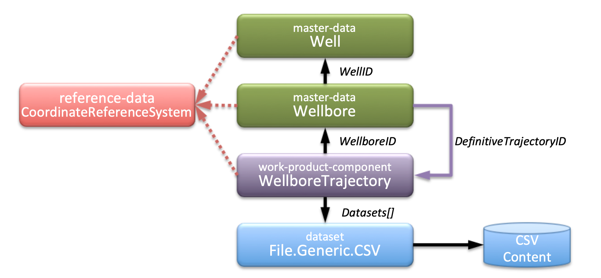
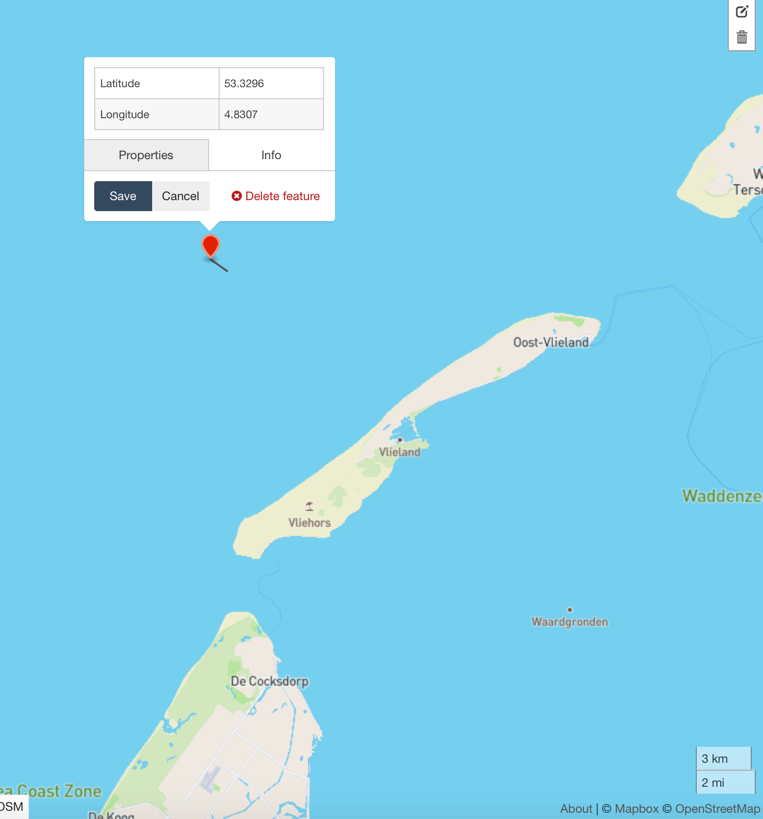

<a name="TOC"><b>Table of Contents</b></a>

[[_TOC_]]

# Trajectory Usage

This usage guide describes a typical enrichment from raw and sometimes incomplete data to a wellbore trajectory
consumable by downstream, high level apps.

## `work-product-component--WellboreTrajectory:1.*`

## Context, Data Source

The example data sets are inspired by a TNO trajectory manifest content taken from
[here](https://community.opengroup.org/osdu/data/open-test-data/-/blob/master/rc--3.0.0/4-instances/TNO/work-products/trajectories/load_path_1.0.0_8816_csv.json)
. The example records are invented to demonstrate the new capabilities in WellboreTrajectory:1.1.0 replicating a simple
fictive workflow from raw data to processed data using platform services.

## Main Entities

## Well

The **Well** holds the surface position, which is used as the reference point. In the original
version [Well.8816.1](./master-data/Well.8816.1.json) the `data.SpatialLocation`
only holds the original projected coordinates as pseudo-GeoJSON in `AsIngestedCoordinates`. The original data only
identified EPSG:23031, _"ED50 / UTM zone 31N"_, as projected CRS
[Projected:EPSG::23031](./geomatics/Projected.EPSG..23031.json). For the purpose of placing the well on the
world map, EPSG:23031 is bound to
[CoordinateTransformation:EPSG::1133](./geomatics/CoordinateTransformation.EPSG..1133.json) to form
_"ED50 / UTM zone 31N * DMA-mean [23031,1133]"_ as
[BoundProjected:EPSG::23031_EPSG::1133](./geomatics/BoundProjected.EPSG..23031_EPSG..1133.json).

### Adding WGS 84 surface location

Given the context, the projected coordinates in _"ED50 / UTM zone 31N * DMA-mean [23031,1133]"_
can be subjected to CRS operations using the
[CRS Converter service](https://community.opengroup.org/osdu/platform/system/reference/crs-conversion-service).
The `AsIngestedCoordinates`
([here](./master-data/Well.8816.1.json#L47))
structure is _**almost**_ ready to be sent to
`crs-converter/v1/convertGeoJson`.

* It is required that
    * the `persistableReferenceCrs` is populated and
    * the relationship `CoordinateReferenceSystemID` is removed from the request payload.
    * Of course, the target CRS _"WGS 84"_
      _[Geographic2D:EPSG::4326](./geomatics/Geographic2D.EPSG..4326.json) must be specified in `toCRS` as persistable
      reference string.

Then

* The [request](./crs_operations/wrp_23031001_to_4326_request.json) is passed to the CRS converter, which returns this
* [response](./crs_operations/wrp_23031001_to_4326_response.json).
* The resulting GeoJSON can be inserted in the Well's `data.SpatialLocation.Wgs84Coordinates`
  ([here](./master-data/Well.8816.2.json#L67)) (after some cleaning of null properties).
* The individual coordinate operations performed are recorded in the converter's
  [response](./crs_operations/wrp_23031001_to_23095001_response.json#L26) and copied into the
  Well record [here](./master-data/Well.8816.2.json#L82)

## Raw Trajectory

The [WellboreTrajectory.8816.raw](work-product-component/WellboreTrajectory.8816.raw.1.json)
advertises the existence of a trajectory to consumers. Some serious interpretation of the
actual [CSV file](./datasets/8816.raw.csv) must have been done in order to populate the
trajectory's `data.AzimuthReferenceType` and `data.ProjectedCRSID`:

* `data.AzimuthReferenceType` is derived from CSV column `"AzimuthReference"`, which carries the values 'Grid'. This
  requires in fact the population of
  `data.ProjectedCRSID` defining the 'grid':
* `data.ProjectedCRSID` is derived from CSV column `"HorizontalCRS"`, which carries the value `"EPSG:23095"`. EPSG:23095
  corresponds to _"ED50 / TM 5 NE"_ and is represented by
  [Projected:EPSG::23095](./geomatics/Projected.EPSG..23095.json). In order to enable normalizations to _WGS 84_
  , the _"ED50 / TM 5 NE"_ is bound to
  [CoordinateTransformation:EPSG::1133](./geomatics/CoordinateTransformation.EPSG..1133.json) to form
  _"ED50 / TM 5 NE * DMA-mean [23095,1133]"_,
  [BoundProjected:EPSG::23095_EPSG::1133](./geomatics/BoundProjected.EPSG..23095_EPSG..1133.json)

Applications want to know what the wellbore trajectory can deliver. This is achieved by the `data.AvailableTrajectoryStationProperties[]` array (
re-using the naming pattern in WellLog)
([here](work-product-component/WellboreTrajectory.8816.raw.1.json#L34)). The raw record lists three columns of critical
importance to consumers:

1. `reference-data--TrajectoryStationPropertyType:MD` &larr; column "MeasuredDepth".  
   The value unit is specified as well via `CurveUnit`.
1. `reference-data--TrajectoryStationPropertyType:AzimuthGN` &larr; column "Azimuth" - interpreted as Grid North azimuth due to
   column "AzimuthReference" == "Grid"
1. `reference-data--TrajectoryStationPropertyType:Inclination` &larr; column "Inclination".

The TrajectoryStationPropertyType indicates a precise meaning of a column or curve
(in terms of a trajectory station, a trajectory station property). Combined with the `Name`, the weakly defined,
arbitrary column identifier in a CSV or equivalent dataset is associated with a precise usage.

Further 'columns' which are not associated with TrajectoryStationPropertyType can be added, as
demonstrated ([here](work-product-component/WellboreTrajectory.8816.raw.1.json#L51)).

## Completing the Trajectory

### Workflow

1. Using [WellboreTrajectory.8816.1.raw](work-product-component/WellboreTrajectory.8816.raw.1.json), navigate
   via `data.WellboreID` to the [Wellbore.8816](master-data/Wellbore.8816.1.json)
2. Complete the `VerticalMeasurement` reference by hunting context - worst case - by guessing or assuming that the
   Wellbore's `data.DefaultVerticalMeasurementID` can be used. In this example nothing better is available as the
   well-reference point or zero depth point from the CSV file - the VerticalMeasurement is taken from the "
   Measured_From" in the parent Wellbore and de-normalized in an updated version
   [WellboreTrajectory.8816.raw.2](work-product-component/WellboreTrajectory.8816.raw.2.json#L32).
   Alternatively the VerticalMeasurement can be set by reference,
   like here in [WellboreTrajectory.8816.raw.3](work-product-component/WellboreTrajectory.8816.raw.3.json#L32),
   however, forcing every consumer to
   hunt the Wellbore parent to get to the elevation value.
3. Navigate via `data.WellID` to [Well.8816](master-data/Well.8816.1.json) to find the surface location
   in `data.SpatialLocation.AsIngestedCoordinates`.
4. Convert the surface location into the CRS context of the CSV document. For this operation
   the source CRS is taken from the `AbstractAnyCrsFeatureCollection` in Well
   `data.SpatialLocation.AsIngestedCoordinates` ([here](./master-data/Well.8816.2.json#L48)).
   The `toCRS` is derived from
   [WellboreTrajectory](./work-product-component/WellboreTrajectory.8816.raw.2.json#L31), which leads to
   [BoundProjected:EPSG::23095_EPSG::1133](./geomatics/BoundProjected.EPSG..23095_EPSG..1133.json) to produce
   the [persistable reference string](./geomatics/BoundProjected.EPSG..23095_EPSG..1133.json#L44).
   1. The request to the CRS converter can be found
      [here](./crs_operations/wrp_23031001_to_23095001_request.json), conversion from EPSG:23031 to
      EPSG:23095.
   1. The [response](./crs_operations/wrp_23031001_to_23095001_response.json) delivers the horizontal
      component of the reference position.
5. With this the zero depth point can be constructed, which is vital for the
   trajectory computation:  
`  "referencePoint": {`  
`    "x": 488817.3086979347,`  
`    "y": 5909154.619253226,`  
`    "z": 42.51`  
`  }`  
   Optionally, the position uncertainty can be defined
   using [data.LocationUncertainty](./master-data/Well.8816.2.json#L122-125). This uncertainty estimate can later be
   used in determining the overall trajectory uncertainty in conjunction with anti-collision computations. The data
   structure is declared in the reusable
   fragment [AbstractLocationUncertainty](../../../E-R/abstract/AbstractLocationUncertainty.1.0.0.md)  
   The type of trajectory input, CRS context, unit contexts are added as well as the parsed
   'trajectory stations' are composed into the
   [request to the CRS converter](./crs_operations/convert_trajectory_request.json)
   `crs-converter/v1/convertTrajectory`
6. The [response](./crs_operations/convert_trajectory_response.json) delivers a
   geo-referenced 3D-trajectory, which can also be placed on the normalized
   WGS 84 world map.
7. This result is reformatted into a new, enriched
   [CSV document](./datasets/8816.completed.csv). It now contains a number of additional
   columns and values of more universal use, e.g. `azimuthTN` and _WGS 84_ coordinates
   `wgs84Latitude` and `wgs84Longitude`.
8. The above two _WGS 84_ coordinates allow the creation of a combined
   well surface position and trajectory map path, which can be registered as an artefact
   to the completed trajectory work product component. The GeoJSON file is presented
   [here](./datasets/8816.completed.geojson.json).

### Map View
The GeoJSON artefact can be viewed in standard viewers, e.g. http://geojson.io/:

## Wellbore Trajectory Completed
Now the construction of the completed WellboreTrajectory remains.
1. Register [8816.completed.csv](./datasets/8816.completed.csv) as dataset
   [dataset--File.Generic.CSV](./datasets/File.Generic.CSV.8816.completed.json).
2. Register [8816.completed.geojson.json](./datasets/8816.completed.geojson.json) as dataset
   [dataset--File.GeoJSON](./datasets/File.Generic.GeoJSON.8816.completed.json),
   which will become an artefact.
3. Register [8816](./datasets/8816.completed.geojson.3d.json) as dataset
   [dataset--File.GeoJSON](./datasets/File.Generic.GeoJSON.8816.completed.3d.json),
   which will also become an artefact
4. Register the
   [completed WellboreTrajectory record](./work-product-component/WellboreTrajectory.8816.completed.json).
   1. Establish the [lineage](./work-product-component/WellboreTrajectory.8816.completed.json#L30)
      to the raw record in
      1. LineageAssertions to the raw trajectory as direct lineage, as well as
      2. as 'legal dependency' in `"ancestry": {"parents": ["..."]}`
         [here](./work-product-component/WellboreTrajectory.8816.completed.json#L21)
      3. Establish the lineage to the parent Well as reference since this record delivered the surface location.
      4. Establish the lineage to the parent Wellbore as reference since this record delivered the
         vertical reference to derive the zero depth point.
   2. Record the dataset relationship to
      [dataset--File.Generic.CSV](./datasets/File.Generic.CSV.8816.completed.json) in the
      [Datasets[] array](./work-product-component/WellboreTrajectory.8816.completed.json#L44)
   3. Record the [Artefacts](./work-product-component/WellboreTrajectory.8816.completed.json#L47)
      and link to the GeoJSON datasets [dataset--File.Generic.GeoJSON 2D](./datasets/File.Generic.GeoJSON.8816.completed.json) and
      [dataset--File.Generic.GeoJSON 3D](./datasets/File.Generic.GeoJSON.8816.completed.3d.json)
   4. Advertise the `AvailableTrajectoryStationProperties[]`, which are available via the Wellbore DMS in the
      [AvailableTrajectoryStationProperties array](./work-product-component/WellboreTrajectory.8816.completed.json#L72)
   5. Record the `OperationsApplied`
      [here](./work-product-component/WellboreTrajectory.8816.completed.json#L183) as delivered
      in the [trajectory computation response](./crs_operations/convert_trajectory_response.json#L2116)

## Transaction
The WorkProduct reflects the complete 'transaction' of the executed workflow. The WorkProduct
record is presented [here](./work-product-component/WorkProduct.8816.trj.json).

## Wellbore Enrichment

With the completed trajectory ready the Wellbore record can be enriched by adding
1. the landing point (last station of the trajectory), and
2. record the new WellboreTrajectory as `DefinitiveTrajectoryID`.

### Adding the `ProjectedBottomHoleLocation`

1. Extract the last point of the trajectory as the landing point or TD.
2. The trajectory, however, used EPSG:23095, while the Well used
   EPSG:23031. To stay consistent the TD position is to be converted from EPSG:23095 &rarr; EPSG:23031.
   The [request](./crs_operations/landing_23095001_to_23031001_request.json) to the CRS converter
   service leads to this [response](./crs_operations/landing_23095001_to_23031001_response.json).
   The result is placed in
   [data.ProjectedBottomHoleLocation.AsIngestedCoordinates](./master-data/Wellbore.8816.2.json#L108)
3. The [data.ProjectedBottomHoleLocation.Wgs84Coordinates](./master-data/Wellbore.8816.2.json#127)
   can be taken from the completed WellboreTrajectory CSV.
4. Record the `OperationsApplied` - including the EPSG:23095 &rarr; EPSG:23031, together with the
   _WGS 84_ transformation [here](./master-data/Wellbore.8816.2.json#L144).

### Set the `DefinitiveTrajectoryID`

1. Set the `id` if the completed WellboreTrajectory work-product-component to as the
   [DefinitiveTrajectoryID](./master-data/Wellbore.8816.2.json#L151) relationship.

## Example Records Summary

1. Well and Wellbore records are located in the
   [master-data](./master-data) folder.
2. The WellboreTrajectory records are located in the
   [work-product-component](./work-product-component) folder.
3. Datasets are located in the [datasets](./datasets) folder, including records and csv files.
4. The relevant CRS definitions are organised as
   `osdu:wks:reference-data--CoordinateReferenceSystem:1.1.0` in the
   [geomatics](./geomatics) folder.